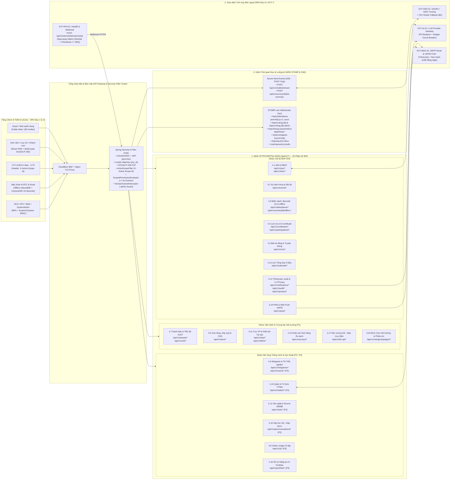
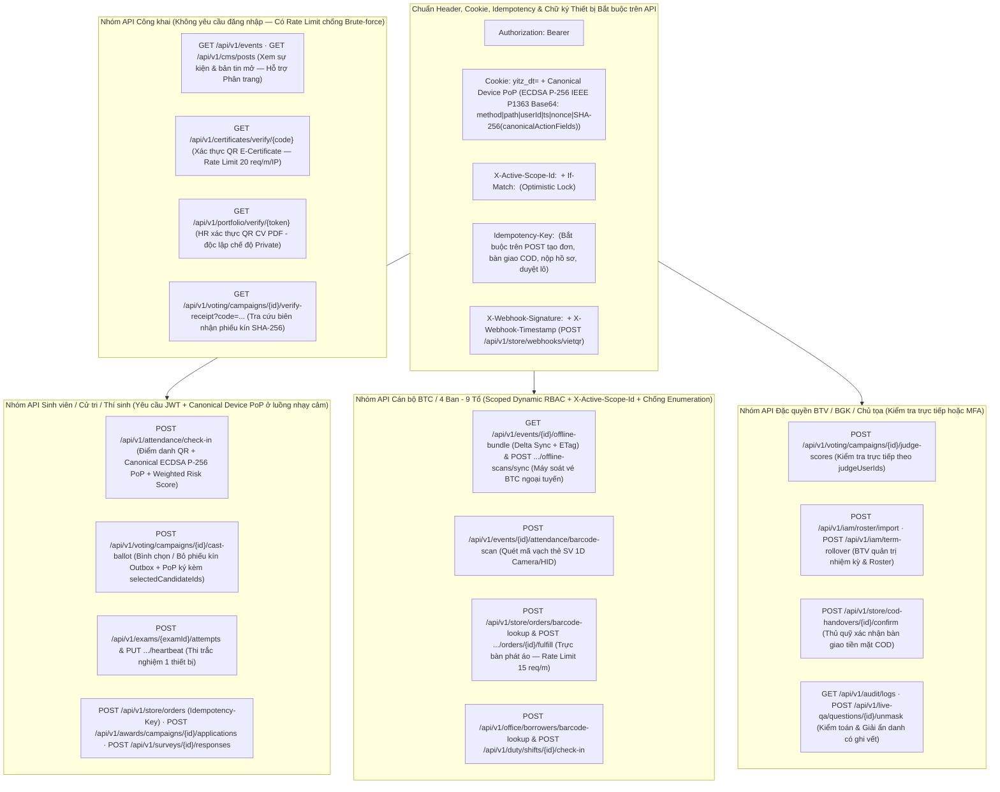

# SƠ ĐỒ & ĐẶC TẢ API TỔNG QUAN DỰ ÁN YITZONE (API OVERVIEW ARCHITECTURE)

**Căn cứ trực tiếp:** [SRS_YITZone.md](./SRS_YITZone.md) (v2.2.1 — Mục 4.1..4.20, Mục 5.3 `NFR-PRIV`, Mục 8.1 `EXT-*`) & [LLD_YITZone.md](./LLD_YITZone.md) (v2.2.1)

---

## 1. Sơ đồ Kiến trúc Giao tiếp & Phân nhóm API Tổng quan (System-Wide API Landscape)

Sơ đồ dưới đây tổng hợp toàn bộ **4 kênh giao tiếp API** (`HTTPS REST /api/v1/*`, `SSE Streaming`, `WSS STOMP WebSocket /ws`, và `External Webhooks / Integrations`) ánh xạ trực tiếp với **20 phân hệ nghiệp vụ trong SRS (Mục 4.1 – 4.20, triển khai thành 22 module kỹ thuật khi tách riêng `rbac` và `privacy`)** và **nhóm tuân thủ bảo vệ dữ liệu cá nhân (`NFR-PRIV`)** trong `SRS_YITZone.md`:



---

## 2. Sơ đồ Phân luồng Giao thức API Theo Tác nhân & Cơ chế Bảo mật



---

## 3. Bảng Danh mục Chi tiết API Theo 20 Phân hệ SRS (`4.1` – `4.20`) & Tuân thủ (`5.3`)

### 3.1. Phân hệ 4.1 — Đăng nhập, Vòng đời Tài khoản & Phân quyền (`FR-IAM-01..04`, `FR-RBAC-01..05`)
| Phương thức & Endpoint | Mã FR / Ràng buộc SRS | Mô tả Nghiệp vụ & Cơ chế Bảo mật |
| :--- | :--- | :--- |
| `GET /oauth2/authorization/{provider}` | `FR-IAM-01`, `EXT-SSO-01` | Đăng nhập OAuth2/OIDC Trường; tự động đối chiếu `OFFICIAL_DIRECTORY_ROSTER` nếu IdP không trả claim MSSV (`B2`) và tự động `Auto-Link` các bản ghi điểm danh mã vạch vãng lai (`Edge 40`). |
| `POST /api/v1/iam/device-tokens` | `FR-ATT-03`, `FR-PWA-02` | Đăng ký khóa công khai **WebCrypto `ECDSA P-256` (`publicKeyJwk`)** gắn với Cookie `HttpOnly` `yitz_dt`. |
| `GET /api/v1/iam/me` | `FR-IAM-01..02`, `FR-RBAC-01` | Lấy hồ sơ người dùng, danh sách `roleScopes[]` (4 Ban - 9 Tổ), `assignedModules[]` và quyền hiệu lực theo `X-Active-Scope-Id`. |
| `POST /api/v1/iam/personal-email/link` & `/verify-otp` | `FR-IAM-02` | Liên kết & xác thực OTP email cá nhân dự phòng để đăng nhập sau khi tốt nghiệp. |
| `POST /api/v1/iam/roster/import` | `FR-IAM-01` (`B2`) | `BTV` tải lên tệp CSV/Excel danh sách sinh viên & cán bộ chính thức đầu học kỳ vào `OFFICIAL_DIRECTORY_ROSTER`. |
| `POST /api/v1/iam/major-configs` | `FR-IAM-01` | `BTV` cấu hình động danh mục mã ngành Khoa CNTT (`110`, `162`, `133`...). |
| `POST /api/v1/iam/term-rollover` | `FR-IAM-02` (`Edge 29`) | Công cụ **Chốt & Chuyển giao Nhiệm kỳ** (`Term Rollover Wizard`), lưu `termHistory` và thu hồi quyền điều hành cũ. |
| `POST /api/v1/iam/units/{unitId}/hr-requests` | `FR-IAM-03` | Quản lý nhân sự nội bộ Ban/Tổ theo 3 cấp: **Đề xuất** (`Tổ phó`/`Phó Ban`) $\rightarrow$ **Thực hiện** (`Tổ trưởng`) $\rightarrow$ **Phê duyệt** (`Trưởng Ban`/`BCH`/`BTV`). |
| `POST /api/v1/rbac/grants` & `DELETE /api/v1/rbac/grants/{id}` | `FR-RBAC-02..04` | Cấp/thu hồi 20 gói module quyền có `expiresAt`; kích hoạt xóa cache Redis và phát `rbac:invalidate` ($\le 5\text{s}$). |

### 3.2. Phân hệ 4.2 — Tổ chức Sự kiện (`FR-EVT-01..06`)
| Phương thức & Endpoint | Mã FR / Ràng buộc SRS | Mô tả Nghiệp vụ & Cơ chế Bảo mật |
| :--- | :--- | :--- |
| `GET /api/v1/events` & `GET /api/v1/events/{id}` | `FR-EVT-01` | Tra cứu danh sách (Cursor/Offset Pagination, `size <= 50`) & chi tiết sự kiện (lọc theo sự kiện toàn Khoa `PUBLIC_FACULTY` hoặc sự kiện nội bộ `INTERNAL_CTV` của đúng Ban). |
| `POST /api/v1/events` & `PUT /api/v1/events/{id}` | `FR-EVT-01..03`, `FR-EVT-06` | Tạo/cập nhật sự kiện (bắt buộc Optimistic Lock `If-Match`/`version` và khóa sửa `benefitTypes`/`visibility` sau khi đã `PUBLISHED`), cấu hình các ca điểm danh (`attendanceSessions`), bộ tuple quyền lợi `[{benefitType, pointValue}]` (**ĐRL / CTXH / CĐDN**) và vị trí BTC. Ràng buộc cứng `internal_event:*` không được gắn quyền lợi cấp Khoa (`A16`). |
| `POST /api/v1/events/{id}/approve` | `FR-EVT-01`, `FR-CERT-01` | `BTV`/`BCH` phê duyệt phát hành sự kiện có cộng điểm quyền lợi. |
| `POST /api/v1/events/{id}/registrations` | `FR-EVT-02`, `FR-EVT-04..05` | Đăng ký tham dự hoặc ứng tuyển 7 vị trí BTC; tự động vào **Danh sách chờ (`Waitlist`)** nếu hết chỗ và kiểm tra kỷ luật `No-show`. |
| `DELETE /api/v1/events/{id}/registrations/me` | `FR-EVT-04` | Hủy đăng ký trước hạn và tự động đôn người kế tiếp trong `Waitlist`. |

### 3.3. Phân hệ 4.3 — Điểm danh Đa lớp, Quét Mã vạch Thẻ SV 1D & Soát vé Ngoại tuyến (`FR-ATT-01..09`)
| Phương thức & Endpoint / Kênh | Mã FR / Ràng buộc SRS | Mô tả Nghiệp vụ & Cơ chế Bảo mật |
| :--- | :--- | :--- |
| `POST /api/v1/events/{id}/attendance/open` | `FR-ATT-01..02` | Mở phiên điểm danh (`DYNAMIC_ROTATING_QR` 10s mặc định hoặc `STATIC_QR` ngoài trời). |
| `STOMP /topic/attendance.{eventId}.qr` & `.count` | `FR-ATT-01` | Broadcast mã QR ký số `ECDSA P-256` xoay vòng mỗi 10s và cập nhật sĩ số trực tiếp. |
| `POST /api/v1/attendance/check-in` | `FR-ATT-01..05`, `FR-ATT-08` | Sinh viên tự quét QR bằng camera (`getUserMedia`) kèm **Canonical `devicePop` (`ECDSA P-256` định dạng `IEEE P1363 64-byte raw r||s` mã hóa Base64, ký `method\|path\|userId\|ts\|nonce\|SHA-256(canonicalActionFields)`, chống Replay bằng Redis `pop:nonce:{nonce}`)** và tọa độ GPS; kiểm tra chữ ký Server trên `signedQrPayload` và hạn QR theo `serverReceivedAt` ($10\text{s} + N$, $N=8\text{s}$) và chấm **Điểm rủi ro có trọng số** (`< 2đ`: trả `200 OK`; $\ge 2\text{đ}$: trả `202 Accepted` vào `PENDING_REVIEW`). |
| `GET /api/v1/events/{id}/offline-ticket` | `FR-ATT-06`, `FR-PWA-02` | Tải vé ngoại tuyến đã ký bởi Server gắn khóa công khai `ECDSA P-256` của thiết bị sinh viên (sinh mã QR bước nhảy `15 giây`). |
| `GET /api/v1/events/{id}/offline-bundle` | `FR-ATT-07` (`A14`, `A34`) | Máy BTC tải gói dữ liệu soát vé ngoại tuyến hỗ trợ **Delta Sync (`?sinceRevision=`) & `ETag` (`If-None-Match`)**, ảnh thẻ nén thumbnail WebP $\le 8\text{ KB}$ tải nền tách biệt (mã hóa `AES-GCM` trong `IndexedDB`, chỉ hợp lệ khi đồng bộ $\le 12\text{ giờ}$). |
| `POST /api/v1/events/{id}/offline-scans/sync` | `FR-ATT-07` (`A10`, `A14`) | Đồng bộ lô quét ngoại tuyến (Idempotent theo `batchId`), phát hiện trùng vé đa máy (`DUPLICATE_OFFLINE_TICKET_SCAN +2đ`) và kích hoạt tự xóa gói dữ liệu (`Auto-Wipe`). |
| `POST /api/v1/events/{id}/offline-scanners/{deviceId}/revoke` | `FR-ATT-07` (`A14`) | Thu hồi quyền máy BTC bị thất lạc và gửi cờ xóa `IndexedDB` từ xa. |
| `POST /api/v1/events/{id}/attendance/barcode-scan` | `FR-ATT-09`, `EXT-SCAN-01` | Lễ tân BTC quét **Mã vạch 1D (`Code 128`/`Code 39`) trên Thẻ sinh viên nhựa vật lý** (Camera hoặc súng HID), bắt buộc xác nhận `physicalCardVerified = true`; hỗ trợ hậu kiểm khách vãng lai (`PENDING_SSO_LINK`). |
| `GET /api/v1/attendance/review-queue` & `POST .../bulk-action` | `FR-ATT-08` | Danh sách chờ BTC hậu kiểm trong 48h (phân trang `size <= 50`, kèm `Idempotency-Key` cho `bulk-action`); cho phép duyệt lô tín hiệu yếu nhưng **cấm gộp duyệt hàng loạt đối với các ca Tín hiệu Mạnh (`+2đ`)**. |

### 3.4. Phân hệ 4.4 — Lịch sử Tham gia & Chứng nhận Điện tử E-Certificate (`FR-CERT-01..05`)
| Phương thức & Endpoint | Mã FR / Ràng buộc SRS | Mô tả Nghiệp vụ & Cơ chế Bảo mật |
| :--- | :--- | :--- |
| `GET /api/v1/participations/me` | `FR-CERT-01..02` | Xem lịch sử tham gia, thống kê điểm **ĐRL / CTXH / CĐDN** theo học kỳ (tự động ẩn mục CĐDN đối với SV ngoài Khoa, trừ khi có `facultyOverride` do `BTV` duyệt). |
| `POST /api/v1/users/{id}/faculty-override` | `FR-CERT-02` | Chỉ `BTV` được bật cờ hưởng đặc quyền Khoa CNTT cho sinh viên chuyển ngành có `effectiveDate`. |
| `GET /api/v1/certificates/me` & `GET /api/v1/certificates/{id}/pdf` | `FR-CERT-03` | Xem danh sách và tải tệp PDF Chứng nhận điện tử (E-Certificate đã được Worker render sẵn lưu trên Silo theo `certVersion`; trả Pre-signed Silo URL / `302 Redirect` kèm `Cache-Control: private, max-age=300`, không render đồng bộ gây nghẽn CPU). |
| `GET /api/v1/certificates/verify/{code}` | `FR-CERT-04` | Endpoint công khai xác thực hiệu lực E-Certificate (`VALID` / `REVOKED`), áp dụng Rate Limit `20 req/phút/IP` chống vét cạn. |
| `POST /api/v1/certificates/{id}/revoke` & `POST /api/v1/certificates/{id}/reissue` | `FR-CERT-05` | Tách biệt rõ 2 nghiệp vụ: `revoke` thu hồi vĩnh viễn (`REVOKED`), `reissue` cấp lại phiên bản mới (`certVersion + 1`, bản cũ chuyển `SUPERSEDED`); bắt buộc kèm `Idempotency-Key` và ghi `AUDIT_LOGS`. |

### 3.5. Phân hệ 4.5 — Bản tin Blog & Truyền thông (`FR-CMS-01..03`)
| Phương thức & Endpoint | Mã FR / Ràng buộc SRS | Mô tả Nghiệp vụ & Cơ chế Bảo mật |
| :--- | :--- | :--- |
| `GET /api/v1/cms/posts` & `GET /api/v1/cms/posts/{slug}` | `FR-CMS-01` | Xem bản tin hoạt động, học thuật, thông báo Đoàn - Hội (hỗ trợ phân trang & HTTP Cache `ETag`). |
| `POST /api/v1/cms/posts` & `PUT /api/v1/cms/posts/{id}` | `FR-CMS-01..03` | Sinh viên gửi bài đóng góp vào hàng chờ hoặc CTV Truyền thông soạn bài, hẹn giờ đăng (kiểm tra Optimistic Lock `version` và lọc XSS HTML Sanitizer). |
| `POST /api/v1/cms/posts/{id}/approve` | `FR-CMS-02` | Biên tập viên (`MOD_CMS_EDITORIAL`) duyệt xuất bản bài viết. |

### 3.6. Phân hệ 4.6 — Minigame Hội trường & Thi Trắc nghiệm Nghiêm túc (`FR-GAME-01..04`, `FR-EXAM-01..06`)
| Phương thức & Endpoint / Kênh | Mã FR / Ràng buộc SRS | Mô tả Nghiệp vụ & Cơ chế Bảo mật |
| :--- | :--- | :--- |
| `POST /api/v1/minigames/rooms` | `FR-GAME-01` | Tạo phòng Minigame bằng mã PIN 6 số. |
| `STOMP /app/minigame.{pin}.answer` & `/topic/minigame.{pin}` | `FR-GAME-02..04` | Gửi đáp án và cập nhật bảng xếp hạng `Redis ZSET` theo công thức tốc độ + chuỗi trả lời đúng (`Streak`). |
| `POST /api/v1/exams/{examId}/attempts` | `FR-EXAM-01..02` | Bắt đầu lượt thi trắc nghiệm (xác minh **Canonical `devicePop` ECDSA P-256**), khóa 1 thiết bị trên Redis bằng `verifiedDeviceTokenId` và tạm khóa `YITBot` của đúng thí sinh đó (`FR-EXAM-05`). |
| `PUT /api/v1/exams/attempts/{id}/heartbeat` | `FR-EXAM-03..04` | Lưu nháp đáp án định kỳ và theo dõi `HEARTBEAT_GAP > 15s` (không khóa bài oan trên iOS Safari). |
| `POST /api/v1/exams/attempts/{id}/violations` | `FR-EXAM-03` | Ghi nhận sự kiện rời tab / thoát Fullscreen kèm phân loại thiết bị (`DESKTOP` / `MOBILE`). |
| `POST /api/v1/exams/{examId}/attempts/{id}/transfer-device` | `FR-EXAM-02` (`Edge 15`) | Giám thị (`exam:proctor`) mở khóa chuyển thiết bị thi khi máy thí sinh sập nguồn. |
| `POST /api/v1/exams/attempts/{id}/submit` | `FR-EXAM-04`, `FR-EXAM-06` | Nộp bài thi (cộng cửa sổ ân hạn mạng `+5 giây`) và chấm điểm tự động. |

### 3.7. Phân hệ 4.7 — Xét duyệt Danh hiệu & Phong trào Sinh viên 5 Tốt (`FR-AWD-01..05`)
| Phương thức & Endpoint | Mã FR / Ràng buộc SRS | Mô tả Nghiệp vụ & Cơ chế Bảo mật |
| :--- | :--- | :--- |
| `GET /api/v1/sv5t/progress/me` | `FR-AWD-01` | Bảng theo dõi tiến độ 5 tiêu chí SV5T (tự động tổng hợp ĐRL/CTXH/Sự kiện từ hệ thống và gắn nhãn rõ các tiêu chí cần nộp minh chứng ngoài). |
| `POST /api/v1/awards/campaigns/{id}/applications` | `FR-AWD-02..03` | Nộp hồ sơ xét danh hiệu (bắt buộc `Idempotency-Key` + Compound Unique `{campaignId, userId}`) kèm tệp minh chứng (quét ClamAV, lưu Private Silo Bucket, không thu thập CCCD mặc định). |
| `POST /api/v1/awards/applications/{id}/review` | `FR-AWD-04` | Hội đồng thẩm định chấm duyệt 2 vòng (chặn tự chấm hồ sơ của chính mình — `NFR-SEC-03`). |
| `POST /api/v1/awards/applications/{id}/appeal` | `FR-AWD-05` | Sinh viên gửi phúc khảo / bổ sung minh chứng trong cửa sổ 72 giờ. |

### 3.8. Phân hệ 4.8 — Luyện tập & Thi đấu Lập trình Online Judge — P3 (`FR-OJ-01..04`)
| Phương thức & Endpoint / Kênh | Mã FR / Ràng buộc SRS | Mô tả Nghiệp vụ & Cơ chế Bảo mật |
| :--- | :--- | :--- |
| `GET /api/v1/oj/problems` & `GET /api/v1/oj/contests` | `FR-OJ-01`, `FR-OJ-04` | Danh sách bài tập thuật toán và kỳ thi lập trình (chế độ ICPC / IOI, hỗ trợ phân trang). |
| `POST /api/v1/oj/submissions` | `FR-OJ-02..03` | Nộp mã nguồn (`C/C++/Python/Java`) qua hàng đợi sang Host Sandbox cô lập (Judge0 CE / DMOJ). |
| `STOMP /user/queue/oj.results` | `FR-OJ-03` | Trả kết quả chấm (`AC`, `WA`, `TLE`, `MLE`, `OLE`, `CE`) theo thời gian thực. |

### 3.9. Phân hệ 4.9 — Cửa hàng Vật phẩm Khoa & Gây quỹ Đoàn - Hội (`FR-STR-01..08`)
| Phương thức & Endpoint | Mã FR / Ràng buộc SRS | Mô tả Nghiệp vụ & Cơ chế Bảo mật |
| :--- | :--- | :--- |
| `GET /api/v1/store/products` & `GET /api/v1/store/fundraising` | `FR-STR-01`, `FR-STR-07` | Xem vật phẩm (phân trang `size <= 50`), tồn kho theo biến thể và thanh tiến độ **Lợi nhuận gây quỹ thực tế** ($\sum (\text{Doanh thu thực nhận} - \text{Giá vốn hàng đã giao})$). |
| `POST /api/v1/store/orders` | `FR-STR-02..04` | Đặt đơn hàng (bắt buộc Header `Idempotency-Key` chống tạo đơn trùng khi rớt mạng; áp dụng giá Combo / Voucher có khóa phân tán Redis `SET NX EX 30` chống vượt `perUserLimit`), giữ tồn kho tạm 15 phút cho VietQR hoặc hạn 3 ngày làm việc cho `PENDING_COD`. |
| `POST /api/v1/store/webhooks/vietqr` | `FR-STR-04`, `EXT-PAY-01` | Nhận Webhook gạch nợ tự động từ 01 cổng đối soát VietQR; **Bước 0 bắt buộc đọc `rawBodyBytes` trước Jackson parse, kiểm tra `\|now - X-Webhook-Timestamp\| <= 300s` và xác minh chữ ký `X-Webhook-Signature` HMAC-SHA256 hằng thời gian (`A11`)**. |
| `POST /api/v1/store/orders/barcode-lookup` | `FR-STR-06` | CTV trực bàn quét mã vạch thẻ SV 1D gửi `studentCode` trong JSON Body (không đặt MSSV trên URL `GET`), giới hạn **Rate Limit `15 req/phút/CTV`** và chỉ trả DTO tối thiểu các đơn `PAID` / `PENDING_COD` tại điểm trực để chống vét cạn PII. |
| `POST /api/v1/store/orders/{id}/fulfill` | `FR-STR-05..06` | Quét QR đơn hàng hoặc xác nhận thẻ SV vật lý để bàn giao vật phẩm (kèm `Idempotency-Key`, chuyển `PENDING_COD` $\rightarrow$ `COD_CONFIRMED` $\rightarrow$ `COMPLETED`). |
| `POST /api/v1/store/cod-handovers` & `POST .../confirm` | `FR-STR-04` (`B3`) | Lập **Phiếu bàn giao tiền mặt COD cuối ca** (`COD_CASH_HANDOVERS`, kèm `Idempotency-Key`) và Thủ quỹ ký xác nhận khớp tiền thực tế. |
| `POST /api/v1/store/orders/{id}/support-requests` | `FR-STR-08` | Yêu cầu đổi size áo hoặc hoàn tiền khi hủy đợt pre-order. |

### 3.10. Phân hệ 4.10 — Trợ lý Ảo AI Đoàn - Hội `YITBot` (`FR-BOT-01..05`)
| Phương thức & Endpoint | Mã FR / Ràng buộc SRS | Mô tả Nghiệp vụ & Cơ chế Bảo mật |
| :--- | :--- | :--- |
| `POST /api/v1/chatbot/stream` *(SSE `POST` duy nhất)* | `FR-BOT-01..03`, `EXT-AI-01` | Luồng trả lời SSE (`Accept: text/event-stream`, dùng `fetch-event-source` gửi JWT trong Header & câu hỏi trong Body; **cấm dùng `GET` SSE** để không lộ PII/Token vào URL log) có trích dẫn nguồn quy chế (`RAG`) và tra cứu dữ liệu cá nhân (`Function Calling`); đi qua `PiiRedactorService` và `AiBudgetCircuitBreaker`. |
| `POST /api/v1/chatbot/knowledge-docs` | `FR-BOT-04` | Biên soạn tài liệu quy chế/FAQ (`MOD_YITBOT_CURATOR` tạo nháp; chỉ `BTV` có `chatbot:approve` được duyệt nạp vào Vector Index). |
| `GET /api/v1/chatbot/budget-ledger` | `FR-BOT-05`, `NFR-AI-BUDGET-01` | Theo dõi hạn mức token và trần ngân sách AI hàng tháng. |

### 3.11. Phân hệ 4.11 — Trực Văn phòng & Kiểm kê Tài sản Ban Văn phòng (`FR-DUTY-01..11`)
| Phương thức & Endpoint | Mã FR / Ràng buộc SRS | Mô tả Nghiệp vụ & Cơ chế Bảo mật |
| :--- | :--- | :--- |
| `GET /api/v1/duty/schedules` & `POST /api/v1/duty/shifts/register` | `FR-DUTY-01..02` | Xem lịch trực tuần và đăng ký ca trực văn phòng. |
| `POST /api/v1/duty/shifts/{id}/check-in` & `/check-out` | `FR-DUTY-03..04` | Điểm danh ca trực (phút `0–15`: `ON_TIME`; phút `16–30`: vẫn mở cho điểm danh `LATE`; quá `30` phút: khóa) kèm ảnh dọn vệ sinh cuối ngày và tự động bật quyền tạm `MOD_STORE_BOOTH`. |
| `POST /api/v1/duty/shifts/{id}/leave-requests` & `POST /api/v1/duty/shifts/{id}/swap-requests` | `FR-DUTY-05..06` | Tách biệt 2 endpoint theo đúng ngữ nghĩa: `leave-requests` xin vắng mặt trước $\ge 2\text{ giờ}$ kèm ca trực bù (hợp lệ tự động duyệt); `swap-requests` yêu cầu đổi ca 2 chiều `A <-> B`. |
| `GET /api/v1/office/assets` & `POST /api/v1/office/inventory-audits` | `FR-DUTY-07`, `FR-DUTY-09..10` | Quản lý danh mục tài sản (phân trang), lập biên bản kiểm kê định kỳ và báo hỏng/hết vật tư. |
| `POST /api/v1/office/borrowers/barcode-lookup` | `FR-DUTY-08` | Quét mã vạch thẻ SV 1D gửi `studentCode` trong JSON Body (Rate Limit `15 req/phút/CTV`) hoặc QR tài sản để ghi nhận mượn - trả thiết bị văn phòng. |

### 3.12. Phân hệ 4.12 — Quản lý Văn nghệ & Tiết mục Chương trình (`FR-ART-01..04`)
| Phương thức & Endpoint | Mã FR / Ràng buộc SRS | Mô tả Nghiệp vụ & Cơ chế Bảo mật |
| :--- | :--- | :--- |
| `POST /api/v1/arts/performances` & `PUT /api/v1/arts/performances/{id}` | `FR-ART-01..02` | Đăng ký tiết mục, danh sách nhân sự biểu diễn và tải tệp nhạc Beat / Visual ($\le 300\text{ MB}$, kiểm tra magic-bytes & ClamAV). |
| `POST /api/v1/arts/performances/{id}/emergency-unlock` | `FR-ART-02` (`Edge 18`) | Trưởng/Phó Ban Văn nghệ mở khóa khẩn cấp 20 phút cho phép thay file Beat tại sân khấu. |
| `PUT /api/v1/arts/events/{eventId}/running-order` | `FR-ART-03` | Kéo thả kịch bản thứ tự biểu diễn (Optimistic Lock `version`). |
| `POST /api/v1/arts/events/{eventId}/export-jobs` & `GET .../export-jobs/{jobId}` | `FR-ART-04` | **Đóng gói `.zip` bất đồng bộ (`202 Accepted`):** Worker gom các file Beat/Visual (tổng dung lượng có thể tới hàng GB), đánh tiền tố `01_`, `02_`, lưu gói `.zip` lên Silo và trả **Pre-signed Silo URL hỗ trợ HTTP `Range` (Resume Download)** để không làm nghẽn RAM/CPU của App Server. |

### 3.13. Phân hệ 4.13 — Lịch Hoạt động Tổng hợp 6 Màu (`FR-CAL-01..05`)
| Phương thức & Endpoint | Mã FR / Ràng buộc SRS | Mô tả Nghiệp vụ & Cơ chế Bảo mật |
| :--- | :--- | :--- |
| `GET /api/v1/calendar/feed` | `FR-CAL-01..04` | Lấy lịch tổng hợp 6 nhóm màu theo khoảng thời gian (`?from=...&to=...`, tối đa 90 ngày/lần gọi) kèm cảnh báo trùng lịch cá nhân. |
| `GET /api/v1/calendar/export.ics` | `FR-CAL-05` | Xuất tệp chuẩn `.ics` đồng bộ sang Google Calendar / Apple Calendar. |

### 3.14. Phân hệ 4.14 & 5.3 — Thông báo, Nhật ký Kiểm toán & Quyền Riêng tư (`FR-SYS-01..02`, `NFR-PRIV-01..06`)
| Phương thức & Endpoint | Mã FR / Ràng buộc SRS | Mô tả Nghiệp vụ & Cơ chế Bảo mật |
| :--- | :--- | :--- |
| `GET /api/v1/notifications` & `PATCH /api/v1/notifications/{id}/read` | `FR-SYS-01` | Trung tâm thông báo In-App (Cursor Pagination `?cursor=...&limit=20`, kết hợp SMTP Email và Web Push). |
| `GET /api/v1/audit/logs` & `GET /api/v1/audit/verify-chain` | `FR-SYS-02` (`A20`) | Tra cứu nhật ký kiểm toán (**bắt buộc Cursor Pagination theo `beforeSeq`**, `limit <= 100`, cấm dùng `SKIP` sâu) và kiểm chứng tính toàn vẹn chuỗi băm (`SHA-256 Hash-Chain`, `MOD_AUDIT_VIEWER`). |
| `POST /api/v1/privacy/consents` | `NFR-PRIV-01` | Ghi nhận/rút lại sự đồng ý xử lý dữ liệu cá nhân theo từng mục đích (`CONSENT_RECORDS`). |
| `POST /api/v1/privacy/my-data-exports` & `POST /api/v1/privacy/deletion-requests` | `NFR-PRIV-04` | Sinh viên yêu cầu trích xuất dữ liệu cá nhân (Background Job tạo gói JSON/PDF trả Pre-signed Silo URL) hoặc gửi yêu cầu xóa/ẩn danh tài khoản. |

### 3.15. Phân hệ 4.15 — Khảo sát & Lấy ý kiến Sinh viên (`FR-SUR-01..05`)
| Phương thức & Endpoint | Mã FR / Ràng buộc SRS | Mô tả Nghiệp vụ & Cơ chế Bảo mật |
| :--- | :--- | :--- |
| `POST /api/v1/surveys` & `GET /api/v1/surveys/{id}` | `FR-SUR-01..02` | Tạo biểu mẫu khảo sát gắn sự kiện hoặc lấy ý kiến toàn Khoa. |
| `POST /api/v1/surveys/{id}/responses` | `FR-SUR-03` | Nộp khảo sát; với khảo sát ẩn danh, hệ thống tách hoàn toàn bảng `SURVEY_PARTICIPATIONS` (chỉ đánh dấu đã tham gia) và `SURVEY_RESPONSES` (không chứa `userId`, làm tròn mốc thời gian). |
| `GET /api/v1/surveys/{id}/analytics` & `POST .../ai-summary` | `FR-SUR-04..05` | Thống kê kết quả (chỉ mở khi $N \ge 5$ phiếu) và tóm tắt ý kiến bằng AI sau bước duyệt/ẩn PII thủ công. |

### 3.16. Phân hệ 4.16 — Hồ sơ Năng lực Số E-Portfolio — P3 (`FR-PORT-01..04`)
| Phương thức & Endpoint | Mã FR / Ràng buộc SRS | Mô tả Nghiệp vụ & Cơ chế Bảo mật |
| :--- | :--- | :--- |
| `GET /api/v1/portfolio/me` & `PUT /api/v1/portfolio/me` | `FR-PORT-01..02` | Quản lý Hồ sơ năng lực số (mặc định chế độ `PRIVATE`; Strict DTO chặn truyền lậu `verifiedStatsSnapshot`, kèm Optimistic Lock `version`). |
| `POST /api/v1/portfolio/me/export-cv` | `FR-PORT-03` | Kết xuất CV PDF kèm mã QR kiểm chứng thành tích Đoàn - Hội (lưu cache bản PDF lên Silo theo hash nội dung hồ sơ để tái sử dụng, giới hạn Rate Limit `5 lần tạo mới/giờ/SV`). |
| `GET /api/v1/portfolio/verify/{verificationToken}` | `FR-PORT-04` (`Edge 28`) | Nhà tuyển dụng quét QR xác thực danh sách chứng nhận/danh hiệu đã in trên CV (`verificationToken` độ dài $\ge 128\text{-bit}$ entropy, Rate Limit `20 req/phút/IP`, hoạt động độc lập cả khi hồ sơ ở chế độ `PRIVATE` hoặc SV đã tốt nghiệp). |

### 3.17. Phân hệ 4.17 — Bức tường Hỏi - Đáp Hội trường Live Q&A (`FR-QA-01..05`)
| Phương thức & Endpoint / Kênh | Mã FR / Ràng buộc SRS | Mô tả Nghiệp vụ & Cơ chế Bảo mật |
| :--- | :--- | :--- |
| `POST /api/v1/live-qa/sessions/{id}/questions` | `FR-QA-01..02` | Gửi câu hỏi cho diễn giả (qua bộ lọc từ khóa nhạy cảm & giới hạn tần suất). |
| `STOMP /app/liveqa.{sessionId}.upvote` & `/topic/liveqa.{sessionId}` | `FR-QA-03..04` | Bình chọn (Upvote) câu hỏi theo thời gian thực trên `Redis ZSET` và chiếu lên màn hình sân khấu. |
| `POST /api/v1/live-qa/questions/{id}/merge` | `FR-QA-03` (`Edge 36`) | Gộp câu hỏi trùng bằng phép hợp tập hợp người bình chọn (`SUNIONSTORE`). |
| `POST /api/v1/live-qa/questions/{id}/unmask` | `FR-QA-05` (`Edge 27`) | Tra cứu danh tính người đặt câu hỏi ẩn danh vi phạm nghiêm trọng (chỉ gói `MOD_LIVEQA_UNMASK`, bắt buộc nhập lý do và ghi `AUDIT_LOGS` + báo `BTV`). |

### 3.18. Phân hệ 4.18 — Ứng dụng PWA, Vé Ngoại tuyến & Web Push (`FR-PWA-01..04`)
| Phương thức & Endpoint | Mã FR / Ràng buộc SRS | Mô tả Nghiệp vụ & Cơ chế Bảo mật |
| :--- | :--- | :--- |
| `GET /api/v1/pwa/vapid-public-key` | `FR-PWA-03` | Lấy khóa công khai VAPID để trình duyệt đăng ký Web Push. |
| `POST /api/v1/pwa/push-subscriptions` | `FR-PWA-03`, `EXT-MSG-01` | Lưu endpoint nhận thông báo đẩy; **bắt buộc chống SSRF bằng Strict Domain Allowlist (`https://` only: `fcm.googleapis.com`, `*.push.apple.com`, `updates.push.services.mozilla.com`, `*.notify.windows.com`), cấm IP nội bộ/loopback và giới hạn tối đa 5 thiết bị active/user**. |

### 3.19. Phân hệ 4.19 — Hộp thư Hỏi - Đáp & Nhắn tin Hỗ trợ BCH (`FR-QACHAT-01..05`)
| Phương thức & Endpoint / Kênh | Mã FR / Ràng buộc SRS | Mô tả Nghiệp vụ & Cơ chế Bảo mật |
| :--- | :--- | :--- |
| `POST /api/v1/qa/conversations` & `GET /api/v1/qa/conversations` | `FR-QACHAT-01..02` | Sinh viên mở luồng hỏi - đáp chuyển về Hộp thư chung của BCH (`Shared Inbox`, SLA 24h, Cursor Pagination). |
| `POST /api/v1/qa/conversations/{id}/claim` | `FR-QACHAT-02` (`Edge 39`) | Thành viên BCH nhận xử lý hội thoại bằng truy vấn nguyên tử (`findOneAndUpdate` khi `assignedBchUserId == null`). |
| `POST /api/v1/qa/conversations/{id}/messages` & `STOMP /topic/qa.bch.inbox` | `FR-QACHAT-03..05` | Nhắn tin 2 chiều thời gian thực (Cursor Pagination tin nhắn theo `beforeMessageId`), tra cứu thẻ tóm tắt 360° của sinh viên (có ghi vết Audit) và đóng hội thoại. |

### 3.20. Phân hệ 4.20 — Bình chọn Hội trường, Biểu quyết & Bỏ phiếu Kín (`FR-VOTE-01..05`)
| Phương thức & Endpoint / Kênh | Mã FR / Ràng buộc SRS | Mô tả Nghiệp vụ & Cơ chế Bảo mật |
| :--- | :--- | :--- |
| `POST /api/v1/voting/campaigns` & `GET /api/v1/voting/campaigns/{id}` | `FR-VOTE-01` | Cấu hình chiến dịch bình chọn/biểu quyết (`[minK..maxK]`, trọng số $W_{\text{BGK}}\% + W_{\text{Khán giả}}\% = 100\%$, danh sách `judgeUserIds`, chế độ phiếu kín `isSecretBallot`). |
| `POST /api/v1/voting/campaigns/{id}/kiosk-sessions` & `/kiosk-cast` | `FR-VOTE-02` | BTC quét mã vạch thẻ SV vật lý 1D tại quầy Kiosk để cấp token 1 lần (`60s`) cho sinh viên hỏng/hết pin điện thoại bình chọn. |
| `POST /api/v1/voting/campaigns/{id}/cast-ballot` | `FR-VOTE-02..03` | Cử tri gửi phiếu bầu kèm **Canonical `devicePop` (`ECDSA P-256` ký ràng buộc `selectedCandidateIds` + `timestamp` + `nonce`)**; với **Bỏ phiếu kín (`isSecretBallot = true`)**, hệ thống ghi vào thùng đệm `VOTING_BALLOT_OUTBOX` (không lưu `userId`) trong ACID Transaction, trộn lô ngẫu nhiên sang `VOTING_BALLOTS` và trả mã biên nhận `VOTE-XXXX-XXXX-XXXX` ($\ge 64\text{-bit}$ entropy, băm `SHA-256`). |
| `POST /api/v1/voting/campaigns/{id}/judge-scores` | `FR-VOTE-04` (`A17`, `A31`) | Ban Giám khảo (nằm trong `judgeUserIds`) chấm điểm thang 100 lưu định danh vào `VOTING_JUDGE_SCORES`. |
| `POST /api/v1/voting/campaigns/{id}/freeze-led` & `/close` | `FR-VOTE-05` | MC/Kỹ thuật (`MOD_QUIZ_EXAM_HOST`) bật/tắt chế độ **Đóng băng màn hình LED phút chót (`Freeze Mode`)** hoặc đóng cổng bình chọn. |
| `STOMP /topic/voting.{id}` & `/topic/voting.{id}.admin` | `FR-VOTE-03`, `FR-VOTE-05` | Kênh `.admin` được bảo vệ bởi `StompChannelInterceptor`; với phiếu kín, khi đang mở cổng chỉ phát số lượng cử tri đã bỏ phiếu (`totalVotersCast`), tuyệt đối không phát số phiếu từng ứng viên theo thời gian thực (`A5`). |
| `GET /api/v1/voting/campaigns/{id}/verify-receipt` & `POST .../export-minutes` | `FR-VOTE-03`, `FR-VOTE-05` | Cử tri tra cứu mã biên nhận `SHA-256` sau khi đóng cổng (Rate Limit `15 req/phút/IP`); BTC kết xuất **Biên bản Kiểm phiếu (PDF/Excel)** lưu lên Silo. |

---

## 4. Quy chuẩn Kiến trúc Giao tiếp API, Bảo mật & Xử lý Lỗi Dùng chung (Cross-Cutting API Standards)

### 4.1. Chuẩn Ký số Bằng chứng Sở hữu Khóa Thiết bị (`Canonical ECDSA P-256 Device PoP`)
Để ngăn chặn tấn công phát lại (Replay Attack) và chỉnh sửa nội dung gói tin (Payload Tampering) trên các luồng nhạy cảm (`POST /api/v1/attendance/check-in`, `POST /api/v1/voting/campaigns/{id}/cast-ballot`, `POST /api/v1/exams/{examId}/attempts`), mọi request bắt buộc đính kèm đối tượng `devicePop` chuẩn hóa (tương thích trực tiếp với đầu ra `crypto.subtle.sign({ name: "ECDSA", hash: "SHA-256" })` của WebCrypto API trên trình duyệt):

```json
{
  "devicePop": {
    "timestamp": 1763559700,
    "nonce": "c4f1a2b3-89d0-4e5f-a1b2-3c4d5e6f7a8b",
    "signature": "r8sP1363Raw64BytesStandardBase64EncodedSignature=="
  }
}
```

* **Định dạng Chữ ký (`IEEE P1363 Raw r||s` & Base64):**
  * WebCrypto `crypto.subtle.sign` xuất chữ ký **ECDSA P-256 dạng `IEEE P1363` (`r || s` nối tiếp đúng `64 byte`)**, client encode bằng **Base64 chuẩn** (`btoa`, hoặc Base64URL).
  * Backend (`DevicePopVerifierService`) giải mã Base64/Base64URL linh hoạt và xác minh bằng thuật toán JCA标准 `SHA256withECDSAinP1363Format` (hoặc `SHA256withECDSA` nếu độ dài khác 64 byte cho client native DER).
* **Chuỗi Canonical bắt buộc để ký và xác minh (`ECDSA P-256 / SHA-256`):**
  $$\texttt{canonicalPayload} = \texttt{HTTP\_METHOD} \;\|\; \texttt{URI\_PATH} \;\|\; \texttt{userId} \;\|\; \texttt{timestamp} \;\|\; \texttt{nonce} \;\|\; \text{SHA-256\_HEX}(\texttt{canonicalActionFields})$$
  *(trong đó `canonicalActionFields` là chuỗi chuẩn hóa của các trường nghiệp vụ cốt lõi: `eventId|sessionId|qrIssuedAtEpochSeconds` với Điểm danh; `campaignId|sorted(selectedCandidateIds)|resolutionChoice` với Bỏ phiếu; `examId|deviceType` với Thi trắc nghiệm).*
* **Quy tắc Xác minh trên Server (`DevicePopVerifierService`):**
  1. Kiểm tra độ lệch thời gian: $|\text{serverTimeEpochSec} - \text{timestamp}| \le 30\text{ giây}$.
  2. Kiểm tra `nonce` chưa từng xuất hiện trên Redis (`pop:nonce:{nonce}`).
  3. Lấy `publicKeyJwk` từ bảng `DEVICE_TOKENS` của `userId` (`revoked == false`) để verify chữ ký `signature` **trước khi** ghi nhận tiêu thụ `nonce` (ngăn kẻ tấn công gửi chữ ký giả để đốt `nonce`).
  4. Chống phát lại (Anti-Replay): Thực thi `SET pop:nonce:{nonce} 1 NX EX 60` trên Redis; nếu key đã tồn tại $\implies$ từ chối ngay với mã lỗi `403 POP_NONCE_REPLAYED`.

### 4.2. Chuẩn Phân trang (`Cursor` vs `Offset`), Lọc & Giới hạn Payload (`Pagination & Query Contract`)
* **Giới hạn kích thước trang cứng (`Hard Limit`):** Mọi endpoint danh sách bắt buộc giới hạn `defaultSize = 20`, `maxPageSize = 50` (tối đa `100` đối với API đối soát nội bộ của `BTV`/Thủ quỹ). Nếu Client truyền `size > maxPageSize`, Backend trả `400 Bad Request` (`INVALID_PAGE_SIZE`).
* **Cursor-based Pagination (`?beforeSeq=...&limit=50` hoặc `?cursor=<opaque_token>&limit=20`):** Áp dụng bắt buộc cho các bảng nhật ký/tin nhắn thời gian thực để đạt độ phức tạp $O(1)$ qua Index, cấm dùng `SKIP`:
  * `GET /api/v1/audit/logs?beforeSeq=15420&limit=50`
  * `GET /api/v1/qa/conversations/{id}/messages?beforeId=...&limit=30`
  * `GET /api/v1/notifications?cursor=...&limit=20`
* **Offset Pagination (`?page=0&size=20`):** Áp dụng cho các bảng danh mục sự kiện và quản trị (`GET /api/v1/events?page=0&size=20`, `USERS`, `STORE_PRODUCTS`, `ATTENDANCE_REVIEW_QUEUE`), trong đó điều kiện lọc hiển thị (`PUBLIC_FACULTY` vs `INTERNAL_CTV` theo `X-Active-Scope-Id` đã xác thực) bắt buộc đẩy xuống tầng truy vấn MongoDB trước khi phân trang.

### 4.3. Chuẩn `Idempotency-Key`, Optimistic Locking (`If-Match`), Webhook HMAC & Chống Mass Assignment
1. **HTTP `Idempotency-Key` Header:** Bắt buộc gửi `Idempotency-Key: <UUIDv4>` trên các lệnh ghi nhạy cảm: `POST /api/v1/store/orders`, `POST /api/v1/store/orders/{id}/fulfill`, `POST /api/v1/store/cod-handovers`, `POST /api/v1/awards/campaigns/{id}/applications`, `POST /api/v1/attendance/review-queue/bulk-action`, `POST /api/v1/certificates/{id}/revoke`, `POST /api/v1/certificates/{id}/reissue`. Server lưu trạng thái xử lý kèm `payloadHash` (SHA-256 của request body) trên Redis (`idemp:{userId}:{method}:{path}:{key}`, TTL `24h`); nếu trùng key và cùng body thì trả kết quả cũ, nếu trùng key nhưng khác body thì trả `409 Conflict`.
2. **Optimistic Locking (`@Version` & `If-Match`):** Các tài nguyên cộng tác nhiều người (`EVENTS`, `BLOG_POSTS`, `VOTING_CAMPAIGNS`, `STORE_PRODUCTS`, `PERFORMANCE_ACTS`, `STUDENT_PORTFOLIOS`) lưu trường `@Version Long version`. Khi gọi `PUT`/`PATCH`, Client **bắt buộc** gửi kèm `version` trong body hoặc Header `If-Match: "<version>"`; nếu thiếu trả `400 Bad Request`, nếu không khớp trả `409 Conflict` (`OPTIMISTIC_LOCK_CONFLICT`) chống ghi đè mất dữ liệu.
3. **Chuẩn Chữ ký Webhook VietQR (`POST /api/v1/store/webhooks/vietqr`):** Chuỗi đầu vào HMAC-SHA256 là `"{X-Webhook-Timestamp}." + rawBodyBytes` (UTF-8), chữ ký được biểu diễn dạng chuỗi `hex` viết thường (chấp nhận cả có hoặc không có tiền tố `sha256=`), so sánh hằng thời gian bằng `MessageDigest.isEqual` trong cửa sổ $|\text{now} - \text{timestamp}| \le 300\text{s}$.
4. **Chống Mass Assignment & Strict DTO:** Toàn bộ Request DTO bật `DeserializationFeature.FAIL_ON_UNKNOWN_PROPERTIES = true` và toàn bộ Response trả về qua `record` DTO định kiểu chặt (tuyệt đối không bind hay trả trực tiếp MongoDB `@Document` entity hoặc `Map<String, Object>` không tường minh).

### 4.4. Chuẩn Phản hồi Lỗi Thống nhất theo RFC 9457 (`application/problem+json`)
Toàn bộ lỗi `4xx` và `5xx` trên các phân hệ trả về định dạng chuẩn **RFC 9457 Problem Details** thông qua `ApiResponse.problem(...)` (gắn `traceId` từ MDC để đối chiếu log, không lặp trùng `detail`/`message`), tuyệt đối không lộ Stack Trace hay tên bảng MongoDB nội bộ:

```json
{
  "success": false,
  "type": "https://yitzone.edu.vn/errors/qr-expired",
  "title": "QR_EXPIRED",
  "status": 422,
  "detail": "Mã QR điểm danh đã hết hạn so với thời điểm máy chủ nhận (18s)",
  "instance": "/api/v1/attendance/check-in",
  "errorCode": "QR_EXPIRED",
  "traceId": "4bf92f3577b34da6a3ce929d0e0e4736",
  "timestamp": "2026-11-19T13:45:12.410Z"
}
```
*(Khi vi phạm giới hạn tần suất `429 Too Many Requests`, Server bắt buộc đính kèm HTTP Header `Retry-After: <seconds>`).*

### 4.5. Bảng Danh mục Quyền Nguyên tử (`Atomic Permissions`) & Trạng thái Triển khai
| Mã Quyền (`domain:action`) | Gói Module (`MOD_*`) / Vai trò | Endpoint tiêu biểu & Trạng thái hiện tại |
| :--- | :--- | :--- |
| `event:view`, `event:create`, `event:update` | `MOD_EVENT_CORE` | `GET/POST/PUT /api/v1/events` (`✅ Done`) |
| `internal_event:create`, `internal_event:update` | `MOD_INTERNAL_EVENT` (Ràng buộc `A16` không gắn quyền lợi Khoa) | `POST/PUT /api/v1/events` (`✅ Done`) |
| `attendance:check_in`, `attendance:scan_barcode` | Sinh viên / `MOD_ATTENDANCE_SCANNER` | `POST /api/v1/attendance/check-in`, `GET /api/v1/events/{id}/offline-bundle`, `POST .../barcode-scan` (`✅ Done`) |
| `certificate:manage` | `MOD_CERT_MANAGER` | `POST /api/v1/certificates/{id}/revoke` & `/reissue` (`✅ Done`) |
| `store:view`, `store:scan_barcode`, `store:fulfill` | Sinh viên / `MOD_STORE_BOOTH` | `POST /api/v1/store/orders`, `POST .../barcode-lookup`, `POST .../fulfill`, `POST .../webhooks/vietqr` (`✅ Done`) |
| `inventory:scan_barcode` | `MOD_OFFICE_INVENTORY` | `POST /api/v1/office/borrowers/barcode-lookup` (`✅ Done`) |
| `voting:cast`, `voting:host` | Cử tri / `MOD_VOTING_HOST` | `POST /api/v1/voting/campaigns/{id}/cast-ballot`, `POST .../judge-scores`, `STOMP /topic/voting.{id}.admin` (`✅ Done`) |
| `performance:view`, `performance:approve` | `MOD_ARTS_DIRECTOR` | `POST/GET /api/v1/arts/events/{eventId}/export-jobs` (`✅ Done`) |
| `audit:view` | `MOD_AUDIT_VIEWER` | `GET /api/v1/audit/logs`, `GET /api/v1/audit/verify-chain` (`🚧 Safe Stub`) |
| `rbac:manage` | `ROLE_STANDING_COMMITTEE` (`BTV`) | `POST /api/v1/iam/roster/import` (`🚧 Safe Stub`) |
