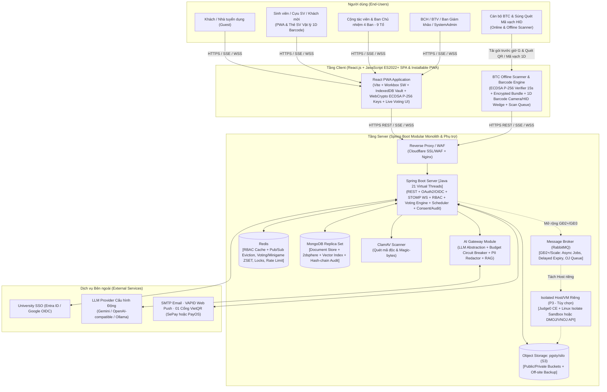
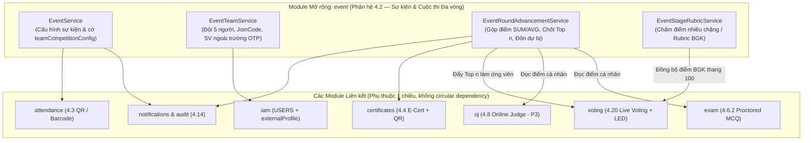
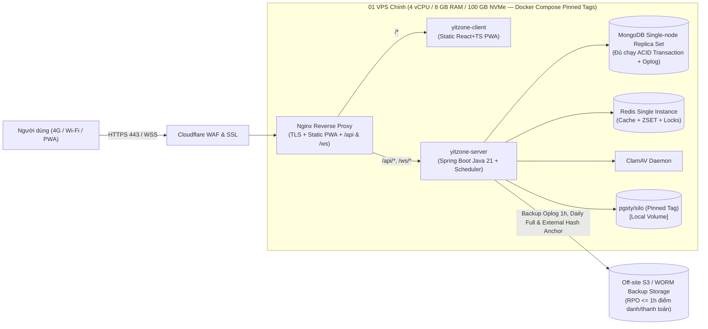
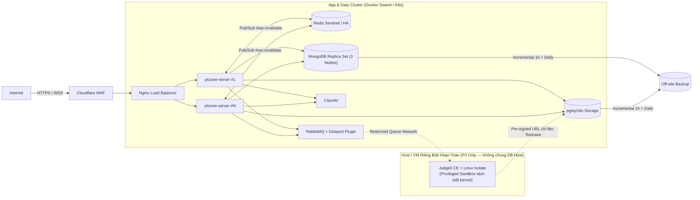

# TÀI LIỆU THIẾT KẾ KIẾN TRÚC MỨC CAO (HIGH-LEVEL DESIGN - HLD)

**Tên dự án:** YITZone — Hệ thống Quản lý Hoạt động Đoàn - Hội & Học thuật Khoa Công nghệ Thông tin  
**Phiên bản:** 2.3.0 (Căn cứ trực tiếp theo `SRS_YITZone.md` phiên bản `2.3.0` — Mở rộng Module `event` (`4.2`) hỗ trợ Sự kiện Đăng ký theo Đội & Đa vòng `FR-EVT-07..12`)  
**Ngày lập:** 22/11/2026  
**Tài liệu liên kết:**  
- [Đặc tả Yêu cầu Phần mềm (SRS_YITZone.md)](./SRS_YITZone.md)  
- [Thiết kế Chi tiết Kỹ thuật (LLD_YITZone.md)](./LLD_YITZone.md)  

---

## MỤC LỤC
1. [Giới thiệu, Động lực Kiến trúc & Truy vết SRS 2.2.1](#1-giới-thiệu-động-lực-kiến-trúc--truy-vết-srs-221)
2. [Kiến trúc Tổng thể Hệ thống (System Context & Container Architecture)](#2-kiến-trúc-tổng-thể-hệ-thống-system-context--container-architecture)
3. [Kiến trúc Các Phân hệ Kỹ thuật & Tuân thủ Cốt lõi (Core Technical Subsystems)](#3-kiến-trúc-các-phân-hệ-kỹ-thuật--tuân-thủ-cốt-lõi-core-technical-subsystems)
4. [Chiến lược Dữ liệu, Bộ nhớ Đệm & Lưu trữ Tệp (Data, Caching & Storage Strategy)](#4-chiến-lược-dữ-liệu-bộ-nhớ-đệm--lưu-trữ-tệp-data-caching--storage-strategy)
5. [Bộ Công nghệ Chuẩn hóa (Standardized Technology Stack)](#5-bộ-công-nghệ-chuẩn-hóa-standardized-technology-stack)
6. [Kiến trúc Triển khai (2 Topology), Sao lưu, Bảo mật & Giám sát](#6-kiến-trúc-triển-khai-2-topology-sao-lưu-bảo-mật--giám-sát)

---

## 1. Giới thiệu, Động lực Kiến trúc & Truy vết SRS 2.2.1

### 1.1. Mục đích tài liệu
Tài liệu Thiết kế Kiến trúc Mức cao (**HLD**) này chuyển hóa các yêu cầu nghiệp vụ và phi chức năng trong [SRS_YITZone.md](./SRS_YITZone.md) (phiên bản **2.2.1**) thành **bản thiết kế kiến trúc phần mềm, phân rã các thành phần hạ tầng, luồng tích hợp liên dịch vụ, cơ chế tuân thủ bảo vệ dữ liệu cá nhân và bộ công nghệ chuẩn hóa**. Chi tiết cấu trúc dữ liệu (Collections/Indexes), hợp đồng API, thuật toán và xử lý trường hợp biên ở mức mã nguồn được đặc tả tiếp tại [LLD_YITZone.md](./LLD_YITZone.md).

### 1.2. Các Động lực Kiến trúc (Architectural Drivers từ NFR)
Kiến trúc của YITZone được thiết kế để giải quyết 6 thách thức kỹ thuật cốt lõi:

| Động lực Kiến trúc | Chỉ tiêu Kỹ thuật (SLA / Constraint — Đồng bộ SRS 2.2.1) | Quyết định Kiến trúc Tương ứng |
| :--- | :--- | :--- |
| **1. Đỉnh tải Hội trường, Live Voting & Tương tác Thời gian thực** | `500` người dùng ảo (ramp-up `10s`, 1 check-in + 20 tương tác Bình chọn `Live Voting` / `Live Q&A` / `Minigame` trong `60s`), chỉ tiêu nghiệm thu chính thức (**Acceptance SLA**) đạt **`≥ 150 req/s`** *(ngưỡng dự phòng thiết kế tham khảo `300 req/s` — `A23`)*, `≥ 500` kết nối WebSocket đồng thời, độ trễ server `p95 ≤ 300 ms`, lỗi `< 0.5%` (`NFR-PERF-01`). | Sử dụng **Java 21 Virtual Threads** trên Spring Boot + **STOMP over WebSocket** (có `ChannelInterceptor` kiểm tra quyền trên các kênh quản trị `.admin` — `A24b`) kết hợp **Redis Pub/Sub, Hash & Sorted Sets (`ZSET`)** để xử lý đua top bình chọn định danh, đóng băng kết quả (`Freeze Mode`) và bảng xếp hạng trong RAM. |
| **2. Hội trường Mất sóng, Tương thích iOS 16.4 & Quét Mã vạch Thẻ SV Tốc độ Cao** | Mở Vé QR & xác thực trên **Máy soát vé BTC Ngoại tuyến** trong `≤ 0.5s` trên cả **iOS Safari $\ge 16.4$ và Android Chrome $\ge 110$** (`A9`); quét & tra cứu **Mã vạch 1D trên Thẻ sinh viên nhựa vật lý (`Code 128`/`Code 39`)** trong `≤ 0.3s` kể cả khi `navigator.onLine == false` (`FR-ATT-07`, `FR-ATT-09`, `FR-PWA-02`, `NFR-PERF-05`). | Áp dụng **Offline-First PWA (Workbox + IndexedDB Vault)** với **Vé ký số bất đối xứng chuẩn `ECDSA P-256` (chu kỳ bucket `15s`)** + **Mã hóa `AES-GCM` & tự động xóa gói dữ liệu offline trên máy BTC sau sự kiện (`A14`)** + **1D Barcode Camera & USB/Bluetooth HID Wedge Listener (`30–50ms/char`, chỉ bật ở màn hình soát vé — `A24`)** + hậu kiểm bắt buộc `BARCODE_WALKIN_UNVERIFIED` với sự kiện có quyền lợi (`A3`). |
| **3. Phân quyền Động Cô lập Đa tầng & Thu hồi $\le 5\text{s}$** | Kiểm tra quyền RBAC `< 5 ms`, 20 Gói Quyền, hỗ trợ cây đơn vị đệ quy N-tầng, tách quyền sự kiện nội bộ (`internal_event:host_attendance` — `A16`), thu hồi quyền (kể cả **hết hạn tự động**) có hiệu lực trong `≤ 5s` (`NFR-SEC-06`). | Mô hình **Hybrid Recursive (`parentId` + `ancestors[]`)** + **Role & Module Flattening** trên Redis có lưu **`expiresAt` kiểm tra lúc đánh giá**, đối chiếu **`permissionVersion`** và phát tán xóa cache qua **Redis Pub/Sub**. |
| **4. Chống Bán lố Tồn kho, Xác thực Webhook, Đối soát Tiền mặt COD & Lợi nhuận Quỹ** | `0%` sai lệch tồn kho/voucher (`NFR-PERF-03`); xác thực chữ ký Webhook thanh toán (`A11`); kiểm soát đơn COD & bàn giao tiền mặt cuối ca (`A12`, `B3`); thống kê quỹ phản ánh lợi nhuận thực tế của hàng đã giao (`FR-STR-03`, `A13`). | **Bước 0 xác minh chữ ký HMAC-SHA256 hằng thời gian tại Webhook** + **Reservation Pattern** (`15m + 5m` cho VietQR; `PENDING_COD` hạn `03 ngày` & tối đa 2 đơn/SV) + **Phiếu bàn giao tiền mặt COD cuối ca (`COD_CASH_HANDOVERS`)** + **MongoDB ACID Transaction** + **Redis `SETNX` Lock có TTL 30s (`A32`)** + ghi nhận giá vốn `costPriceVnd` tại thời điểm `fulfill`. |
| **5. Bảo vệ Dữ liệu Cá nhân (Luật 91/2025, NĐ 356/2025 & NĐ 330/2026) & Bỏ phiếu Kín Outbox** | Tuân thủ `NFR-PRIV-01..06` (Consent, Retention, Export dữ liệu, Audit hash-chain 5 năm có neo hash ra ngoài `A20`, Quét mã độc, `RPO ≤ 1h` điểm danh/thanh toán, `RTO ≤ 4h`, tách bảng khảo sát ẩn danh & bỏ phiếu kín chống tương quan thời gian `FR-VOTE-03`, `A5`). | **Consent & Privacy Governance**, **Data Retention Scheduler**, **ClamAV**, **Single-Writer Audit Sequencer + Daily External Hash Anchor (Email BTV & WORM Backup)**, và **Bỏ phiếu kín qua `VOTING_BALLOT_OUTBOX` trộn lô (`_id` UUID v4) + Tắt kiểm phiếu thời gian thực (kể cả kênh `.admin`)**. |
| **6. AI Gateway An toàn, Trích dẫn & Kiểm soát Ngân sách** | TTFT `p95 ≤ 1.5s` (`NFR-PERF-04`), trích dẫn nguồn $\ge 90\%$, chống Prompt Injection, ngắt mạch ngân sách (`NFR-AI-BUDGET-01`). | **AI Gateway** với lớp trừu tượng LLM theo cấu hình, **Token/Cost Circuit Breaker** về FAQ tĩnh, **PII Redactor** (+ xem trước thủ công), **Metadata Citation Enforcement** và `@Tool` chỉ đọc theo `SecurityContextHolder`. |

### 1.3. Bảng Truy vết Quyết định Kiến trúc $\leftrightarrow$ FR / NFR (SRS 2.2.1)

| Quyết định Kiến trúc (HLD 2.2.1) | Mã FR / NFR Liên quan trong SRS 2.2.1 | Ghi chú Ràng buộc |
| :--- | :--- | :--- |
| Định danh tin cậy 2 lớp (OIDC Claims + Bảng dự phòng `OFFICIAL_DIRECTORY_ROSTER`) + `MAJOR_CONFIG` động | `FR-IAM-01`, `FR-CERT-02`, `EXT-SSO-01` | Dự phòng import CSV Phòng Đào tạo nếu IdP Trường không trả claim MSSV (`B2`) |
| Cache RBAC lưu `expiresAt` + `permissionVersion` + Redis Pub/Sub + Tách `internal_event:host_attendance` | `FR-RBAC-03`, `FR-RBAC-04`, `NFR-SEC-06` | Thu hồi `≤ 5s`; chặn CTV `MOD_DEPT_*` mở điểm danh sự kiện cấp Khoa (`A16`) |
| Vé QR ký số bất đối xứng **`ECDSA P-256`** (bucket **`15s`**) + Mã hóa & tự xóa gói Offline trên máy BTC | `FR-ATT-07`, `FR-PWA-02`, `NFR-PERF-05`, `NFR-PRIV-03` | Tương thích WebCrypto iOS 16.4 / Chrome 110 (`A9`); thu hẹp cửa sổ phát lại (`A10`); tự xóa gói offline sau sự kiện + 24h (`A14`) |
| Quét Mã vạch Thẻ SV 1D (`Code 128`/`Code 39`) qua Camera & Súng quét HID (`30–50ms/char`) + Hậu kiểm Vãng lai | `FR-ATT-09`, `FR-STR-06`, `FR-DUTY-08`, `NFR-PERF-05` | Chỉ nhận thẻ nhựa vật lý khớp regex 8 số; ca vãng lai gắn `BARCODE_WALKIN_UNVERIFIED` bắt buộc hậu kiểm nếu có quyền lợi (`A3`, `A24`) |
| Chấm điểm rủi ro điểm danh theo **Trọng số (`Weighted Risk`)** + Bằng chứng sở hữu khóa thiết bị (`ECDSA P-256 PoP`) | `FR-ATT-02..04`, `FR-ATT-08`, `NFR-SEC-02` | Không nhận `deviceTokenId` tự khai từ body (`A2`); trùng thiết bị hoặc GPS xa `> 1km` = `+2đ` vào thẳng hàng chờ hậu kiểm (`A1`) |
| Hệ thống Bình chọn (`Live Voting`): `VOTING_JUDGE_SCORES` theo `judgeUserIds`, Phiếu kín `VOTING_BALLOT_OUTBOX` trộn lô & tắt realtime, Kiosk 60s | `FR-VOTE-01..05`, `NFR-PERF-01`, `NFR-PRIV-03` | Phiếu kín dùng `_id` UUID v4, không đẩy số phiếu ra kênh `.admin` khi đang mở cổng (`A5`); tách `PERSONNEL_ELECTION` sang P3 (`A8`) |
| Thi Desktop-only Fullscreen, Mobile & đứt Heartbeat `> 15s` chỉ ghi log hậu kiểm, khóa YITBot riêng thí sinh | `FR-EXAM-03`, `FR-EXAM-04`, `FR-EXAM-05`, `NFR-SEC-05` | Không ép Fullscreen iOS Safari; đứt Heartbeat ghi `HEARTBEAT_GAP` không tự thu bài (`A33`) |
| Cửa hàng: Xác thực chữ ký Webhook VietQR, `PENDING_COD` (hạn 3 ngày) + Bàn giao tiền mặt COD cuối ca, Giá vốn khi `fulfill` | `FR-STR-01..08`, `EXT-PAY-01` | Constant-time HMAC verification (`A11`); `COD_CASH_HANDOVERS` ký nhận với Thủ quỹ (`A12`, `B3`); giá vốn tính lúc giao (`A13`) |
| AI Gateway trừu tượng hóa LLM + PII Redactor + Circuit Breaker | `FR-BOT-01..05`, `FR-SUR-05`, `NFR-PRIV-05`, `NFR-AI-BUDGET-01` | Thay đổi provider qua cấu hình; ngắt mạch về FAQ tĩnh; ẩn danh `userId` trong `AI_USAGE_LEDGER` sau 90 ngày (`B9`) |
| Governance: Consent, Retention Scheduler, ClamAV, Single-Writer Audit Hash-chain + External Hash Anchor, Off-site Backup | `FR-SYS-01..02`, `NFR-PRIV-01..06`, `NFR-STORAGE-01`, `NFR-BACKUP-01` | Neo hash hằng ngày qua Email BTV & WORM backup (`A20`); tuân thủ Nghị định 356/2025 & 330/2026 (`B8`) |
| 2 Topology triển khai (Topology A Single-node RS có bảng cấu hình VPS 8GB RAM & chi phí; Judge0 P3 tách Host riêng) | Mục 7.1, 7.2, `FR-OJ-01..04`, `NFR-SEC-01` | Định cỡ rõ RAM cho ClamAV/MongoDB/JVM ở Topology A (`A21`) và cô lập rủi ro kernel escape |

---

## 2. Kiến trúc Tổng thể Hệ thống (System Context & Container Architecture)

### 2.1. Mô hình Client - Server Tách biệt & Modular Monolith
Hệ thống tuân thủ kiến trúc **Decoupled Client-Server**:
* **Tầng Client (`yitzone-client`):** Ứng dụng Single Page Application (SPA) tích hợp **Progressive Web App (React.js + JavaScript ES2022+/JSX + Vite + Workbox Service Worker + IndexedDB)**. Sử dụng **JavaScript (ES2022+ / JSX)** kèm **JSDoc, ESLint và Zod** giúp đội dự án phát triển nhanh, dễ tiếp cận qua các nhiệm kỳ đồng thời vẫn kiểm soát lỗi tĩnh và xác thực cấu trúc dữ liệu runtime khi trao đổi với Spring Boot API. Client giao tiếp với Server qua **HTTPS RESTful JSON**, **Server-Sent Events (SSE)** cho AI streaming và **WSS (STOMP over WebSocket)** cho tương tác thời gian thực; đồng thời tích hợp **chế độ Máy Soát vé BTC Ngoại tuyến (`Offline Scanner`)** hỗ trợ cả **Vé QR 2D ký số** lẫn **Mã vạch 1D trên Thẻ sinh viên vật lý (`Camera` & `USB/Bluetooth HID Scanner`)** ngay trên PWA.
* **Tầng Server (`yitzone-server`):** Ứng dụng **Spring Boot 3.x (Java 21 LTS)** tổ chức theo kiến trúc **Modular Monolith (Package-by-Feature)** với 20+ module nghiệp vụ (`iam`, `event`, `attendance`, `certificate`, `cms`, `minigame`, `exam`, `award`, `oj`, `store`, `chatbot`, `office`, `arts`, `calendar`, `survey`, `voting`, `portfolio`, `liveqa`, `qachat`, `pwa`, `privacy`, `audit`) giao tiếp nội bộ qua Spring Application Events và Service Interfaces.

### 2.2. Sơ đồ Kiến trúc Container & Hạ tầng (System Container Diagram)

---

## 3. Kiến trúc Các Phân hệ Kỹ thuật & Tuân thủ Cốt lõi (Core Technical Subsystems)

### 3.1. Kiến trúc Bảo mật, Định danh Tin cậy 2 Lớp & Phân quyền Động (`Scoped Dynamic RBAC`)
* **Xác thực & Định danh 2 Lớp (`FR-IAM-01..02`, `B2`):**
  * Đăng nhập **OAuth2 / OIDC** với nhà cung cấp SSO của Trường (Microsoft Entra ID / Google Workspace). Bắt buộc **MFA** cho `BTV` và `SystemAdmin` (`NFR-AUTH-01`).
  * **Nguồn định danh tin cậy 2 lớp (Xử lý trường hợp IdP không trả custom claim — `B2`):**
    1. **Lớp 1 (OIDC Claims):** Lấy `userType` (`STUDENT`, `STAFF_LECTURER`, `GRAD_SECOND_DEGREE`, `TEMP_GUEST`), `studentCode` hoặc `staffId` trực tiếp từ OIDC ID Token nếu IdP của Trường đã cấu hình.
    2. **Lớp 2 (Bảng Danh sách Chính thức `OFFICIAL_DIRECTORY_ROSTER`):** Nếu IdP của Trường chỉ trả về `email` và `fullName` chuẩn, `OidcUserService` tự động tra cứu khớp `email` đã xác thực với collection **`OFFICIAL_DIRECTORY_ROSTER`** (được `BTV` import từ tệp CSV/Excel chuẩn của Phòng Đào tạo / Phòng CTSV đầu mỗi học kỳ) để gán chính xác `studentCode`/`staffId`/`userType` (không cắt chuỗi email phỏng đoán tự do).
  * Mã ngành Khoa CNTT được kiểm tra động qua collection **`MAJOR_CONFIG`** (do `BTV` cấu hình, khởi tạo `110, 162, 133`) kết hợp cờ `facultyOverride{enabled, effectiveDate, reason}` của `BTV`.
  * Hỗ trợ liên kết `personalEmail` (xác thực OTP) để cựu sinh viên (`GRADUATED`) đăng nhập sau khi email trường bị thu hồi; trang xác thực QR công khai hoạt động độc lập.
  * Cấp phát JWT (`Access Token` ngắn hạn chứa `permissionVersion` + `Refresh Token` HTTP-Only Cookie xoay vòng, Idle Timeout `≤ 30 phút` cho quản trị và `≤ 7 ngày` cho sinh viên).
* **Kiến trúc Quyền 2 Tầng (`20 Gói Quyền` — `A16`, `A17`, `A22`):**
  1. **Tầng 1 — Quyền Nguyên tử (`<module>:<action>:<scope_level>`):** Kiểm soát qua Spring Security Custom `PermissionEvaluator` và `@PreAuthorize`, tách rõ 3 cấp nhân sự (`unit_hr:propose`, `unit_hr:execute`, `unit_hr:approve`) và **tách riêng quyền điểm danh sự kiện nội bộ (`internal_event:host_attendance`) khỏi quyền điểm danh sự kiện cấp Khoa (`attendance:host`)** để CTV giữ gói `MOD_DEPT_*` (như `EMFIT`) chỉ mở được điểm danh cho sự kiện nội bộ CTV không cộng quyền lợi (`visibility == INTERNAL_CTV && benefitTypes.isEmpty()` — `A16`).
  2. **Tầng 2 — 20 Gói Quyền Nghiệp vụ (`PERMISSION_MODULES`):** Đóng gói 20 gói chuẩn hóa theo **SRS 2.2.1** (`A22`), trong đó tách riêng **`MOD_LIVEQA_UNMASK`** khỏi **`MOD_AUDIT_VIEWER`** (không cấp cho `SystemAdmin`), giữ quyền điều khiển màn hình LED bình chọn **`voting:host` duy nhất tại gói `MOD_QUIZ_EXAM_HOST`** và kiểm tra quyền chấm điểm Ban Giám khảo trực tiếp theo danh sách **`VOTING_CAMPAIGNS.judgeUserIds`** thay vì qua gói khảo sát (`A17`).
* **Giải nén, Kiểm tra Hết hạn & Thu hồi $\le 5\text{s}$ (`NFR-SEC-06`):**
  * Bộ giải nén lưu trên Redis (`rbac:permissions:{userId}`) danh sách các quyền kèm trường **`expiresAt` của từng `roleScope`/`assignedModule`** và **`permissionVersion`**.
  * **Kiểm tra hết hạn tại thời điểm đánh giá (Evaluation-time Check):** Mỗi lần `PermissionEvaluator` kiểm tra quyền, hệ thống lọc `grant.expiresAt == null || grant.expiresAt.isAfter(Instant.now())`. Nhờ vậy, gói quyền **hết hạn tự động (`FR-RBAC-03`) mất hiệu lực ngay tại giây thứ 0** mà không phải chờ TTL cache 15 phút.
  * **Thu hồi thủ công & Multi-Replica Eviction:** Khi `BTV`/`Trưởng Ban` thu hồi quyền, thay đổi chức vụ hoặc chạy `Term Rollover Wizard`, hệ thống tăng `USERS.permissionVersion`, xóa key Redis `rbac:permissions:{userId}` và phát thông điệp qua **Redis Pub/Sub (`rbac:invalidate`)** để mọi bản sao `yitzone-server` xóa cache cục bộ trong **`≤ 5 giây`**.
* **Audit Log Bất biến Hash-chain, Tuần tự Hóa & Neo Hash Định kỳ Ra Ngoài (`FR-SYS-02`, `A20`):**
  * **Single-Writer Audit Sequencer:** Spring AOP (`@Aspect`) đánh chặn các thao tác nhạy cảm và ghi dạng `Append-only` vào `AUDIT_LOGS`. Để chống trùng `seq` hoặc rẽ nhánh chuỗi khi nhiều request/replica ghi đồng thời, việc cấp số thứ tự `(seq, prevHash)` thực hiện nguyên tử qua `findAndModify` trên bảng chốt trạng thái chuỗi **`AUDIT_CHAIN_STATE`** (hoặc khóa tuần tự Redis `audit:chain:lock`) trong cùng transaction trước khi tính `hash = SHA-256(seq | timestamp | actorId | action | targetId | changedFields | prevHash)`.
  * **Neo Hash Định kỳ Ra Ngoài (`External Hash Anchoring`):** Mỗi ngày lúc `00:05`, Scheduled Job trích xuất đỉnh chuỗi `{date, lastSeq, lastHash}` gửi qua Email SMTP tới hộp thư lưu trữ độc lập của `BTV` và ghi vào vùng sao lưu Off-site chỉ ghi (WORM backup), kết hợp Job kiểm tra toàn vẹn toàn chuỗi hằng tuần để phát hiện mọi hành vi can thiệp/tính lại chuỗi ở tầng CSDL.
  * Chỉ lưu các trường thay đổi cần thiết (**`changedFields` minimal diff**), không chụp nguyên document chứa PII thừa (`NFR-PRIV-03`).

### 3.2. Kiến trúc Offline-First PWA, Vé Ký số `ECDSA P-256` (Bucket 15s), Quét Mã vạch Thẻ SV 1D & Bảo vệ Dữ liệu Máy BTC Ngoại tuyến
* **App Shell & Két sắt Ngoại tuyến (`Workbox` + `IndexedDB/Dexie.js`):**
  * `CacheFirst` cho App Shell (JS/CSS/Fonts/Icons); lưu cục bộ trong `IndexedDB`: Vé sự kiện ký số, Ảnh thẻ (chỉ khi người dùng đã cấp Consent), Mã QR nhận hàng (`pickupQrToken`), Lịch 7 ngày tới, E-Cert đã ghim, và Hàng đợi `Background Sync`. Hệ thống tự động gửi thông báo **nhắc kiểm tra/kích hoạt lại vé trước giờ sự kiện `24 giờ`** để phòng trường hợp iOS Safari thu hồi `IndexedDB` của trang web chưa cài ra Màn hình chính (`A9b`).
* **Thiết kế Chữ ký Bất đối xứng `ECDSA P-256` Cho Vé Ngoại tuyến (`FR-ATT-07`, `FR-PWA-02`, `A9`, `A10`):**
  * **Chuẩn hóa thuật toán `ECDSA P-256 (SHA-256)` (`A9`):** Để đảm bảo tương thích 100% với WebCrypto API trên cả **iOS Safari $\ge 16.4$ và Android Chrome $\ge 110$** (do Ed25519 chỉ có trên WebCrypto từ iOS 17 và Chrome 137), hệ thống chuẩn hóa sử dụng cặp khóa bất đối xứng **`ECDSA P-256`**:
    1. **Trên thiết bị Sinh viên:** Khi đăng nhập / kích hoạt Vé Ngoại tuyến, trình duyệt/PWA tạo cặp khóa `ECDSA P-256` bằng **WebCrypto (`extractable: false`)** — khóa riêng không thể xuất ra khỏi IndexedDB — và đăng ký `publicKeyJwk` lên Server (lưu vào `DEVICE_TOKENS`, dùng chung cho cả ký thử thách vé offline lẫn bằng chứng sở hữu thiết bị `Device Token PoP` — `A2`).
    2. **Server ký Vé (`Server ECDSA P-256 Private Key`):** Server phát hành chứng chỉ vé đã ký số gồm `{ ticketId, userId, eventId, sessionId, devicePublicKey, issuedAt, expiresAt, serverSignature }`.
    3. **Hiển thị QR biến đổi mỗi `15 giây` (`A10`):** Ngay cả khi bật Chế độ máy bay, thiết bị sinh viên dùng khóa riêng cục bộ ký thử thách theo bước nhảy **15 giây** (`bucket = floor(unixTime / 15)` + `ticketId`), kết xuất QR gồm `{ ticketPayload, serverSignature, bucket, deviceSignature }` để hạn chế việc chụp ảnh màn hình vé gửi từ xa.
* **Máy Soát vé BTC Ngoại tuyến (`Offline Scanner` — `FR-ATT-07`), Bảo vệ Gói Dữ liệu Offline (`A14`) & Bộ Quét Mã vạch Thẻ Sinh viên 1D (`FR-ATT-09`, `A3`, `A22`, `A24`):**
  1. **Chuẩn bị trước giờ G, Mã hóa `AES-GCM` & Giới hạn Tuổi Gói Offline (`A14`, `A34`):** Cán bộ giữ `MOD_ATTENDANCE_STAFF` hoặc `MOD_EVENT_OPS` gọi API tải gói sự kiện về `IndexedDB` máy BTC: danh sách đăng ký tối thiểu (MSSV, Họ tên, Ngành, ảnh thẻ có consent), **`Server Public Key` (`ECDSA P-256`)**, và đồng bộ đồng hồ tính **`lastServerSyncAt` + `clockOffsetMs = serverTime - deviceTime`**. Toàn bộ dữ liệu sinh viên trong `IndexedDB` máy BTC **được mã hóa cục bộ bằng khóa phiên `AES-GCM 256-bit`**, từ chối sử dụng nếu gói đã tải quá **`12 giờ`**, và **tự động xóa sạch (`Auto-Wipe`) ngay sau khi đồng bộ xong hoặc chậm nhất tại `endTime + 24 giờ`** (kèm API thu hồi/xóa máy BTC từ xa khi mất máy).
  2. **Quét Vé QR 2D tại hội trường mất mạng (`≤ 0.5s`, `A10`):** Khi quét QR của sinh viên, ứng dụng BTC kiểm tra bằng `SubtleCrypto.verify("ECDSA", ...)`: (a) `serverSignature` bằng `Server Public Key`, (b) `deviceSignature` bằng `devicePublicKey` trong payload vé, (c) `bucket` 15 giây đã hiệu chỉnh `clockOffsetMs` chỉ chấp nhận **bucket hiện tại (cộng biên lệch đồng hồ $\le 5\text{s}$)**, và **bắt buộc hiển thị ảnh thẻ chân dung** để Lễ tân đối chiếu. Không chứa khóa bí mật ký vé nào trên máy BTC.
  3. **Quét Mã vạch 1D trên Thẻ Sinh viên Nhựa Vật lý (`Code 128` / `Code 39` — `≤ 0.3s`, `A3`, `A22`, `A24`):**
     * **Đa nguồn thu nhận & Chống xung đột ô nhập liệu (`A24`):** (a) **Camera trình duyệt** dùng `BarcodeDetector API` (fallback `@zxing/browser`) bật đồng thời decoder 2D (`QR_CODE`) và 1D (`CODE_128`, `CODE_39` — bỏ `EAN_13` khỏi mặc định và kiểm tra khớp regex MSSV 8 chữ số `^[0-9]{8}$`); (b) **Súng quét mã vạch cầm tay (`USB / Bluetooth HID Keyboard Wedge`)** dùng `useHidBarcodeScanner` hook **chỉ bật ở màn hình Soát vé/Trực bàn**, gọi `preventDefault()` tách luồng phím tốc độ cao với **ngưỡng cấu hình được (mặc định `30–50 ms/char` tương thích cả súng Bluetooth lẫn USB)** kết thúc bằng `Enter`, không xung đột với ô nhập MSSV thủ công (`FR-ATT-05`).
     * **Đối chiếu Thẻ Vật lý & Hậu kiểm Bắt buộc cho Vãng lai (`Walk-in Auto-Link` — `A3`, `A22`):** Chỉ tài khoản giữ **`MOD_ATTENDANCE_STAFF` / `MOD_EVENT_OPS` / `MOD_STORE_BOOTH` / `MOD_DEPT_OFFICE`** mới mở được trình quét 1D (`A22`). Quy chế chỉ nhận thẻ sinh viên nhựa vật lý chính thức (không quét màn hình điện thoại). Với sự kiện có quyền lợi (`ĐRL/CTXH/CĐDN`), mặc định `allowBarcodeWalkIn = false`; nếu BTC bật tiếp nhận vãng lai, bản ghi `PENDING_SSO_LINK` luôn mang cờ **`BARCODE_WALKIN_UNVERIFIED (+2 điểm)`** và sau khi `OidcUserSuccessHandler` tự động ghép (`Auto-Link`) `userId` thì **bắt buộc nằm trong Hàng chờ Hậu kiểm (`ATTENDANCE_REVIEW_QUEUE`) chờ BTC duyệt mới cấp E-Cert có quyền lợi** (Edge 40).
  4. **Hàng đợi, Đồng bộ Xung đột & Phát hiện Quét Trùng Đa Máy (`A10`):** Lượt quét hợp lệ được ghi vào hàng đợi cục bộ theo `localSeq` + `adjustedScanAt = deviceScannedAt + clockOffsetMs`. Khi có mạng lại, máy BTC đẩy `OFFLINE_SCAN_BATCHES`; nếu cùng 1 vé ngoại tuyến bị quét trên **$\ge 2$ máy BTC khác nhau**, Server giữ bản ghi sớm nhất nhưng đồng thời gắn cờ **`DUPLICATE_OFFLINE_TICKET_SCAN (+2 điểm)`** đẩy vào Hàng chờ Hậu kiểm.

### 3.3. Kiến trúc Thời gian thực & Hệ thống Bình chọn Hội trường (`STOMP WebSocket + Redis Pub/Sub & ZSET`)
* **STOMP over WebSocket** (kèm SockJS fallback & `StompChannelInterceptor` kiểm tra quyền SUBSCRIBE theo từng topic — `A24b`) phục vụ:
  * `/topic/attendance.{eventId}`: Phát mã `DYNAMIC_ROTATING_QR` (mặc định) mỗi 10s chứa `qrIssuedAt` nằm trong phần đã ký số của server; cập nhật bộ đếm sĩ số hội trường.
  * `/topic/minigame.{pinCode}`: Đồng bộ vòng đời câu hỏi và bảng xếp hạng trên **Redis `ZSET`**. Tốc độ trả lời $\Delta t$ được giới hạn hai đầu bằng đồng hồ server: $\Delta t \in [\max(0, \Delta t_{\text{server}} - 2\text{s}),\, \Delta t_{\text{server}}]$ (`FR-GAME-03`).
  * `/topic/liveqa.{sessionId}`: Cập nhật Upvote qua Redis `ZSET` + `Set` và gộp câu hỏi trùng bằng `SUNIONSTORE`.
  * `/topic/voting.{campaignId}` & `/topic/voting.{campaignId}.admin` (**`Live Voting & Polling` — `FR-VOTE-01..05`, `A5..A8`, `A17`, `A24b`, `A29`, `A31`**):
    * **Ủy quyền kênh quản trị (`A24b`):** `StompChannelInterceptor` bắt buộc kiểm tra người dùng có quyền **`voting:host` (`MOD_QUIZ_EXAM_HOST`) hoặc `voting:update` (`MOD_SURVEY_POLL` / `BTV`)** mới được `SUBSCRIBE /topic/voting.{campaignId}.admin`.
    * **Phân tách luồng Bình chọn Định danh (`isSecretBallot = false`) và Bỏ phiếu Kín (`isSecretBallot = true` — `A5`, `A29`):**
      1. **Với Bình chọn Định danh (`isSecretBallot = false`):** Xác minh điều kiện cử tri (đã Check-in sự kiện) và bằng chứng sở hữu `Device Token PoP` (riêng quầy Kiosk dùng phiên 60s một lần qua `POST /kiosk-sessions` & `POST /kiosk-cast`, miễn kiểm tra trùng Device Token cho máy Kiosk — `A7`); hỗ trợ đổi phiếu trước giờ đóng cổng nếu bật (`A6`); sau khi commit MongoDB mới cập nhật Redis `SADD voting:voters:{id}` và `ZINCRBY voting:tally:{id}` (`A29`), đẩy biến động điểm thời gian thực ra màn hình LED (hoặc tạm ngắt kênh công khai khi bật **`Freeze Mode` phút chót** bởi `MOD_QUIZ_EXAM_HOST` — `FR-VOTE-05`).
      2. **Với Bỏ phiếu Kín Đã Xác thực (`isSecretBallot = true` — `A5`, `A6`, `A7`):** Khóa chế độ đổi phiếu và khóa chế độ Kiosk. Trong cùng 1 MongoDB ACID Transaction: ghi `VOTING_VOTER_LOGS` (`_id` là **`UUID v4` ngẫu nhiên**, `votedAt = null`) và ghi lá phiếu vào thùng đệm **`VOTING_BALLOT_OUTBOX`** (`_id` là **`UUID v4` ngẫu nhiên**, không có `userId`), đồng thời tắt log HTTP request body. Khi Outbox đủ **lô $\ge k$ phiếu ($k = 10$)** hoặc khi đóng cổng, Worker trộn ngẫu nhiên thứ tự (`SecureRandom`) rồi ghi hàng loạt sang **`VOTING_BALLOTS`**. Trong suốt thời gian mở cổng bỏ phiếu kín, hệ thống **tắt hoàn toàn kiểm phiếu thời gian thực (không chạy `ZINCRBY` và không đẩy số phiếu ứng viên ra cả kênh LED lẫn kênh `.admin`)**, chỉ hiển thị tổng số cử tri đã bỏ phiếu để chống suy đoán lá phiếu theo thời gian.
    * **Bảng Điểm Giám khảo Định danh Độc lập (`VOTING_JUDGE_SCORES` — `A17`, `A31`):** Quyền chấm điểm BGK được kiểm tra trực tiếp theo danh sách `VOTING_CAMPAIGNS.judgeUserIds` và lưu định danh vào collection riêng `VOTING_JUDGE_SCORES`. Kết hợp điểm trung bình BGK ($\overline{S}_{\text{BGK}}$) và bình chọn khán giả theo tỷ lệ $W_{\text{BGK}}\% + W_{\text{Khán giả}}\% = 100\%$; phân định đồng điểm (`Tie-breaker`) ưu tiên $\overline{S}_{\text{BGK}}$ cao hơn trước (tiêu chí thời điểm đạt mốc phiếu sớm hơn chỉ áp dụng cho bình chọn định danh — `A26b`).
  * `/topic/qa.bch.inbox` & `/topic/qa.conv.{id}`: Đẩy tin nhắn 2 chiều, trạng thái `Typing`/`Seen`, và khóa tiếp nhận nguyên tử (`Atomic Claim`).

### 3.4. Kiến trúc Điểm danh Chống Gian lận Theo Trọng số & Thi Trắc nghiệm (`FR-ATT-*`, `FR-EXAM-*`)
* **Điểm danh Đa lớp (`FR-ATT-02..09`, `A1`, `A2`):**
  * **Camera trực tiếp & Súng quét HID:** Bắt buộc `navigator.mediaDevices.getUserMedia` (không hỗ trợ chọn ảnh từ thư viện); máy BTC hỗ trợ thêm súng quét mã vạch `USB/Bluetooth HID` (`30–50ms/char`) cho thẻ sinh viên nhựa vật lý 1D.
  * **Xác thực thời gian QR hoàn toàn phía Server:** Kiểm tra `serverReceivedAt - qrIssuedAt <= qrRotationSeconds + N` (mặc định `10s + 8s = 18s`), không dùng timestamp do client tự gửi.
  * **Device Token có Bằng chứng Sở hữu Khóa (`ECDSA P-256 PoP` — `A2`):** Server cấp định danh thiết bị qua `HttpOnly Cookie` khi đăng nhập kết hợp xác minh chữ ký **WebCrypto `ECDSA P-256` (`extractable: false`)** trên mỗi lượt `check-in`, `cast-ballot`, `exam attempts` (không nhận `deviceTokenId` tự khai dạng chuỗi từ body; không dùng `FingerprintJS`).
  * **Chấm điểm Rủi ro Theo Trọng số & Hàng chờ Hậu kiểm 48h (`FR-ATT-08`, `A1`):** Thay thế cơ chế đếm số lượng tín hiệu đơn thuần bằng **bộ chấm điểm rủi ro có trọng số (ngưỡng vào `ATTENDANCE_REVIEW_QUEUE` mặc định: `riskScore >= 2` điểm)**:
    * **Tín hiệu mạnh (`+2 điểm` — một mình đủ đẩy thẳng vào Hàng chờ Hậu kiểm):** (1) `DEVICE_TOKEN_COLLISION` (1 điện thoại điểm danh cho $\ge 2$ tài khoản ngay trong hội trường); (2) `GPS_FAR_OUT_OF_RANGE` (**có** tọa độ GPS nhưng cách tâm sự kiện $> 1.000\text{m}$ hoặc $> 3R$ — phát hiện bạn ở nhà nhận QR qua Zalo); (3) `IMPOSSIBLE_VELOCITY`; (4) `DUPLICATE_OFFLINE_TICKET_SCAN` (1 vé offline quét trên $\ge 2$ máy BTC); (5) `BARCODE_WALKIN_UNVERIFIED` (vãng lai mã vạch tại sự kiện có quyền lợi `ĐRL/CTXH/CĐDN`).
    * **Tín hiệu yếu (`+1 điểm`):** `GPS_MODERATE_DRIFT` (lệch nhẹ ngoài bán kính $\le 1.000\text{m}$), `ABNORMAL_ACCURACY`, `NEW_EPHEMERAL_DEVICE`, và `GPS_UNAVAILABLE` (`0 điểm` ở hội trường kín có bật Check-out 2 chiều/QR giữa giờ; nâng lên **`+2 điểm`** nếu sự kiện chỉ điểm danh 1 chiều mà người dùng tắt GPS để chặn nhận QR qua Zalo ở nhà rồi tắt định vị).
* **Thi Trắc nghiệm Giám sát Phù hợp Giới hạn Trình duyệt (`FR-EXAM-01..06`, `A33`):**
  * Đảo câu hỏi & 4 đáp án bằng `SecureRandom` (Fisher-Yates) trên Server; payload gửi Client không bao giờ chứa đáp án đúng.
  * Khóa đơn thiết bị trên Redis theo `verifiedDeviceTokenId` (có chữ ký `ECDSA P-256 PoP`); hỗ trợ **Cán bộ coi thi chuyển thiết bị** (ghi Audit Log).
  * **Fullscreen chỉ bắt buộc trên Desktop** (`requestFullscreen`), không chặn người dùng iOS Safari/Mobile.
  * **`visibilitychange`/`blur` & Đứt Heartbeat (`A33`):** Trên Desktop, đạt ngưỡng rời tab (mặc định 3 lần) tự động thu bài; trên **Mobile** hoặc khi Server phát hiện **đứt kết nối Heartbeat `> 15 giây` (`HEARTBEAT_GAP`)**, hệ thống **chỉ ghi nhật ký sự kiện để Cán bộ coi thi hậu kiểm, không tự động thu bài** tránh thu oan do cuộc gọi/rớt Wi-Fi tạm thời.
  * Phủ **Dynamic Diagonal Watermark** chỉ gồm **`MSSV + Họ tên + Thời gian`** (không gắn địa chỉ IP); khóa `YITBot` **chỉ áp dụng cho đúng thí sinh đang trong lượt thi**.

### 3.5. Kiến trúc Cửa hàng, Xác thực Webhook, Đối soát Tiền mặt COD & Gây quỹ Minh bạch (`FR-STR-*`)
* **Hình thức Giao nhận Tinh gọn:** Hỗ trợ đúng 2 hình thức: (1) **Nhận tại Văn phòng theo Cơ sở (`OFFICE_PICKUP`)** và (2) **Giao đến Phòng học cùng Cơ sở (`CLASSROOM_DELIVERY`, $\le 5\text{kg}$)**.
* **Giữ chỗ Tồn kho, Khóa Voucher Có TTL & Hạn Đơn COD (`NFR-PERF-03`, `A12`, `A32`, `B3`):**
  * Dùng khóa phân tán Redis `SET voucher:lock:{voucherId}:{userId} {reqId} NX EX 30` (TTL `30 giây`, giải phóng trong khối `finally`) kết hợp **đếm trực tiếp số đơn chưa hủy của user với voucher đó bên trong MongoDB Multi-Document ACID Transaction** trước khi trừ tồn kho/lượt dùng (`A32`).
  * Đơn chuyển khoản `VIETQR_TRANSFER` giữ chỗ `15 phút` (+ `5 phút` ân hạn giao dịch chậm); đơn tiền mặt `COD` khởi tạo ở trạng thái **`PENDING_COD`** với hạn nhận hàng **`codDueAt` mặc định `03 ngày làm việc`** (và giới hạn tối đa `02 đơn PENDING_COD` đang chờ/sinh viên; quá hạn Scheduler tự động hủy và hoàn tồn kho + Voucher — `A12`, `B3`).
* **Xác thực Chữ ký Webhook VietQR (`A11`) & Quy trình Bàn giao Tiền mặt COD Cuối ca (`COD_CASH_HANDOVERS` — `B3`):**
  * **Bước 0 Xác thực Webhook (`A11`):** Endpoint `POST /api/v1/store/webhooks/vietqr` bắt buộc đọc `rawBodyBytes` trước khi parse JSON, kiểm tra `|now - X-Webhook-Timestamp| <= 300s` và **xác minh chữ ký `X-Webhook-Signature` HMAC-SHA256 / Checksum của cổng đối soát đã chọn (SePay hoặc PayOS) bằng phép so sánh hằng thời gian (`MessageDigest.isEqual`)** kèm kiểm tra IP/API đối chiếu trước khi xử lý; mọi Webhook sai chữ ký bị từ chối `401/403` và ghi vào `AUDIT_LOGS`.
  * **Thu tiền & Bàn giao tiền mặt COD cuối ca (`B3`, `A12`):** Khi CTV trực bàn (`MOD_STORE_BOOTH`) quét QR nhận hàng hoặc mã vạch 1D trên thẻ SV vật lý và thu tiền mặt, đơn chuyển từ `PENDING_COD` sang **`COD_CONFIRMED`**. Cuối mỗi ca trực/ngày bán, hệ thống tạo **Phiếu Bàn giao Tiền mặt COD (`COD_CASH_HANDOVERS`)** để CTV nộp tiền mặt và Thủ quỹ (`MOD_STORE_MANAGER`) ký nhận đối soát trên hệ thống (lưu `AUDIT_LOGS`; cảnh báo nếu quá 24h chưa bàn giao).
* **Hạch toán Lợi nhuận Quỹ Theo Thời điểm Giao hàng (`FR-STR-03`, `A13`):** Doanh thu (`totalRevenueVnd`) ghi nhận khi đơn `PAID`/`COD_CONFIRMED`; **giá vốn hàng bán (`totalCostOfGoodsVnd`) được cộng tại thời điểm xác nhận giao hàng / chốt xuất kho (`fulfill`)** để tránh lệch lợi nhuận sớm với hàng Pre-order:
  $$\text{Lợi nhuận quỹ} = \sum(\text{Thực thu tiền hàng sau giảm giá}) - \sum(\text{Giá vốn `costPriceVnd` của hàng đã giao/chốt xuất}) - \text{Hoàn tiền thực tế}$$

### 3.6. Kiến trúc AI Gateway (`YITBot` & Tóm tắt Khảo sát)
Thay thế thiết kế cũ (đã gỡ bỏ Exam Semantic Shielding cosine $\ge 0.72$ và khóa Guest) bằng kiến trúc **AI Gateway** chuẩn hóa:
1. **Lớp Trừu tượng Nhà cung cấp LLM (`LLM Provider Abstraction`):** Giao tiếp thông qua giao diện `ChatModel` của Spring AI; chọn nhà cung cấp/model qua biến cấu hình (`Gemini API`, `OpenAI-compatible`, hoặc `Ollama` nội bộ), không khóa cứng vào một model cố định.
2. **Kiểm soát Ngân sách & Ngắt mạch (`NFR-AI-BUDGET-01`):** Ghi nhận lượng token & chi phí ước tính vào `AI_USAGE_LEDGER` và bộ đếm Redis (20 req/phút với SV, 5 req/phút với Guest; hạn mức ngày/người và trần ngân sách tháng). Khi vượt trần ngân sách, **Circuit Breaker** tự động ngắt gọi LLM ngoài và chuyển sang trả lời từ **kho FAQ tĩnh** + gợi ý `Q&A Messenger`.
3. **Bộ lọc Khử Định danh PII (`PII Redactor` — `NFR-PRIV-05`):** Tự động loại bỏ MSSV, email, SĐT bằng Regex kết hợp NER tiếng Việt trước khi gửi văn bản ra LLM ngoài; riêng tóm tắt khảo sát bắt buộc trả về **bản xem trước cho người phụ trách (`MOD_SURVEY_POLL`) rà soát & che thủ công họ tên tiếng Việt** trước khi xác nhận gửi.
4. **RAG Có Ép Trích dẫn (`Citation Enforcement` — `FR-BOT-01`):** `KNOWLEDGE_DOCUMENTS` lưu đầy đủ metadata (`sourceTitle`, `articleSection`, `docVersion`, `effectiveDate`, `approvedBy`). Prompt hệ thống và bộ kiểm tra đầu ra bắt buộc kèm trích dẫn hoặc trả về câu chuẩn *"Chưa có thông tin chính thức trong quy chế hiện hành"*.
5. **Secured Read-Only `@Tool` & Khóa Thi Đúng Đối tượng:** Mọi `@Tool` tra cứu dữ liệu cá nhân lấy `userId` duy nhất từ `SecurityContextHolder` (JWT) và bọc dữ liệu trong `<context>...</context>`; chỉ khóa `YITBot` với đúng tài khoản thí sinh đang có `exam:lock:*:{userId}`.

### 3.7. Kiến trúc Chấm bài Lập trình Cô lập (`Online Judge` — P3)
* **Chiến lược Giai đoạn Sau (`P3`):** Trước khi tự vận hành cụm Judge0, đội kỹ thuật đánh giá phương án tích hợp SSO/API với nền tảng sẵn có (**DMOJ / VNOJ**).
* **Ràng buộc Bảo mật nếu tự triển khai Judge0 CE:** Cụm **Judge Worker (Judge0 CE + Linux Isolate Sandbox)** **bắt buộc đặt trên Host/VM tách biệt hoàn toàn với Host chạy MongoDB/Redis/Silo** để cô lập rủi ro thoát container (privileged Isolate container không được phép chung kernel/mạng nội bộ với dữ liệu lõi). Giao tiếp qua RabbitMQ + S3 Pre-signed URL, giới hạn CPU/RAM/`pids.max`/stdout `16 MB` (`OLE`).

### 3.8. Kiến trúc Sinh Chứng nhận E-Cert, Biên bản Kiểm phiếu & Verified CV PDF
* Dùng **Thymeleaf + Flying Saucer (`xhtmlrenderer`) / OpenPDF + Google ZXing** để tạo E-Cert, Biên bản Kiểm phiếu (`FR-VOTE-05`) và Verified CV PDF (`≤ 2.0s`, lưu đệm trên Silo).
* Hỗ trợ **phiên bản chứng nhận (`certVersion`), trạng thái (`VALID | REVOKED | SUPERSEDED`)** và tra cứu QR công khai độc lập với trạng thái email trường của cựu sinh viên (`FR-IAM-02`, `FR-CERT-05`) cũng như chế độ Riêng tư của E-Portfolio (`FR-PORT-03`).

### 3.9. Kiến trúc Quản trị Quyền riêng tư, Bỏ phiếu Kín Outbox, Quét Mã độc & Tuân thủ Dữ liệu (`NFR-PRIV`, `NFR-STORAGE-01`, `NFR-BACKUP-01`)
* **Khung Pháp lý & Quản lý Đồng ý (`Consent Management` — `NFR-PRIV-01`, `NFR-PRIV-06`, `B8`):** Đáp ứng **Luật Bảo vệ dữ liệu cá nhân số 91/2025/QH15**, **Nghị định 356/2025/NĐ-CP** và **Nghị định 330/2026/NĐ-CP** (về chế tài xử phạt vi phạm hành chính trong lĩnh vực an ninh mạng & BVDLCN). Lưu vết phiên bản chính sách và trạng thái opt-in tại `CONSENT_RECORDS` cho từng mục đích: đăng nhập lần đầu, ảnh chân dung trên vé ngoại tuyến, và sử dụng tính năng AI. Hỗ trợ API **xuất toàn bộ dữ liệu cá nhân (JSON/PDF)**, yêu cầu xóa/ẩn danh tài khoản (`NFR-PRIV-04`) và lập Hồ sơ DPIA bao phủ cả gói dữ liệu soát vé ngoại tuyến trên máy BTC (`A14`).
* **Bộ Lập lịch Xóa / Ẩn danh Theo Hạn (`Data Retention Scheduler` — `NFR-PRIV-03`, `A14`, `B9`):** Spring Scheduler chạy hằng ngày áp dụng nguyên tắc **mốc muộn hơn** để tự động:
  * Xóa/ẩn danh tọa độ GPS và `Device Token` điểm danh sau mốc muộn hơn giữa `90 ngày` và `kết thúc học kỳ`.
  * **Tự động xóa gói dữ liệu soát vé ngoại tuyến (`Offline Scanner Bundle`)** trên máy cá nhân của Lễ tân BTC ngay sau khi đồng bộ xong hoặc chậm nhất **`24 giờ` sau khi sự kiện kết thúc** (mã hóa cục bộ `AES-GCM` bằng khóa phiên và hỗ trợ thu hồi máy BTC từ xa — `A14`).
  * **Xóa bản ghi điểm danh vãng lai mồ côi (`PENDING_SSO_LINK`)** không bao giờ có tài khoản SSO nhận sau mốc muộn hơn giữa `180 ngày` và `kết thúc 01 học kỳ` (`A3`, `B9`).
  * **Ẩn danh/xóa trường `userId` trong `AI_USAGE_LEDGER`** sau **`90 ngày`** (chỉ giữ số liệu tổng hợp chi phí theo tháng `monthKey` trong `02 năm` — `B9`).
  * Xóa ảnh thẻ ngoại tuyến trên máy chủ sau `90 ngày` kể từ khi chuyển `GRADUATED`.
  * Xóa `SURVEY_PARTICIPATIONS` và `VOTING_VOTER_LOGS` (đối với bỏ phiếu kín) sau `30 ngày` đóng khảo sát / chốt biên bản bầu cử; ẩn danh khảo sát/bình chọn định danh & lịch sử chat sau `02 năm`; rà soát tài khoản `ARCHIVED` quá `02 năm`; xóa tệp minh chứng SV5T sau `hết khóa + 01 năm`.
* **Ẩn danh Khảo sát & Bỏ phiếu Kín Qua Thùng đệm Trộn lô (`FR-SUR-03`, `FR-VOTE-03`, `A5`):**
  * Với khảo sát ẩn danh: tách `SURVEY_PARTICIPATIONS` (lưu `surveyId + userId`) khỏi `SURVEY_RESPONSES` (không chứa `userId`/hash, chỉ lưu `submittedDateBucket` dạng `YYYY-MM-DD`, ghi qua hàng đợi gom lô xáo trộn thứ tự).
  * Với bỏ phiếu kín (`Verified Secret Ballot`): trong cùng giao dịch nguyên tử, ghi `VOTING_VOTER_LOGS` (`_id` là **`UUID v4` ngẫu nhiên**, lưu `campaignId + userId`, `votedAt = null`) và ghi lá phiếu vào thùng đệm **`VOTING_BALLOT_OUTBOX`** (`_id` là **`UUID v4` ngẫu nhiên**, không có `userId`, lưu `ballotReceiptHash = SHA-256(receiptCode + campaignSalt)`). Worker định kỳ chuyển từ `VOTING_BALLOT_OUTBOX` sang `VOTING_BALLOTS` theo **lô $\ge 10$ phiếu đã xáo trộn ngẫu nhiên thứ tự**, đồng thời **tắt hoàn toàn kiểm phiếu thời gian thực (kể cả trên kênh `.admin`)** cho đến khi đóng cổng (`A5`).
* **Đường ống Kiểm tra Tệp & Quét Mã độc (`NFR-STORAGE-01`):** Mọi tệp tải lên đi qua lớp kiểm tra dung lượng (`5 MB` ảnh / `10 MB` PDF / `300 MB` video), kiểm tra **Magic Bytes** (chặn `.exe, .sh, .bat, .js...`), và quét qua **ClamAV Daemon** trước khi ghi vào **Silo**.
* **Sao lưu & Khôi phục (`NFR-BACKUP-01`):** Sao lưu gia tăng oplog/snapshot mỗi **`≤ 1 giờ`** cho phân hệ điểm danh & thanh toán (`RPO ≤ 1 giờ`) và sao lưu toàn bộ CSDL + Silo hằng ngày ra vùng lưu trữ tách biệt (`RPO ≤ 24 giờ`, kèm mốc neo Hash Audit Log chỉ ghi `A20`), đảm bảo mục tiêu khôi phục **`RTO ≤ 4 giờ`** kèm diễn tập khôi phục định kỳ theo học kỳ.

### 3.10. Kiến trúc Mở rộng Module `event` cho Sự kiện Đăng ký theo Đội & Đa vòng (`FR-EVT-07..12`)
Để hỗ trợ các sự kiện cuộc thi học thuật nhiều vòng theo đội (điển hình như **Mastering IT**: Đăng ký đội 5 SV có SV ngoài trường $\rightarrow$ 5 thành viên thi cá nhân gộp điểm đội $\rightarrow$ Chốt Top $n$ vào chung kết $\rightarrow$ Đêm Chung kết sân khấu) **ngay trong luồng Sự kiện thông thường** mà không tách phân hệ hay thêm gói quyền mới, mở rộng trực tiếp module `vn.edu.fit.yitzone.event` với các service con:

* **Giữ nguyên 20 phân hệ & 20 Gói Quyền:** Mọi cuộc thi học thuật là một bản ghi `EVENTS` bình thường bật cờ tùy chọn `teamCompetitionConfig` (tái sử dụng `MOD_EVENT_OPS`, `MOD_QUIZ_EXAM_HOST`, `MOD_OJ_MANAGER`, `MOD_SURVEY_POLL`, `judgeUserIds` và `BTV`).
* **Tuân thủ `NFR-PRIV` cho SV ngoài trường:** Mọi thí sinh ngoài trường tự đăng ký tài khoản Email + OTP (`FR-IAM-01`), lưu hồ sơ bổ sung (`externalProfile`) tuân thủ chính sách xóa/ẩn danh hóa định kỳ của `Data Retention Scheduler`, và tách biệt khỏi tiến trình cộng quyền lợi `ĐRL/CTXH/CĐDN` của sinh viên HCM-UTE.

---

## 4. Chiến lược Dữ liệu, Bộ nhớ Đệm & Lưu trữ Tệp (Data, Caching & Storage Strategy)

### 4.1. Chiến lược Thiết kế Cơ sở Dữ liệu MongoDB
* **Document Model & Tham chiếu Hợp lý:** Nhúng mảng/tài liệu con gắn chặt vòng đời (`roleScopes`, `assignedModules`, `attendanceSessions`, `teamCompetitionConfig`, `benefitTypes`, `variants`, `items`, `criteriaTree`, `candidates`, `members`, `stageSegments`), giới hạn mảng tin nhắn `CHAT_SESSIONS.messages[]` theo cửa sổ trượt tối đa `50 tin nhắn/phiên` để không chạm trần 16 MB (`A30`), đồng thời tách collection cho các luồng tăng trưởng không giới hạn hoặc yêu cầu bảo mật/ẩn danh riêng (`OFFICIAL_DIRECTORY_ROSTER`, `EVENT_ATTENDANCES` với khóa định danh tổng quát `attendeeKey`, `ATTENDANCE_REVIEW_QUEUE`, `OFFLINE_SCAN_BATCHES`, `EVENT_TEAMS` + `EVENT_ROUNDS` + `EVENT_ROUND_RESULTS`, `SURVEY_PARTICIPATIONS` vs `SURVEY_RESPONSES`, `VOTING_CAMPAIGNS` + `VOTING_VOTER_LOGS` + `VOTING_BALLOT_OUTBOX` vs `VOTING_BALLOTS` + `VOTING_JUDGE_SCORES`, `COD_CASH_HANDOVERS`, `ORDER_SUPPORT_REQUESTS`, `CONSENT_RECORDS`, `AI_USAGE_LEDGER`, `AUDIT_CHAIN_STATE`).
* **Mô hình Đệ quy Lai (`ORG_UNITS`):** Kết hợp `parentId` + `ancestors[]` + `$graphLookup` cho cây tổ chức 4 Ban - 9 Tổ để kiểm tra phạm vi đơn vị trong $O(1)$.
* **Chỉ mục & ACID Transaction (`A15`):** `2dsphere` (tín hiệu rủi ro GPS), `vector` Index (RAG), `text` Index (Blog), `Sparse Unique` (`studentCode`, `staffId`), `Partial Unique` (`{eventId, "members.userId"}` trên `EVENT_TEAMS` chặn 1 sinh viên tham gia 2 đội cùng sự kiện — Edge 43), `Compound Unique` (**`{eventId, sessionId, attendeeKey}`** trên `EVENT_ATTENDANCES` để hỗ trợ cả sinh viên có MSSV, khách vãng lai chưa có `userId` lẫn giảng viên/khách mời không có MSSV mà không bị lỗi trùng `null` — `A15`; `{campaignId, userId}` chống bỏ phiếu 2 lần; `{campaignId, judgeUserId}` trên `VOTING_JUDGE_SCORES`). Bật MongoDB Replica Set cho Multi-Document ACID Transactions. *(Xem chi tiết Schema & Indexes tại [LLD_YITZone.md](./LLD_YITZone.md)).*

### 4.2. Chiến lược Phân tầng Bộ nhớ Đệm (Redis Caching)
| Phân vùng Dữ liệu Redis | Cấu trúc & Cơ chế | Mục đích & Đồng bộ |
| :--- | :--- | :--- |
| **RBAC Effective Permissions** | Hash/Set (`TTL = 15m`) + **`expiresAt` per-grant** + `permissionVersion` | Kiểm tra quyền `< 5ms`; tự vô hiệu hóa ngay khi qua `expiresAt`; xóa ngay tức thời qua **Redis Pub/Sub (`rbac:invalidate`)** khi thu hồi thủ công/chuyển nhiệm kỳ (`≤ 5s`). |
| **Live Minigame, Live Q&A & Live Voting** | `ZSET` + `Set` + `Hash` | Bảng xếp hạng thời gian thực, danh sách Upvoter (`SUNIONSTORE`), bộ đếm cử tri (`voting:voters:{campaignId}` cập nhật **sau khi** commit transaction `A29`), bộ đếm phiếu định danh (`voting:tally:{campaignId}` — **tắt đối với phiếu kín `A5`**), token phiên Kiosk 60s (`voting:kiosk:{token}`) và trạng thái đóng băng LED (`Freeze Mode`). |
| **Dynamic QR Ephemeral State** | String / Signed Seed | Theo dõi trạng thái phiên QR xoay vòng 10s (xác thực theo `serverReceivedAt − qrIssuedAt ≤ 10s + N`, mặc định `N = 8s`). |
| **Exam Session & AI Lock** | Hash/String (`TTL = duration`) | Khóa 1 thiết bị (`verifiedDeviceTokenId`), **chỉ khóa `YITBot` của đúng thí sinh đang thi**, lưu nháp câu trả lời & theo dõi `HEARTBEAT_GAP > 15s`. |
| **AI Budget & Rate Limit** | Counter / Token Bucket | Đếm hạn mức `20 req/m` (SV), `5 req/m` (Guest), và tổng chi phí tháng kích hoạt Circuit Breaker (`NFR-AI-BUDGET-01`). |
| **Distributed Lock** | `SET ... NX EX 30` (TTL 30s) | Chống Race Condition `perUserLimit` Voucher (giải phóng trong `finally` kết hợp đếm đơn trong Transaction `A32`) và khóa tuần tự chuỗi Audit (`audit:chain:lock`). |

### 4.3. Chiến lược Lưu trữ Tệp (Object Storage — `pgsty/silo`)
* **Lựa chọn Công nghệ:** Dùng **Silo (`pgsty/silo`)** — bản phân nhánh tương thích S3 do cộng đồng PGSTY duy trì (sau khi repo MinIO gốc chuyển sang trạng thái lưu trữ). Lưu ý **giấy phép AGPLv3** của Silo (không chỉnh sửa/phân phối lại mã nguồn Silo nếu không mở nguồn; sử dụng như dịch vụ hạ tầng độc lập qua giao thức S3 bằng **AWS SDK for Java v2** và **cố định phiên bản image cụ thể** trong `docker-compose.yml`).
* **Public Bucket (qua Nginx/CDN):** Ảnh bìa sự kiện, ảnh bài viết Blog, ảnh sản phẩm cửa hàng, ảnh đại diện ứng viên/tiết mục bình chọn.
* **Private Bucket (Pre-signed URL `≤ 5 phút`, sau khi qua ClamAV):** Minh chứng SV5T (bảng điểm, giấy khám sức khỏe — **không thu thập CCCD mặc định** theo `NFR-PRIV-02`), ảnh chân dung vé ngoại tuyến (có Consent), file source văn nghệ gốc (Beat/Visual), file PDF E-Certificate / Biên bản Kiểm phiếu / Verified CV lưu đệm, và Testcases OJ (nếu triển khai P3).

---

## 5. Bộ Công nghệ Chuẩn hóa (Standardized Technology Stack)

### 5.1. Tầng Client — Giao diện Người dùng Độc lập & PWA (`yitzone-client`)

| Thành phần | Công nghệ / Thư viện chuẩn | Phiên bản khuyến nghị | Mục đích sử dụng trong YITZone |
| :--- | :--- | :---: | :--- |
| **Core Library & Build Tool** | **React.js** + **Vite** | React `18.3+` / `19.x` + Vite `6.x` | Xây dựng SPA tốc độ cao, tách biệt hoàn toàn với Backend. |
| **Ngôn ngữ** | **JavaScript (ES2022+ / JSX)** *(kèm JSDoc & ESLint)* | `ES2022+` | Phát triển nhanh, dễ tiếp cận cho đội dự án; kết hợp **ESLint** kiểm soát lỗi tĩnh và **Zod** xác thực cấu trúc dữ liệu runtime khi trao đổi với Spring Boot API. |
| **PWA, Offline & Chữ ký Vé `ECDSA P-256`** | **`vite-plugin-pwa` (Workbox)** + **`Dexie.js` (IndexedDB)** + **WebCrypto API (`ECDSA P-256` & `AES-GCM`)** + **Web Push API** | Workbox `7.x` + Dexie `4.x` | Đóng gói PWA (Android Chrome $\ge 110$ & iOS Safari $\ge 16.4$), giữ khóa riêng **`ECDSA P-256` (`extractable: false`)** cho Vé QR bất đối xứng (bucket 15s) & bằng chứng sở hữu thiết bị (`PoP`), mã hóa `AES-GCM` & tự xóa gói dữ liệu trên **Máy Soát vé BTC Ngoại tuyến** (`A9`, `A10`, `A14`). |
| **Định tuyến & UI** | **React Router** + **Tailwind CSS** + **Shadcn/UI (Radix UI Primitives)** + **Lucide Icons** + **Recharts** | Router `v7`/`v6.28+` · Tailwind `3.4+` | Điều hướng `ProtectedRoute` theo RBAC, bộ component tùy biến theo Design Token YITZone (`DESIGN.md` — hỗ trợ Light/Dark theo hệ thống & Dark Stage LED), biểu đồ thống kê và giao diện đáp ứng **WCAG 2.1 Level AA**. |
| **Data Fetching & State** | **TanStack Query** + **Axios** + **Zustand** | v5 | Quản lý API, tự động xoay vòng Refresh Token, caching và trạng thái Minigame/Live Q&A/Live Voting. |
| **Real-time & AI Streaming** | **`@stomp/stompjs`** + **`sockjs-client`** + **Fetch EventSource (SSE)** | `@stomp/stompjs 7.x` | Kênh thời gian thực STOMP (QR động, Minigame, Live Q&A, Live Voting, Messenger) và nhận luồng SSE từ `YITBot`. |
| **Biểu mẫu, Soạn thảo & Code** | **React Hook Form** + **Tiptap** + `react-markdown` + **KaTeX** + **Monaco Editor** (P3) | Tiptap `2.x` | Soạn bài Blog, công thức toán và trình soạn code (P3). |
| **Lịch, QR, Mã vạch 1D & Bản đồ** | **FullCalendar React** (`v6`) + **`html5-qrcode` / `@zxing/browser` (2D QR + 1D `Code 128`/`Code 39`)** + **Scoped HID Barcode Wedge Hook (`30–50ms/char`)** + `qrcode.react` + **React-Leaflet** | Mới nhất | Lịch tổng hợp 6 màu, quét QR 2D & Mã vạch thẻ SV 1D khớp regex MSSV 8 số bằng camera trực tiếp (`getUserMedia`) hoặc súng quét mã vạch USB/Bluetooth HID (`30–50ms/char`, chỉ bật ở màn hình soát vé — `A24`). |
| **Định danh Thiết bị** | **Server HttpOnly Cookie + WebCrypto `ECDSA P-256` Proof-of-Possession** | Chuẩn trình duyệt | Xác minh bằng chứng sở hữu khóa thiết bị cho điểm danh, bình chọn & thi trắc nghiệm *(không nhận ID tự khai từ body, không dùng FingerprintJS — `A2`)*. |

### 5.2. Tầng Server — Backend Core, AI Gateway & Tuân thủ (`yitzone-server`)

| Thành phần | Công nghệ / Thư viện chuẩn | Phiên bản khuyến nghị | Mục đích sử dụng trong YITZone |
| :--- | :--- | :---: | :--- |
| **Ngôn ngữ & Core Framework** | **Java 21 LTS** (Virtual Threads) + **Spring Boot** | Java `21 LTS` · Boot `3.3.x`/`3.4.x` | Xử lý tải cao nhẹ RAM với Virtual Threads, `Spring Web`, `Spring Validation`, `Spring Actuator`, `Spring Scheduler`. |
| **AI Gateway (`YITBot` & Survey)** | **Spring AI** (trừu tượng `ChatModel`) + **Apache Tika** | Spring AI `1.0.x` | Độc lập nhà cung cấp LLM qua cấu hình (`Gemini` / `OpenAI-compatible` / `Ollama`), RAG trích dẫn nguồn, PII Redactor và Budget Circuit Breaker. |
| **Bảo mật, Chữ ký Số & RBAC** | **Spring Security 6** + **OAuth2 Client** + **JJWT** + **Java Security / BouncyCastle (`ECDSA P-256`)** | Spring Security `6.x` | OIDC SSO + Roster CSV Fallback (`B2`), MFA cho BTV/Admin, `PermissionEvaluator` kiểm tra `expiresAt` & `judgeUserIds`, Single-Writer Audit Hash-chain + External Hash Anchor (`A20`), ký/xác thực vé & Device PoP **`ECDSA P-256`** (`A2`, `A9`). |
| **Dữ liệu & Real-time** | **Spring Data MongoDB** + **Spring Data Redis (Lettuce)** + **Spring WebSocket (STOMP)** | Theo Boot 3 | Document/Geo/Vector queries, ACID Transactions (`VOTING_BALLOT_OUTBOX`), Redis Pub/Sub invalidation, `StompChannelInterceptor` bảo vệ kênh `.admin` (`A24b`). |
| **Thông báo & PDF & Excel** | **Spring Mail (SMTP/TLS)** + **`nl.martijndwars:web-push`** + **Thymeleaf + OpenPDF + ZXing** + **Apache POI** | POI `5.3.x` · ZXing `3.5.x` | Gửi Email SMTP (`FR-SYS-01` & neo hash Audit hằng ngày), Web Push VAPID, kết xuất E-Cert/Biên bản kiểm phiếu/CV PDF và xuất/nhập Excel. |
| **Thanh toán & Quét Mã độc** | **VietQR EMVCo** + **01 Cổng Đối soát (SePay hoặc PayOS Webhook kèm HMAC-SHA256 Verifier)** + **ClamAV Client** | Mới nhất | Xác minh chữ ký Webhook hằng thời gian ở Bước 0 (`A11`), gạch nợ tự động về tài khoản tổ chức được `BTV` duyệt; quét virus mọi tệp tải lên. |
| **API Docs & Mapping** | **Lombok** + **MapStruct `1.6.x`** + **SpringDoc OpenAPI `2.6.x`** + **Maven `3.9+`** | — | Sinh OpenAPI 3.0 Swagger UI và chuyển đổi DTO an toàn. |

### 5.3. Tầng Lưu trữ, Hàng đợi & Sandbox

| Thành phần | Công nghệ chuẩn | Giai đoạn Áp dụng | Mục đích sử dụng |
| :--- | :--- | :---: | :--- |
| **MongoDB** | MongoDB `7.0+` / `8.0` (Replica Set) | GĐ1 (MVP) | CSDL chính, `2dsphere`, Vector Index, ACID Transactions. |
| **Redis** | Redis `7.4.x` | GĐ1 (MVP) | RBAC cache + Pub/Sub eviction, rate limit, locks có TTL, `ZSET`. |
| **Object Storage** | **Silo (`pgsty/silo`)** *(pinned tag, AGPLv3)* | GĐ1 (MVP) | Lưu trữ S3-compatible cho Public/Private Buckets & bản sao lưu tách biệt. |
| **Malware Scanner** | **ClamAV** (`clamd`) | GĐ1 (MVP) | Quét tệp tải lên đáp ứng `NFR-STORAGE-01`. |
| **Message Broker** | **RabbitMQ** (kèm Delayed Plugin) | GĐ2+ / Scale | Ở GĐ1 dùng Spring Scheduler gọn nhẹ; GĐ2+/khi tách worker dùng RabbitMQ cho hàng đợi bất đồng bộ & hết hạn đơn hàng. |
| **Online Judge** | **DMOJ/VNOJ Integration** hoặc **Judge0 CE + Isolate** | P3 (GĐ4) | Nếu tự dựng Judge0 CE, **bắt buộc chạy trên Host/VM tách biệt khỏi CSDL**. |

---

## 6. Kiến trúc Triển khai (2 Topology), Định cỡ Hạ tầng, Sao lưu, Bảo mật & Giám sát

### 6.1. Hai Mô hình Triển khai Theo Lộ trình & Định cỡ Tài nguyên (Deployment Topologies & Sizing)

Để phù hợp năng lực vận hành của đội **`5–7` sinh viên** và ngân sách năm của Khoa ở giai đoạn đầu mà vẫn sẵn sàng mở rộng về sau, hệ thống quy định **2 Topology triển khai**:

#### Topology A — MVP & Vận hành Chuẩn (GĐ1 – GĐ2: Tối giản, Chi phí thấp trên 01 VPS — `A21`)
Sử dụng **Spring Scheduler + Redis + MongoDB Single-node Replica Set** (bật chế độ Replica Set 1 node dữ liệu để hỗ trợ đầy đủ Multi-Document ACID Transaction mà không tốn tài nguyên cho Arbiter trên cùng 1 máy chủ; độ an toàn dữ liệu được đảm bảo bằng sao lưu Oplog mỗi 1 giờ ra Off-site Storage):

* **Bảng Cấu hình Phần cứng Tối thiểu, Phân bổ RAM & Ước tính Chi phí Duy trì Hàng năm cho Topology A (`A21` — Liên thông mục dự toán SRS 7.2):**

| Hạng mục / Container trên 01 VPS | Cấu hình Tối thiểu / Giới hạn Tài nguyên (`mem_limit`) | Ghi chú Kỹ thuật & Dự toán Ngân sách Năm (Tham khảo) |
| :--- | :--- | :--- |
| **Cấu hình VPS Chính (01 Node)** | **`4 vCPU` · `8 GB RAM` (+ `4 GB Swap`) · `100 GB NVMe SSD`** | Đảm bảo chạy ổn định đồng thời MongoDB, ClamAV, JVM Virtual Threads, Redis và Silo ở tải đỉnh 500 người dùng hội trường (`≥ 150 req/s`). |
| **1. `yitzone-server` (Spring Boot Java 21)** | `-Xms1024m -Xmx2048m` (`~2.0 GB RAM`) | Tận dụng Java 21 Virtual Threads giúp chịu tải 500 kết nối WebSocket với footprint bộ nhớ nhỏ. |
| **2. `mongodb` (Single-node Replica Set)** | `--wiredTigerCacheSizeGB 2.0` (`~2.2 GB RAM`) | Bật `--replSet rs0` (1 Primary) để kích hoạt ACID Transaction và Oplog Incremental Backup. |
| **3. `clamav` (`clamd` Daemon)** | `~1.2 – 1.5 GB RAM` | Giữ cơ sở dữ liệu chữ ký virus trong RAM để quét tệp tải lên tức thời (`NFR-STORAGE-01`). |
| **4. `redis` (`Redis 7.4`)** | `maxmemory 512mb` (`~0.5 GB RAM`) | Lưu RBAC cache, ZSET bình chọn/minigame, distributed locks và rate limit. |
| **5. `silo` (`pgsty/silo`) + `nginx` + OS** | `~1.5 – 1.8 GB RAM` | Phục vụ Object Storage S3 cục bộ, Reverse Proxy TLS và nhân Linux. |
| **Dự toán Chi phí Duy trì Hàng năm** | **Khoảng `6.000.000 – 10.000.000 VNĐ / năm`** | Bao gồm: 01 VPS 4 vCPU/8GB RAM (`~400–600k/tháng`), Off-site S3 Backup Storage `100–200 GB` (`~50k/tháng`), Tên miền `.edu.vn`/`.vn` + Cloudflare Free WAF, SMTP Email và trần ngân sách API AI (`NFR-AI-BUDGET-01`). |

#### Topology B — Mở rộng Tải cao & Học thuật Chuyên sâu (GĐ3 – GĐ4 / Multi-Replica)
Khi lưu lượng tăng hoặc triển khai thêm hàng đợi nặng và cụm chấm bài P3, tách các thành phần bất đồng bộ và **cô lập hoàn toàn Judge0 sang Host/VM riêng biệt**:

### 6.2. Quy chuẩn Hạ tầng, CI/CD, Sao lưu & Giám sát (DevOps & Observability)

| Thành phần | Công nghệ / Cấu hình Chuẩn | Mục đích & Lưu ý Triển khai |
| :--- | :--- | :--- |
| **Tổ chức Mã nguồn & Container** | **2 Modules (`yitzone-client` & `yitzone-server`)** + Docker Compose | Cố định phiên bản toàn bộ Docker image (đặc biệt `pgsty/silo`). Tuân thủ điều khoản **AGPLv3** của Silo bằng cách dùng nguyên bản như dịch vụ lưu trữ tách biệt. |
| **Bắt buộc HTTPS (Secure Context)** | **Nginx + Cloudflare SSL/WAF** | Bắt buộc HTTPS hợp lệ để trình duyệt di động cấp quyền Camera (`getUserMedia`), `Geolocation`, `WebCrypto`, `Service Worker` và `VAPID Web Push`. |
| **CI/CD Pipeline** | **GitHub Actions** | Backend: `mvn test` (JUnit 5 + Testcontainers MongoDB/Redis). Frontend: **`eslint` (ES2022+/JSX static check)** + `vite build`. |
| **Sao lưu & Diễn tập Khôi phục** | `mongodump` / Oplog Incremental + Silo Sync + External Hash Anchor | Tự động sao lưu mỗi **`1 giờ`** cho điểm danh/thanh toán (`RPO ≤ 1h`), hằng ngày toàn hệ thống (`RPO ≤ 24h`) và neo hash Audit Log ra vùng lưu trữ WORM tách biệt; diễn tập khôi phục định kỳ mỗi học kỳ (`RTO ≤ 4h`). |
| **Logging & Monitoring** | **SLF4J + Logback** + **Spring Boot Actuator** + **Prometheus & Grafana** | Log có cấu trúc kèm `traceId`/`userId` (**không ghi PII nhạy cảm, token hay payload bỏ phiếu kín `/cast-ballot` vào file log**); theo dõi Virtual Threads, độ trễ STOMP, tỷ lệ hàng đợi hậu kiểm, ngân sách AI (`AI_USAGE_LEDGER`) và cảnh báo lỗi `< 0.5%`. |
