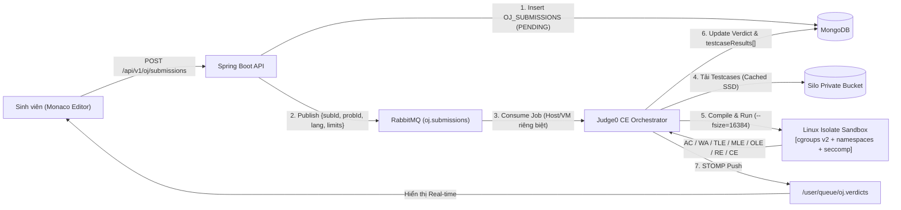

# TÀI LIỆU THIẾT KẾ CHI TIẾT KỸ THUẬT (LOW-LEVEL DESIGN - LLD)

**Tên dự án:** YITZone — Hệ thống Quản lý Hoạt động Đoàn - Hội & Học thuật Khoa Công nghệ Thông tin  
**Phiên bản:** 2.2.1 (Căn cứ trực tiếp theo `SRS_YITZone.md` 2.2.1 & `HLD_YITZone.md` 2.2.1 — Hoàn thiện theo `report03.md`)  
**Ngày lập:** 19/11/2026  
**Tài liệu liên kết:**  
- [Đặc tả Yêu cầu Phần mềm (SRS_YITZone.md)](./SRS_YITZone.md)  
- [Thiết kế Kiến trúc Mức cao (HLD_YITZone.md)](./HLD_YITZone.md)  

---

## MỤC LỤC
1. [Giới thiệu (Introduction)](#1-giới-thiệu-introduction)
2. [Thiết kế Chi tiết Phân quyền Động 2 Tầng (`Scoped Dynamic RBAC`)](#2-thiết-kế-chi-tiết-phân-quyền-động-2-tầng-scoped-dynamic-rbac)
3. [Mô hình Dữ liệu MongoDB Cốt lõi (ERD & Document Schemas)](#3-mô-hình-dữ-liệu-mongodb-cốt-lõi-erd--document-schemas)
4. [Đặc tả Chỉ mục Cơ sở Dữ liệu Bắt buộc (Mandatory MongoDB Indexes)](#4-đặc-tả-chỉ-mục-cơ-sở-dữ-liệu-bắt-buộc-mandatory-mongodb-indexes)
5. [Thiết kế Chi tiết Luồng Tương tác Kỹ thuật (API, STOMP, Redis, Scheduler/Queue)](#5-thiết-kế-chi-tiết-luồng-tương-tác-kỹ-thuật-api-stomp-redis-schedulerqueue)
6. [Công thức Thuật toán & Quy chuẩn Xử lý Kỹ thuật 42 Trường hợp Biên (Edge Cases)](#6-công-thức-thuật-toán--quy-chuẩn-xử-lý-kỹ-thuật-42-trường-hợp-biên-edge-cases)

---

## 1. Giới thiệu (Introduction)

### 1.1. Mục đích tài liệu
Tài liệu Thiết kế Chi tiết Kỹ thuật (**LLD**) này cung cấp đặc tả chính xác ở mức mã nguồn và cơ sở dữ liệu (đồng bộ với [SRS_YITZone.md](./SRS_YITZone.md) v2.2.1 và [HLD_YITZone.md](./HLD_YITZone.md) v2.2.1) để đội ngũ lập trình (`yitzone-client` và `yitzone-server`) triển khai trực tiếp:
- Quy ước mã quyền nguyên tử (`Atomic Permissions`), **20 Gói Module Quyền**, tách quyền điểm danh nội bộ (`internal_event:host_attendance`) và cơ chế kiểm tra hết hạn/thu hồi quyền trên Redis ($\le 5\text{s}$).
- Toàn bộ hệ thống MongoDB Collections (bao gồm `OFFICIAL_DIRECTORY_ROSTER`, các bảng tuân thủ `NFR-PRIV`, `Device Token ECDSA P-256 PoP`, `Offline Scanner 15s`, `Quét mã vạch thẻ SV 1D & Hậu kiểm Walk-in`, `Chấm điểm rủi ro trọng số`, `Tách bảng khảo sát ẩn danh`, `Hệ thống Bình chọn Live Voting với VOTING_BALLOT_OUTBOX & VOTING_JUDGE_SCORES`, `Phiếu bàn giao tiền mặt COD_CASH_HANDOVERS`, `AUDIT_CHAIN_STATE`) kèm cấu trúc `Embedded` / `GeoJSON` / `Vector` và bảng **Mandatory Indexes**.
- Biểu đồ tuần tự kỹ thuật ở mức Endpoint REST, WebSocket STOMP topics (có kiểm tra quyền SUBSCRIBE kênh `.admin`), Redis data structures và Scheduler/RabbitMQ queues.
- Công thức toán học, quy chuẩn chống gian lận phù hợp giới hạn trình duyệt và cách triển khai kỹ thuật cho toàn bộ **42 trường hợp biên (Edge Cases)**.

---

## 2. Thiết kế Chi tiết Phân quyền Động 2 Tầng (`Scoped Dynamic RBAC`)

### 2.1. Tầng 1: Quyền Nguyên tử (Atomic Permissions — Backend Method Security)
Mọi thao tác kiểm tra qua `@PreAuthorize` và Custom `PermissionEvaluator` dưới Spring Security tuân theo cú pháp chuẩn:
`<module>:<action>:<scope_level>`

* **`<module>`:** `unit_hr`, `notification`, `internal_event`, `sv5t`, `award`, `duty`, `inventory`, `performance`, `survey`, `voting`, `portfolio`, `liveqa`, `qachat`, `event`, `attendance`, `blog`, `minigame`, `exam`, `rbac`, `oj`, `certificate`, `store`, `chatbot`, `audit`, `privacy`, `ai_budget`
* **`<action>`:** `view`, `create`, `update`, `delete`, `propose`, `execute`, `approve`, `publish`, `send`, `reply`, `claim`, `resolve`, `audit`, `review`, `override`, `unlock`, `assign`, `host`, `host_attendance`, `moderate`, `unmask`, `proctor`, `scan_barcode`, `track`, `fulfill`, `support`, `reconcile`, `train`, `export`, `manage`
* **`<scope_level>`:** `own` (Cá nhân), `team` (Cấp Tổ), `committee` (Cấp Ban — kế thừa đệ quy xuống các Tổ con), `event` (Theo Sự kiện được giao), `campaign` (Theo Chiến dịch bán hàng / bình chọn / xét thưởng được giao), `faculty` (Toàn Khoa)

### 2.2. Tầng 2: Bảng Mã hóa 20 Gói Module Quyền (`PERMISSION_MODULES`)

| `moduleCode` | Tên hiển thị trên UI | Tập quyền nguyên tử (`includedPermissions[]`) | Quy tắc Gán & Scope Validation |
| :--- | :--- | :--- | :--- |
| **`MOD_UNIT_HR_INTERNAL`** | Quản lý Nhân sự Ban/Tổ & Thông báo CTV | Phân tầng theo chức vụ (xem Bảng 3.3A SRS): `DeputyTeamLeader` (`unit_hr:view`, `unit_hr:propose`, `notification:send`), `TeamLeader` (`unit_hr:view`, `unit_hr:execute`, `notification:send`), `ViceCommitteeHead` (`unit_hr:view`, `unit_hr:propose`, `notification:send`), `CommitteeHead`/`BCH`/`BTV` (`unit_hr:view`, `unit_hr:propose`, `unit_hr:execute`, `unit_hr:approve`, `notification:send`). | Gán theo chức vụ trong `roleScopes` (tách 3 cấp Đề xuất/Thực hiện/Phê duyệt). **Không gán `unit_hr:delete` cho `DeputyTeamLeader`. Không gán cho CTV thường hoặc `SystemAdmin`.** |
| **`MOD_DEPT_EVENT_MEDIA`** | Nghiệp vụ CTV Ban Sự kiện & Truyền thông | `internal_event:create`, `internal_event:update`, `internal_event:view`, `internal_event:host_attendance` | Gán qua `ORG_UNITS.defaultDeptModules` của `EMFIT` (`scopeType = COMMITTEE`). **Dùng `internal_event:host_attendance` (không dùng `attendance:host`) để chặn CTV `EMFIT` mở điểm danh sự kiện cấp Khoa (`A16`). Không chứa `liveqa:moderate` và không chứa `unit_hr:*`.** |
| **`MOD_DEPT_SV5T`** | Nghiệp vụ CTV Ban Phát triển Phong trào SV5T | `sv5t:view`, `sv5t:track`, `award:view`, `award:review`, `internal_event:create`, `internal_event:update`, `internal_event:view`, `internal_event:host_attendance` | Gán cho Ban `SV5T` (`award:approve` giữ riêng cho Hội đồng/BTV; không tự chấm hồ sơ mình; sự kiện nội bộ cô lập trong `SV5T`). |
| **`MOD_DEPT_OFFICE`** | Nghiệp vụ CTV Ban Văn phòng (Trực & Kiểm kê) | `duty:view`, `duty:create`, `duty:update`, `inventory:view`, `inventory:create`, `inventory:update`, `inventory:audit`, `inventory:scan_barcode`, `internal_event:create`, `internal_event:update`, `internal_event:view`, `internal_event:host_attendance` | `duty:*` và `inventory:*` áp dụng `scopeType = FACULTY`; `internal_event:*` cô lập trong `OFIT`. **Không chứa `duty:approve`** (đơn hợp lệ duyệt tự động; ngoại lệ thuộc `MOD_DEPT_OFFICE_LEAD`). |
| **`MOD_DEPT_OFFICE_LEAD`**| Thẩm quyền Trưởng/Phó Ban Văn phòng | `duty:override`, `inventory:override` | Gán cho BCN Ban `OFIT` và mặc định thuộc BCH/BTV. |
| **`MOD_DEPT_ARTS`** | Nghiệp vụ CTV Ban Văn nghệ (Tiết mục & Source) | `performance:view`, `performance:create`, `performance:update`, `internal_event:create`, `internal_event:update`, `internal_event:view`, `internal_event:host_attendance` | Gán cho Ban `ARTIT`; sự kiện nội bộ cô lập trong `ARTIT`. |
| **`MOD_DEPT_ARTS_LEAD`** | Thẩm quyền Trưởng/Phó Ban Văn nghệ | `performance:approve`, `performance:unlock` | Gán cho Trưởng/Phó Ban `ARTIT` và mặc định thuộc BCH/BTV. |
| **`MOD_EVENT_OPS`** | Tổ chức & Điều phối Sự kiện Khoa | `event:view`, `event:create`, `event:update`, `attendance:view`, `attendance:host`, `attendance:scan_barcode`, `attendance:review`, `certificate:view` | Mặc định BCH/BTV; gán động cho Trưởng BTC theo `scopeType = EVENT`. **Không chứa `liveqa:*` và không chứa duyệt quyền lợi.** |
| **`MOD_ATTENDANCE_STAFF`**| Điểm danh, Quét Mã vạch Thẻ SV & Soát vé Hội trường | `attendance:view`, `attendance:host`, `attendance:scan_barcode`, `attendance:review`, `attendance:override` | Mặc định BCH/BTV; gán động cho nhóm Lễ tân/Điều phối theo `EVENT` (cho phép tải gói Offline Scanner, quét Vé QR 2D & Mã vạch thẻ SV 1D). |
| **`MOD_QUIZ_EXAM_HOST`** | Tổ chức Minigame, Live Q&A, Voting LED & Thi Trắc nghiệm | `minigame:create`, `minigame:update`, `minigame:host`, `liveqa:host`, `liveqa:moderate`, `voting:host`, `exam:create`, `exam:update`, `exam:proctor` | Mặc định BCH/BTV; gán động cho MC/Kỹ thuật/Coi thi theo `EVENT`. **Gói duy nhất sở hữu `liveqa:moderate` và điều khiển màn hình LED `voting:host` (`A17`).** |
| **`MOD_CMS_EDITORIAL`** | Biên tập & Xuất bản Truyền thông | `blog:view`, `blog:create`, `blog:update`, `blog:approve`, `blog:publish` | Mặc định BCH/BTV; gán động cho biên tập viên (`Tổ Truyền thông`). |
| **`MOD_STORE_MANAGER`** | Quản lý Bán hàng & Gây quỹ | `store:view`, `store:create`, `store:update`, `store:fulfill`, `store:scan_barcode`, `store:support`, `store:reconcile` | Mặc định BCH/BTV; gán động theo `CAMPAIGN` hoặc `FACULTY` (Thủ quỹ — bao gồm ký nhận bàn giao tiền mặt COD cuối ca). |
| **`MOD_STORE_BOOTH`** | Trực bàn Giao hàng Vật phẩm (QR / Mã vạch Thẻ SV) | `store:view`, `store:fulfill`, `store:scan_barcode` | Mặc định BCH/BTV; tự động kích hoạt trong khung giờ ca trực VP khi `attendanceStatus IN {ON_TIME, LATE}`. |
| **`MOD_OJ_MANAGER`** | Ra đề & Tổ chức Thi Online Judge | `oj:view`, `oj:create`, `oj:update`, `oj:approve` | Mặc định BCH/BTV; gán động cho Problem Setter (P3). |
| **`MOD_YITBOT_CURATOR`** | Biên soạn Kho Tri thức `YITBot` | `chatbot:view`, `chatbot:create`, `chatbot:update` | Mặc định BCH/BTV; gán động cho người soạn FAQ/bản nháp quy chế. **Không chứa `chatbot:approve` (chỉ BTV phê duyệt tri thức).** |
| **`MOD_YITBOT_FULL`** | Quản trị & Phê duyệt Dữ liệu AI `YITBot` | `chatbot:view`, `chatbot:create`, `chatbot:update`, `chatbot:approve`, `chatbot:train`, `ai_budget:manage` | Mặc định chỉ **BTV** (không ủy quyền CTV). |
| **`MOD_SURVEY_POLL`** | Khảo sát, Bình chọn (`Voting`) & Lấy ý kiến Sinh viên | `survey:view`, `survey:create`, `survey:update`, `survey:publish`, `survey:export`, `voting:view`, `voting:create`, `voting:update`, `voting:publish`, `voting:export` | Mặc định BCH/BTV; gán động theo `EVENT` hoặc `COMMITTEE`. **Không chứa `voting:host` (thuộc `MOD_QUIZ_EXAM_HOST`) và không chứa `voting:judge` (quyền chấm BGK kiểm tra trực tiếp theo `VOTING_CAMPAIGNS.judgeUserIds` — `A17`).** |
| **`MOD_QA_MESSENGER`** | Hộp thư Hỏi - Đáp & Nhắn tin Hỗ trợ BCH | `qachat:view`, `qachat:claim`, `qachat:reply`, `qachat:resolve` | Mặc định BCH/BTV (nhận 100% câu hỏi về Shared Inbox); gán động hạn chế khi BCH ủy quyền. |
| **`MOD_AUDIT_VIEWER`** | Kiểm toán Nhật ký Hệ thống (`Audit Log`) | `audit:view` | Mặc định chỉ **BTV** và **`SystemAdmin`** (chỉ đọc; không chứa quyền tra danh tính Live Q&A). |
| **`MOD_LIVEQA_UNMASK`** | Tra cứu Danh tính Câu hỏi Ẩn danh `Live Q&A` | `liveqa:unmask` | Mặc định chỉ **BTV**; có thể gán động theo `EVENT` cho *Trưởng BTC*. **Không cấp cho `SystemAdmin`.** |

### 2.3. Logic Giải nén Quyền, Kiểm tra Scope $O(1)$, Ràng buộc Sự kiện Nội bộ & Thu hồi $\le 5\text{s}$
1. **Mô hình Cây Đơn vị Lai (`ORG_UNITS`):** Lưu `parentId` + `ancestors: [ObjectId]`. Để kiểm tra một cán bộ có quyền tại `userScopeId` có được phép thao tác trên `targetUnit` hay không:
   ```java
   boolean hasScopeAccess = targetUnit.getId().equals(userScopeId)
       || targetUnit.getAncestors().contains(userScopeId); // O(1) lookup, hoặc dùng $graphLookup cho truy vấn cây
   ```
2. **Danh mục `ROLES` Đầy đủ & Nhiệm kỳ:** Collection `ROLES` bao gồm đầy đủ 8 mã vai trò: `COLLABORATOR`, `DEPUTY_TEAM_LEADER`, `TEAM_LEADER`, `VICE_COMMITTEE_HEAD`, `COMMITTEE_HEAD`, `EXECUTIVE_COMMITTEE` (`BCH`), `STANDING_COMMITTEE` (`BTV`), `SYSTEM_ADMIN`. Mỗi phần tử trong `USERS.roleScopes[]` lưu `{roleCode, unitId, scopeType, scopeId, termYear, startAt, endAt, expiresAt}` để phản ánh đúng mô hình `Người dùng — Chức vụ — Đơn vị — Nhiệm kỳ`.
3. **Tách biệt `MOD_DEPT_*` khỏi `ROLES` & Ràng buộc Cứng `internal_event:*` (`A16`):** Các bản ghi cấp Tổ/Ban trong `ROLES` chỉ gắn tập quyền `MOD_UNIT_HR_INTERNAL` theo đúng tầng quyền ở Bảng 2.2 (chống kế thừa chéo quyền chuyên môn giữa 4 Ban). Khi `PermissionEvaluator` đánh giá bất kỳ quyền `internal_event:create | update | host_attendance` đến từ gói `MOD_DEPT_*`, hệ thống **bắt buộc kiểm tra điều kiện kép trên đối tượng `Event`**:
   ```java
   boolean isValidInternalEventAccess = (event.getVisibility() == EventVisibility.INTERNAL_CTV)
       && (event.getBenefitTypes() == null || event.getBenefitTypes().isEmpty())
       && hasUnitScopeAccess(userGrantScopeId, event.getOrganizerUnitId());
   ```
   Nhờ vậy, ngay cả khi Ban `EMFIT` là `organizerUnitId` của các sự kiện cấp Khoa có cộng quyền lợi (`PUBLIC_FACULTY`), các CTV thường của `EMFIT` cũng bị chặn hoàn toàn (`403 Forbidden`) không thể tự mở/chiếu mã QR điểm danh của sự kiện cấp Khoa (`A16`).
4. **Phân quyền Giám khảo Theo Chiến dịch (`judgeUserIds` — `A17`):** Quyền nộp bảng điểm Ban Giám khảo tại `POST /api/v1/voting/campaigns/{id}/judge-scores` không gán qua gói quyền tĩnh mà được kiểm tra trực tiếp bằng `votingCampaign.getJudgeUserIds().contains(currentUserId)` (cho phép cả Giảng viên `STAFF_LECTURER` và Khách mời chuyên môn `TEMP_GUEST` chấm điểm đúng chiến dịch được chỉ định).
5. **Scope Compatibility & Module Grant Ceiling:** Khi gán gói quyền với `scopeType`, Validator kiểm tra node đích trong `ORG_UNITS`: `scopeType == TEAM` $\implies$ `unitType == TEAM`; `scopeType == COMMITTEE` $\implies$ `unitType == COMMITTEE`. Người gán (`grantor`) chỉ được gán `moduleCode` nếu `grantorEffectivePermissions.containsAll(module.includedPermissions)` và không được ủy quyền các quyền `Non-delegable` của `BTV`.
6. **Context Switcher (`X-Active-Scope-Id`):** Với người dùng kiêm nhiệm nhiều bản ghi trong `USERS.roleScopes[]`, Client gửi Header HTTP `X-Active-Scope-Id`. Backend đối chiếu Header này với danh sách Scope đang còn hiệu lực.
7. **Kiểm tra Hết hạn tại Thời điểm Đánh giá & Thu hồi $\le 5\text{s}$ (`NFR-SEC-06`):**
   * Cache Redis `rbac:permissions:{userId}` (`TTL = 15m`) lưu cấu trúc `EffectiveGrant[]`: `[{ permission, scopeType, scopeId, expiresAt }]` kèm `permissionVersion`.
   * **Chống lỗ hổng quyền hết hạn tự động:** Tại mỗi lần gọi `PermissionEvaluator.hasPermission(...)`, Backend **bắt buộc lọc `grant.expiresAt == null || grant.expiresAt.isAfter(Instant.now())`**. Do đó quyền có thời hạn (`FR-RBAC-03`) hết hiệu lực ngay lập tức đúng thời điểm `expiresAt` mà không sống dai tới 15 phút.
   * **So khớp `permissionVersion` & Redis Pub/Sub Multi-Replica Eviction:** Mỗi JWT Access Token mang claim `permVer`. Khi thu hồi quyền, hạ cấp chức vụ hoặc chạy `Term Rollover Wizard`, Backend tăng `USERS.permissionVersion` trong MongoDB, xóa `rbac:permissions:{userId}` trên Redis và phát sự kiện lên **Redis Pub/Sub channel `rbac:invalidate` (`{userId, newPermissionVersion}`)** để mọi replica server xóa cache cục bộ (L1 cache nếu có) và cập nhật `permVer` trong **$\le 5\text{ giây}$**.

---

## 3. Mô hình Dữ liệu MongoDB Cốt lõi (ERD & Document Schemas)

### 3.1. Sơ đồ Thực thể Kết hợp (Entity-Relationship Diagram)

```mermaid
erDiagram
    OFFICIAL_DIRECTORY_ROSTER ||--o| USERS : "đối chiếu dự phòng SSO (email -> studentCode/staffId)"
    USERS ||--o{ EVENT_REGISTRATIONS : "đăng ký (userId)"
    EVENTS ||--o{ EVENT_REGISTRATIONS : "thuộc sự kiện (eventId)"
    EVENTS ||--o{ EVENT_ATTENDANCES : "ghi nhận (eventId, sessionId, attendeeKey)"
    USERS ||--o{ EVENT_ATTENDANCES : "điểm danh / Auto-Link (userId)"
    EVENT_ATTENDANCES ||--o| ATTENDANCE_REVIEW_QUEUE : "hàng chờ hậu kiểm trọng số (attendanceId)"
    EVENTS ||--o{ OFFLINE_SCAN_BATCHES : "đồng bộ quét ngoại tuyến (eventId)"
    USERS ||--o{ PARTICIPATION_HISTORIES : "lưu lịch sử & E-Cert (userId)"
    EVENTS ||--o{ PARTICIPATION_HISTORIES : "cấp chứng nhận (eventId)"
    USERS ||--o{ NO_SHOW_PENALTIES : "tích lũy no-show (userId)"

    USERS ||--o{ DEVICE_TOKENS : "đăng ký khóa ECDSA P-256 PoP (userId)"
    USERS ||--o{ CONSENT_RECORDS : "lưu vết đồng ý dữ liệu (userId)"
    MAJOR_CONFIG ||--o{ USERS : "đối chiếu ngành cấu hình (majorCode)"

    ROLES ||--o{ ROLES : "đệ quy kế thừa (parentRoleCode)"
    ROLES ||--o{ USERS : "nhúng trong users.roleScopes[]"
    PERMISSION_MODULES ||--o{ ROLES : "đóng gói trong roles.moduleCodes[]"
    PERMISSION_MODULES ||--o{ USERS : "gán nhanh trong users.assignedModules[]"
    ORG_UNITS ||--o{ ORG_UNITS : "đệ quy cây đơn vị (parentId / ancestors[])"
    ORG_UNITS ||--o{ USERS : "tham chiếu scopeId"

    USERS ||--o{ BLOG_POSTS : "viết bài (authorId)"
    ORG_UNITS ||--o{ BLOG_POSTS : "thuộc ban biên soạn (unitId)"

    EVENTS ||--o{ MINIGAME_ROOMS : "tổ chức (eventId)"
    QUIZZES ||--o{ MINIGAME_ROOMS : "sử dụng bộ đề (quizId)"
    EVENTS ||--o{ EVENT_EXAMS : "gắn cuộc thi trắc nghiệm (eventId)"
    EVENT_EXAMS ||--o{ EXAM_ATTEMPTS : "ghi nhận bài thi (examId)"
    USERS ||--o{ EXAM_ATTEMPTS : "dự thi (userId)"

    AWARD_CAMPAIGNS ||--o{ AWARD_APPLICATIONS : "nhận hồ sơ (campaignId)"
    USERS ||--o{ AWARD_APPLICATIONS : "nộp hồ sơ (userId)"

    OJ_PROBLEMS ||--o{ OJ_SUBMISSIONS : "nhận bài nộp (problemId)"
    USERS ||--o{ OJ_SUBMISSIONS : "nộp code (userId)"
    OJ_CONTESTS ||--o{ OJ_SUBMISSIONS : "thuộc kỳ thi (contestId)"

    FUNDRAISING_CAMPAIGNS ||--o{ STORE_PRODUCTS : "bao gồm vật phẩm (campaignId)"
    STORE_CATEGORIES ||--o{ STORE_PRODUCTS : "phân nhóm & kế thừa hình thức nhận (categoryId)"
    STORE_PRODUCTS ||--o{ STORE_ORDERS : "được đặt trong orders.items[]"
    STORE_VOUCHERS ||--o{ STORE_ORDERS : "áp dụng giảm giá (voucherId)"
    USERS ||--o{ STORE_ORDERS : "đặt mua (buyerId)"
    STORE_ORDERS ||--o{ PAYMENT_TRANSACTIONS : "đối soát thanh toán (orderId)"
    STORE_ORDERS }o--o| COD_CASH_HANDOVERS : "bàn giao tiền mặt COD cuối ca (codHandoverId)"
    STORE_ORDERS ||--o{ ORDER_SUPPORT_REQUESTS : "đổi size / hoàn tiền (orderId)"

    USERS ||--o{ KNOWLEDGE_DOCUMENTS : "biên soạn & BTV duyệt (creatorUserId / approvedBy)"
    USERS ||--o{ CHAT_SESSIONS : "trò chuyện với YITBot (userId)"
    USERS ||--o{ AI_USAGE_LEDGER : "đếm token & ngân sách AI (userId)"
    OFFICE_DUTY_SCHEDULES ||--o{ OFFICE_DUTY_SHIFTS : "gồm các ca trực (scheduleId)"
    USERS ||--o{ OFFICE_DUTY_SHIFTS : "đăng ký & trực ca (assignedAttendees[])"
    OFFICE_ASSETS ||--o{ OFFICE_INVENTORY_AUDITS : "kiểm kê vật dụng (items[].assetId)"
    USERS ||--o{ OFFICE_INVENTORY_AUDITS : "lập biên bản kiểm kê (auditorUserId)"
    EVENTS ||--o{ PERFORMANCE_ACTS : "gồm các tiết mục văn nghệ (eventId)"
    USERS ||--o{ PERFORMANCE_ACTS : "biểu diễn trong tiết mục (performers[].userId)"

    AUDIT_CHAIN_STATE ||--o{ AUDIT_LOGS : "cấp seq & prevHash tuần tự nguyên tử"
    USERS ||--o{ AUDIT_LOGS : "thực hiện thao tác hash-chain (actorId)"
    USERS ||--o{ NOTIFICATIONS : "nhận thông báo (recipientUserId)"
    USERS ||--o{ PUSH_SUBSCRIPTIONS : "đăng ký nhận Web Push PWA (userId)"
    USERS ||--o{ QA_CONVERSATIONS : "mở luồng hỏi - đáp BCH (studentId / assignedBchUserId)"
    QA_CONVERSATIONS ||--o{ QA_MESSAGES : "chứa tin nhắn trao đổi 2 chiều (conversationId)"
    EVENTS ||--o{ SURVEYS : "gắn biểu mẫu khảo sát (eventId)"
    SURVEYS ||--o{ SURVEY_PARTICIPATIONS : "chống gửi trùng (surveyId, userId)"
    SURVEYS ||--o{ SURVEY_RESPONSES : "lưu câu trả lời tách rời (surveyId — ẩn danh không chứa userId)"
    EVENTS ||--o{ VOTING_CAMPAIGNS : "tổ chức bình chọn / biểu quyết (eventId)"
    PERFORMANCE_ACTS ||--o{ VOTING_CAMPAIGNS : "liên kết tiết mục ứng viên (candidates[].linkedPerformanceActId)"
    VOTING_CAMPAIGNS ||--o{ VOTING_VOTER_LOGS : "khóa 1 cử tri / 1 lượt bầu (_id UUIDv4, campaignId, userId)"
    VOTING_CAMPAIGNS ||--o{ VOTING_BALLOT_OUTBOX : "thùng đệm ACID chờ trộn lô (_id UUIDv4, không userId)"
    VOTING_CAMPAIGNS ||--o{ VOTING_BALLOTS : "thùng phiếu chính thức đã xáo trộn (_id UUIDv4, phiếu kín không userId)"
    VOTING_CAMPAIGNS ||--o{ VOTING_JUDGE_SCORES : "bảng điểm BGK định danh độc lập (campaignId, judgeUserId)"
    USERS ||--o{ SV5T_PROGRESS_TRACKING : "theo dõi tiến độ (userId)"
    USERS ||--o| STUDENT_PORTFOLIOS : "sở hữu Hồ sơ năng lực số (userId)"
    EVENTS ||--o{ LIVE_QA_SESSIONS : "mở bức tường Hỏi-Đáp (eventId)"
    LIVE_QA_SESSIONS ||--o{ LIVE_QA_QUESTIONS : "chứa câu hỏi hội trường (sessionId)"
    USERS ||--o{ LIVE_QA_QUESTIONS : "đặt câu hỏi & Upvote (authorUserId)"
```



### 3.2. Đặc tả Chi tiết Từng Collection (Document Schemas)

```mermaid
erDiagram
    USERS {
        ObjectId _id PK
        string userType "STUDENT | STAFF_LECTURER | GRAD_SECOND_DEGREE | TEMP_GUEST"
        string studentCode UK "Sparse Unique Nullable: MSSV từ OIDC claim hoặc OFFICIAL_DIRECTORY_ROSTER (B2)"
        string staffId UK "Sparse Unique Nullable: Mã cán bộ/giảng viên (không có MSSV)"
        string email UK "Email trường (hoặc email mời với TEMP_GUEST)"
        string personalEmail "Nullable: Email cá nhân dự phòng sau tốt nghiệp"
        boolean isPersonalEmailVerified "Đã xác thực OTP"
        date personalEmailVerifiedAt
        string fullName
        string className
        int cohort "Nullable: Khóa AA"
        string majorCode "Nullable: Mã ngành đối chiếu động qua MAJOR_CONFIG"
        object facultyOverride "Embedded: {enabled: boolean, effectiveDate: date, reason: string, approvedBy: ObjectId, approvedAt: date}"
        string portraitPhotoUrl "Nullable: Private Silo URL ảnh chân dung vé (cần Consent)"
        string lifecycleStatus "ACTIVE_STUDY | GRADUATED | ARCHIVED"
        string memberStatus "Nullable (CTV): ACTIVE | ON_LEAVE | LEFT"
        long permissionVersion "Tăng mỗi khi đổi/thu hồi quyền để so khớp JWT/Redis <= 5s"
        array roleScopes "Embedded: [{roleCode, unitId, scopeType, scopeId, termYear, startAt, endAt, expiresAt}]"
        array assignedModules "Embedded: [{moduleCode, scopeType, scopeId, expiresAt}]"
        array termHistory "Embedded: [{termYear, unitName, positionTitle, startAt, endAt}]"
        date tempGuestExpiresAt "Nullable: Hạn tài khoản tạm của khách mời sự kiện"
        date lastLoginAt
    }

    OFFICIAL_DIRECTORY_ROSTER {
        ObjectId _id PK
        string email UK "Email trường chính thức từ file CSV/Excel Phòng Đào tạo / CTSV (B2)"
        string userType "STUDENT | STAFF_LECTURER | GRAD_SECOND_DEGREE"
        string studentCode UK "Sparse Unique: MSSV chính thức dùng gán tự động nếu SSO không trả custom claim"
        string staffId UK "Sparse Unique: Mã cán bộ/giảng viên"
        string fullName
        string className
        string majorCode
        string importedTerm "VD: 2026-2027-HK1"
        ObjectId importedBy FK "BTV thực hiện import"
        date importedAt
    }

    MAJOR_CONFIG {
        ObjectId _id PK
        string majorCode UK "Mã ngành (khởi tạo mặc định: 110, 162, 133 — cấu hình động bởi BTV)"
        string majorName "Tên ngành đào tạo"
        string facultyCode "Mặc định FIT"
        boolean isCddnEligible "Cho phép tự động tích lũy chuẩn CĐDN Khoa CNTT"
        boolean isActive
        ObjectId updatedBy FK
        date updatedAt
    }

    DEVICE_TOKENS {
        ObjectId _id PK
        ObjectId userId FK
        string tokenHash UK "Hash của Server-issued HttpOnly Cookie Token (yitz_dt) / WebAuthn ID (A2)"
        string deviceLabel "Nhãn trình duyệt/thiết bị thân thiện"
        string publicKeyJwk "Khóa công khai ECDSA P-256 (WebCrypto extractable=false) xác thực PoP & vé offline (A2, A9)"
        boolean isRegisteredKiosk "True nếu là thiết bị BTC đăng ký làm Quầy Kiosk Voting (miễn kiểm tra trùng thiết bị - A7)"
        date registeredAt
        date lastUsedAt
        boolean isRevoked
    }

    CONSENT_RECORDS {
        ObjectId _id PK
        ObjectId userId FK
        string consentType "INITIAL_PRIVACY | PORTRAIT_TICKET | AI_USAGE | LOCATION_CHECKIN"
        string policyVersion "VD: v2026.1"
        boolean granted
        date grantedAt
        date revokedAt
    }

    ORG_UNITS {
        ObjectId _id PK
        string unitCode UK "VD: FIT, EMFIT, SV5T, OFIT, ARTIT, EMFIT_TIEP_UNG..."
        string name "Tên Khoa / Ban / Tổ"
        string unitType "FACULTY | COMMITTEE | TEAM | SUBGROUP"
        ObjectId parentId FK "Đệ quy trỏ lên đơn vị Cha trực tiếp"
        ObjectId_array ancestors "Mảng tổ tiên [rootId, ..., parentId] hỗ trợ kiểm tra Scope O(1)"
        string_array defaultDeptModules "Module chuyên môn mặc định của Ban (VD: EMFIT -> [MOD_DEPT_EVENT_MEDIA])"
        string termYear "Nhiệm kỳ (VD: 2026-2027)"
        boolean isActive
    }

    PERMISSION_MODULES {
        ObjectId _id PK
        string moduleCode UK "20 mã gói: MOD_UNIT_HR_INTERNAL, MOD_DEPT_*, MOD_AUDIT_VIEWER, MOD_LIVEQA_UNMASK..."
        string name "Tên hiển thị của Gói Module Quyền"
        string description "Mô tả chức năng của Gói Module"
        string_array includedPermissions "Tập quyền nguyên tử thuộc gói"
        boolean isSystemDefault
    }

    ROLES {
        ObjectId _id PK
        string code UK "COLLABORATOR | DEPUTY_TEAM_LEADER | TEAM_LEADER | VICE_COMMITTEE_HEAD | COMMITTEE_HEAD | EXECUTIVE_COMMITTEE | STANDING_COMMITTEE | SYSTEM_ADMIN"
        string name
        string parentRoleCode FK "Đệ quy kế thừa từ Role cấp dưới (Chỉ quyền HR chung, không chứa MOD_DEPT_*)"
        int hierarchyLevel "Cấp bậc kiểm tra Grant Ceiling"
        string_array moduleCodes "Mảng Gói Module Quyền gắn với Role"
        string_array permissions "Mảng quyền bổ sung (nếu có)"
    }

    EVENTS {
        ObjectId _id PK
        string title "Tên sự kiện"
        ObjectId organizerUnitId FK "Ban/Tổ phụ trách tổ chức"
        string visibility "PUBLIC_FACULTY | INTERNAL_CTV"
        date startTime "Thời gian bắt đầu sự kiện"
        date endTime "Thời gian kết thúc sự kiện"
        date registrationStartTime "Mở cổng đăng ký"
        date registrationEndTime "Đóng cổng đăng ký"
        date listLockAt "Giờ khóa danh sách (mặc định startTime - 60 phút)"
        string academicYear "Năm học (VD: 2026-2027)"
        string semester "Học kỳ (VD: HK1 | HK2 | HK_SUMMER)"
        string sv5tCriterion "NONE | ETHICS | STUDY | FITNESS | VOLUNTEER | INTEGRATION"
        boolean requireCheckout "Yêu cầu điểm danh 2 chiều (Mặc định true nếu hội trường kín có quyền lợi - A1)"
        int minPresencePercent "Tỷ lệ thời gian hiện diện tối thiểu (VD: 70%)"
        string qrCheckinMode "DYNAMIC_ROTATING_QR (Mặc định) | STATIC_QR (Ngoài trời)"
        int qrRotationSeconds "Chu kỳ đổi QR động (Mặc định: 10s)"
        int qrNetworkGraceSeconds "Ngưỡng trễ mạng cấu hình N (Mặc định: 8s, khoảng 5-15s)"
        string qrSigningKeyId "ID cặp khóa bất đối xứng ECDSA P-256 trên Server (không dùng secret đối xứng - A9)"
        boolean allowBarcodeWalkIn "Mặc định false cho mọi sự kiện có quyền lợi (ĐRL/CTXH/CĐDN - A3)"
        string_array barcodeFormatsAllowed "Mặc định: [CODE_128, CODE_39] khớp regex MSSV 8 số (Bỏ EAN_13 mặc định - A24)"
        int hidCharIntervalThresholdMs "Ngưỡng thời gian giữa 2 ký tự súng quét HID cấu hình được (Mặc định: 40ms, dải 30-50ms - A24)"
        boolean isIndoorNoGpsMode "Hội trường kín/tầng hầm (mất GPS đơn lẻ không đẩy hàng chờ khi đã có Check-out bù)"
        int riskReviewThreshold "Tổng ĐIỂM TRỌNG SỐ rủi ro tối thiểu đẩy vào Hàng chờ Hậu kiểm (Mặc định: 2 điểm - A1)"
        int minRequiredSessions "Số buổi tối thiểu K/N cần đạt để hoàn thành sự kiện nhiều buổi"
        array attendanceSessions "Embedded: [{sessionId, title, startTime, endTime, isRequired, checkinLocation: GeoJSON, checkinRadiusMeters: int, checkoutLocation: GeoJSON, checkoutRadiusMeters: int}]"
        object noShowPolicy "Embedded: {enabled: boolean, thresholdCount: 3, lockDurationDays: 14}"
        int maxAttendees "Số lượng sinh viên tham dự tối đa"
        string organizerRecruitmentScope "INTERNAL_CTV_ONLY | FACULTY_WIDE"
        array organizerPositions "Embedded: [{role: MC|RECEPTIONIST|LOGISTICS|COORDINATOR|MEDIA|PERFORMANCE|TECHNICAL, isEnabled: boolean, description}]"
        object registrationFormConfig "Embedded: {attendeeMode: ONE_CLICK|CUSTOM_FORM, attendeeCustomFields[], organizerCustomFields[]}"
        ObjectId surveyId FK "Nullable: Biểu mẫu khảo sát gắn kèm sau sự kiện"
        boolean requireSurveyForCert "Bắt buộc hoàn thành khảo sát mới cấp E-Cert"
        boolean exemptOrganizersFromSurvey "Miễn trừ khảo sát cho thành viên BTC"
        array benefitTypes "Embedded định lượng: [{type: DRL|CTXH|CDDN, value: double, unit: string}]"
        string status "DRAFT | PENDING_APPROVAL | REVISION_REQUESTED | REJECTED | PUBLISHED | REGISTRATION_CLOSED | ONGOING | POSTPONED | COMPLETED | FINALIZED | CANCELLED"
    }

    EVENT_REGISTRATIONS {
        ObjectId _id PK
        ObjectId eventId FK
        ObjectId userId FK
        string registrationType "ATTENDEE | ORGANIZER"
        string organizerPosition "NV1 (Chính thức): MC | RECEPTIONIST | LOGISTICS | COORDINATOR | MEDIA | PERFORMANCE | TECHNICAL"
        string secondaryOrganizerPosition "Nullable (NV2 dự phòng khi ứng tuyển BTC)"
        string_array secondaryRoles "Mảng vai trò phụ kiêm nhiệm (VD: [PERFORMANCE])"
        string note "Ghi chú kinh nghiệm khi đăng ký BTC"
        array formAnswers "Embedded: [{fieldId, labelSnapshot, fieldType: SHORT_TEXT|LONG_TEXT|SINGLE_CHOICE|CONSENT_CHECKBOX, answerValue: string|boolean}]"
        string status "REGISTERED | WAITLIST | PROMOTED_HOLD | APPROVED | REJECTED | CANCELLED"
        date holdExpiresAt "Nullable: Hạn giữ chỗ Waitlist T phút (30p hoặc 10p sát giờ)"
        date registeredAt
    }

    EVENT_ATTENDANCES {
        ObjectId _id PK
        ObjectId eventId FK
        string sessionId "Mã buổi trong EVENTS.attendanceSessions[] (mặc định DEFAULT cho SK 1 buổi)"
        string attendeeKey "Bắt buộc Non-null: ('SV:' + studentCodeSnapshot) ?? ('CB:' + staffId) ?? ('U:' + userId) — Chống lỗi trùng null (A4, A15)"
        ObjectId userId FK "Nullable khi quét mã vạch thẻ SV vãng lai chưa đăng nhập SSO lần đầu (PENDING_SSO_LINK)"
        string studentCodeSnapshot "Nullable với Giảng viên/Khách mời; MSSV 8 số khớp regex ^[0-9]{8}$ với SV (FR-ATT-09)"
        string ssoLinkStatus "LINKED | PENDING_SSO_LINK"
        date ssoLinkedAt "Nullable: Thời điểm tự động ghép userId khi tân SV đăng nhập SSO lần đầu"
        date orphanExpiresAt "Nullable: Hạn tự động xóa bản ghi PENDING_SSO_LINK mồ côi sau max(180d, hết học kỳ) (A3, B9)"
        date checkinAt "Thời điểm ghi nhận theo server (hoặc adjustedScanAt nếu đồng bộ offline)"
        date checkoutAt
        string source "SELF_DYNAMIC_QR | SELF_STATIC_QR | BTC_OFFLINE_SCAN | BTC_ONLINE_SCAN | BTC_BARCODE_ONLINE | BTC_BARCODE_OFFLINE | MANUAL_OVERRIDE"
        string barcodeHardwareType "Nullable: CAMERA_1D | USB_BLUETOOTH_HID"
        boolean physicalCardVerifiedByStaff "Lễ tân xác nhận đã đối chiếu ảnh in trên thẻ nhựa vật lý (A3)"
        string checkinDeviceTokenId FK "Tham chiếu DEVICE_TOKENS._id đã xác minh chữ ký ECDSA P-256 PoP (Không nhận từ body - A2)"
        string checkoutDeviceTokenId FK
        GeoJSON checkinLocation "Nullable GeoJSON Point: [lng, lat]"
        double gpsAccuracyMeters
        GeoJSON checkoutLocation "Nullable GeoJSON Point"
        double checkoutGpsAccuracyMeters
        string_array riskFlags "Mạnh (+2đ): DEVICE_TOKEN_COLLISION | GPS_FAR_OUT_OF_RANGE | IMPOSSIBLE_VELOCITY | DUPLICATE_OFFLINE_TICKET_SCAN | BARCODE_WALKIN_UNVERIFIED ; Yếu (+1đ): GPS_MODERATE_DRIFT | GPS_UNAVAILABLE | ABNORMAL_ACCURACY | NEW_EPHEMERAL_DEVICE (A1, A3, A10)"
        int riskScore "Tổng ĐIỂM TRỌNG SỐ rủi ro (Weighted Risk Score - A1)"
        string reviewStatus "AUTO_ACCEPTED | ACCEPTED_LOW_RISK | PENDING_REVIEW | REVIEW_APPROVED | REVIEW_REJECTED"
        string scannerDeviceId "Nullable: ID máy BTC quét vé/mã vạch (nếu quét offline/online bởi BTC)"
        date syncedAt "Nullable: Thời điểm đồng bộ từ máy BTC offline"
        int localSeq "Nullable: Số thứ tự hàng đợi cục bộ trên máy BTC offline"
        boolean isManualOverride
        ObjectId overrideBy FK
        string overrideReason
    }

    ATTENDANCE_REVIEW_QUEUE {
        ObjectId _id PK
        ObjectId attendanceId UK "1-1 với bản ghi EVENT_ATTENDANCES có tổng điểm trọng số riskScore >= riskReviewThreshold (Mặc định >= 2)"
        ObjectId eventId FK
        string sessionId
        ObjectId userId FK
        string_array riskFlags
        int riskScore "Tổng điểm trọng số rủi ro"
        string status "PENDING | APPROVED | REJECTED"
        date reviewDeadlineAt "Hạn chót duyệt hậu kiểm (endTime + 48 giờ)"
        ObjectId reviewedBy FK
        date reviewedAt
        string reviewNote
        boolean isBulkApproved "Chỉ cho phép với nhóm tín hiệu yếu cùng ngữ cảnh; cấm bulk-approve tín hiệu mạnh (+2đ)"
    }

    OFFLINE_SCAN_BATCHES {
        ObjectId _id PK
        string batchId UK "Idempotency key mỗi gói đồng bộ từ máy BTC"
        ObjectId eventId FK
        string sessionId
        ObjectId scannerUserId FK
        string scannerDeviceId
        date lastServerSyncAt "Mốc máy BTC tải gói dữ liệu mã hóa AES-GCM (hiệu lực <= 12h - A14, A34)"
        long clockOffsetMs "serverTime - deviceTime đo lúc tải gói"
        date uploadedAt
        date bundleWipedConfirmedAt "Thời điểm máy BTC xác nhận đã tự xóa sạch gói dữ liệu cục bộ sau đồng bộ (A14)"
        array scans "Embedded: [{localSeq, scanMethod: QR_ECDSA_P256_15S|BARCODE_1D, userId, studentCode, ticketId, scanType: CHECKIN|CHECKOUT, physicalCardVerified: boolean, deviceScannedAt, adjustedScanAt, resolutionStatus: ACCEPTED|PENDING_REVIEW|PENDING_SSO_LINK|DUPLICATE_FLAGGED|INVALID}]"
    }

    NO_SHOW_PENALTIES {
        ObjectId _id PK
        ObjectId userId FK
        string academicYear
        string semester
        ObjectId_array missedEventIds
        int strikeCount
        boolean isLocked
        date lockStartAt
        date lockEndAt
        ObjectId unlockedBy FK
        string unlockReason
    }

    PARTICIPATION_HISTORIES {
        ObjectId _id PK
        ObjectId userId FK
        ObjectId eventId FK
        string eventTitleSnapshot "Lưu snapshot tên sự kiện"
        string academicYear "Năm học (VD: 2026-2027)"
        string semester "Học kỳ (VD: HK1 | HK2 | HK_SUMMER)"
        array benefits "Embedded định lượng: [{type: DRL|CTXH|CDDN, value: double, unit: string}]"
        boolean isBenefitOverridden "Cờ can thiệp thủ công quyền lợi (CDDN...)"
        ObjectId overrideBy FK "Người can thiệp thủ công"
        string overrideReason "Lý do can thiệp thủ công"
        string participationRole "ATTENDEE | ORGANIZER"
        string organizerPosition "MC | RECEPTIONIST | LOGISTICS | COORDINATOR | MEDIA | PERFORMANCE | TECHNICAL"
        string_array secondaryRoles "Mảng vai trò phụ kiêm nhiệm (VD: [PERFORMANCE])"
        string certificateCode UK "Mã serial tra cứu E-Certificate"
        int certVersion "Phiên bản chứng nhận (bắt đầu từ 1, tăng khi cấp lại)"
        string certStatus "VALID | REVOKED | SUPERSEDED"
        string revokedReason "Nullable: Lý do thu hồi bắt buộc khi certStatus = REVOKED"
        ObjectId revokedBy FK
        date revokedAt
        ObjectId supersededBy FK "Nullable: Trỏ sang bản ghi E-Cert mới hơn"
        string certificatePdfUrl "Đường dẫn file PDF trên Silo"
        date issuedAt
    }

    BLOG_POSTS {
        ObjectId _id PK
        string title "Tiêu đề bài viết"
        string slug UK "Đường dẫn SEO"
        string content "Nội dung bài viết định dạng Markdown/Rich-text"
        string coverImageUrl "Ảnh bìa đại diện"
        ObjectId authorId FK "Tác giả bài viết"
        ObjectId unitId FK "Đơn vị Ban/Tổ biên soạn"
        string_array tags "Tags phân loại [TIN_TUC, HOC_THUAT, TUYEN_DUNG...]"
        string status "DRAFT | TEAM_REVIEW | COMMITTEE_REVIEW | PUBLISHED | REJECTED"
        date scheduledPublishAt "Hẹn giờ đăng bài tự động"
        date publishedAt
        int viewCount
    }

    FUNDRAISING_CAMPAIGNS {
        ObjectId _id PK
        string title "VD: Gây quỹ Xuân Tình Nguyện 2027"
        string description "Mô tả mục đích chiến dịch"
        string bannerImageUrl "Ảnh bìa đại diện chiến dịch"
        date startDate "Ngày mở chiến dịch"
        date endDate "Hạn chót chiến dịch"
        ObjectId organizerUnitId FK "Ban/Đội phụ trách"
        long targetAmountVnd "Mục tiêu lợi nhuận gây quỹ (VNĐ)"
        long totalRevenueVnd "Tổng doanh thu tiền hàng thực thu (cộng khi đơn PAID hoặc COD_CONFIRMED)"
        long totalCostOfGoodsVnd "Tổng giá vốn của hàng ĐÃ GIAO / CHỐT XUẤT (cộng tại thời điểm fulfill - A13)"
        long totalRefundedVnd "Tổng số tiền đã hoàn lại qua hỗ trợ đơn hàng"
        long netProfitFundVnd "Lợi nhuận thực góp quỹ = totalRevenueVnd - totalCostOfGoodsVnd - totalRefundedVnd"
        long totalClassroomDeliveryFeeVnd "Phí giao phòng học hạch toán tách biệt"
        object bankAccountConfig "Embedded: {bankBin, accountNo, accountName, isOrgAccount: boolean, approvalStatus: PENDING|APPROVED|REJECTED, approvedByBtvId: ObjectId, approvedAt: date}"
        string status "DRAFT | OPEN | CLOSED"
    }

    STORE_CATEGORIES {
        ObjectId _id PK
        string code UK "VD: UNIFORM_APPAREL, ACCESSORY, FUNDRAISING_FOOD_DRINK"
        string name "Tên danh mục"
        string_array allowedDeliveryMethods "Mặc định: [OFFICE_PICKUP, CLASSROOM_DELIVERY]"
        object deliveryFeeConfig "Embedded: {classroomDeliveryFeeVnd: 0..5000, maxClassroomWeightGrams: 5000}"
        boolean isActive
    }

    STORE_PRODUCTS {
        ObjectId _id PK
        string name "VD: Áo thun Khoa CNTT / Dây đeo thẻ"
        ObjectId categoryId FK "Danh mục sản phẩm (STORE_CATEGORIES)"
        string productType "FACULTY_MERCH | FUNDRAISING_ITEM"
        ObjectId campaignId FK "Nullable nếu là vật phẩm thường trực của Khoa"
        boolean isPreOrder "Cho phép đặt trước để chốt số lượng may"
        string_array allowedDeliveryMethods "Kế thừa từ Category: [OFFICE_PICKUP, CLASSROOM_DELIVERY]"
        string promotionalBadge "Nhãn ưu đãi (VD: Ưu đãi Tân SV | Early Bird)"
        date saleStartAt "Thời điểm bắt đầu áp giá ưu đãi"
        date saleEndAt "Thời điểm kết thúc áp giá ưu đãi"
        array variants "Embedded: [{sku, sizeName, color, weightGrams, costPriceVnd, originalPriceVnd, salePriceVnd, isOnSale: boolean, stockQuantity}]"
        string status "ACTIVE | OUT_OF_STOCK | ARCHIVED"
    }

    STORE_VOUCHERS {
        ObjectId _id PK
        string voucherCode UK "Mã giảm giá (VD: YITZ-WELCOME26, FREECLASS)"
        string title "Tên chương trình mã giảm giá"
        string discountType "FIXED_AMOUNT | PERCENTAGE | CLASSROOM_DELIVERY_DISCOUNT"
        long discountValue "Số tiền giảm (VNĐ), % giảm (1-100) hoặc mức giảm phí giao phòng"
        long maxDiscountVnd "Mức giảm tối đa (VNĐ) khi dùng PERCENTAGE"
        long minOrderAmountVnd "Giá trị đơn hàng tối thiểu để áp mã"
        string applicableScope "ALL_STORE | CAMPAIGN_SPECIFIC | CATEGORY_SPECIFIC | PRODUCT_SPECIFIC"
        ObjectId_array targetIds "Danh sách campaignId / categoryId / productId áp dụng"
        boolean isStackableWithSalePrice "Cho phép áp chồng lên sản phẩm đang hưởng Giá ưu đãi"
        int usageLimit "Tổng số lượt sử dụng tối đa toàn hệ thống"
        int usedCount "Số lượt đã sử dụng (hoặc đang giữ chỗ)"
        int perUserLimit "Giới hạn số lần dùng trên 1 sinh viên (VD: 1)"
        date startDate
        date endDate
        string status "ACTIVE | EXPIRED | DEPLETED | DISABLED"
    }

    STORE_ORDERS {
        ObjectId _id PK
        string orderCode UK "Mã đơn (VD: YITZ-ORD261101)"
        ObjectId buyerId FK "Sinh viên đặt mua (Giới hạn tối đa 2 đơn PENDING_COD cùng lúc - B3)"
        ObjectId campaignId FK
        array items "Embedded: [{productId, productName, sku, sizeName, quantity, weightGrams, costPriceVnd, originalPriceVnd, appliedUnitPriceVnd, isSalePriceApplied: boolean}]"
        int totalWeightGrams "Tổng khối lượng giỏ hàng = sum(quantity * weightGrams)"
        long subtotalAmountVnd "Tổng tiền hàng (sau giá ưu đãi)"
        long totalCostOfGoodsVnd "Tổng giá vốn đơn hàng (chỉ cộng vào chiến dịch khi fulfill - A13)"
        ObjectId voucherId FK "Nullable: Voucher đã áp dụng"
        string voucherCodeSnapshot "Mã voucher lưu vết"
        long voucherDiscountVnd "Số tiền giảm trực tiếp vào tiền hàng"
        long baseDeliveryFeeVnd "Phí giao phòng học gốc (0 với OFFICE_PICKUP; 0..5000đ với CLASSROOM_DELIVERY)"
        long deliveryDiscountVnd "Số tiền giảm phí giao phòng"
        long deliveryFeeVnd "Phí giao phòng thực thu = max(0, baseDeliveryFeeVnd - deliveryDiscountVnd)"
        long totalAmountVnd "Tổng thanh toán cuối = (subtotal - voucherDiscount) + deliveryFee"
        string paymentMethod "VIETQR_TRANSFER | COD"
        string paymentProofUrl "Nullable: Ảnh biên lai tham chiếu (Thủ quỹ đối chiếu sao kê)"
        date codDueAt "Nullable: Hạn chót nhận hàng COD (Mặc định createdAt + 3 ngày làm việc; quá hạn tự hủy & hoàn kho - A12, B3)"
        ObjectId codConfirmedBy FK "Nullable: CTV xác nhận thu đủ tiền mặt COD lúc quét QR/Mã vạch thẻ SV giao hàng"
        date codConfirmedAt
        long codAmountCollectedVnd
        ObjectId codHandoverId FK "Nullable: Phiếu bàn giao tiền mặt COD cuối ca cho Thủ quỹ (COD_CASH_HANDOVERS - B3)"
        string deliveryMethod "OFFICE_PICKUP | CLASSROOM_DELIVERY"
        object deliveryDetails "Embedded: {recipientName, recipientPhone, campusCode, buildingCode, classroomCode, studyShiftNote}"
        string status "PENDING_PAYMENT | PENDING_COD | PAID | COD_CONFIRMED | PAID_REFUND_PENDING | REFUNDED | COMPLETED | CANCELLED"
        string pickupQrToken UK "Mã QR nhận hàng (hiển thị nổi bật chờ thu tiền nếu PENDING_COD)"
        ObjectId verifiedBy FK "Thủ quỹ/Cán bộ xác nhận đối soát sao kê"
        ObjectId fulfilledBy FK "CTV đã giao hàng"
        date fulfilledAt
        date createdAt
    }

    COD_CASH_HANDOVERS {
        ObjectId _id PK
        string handoverCode UK "Mã phiếu bàn giao tiền mặt cuối ca (VD: COD-HDV-20270415-CA2 - B3)"
        ObjectId shiftId FK "Nullable: Ca trực văn phòng tương ứng"
        ObjectId collectorUserId FK "CTV trực bàn đã thu tiền mặt COD"
        ObjectId treasurerUserId FK "Thủ quỹ (MOD_STORE_MANAGER) nhận bàn giao tiền mặt"
        ObjectId_array orderIds "Danh sách đơn hàng COD_CONFIRMED trong ca"
        long expectedTotalCashVnd "Tổng tiền mặt phải nộp theo hệ thống"
        long actualHandedOverCashVnd "Tổng tiền mặt thực nộp cho Thủ quỹ"
        long discrepancyVnd "Chênh lệch (nếu có)"
        string status "PENDING_HANDOVER | CONFIRMED | DISCREPANCY_FLAGGED"
        date createdAt "Tự động cảnh báo nếu quá 24h chưa CONFIRMED"
        date confirmedAt
        string note
    }

    ORDER_SUPPORT_REQUESTS {
        ObjectId _id PK
        string requestCode UK "VD: SUP-2026-0012"
        ObjectId orderId FK
        ObjectId buyerId FK
        string requestType "SIZE_EXCHANGE | MODEL_EXCHANGE | RETURN_REFUND"
        array requestedItems "Embedded: [{oldSku, newSku, quantity}]"
        string reason
        string_array proofImageUrls "Private Silo URLs"
        string status "PENDING | APPROVED | REJECTED | COMPLETED"
        ObjectId handledBy FK "Thủ quỹ (MOD_STORE_MANAGER) hoặc BTV"
        date handledAt
        string refundTransactionRef "Mã giao dịch hoàn tiền (nếu RETURN_REFUND)"
        long refundAmountVnd
        boolean restockReturnedItems "Hàng còn nguyên vẹn nhập lại kho -> hoàn nhập giá vốn"
        string handlingNote
    }

    PAYMENT_TRANSACTIONS {
        ObjectId _id PK
        string bankTransactionId UK "Mã giao dịch từ 01 cổng đối soát thống nhất (SePay hoặc PayOS)"
        ObjectId orderId FK "Đơn hàng đối soát (Nullable nếu sai mã đơn)"
        string orderCodeExtracted "Mã đơn bóc tách từ nội dung chuyển khoản"
        long transferAmountVnd "Số tiền thực chuyển"
        string transferContent "Nội dung chuyển khoản gốc"
        boolean isSignatureVerified "Đã xác minh chữ ký HMAC-SHA256 của cổng thanh toán ở Bước 0 (A11)"
        string reconciliationStatus "MATCHED_PAID | MISMATCH_AMOUNT | LATE_AFTER_CANCELLED | UNIDENTIFIED_ORDER"
        date receivedAt
    }

    KNOWLEDGE_DOCUMENTS {
        ObjectId _id PK
        string sourceTitle "Tên văn bản quy chế chính thức (bắt buộc để trích dẫn)"
        string articleSection "Mục / Điều khoản (VD: Điều 4, Khoản 2)"
        string docVersion "Phiên bản quy chế (VD: 2026.1)"
        date effectiveDate "Ngày hiệu lực văn bản"
        string category "REGULATION | FAQ | AWARD_GUIDE | MERCH_GUIDE"
        ObjectId creatorUserId FK "Cán bộ biên soạn (MOD_YITBOT_CURATOR)"
        ObjectId approvedBy FK "Chỉ BTV (MOD_YITBOT_FULL) phê duyệt"
        date approvedAt
        ObjectId scopeUnitId FK "Phạm vi tri thức (Mặc định FIT)"
        string contentChunk "Đoạn văn bản đã cắt (Chunk)"
        float_array embedding "Vector Embedding (768/1536 dims)"
        string status "DRAFT | APPROVED_INDEXED | ARCHIVED"
    }

    AI_USAGE_LEDGER {
        ObjectId _id PK
        string monthKey "YYYY-MM phục vụ trần ngân sách tháng (NFR-AI-BUDGET-01)"
        ObjectId userId FK "Nullable: Tự động ẩn danh/xóa userId sau 90 ngày bởi Retention Scheduler (B9)"
        string featureType "YITBOT_CHAT | SURVEY_SUMMARY | PORTFOLIO_CV_ASSIST"
        string provider "Cấu hình động: GEMINI | OPENAI_COMPATIBLE | OLLAMA"
        string modelName
        int promptTokens
        int completionTokens
        double estimatedCostUsd
        date createdAt
    }

    CHAT_SESSIONS {
        ObjectId _id PK
        ObjectId userId FK "Sinh viên đang hội thoại"
        int messageCount "Giới hạn tối đa 50 tin nhắn/phiên ($slice: -50 hoặc tách phiên mới) chống vượt 16MB (A30)"
        array messages "Embedded (Max 50 items): [{role: USER|ASSISTANT, content, citations[], toolCalls[], timestamp}]"
        boolean isEscalatedToStaff "Cờ chuyển tiếp sang BCH Q&A Messenger"
        date updatedAt
    }

    OFFICE_DUTY_SCHEDULES {
        ObjectId _id PK
        string title "VD: Lịch trực Văn phòng Giai đoạn Học kỳ 1 (2026-2027)"
        date weekStartDate
        date weekEndDate
        date registrationOpenAt "Thời điểm mở cổng đăng ký trực"
        date registrationCloseAt "Thời hạn chót đóng cổng đăng ký trực"
        int minShiftsPerWeekPerCtv "Định mức số ca tối thiểu/tuần của mỗi CTV (VD: 1)"
        GeoJSON officeLocation "GeoJSON Point: Tọa độ Văn phòng Đoàn - Hội Khoa"
        int geofenceRadiusMeters "Bán kính GPS tín hiệu rủi ro (VD: 30m)"
        string status "REGISTRATION_OPEN | PUBLISHED | CLOSED"
        array examSuspensionPeriods "Embedded: [{title, reason, startDate, endDate, announcedBy, announcedAt}]"
    }

    OFFICE_DUTY_SHIFTS {
        ObjectId _id PK
        ObjectId scheduleId FK
        date shiftDate
        string shiftType "FIXED_WEEKLY | OFFICE_CLEANING"
        string shiftCode "CA_1 | CA_2 | CA_3 | CA_4 | CA_5 | CA_6 | VE_SINH_VAN_PHONG"
        string startTime "07:30 | 08:40 | 09:50 | 13:30 | 14:40 | 15:50 | Vệ sinh: 16:50"
        string endTime "08:30 | 09:40 | 10:50 | 14:30 | 15:40 | 16:50 | Vệ sinh: 17:30"
        string shiftStatus "ACTIVE | SUSPENDED"
        int maxAssignees "Định mức số lượng CTV tối đa trong ca"
        ObjectId_array registeredUserIds "Danh sách CTV đăng ký ca trực trong hạn"
        array assignedAttendees "Embedded: [{userId, checkinAt, checkoutAt, attendanceStatus: PENDING|ON_TIME|LATE|EXCUSED_ABSENT|UNEXCUSED_ABSENT, leaveRequest, isMakeupAttendee, makeupForShiftId}]"
        array swapRequests "Embedded: [{requesterUserId, targetUserId, targetShiftId, reason, status, approvedBy, requestedAt}]"
        object cleaningChecklist "Embedded: {tablesAndChairs, floorCleaned, shoeRackArranged, backpackCabinetsArranged, equipmentArranged, notes, proofPhotos[]}"
        string shiftLogbook "Nhật ký bàn giao công việc, tài sản & ghi chú ca trực"
    }

    OFFICE_ASSETS {
        ObjectId _id PK
        string assetCode UK "Mã tài sản / QR dán trên vật dụng (VD: YITZ-VP-LOA01)"
        string name "Tên vật dụng"
        string category "REUSABLE_EQUIPMENT | CONSUMABLE_SUPPLY"
        string unit "Cái | Bộ | Cuộn | Xấp"
        int totalQuantity
        int availableQuantity
        int damagedQuantity
        int lostQuantity
        int surplusUnregisteredQty
        int minThresholdQty
        string conditionStatus "GOOD | DAMAGED | UNDER_REPAIR | LOST | SURPLUS_UNREGISTERED"
        array borrowLogs "Embedded: [{borrowerUserId, eventId, qty, conditionOnBorrow, borrowedAt, returnedAt, returnConditionNote, status: BORROWED|RETURNED|OVERDUE}]"
    }

    OFFICE_INVENTORY_AUDITS {
        ObjectId _id PK
        string auditTitle "VD: Kiểm kê vật dụng Văn phòng Tháng 11/2026"
        ObjectId auditorUserId FK "Nhân sự Ban Văn phòng thực hiện kiểm kê"
        date auditedAt
        array items "Embedded: [{assetId, assetName, systemQty, actualQty, goodQty, damagedQty, missingQty, proofPhotoUrls[], note}]"
        string overallNote
        string status "DRAFT | COMPLETED_VERIFIED"
    }

    PERFORMANCE_ACTS {
        ObjectId _id PK
        ObjectId eventId FK "Chương trình / Sự kiện biểu diễn"
        string actTitle "Tên tiết mục văn nghệ"
        string actCategory "SOLO_VOCAL | GROUP_VOCAL | DANCE | INSTRUMENTAL_BAND | DRAMA"
        int durationSeconds
        int stageOrderIndex "Thứ tự biểu diễn (Run-of-Show)"
        date rehearsalStartTime
        date rehearsalEndTime
        string rehearsalLocation
        array performers "Embedded: [{userId, studentCode, fullName, roleInAct, isGuestPerformer, guestFullName, guestOrganization}]"
        object technicalSources "Embedded: {audioBeatUrl, visualBackgroundUrl, lyricsOrScriptUrl, lightingAndSoundCueNote}"
        object stageSetupRequirements "Embedded: {handheldMics, headsetMics, instrumentJacks, propsNote}"
        string status "SUBMITTED | REHEARSAL_PENDING | REVISION_REQUIRED | STAGE_READY | REJECTED"
        ObjectId approvedBy FK
        ObjectId emergencyUnlockBy FK
        date emergencyUnlockExpiresAt "Tự động khóa lại sau 20 phút"
    }

    QUIZZES {
        ObjectId _id PK
        string title
        ObjectId createdBy FK
        array questions "Embedded: [{content, options[], correctIndices[], timeLimitSec, basePoints}]"
    }

    MINIGAME_ROOMS {
        ObjectId _id PK
        string pinCode UK "Mã PIN 6 chữ số"
        ObjectId quizId FK
        ObjectId eventId FK
        ObjectId hostUserId FK
        int currentQuestionIndex
        array participants "Embedded: [{userId, studentCode, fullName, currentScore, streak, isConnected}]"
        string status "LOBBY | QUESTION_ACTIVE | QUESTION_CLOSED | LEADERBOARD | FINISHED"
        date startedAt
        date finishedAt
    }

    EVENT_EXAMS {
        ObjectId _id PK
        ObjectId eventId FK
        string title
        date openTime
        date closeTime
        int durationMinutes
        int totalQuestionsToDraw
        object difficultyDistribution "{easyCount, mediumCount, hardCount}"
        int maxAttemptsAllowed
        int maxViolationsAllowed
        boolean requireEventCheckin
        double minPassScorePercent
        array questionPool "Embedded: [{questionId, content, options[4], correctIndex, difficulty}]"
        string status "DRAFT | PUBLISHED | ONGOING | CLOSED"
    }

    EXAM_ATTEMPTS {
        ObjectId _id PK
        ObjectId examId FK
        ObjectId userId FK
        string deviceTokenId FK "Khóa 1 thiết bị theo DEVICE_TOKENS._id đã xác minh chữ ký ECDSA P-256 PoP (A2)"
        string deviceType "DESKTOP | MOBILE"
        array deviceTransfers "Embedded: [{fromDeviceTokenId, toDeviceTokenId, proctorId, reason, transferredAt}]"
        array assignedQuestions "Embedded: [{questionId, shuffledOptionMapping[4], selectedIndex}]"
        date startedAt
        date expiresAt
        date submittedAt
        int timeSpentSeconds
        double finalScore
        int violationCount
        array violationLogs "Embedded: [{type: TAB_SWITCH|FULLSCREEN_EXIT|BLUR|HEARTBEAT_GAP, deviceType: DESKTOP|MOBILE, actionTaken: WARNING|LOG_ONLY|FORCED_SUBMITTED, gapSeconds: int, timestamp}] (A33)"
        string status "IN_PROGRESS | SUBMITTED | FORCED_SUBMITTED | DISQUALIFIED"
    }

    AWARD_CAMPAIGNS {
        ObjectId _id PK
        string title
        string academicYear
        string awardLevel "FACULTY | UNIVERSITY | CITY"
        array criteriaTree "Embedded: [{code, name, ruleType: AND|OR, subCriteria[]}]"
        date startDate
        date endDate
        date appealDeadlineAt "3 ngày sau sơ khảo"
    }

    AWARD_APPLICATIONS {
        ObjectId _id PK
        ObjectId campaignId FK
        ObjectId userId FK
        string academicYear
        array criteriaSubmissions "Embedded: [{criterionCode, status: PENDING|PASS|FAIL|NEEDS_SUPPLEMENT, internalEvidenceCertIds[], externalEvidenceUrls[], reviewerNote}]"
        object appealInfo "Embedded: {isAppealed, appealReason, appealedAt, appealDecisionNote, resolvedBy}"
        string status "SUBMITTED | UNDER_REVIEW | NEEDS_SUPPLEMENT | APPEALING | APPROVED | REJECTED"
        date submittedAt
        date reviewedAt
        ObjectId reviewedBy FK
        string councilFinalDecisionNote
    }

    OJ_PROBLEMS {
        ObjectId _id PK
        string code UK "VD: YITZ-P01-TWO-SUM"
        string title
        string description "Markdown + LaTeX"
        int timeLimitMs "500ms - 5000ms"
        int memoryLimitKb "65536KB - 524288KB"
        string_array allowedLanguages "[CPP, PYTHON, JAVA, C]"
        string testcasesZipUrl "Private Silo URL"
        string difficulty "EASY | MEDIUM | HARD"
        ObjectId createdBy FK
        string status "DRAFT | PUBLISHED | ARCHIVED"
    }

    OJ_CONTESTS {
        ObjectId _id PK
        string title
        date startTime
        date endTime
        int freezeTimeMinutes
        string scoringRule "ICPC | IOI"
        ObjectId_array problemIds
        ObjectId createdBy FK
        string status "UPCOMING | ONGOING | FROZEN | ENDED"
    }

    OJ_SUBMISSIONS {
        ObjectId _id PK
        ObjectId problemId FK
        ObjectId userId FK
        ObjectId contestId FK
        string language "CPP | PYTHON | JAVA | C"
        string sourceCode
        string verdict "PENDING | AC | WA | TLE | MLE | OLE | RE | CE"
        int executionTimeMs
        int memoryUsedKb
        string compileOutput
        array testcaseResults "Embedded: [{testIndex, verdict, timeMs, memoryKb}]"
    }

    AUDIT_CHAIN_STATE {
        string _id PK "Hằng số MAIN_CHAIN — dùng findAndModify nguyên tử để cấp seq & prevHash chống rẽ nhánh đồng thời (A20)"
        long lastSeq "Số thứ tự cao nhất hiện tại"
        string lastHash "Mã băm SHA-256 của bản ghi lastSeq"
        long lastAnchoredSeq "Số thứ tự gần nhất đã neo ra ngoài (Email BTV & Off-site WORM Backup)"
        string lastAnchoredHash "Mã băm đã neo ra ngoài"
        date lastAnchoredAt "Thời điểm neo hash định kỳ hằng ngày gần nhất"
    }

    AUDIT_LOGS {
        ObjectId _id PK
        long seq UK "Số thứ tự đơn điệu tăng cấp nguyên tử từ AUDIT_CHAIN_STATE"
        string prevHash "SHA-256 của bản ghi seq - 1 (GENESIS cho seq = 1)"
        string hash "SHA-256(seq | timestamp | actorId | action | targetDocumentId | changedFields | prevHash)"
        date timestamp
        ObjectId actorId FK
        string actorEmail
        string clientIp
        string userAgent
        string action "RBAC_GRANT | ATTENDANCE_OVERRIDE | ATTENDANCE_BULK_REVIEW | LIVEQA_UNMASK | CERT_REVOKE | STORE_REFUND | COD_CASH_HANDOVER | WEBHOOK_SIGNATURE_REJECTED..."
        string targetCollection
        string targetDocumentId
        array changedFields "Embedded diff tối thiểu: [{field, oldVal, newVal}] — Không chụp nguyên document chứa PII thừa"
        string reason
    }

    NOTIFICATIONS {
        ObjectId _id PK
        ObjectId recipientUserId FK
        ObjectId scopeUnitId FK
        string title
        string body
        string type "SYSTEM | EVENT_REMINDER | ATTENDANCE_CONFIRM | ORDER_STATUS | DUTY_SWAP | BROADCAST"
        string linkUrl
        boolean isRead
        date createdAt
    }

    QA_CONVERSATIONS {
        ObjectId _id PK
        string conversationCode UK "VD: QA-2026-0042"
        ObjectId studentId FK
        object studentSnapshot "Embedded: {fullName, studentCode, className, majorCode}"
        string categoryTag "ATTENDANCE_CERT | SV5T_AWARD | EVENT_BTC | STORE_ORDER | OFFICE_DUTY | OJ_CONTEST | GENERAL"
        string subject
        ObjectId handoffBotSessionId FK "Nullable: Phiên YITBot chuyển tiếp"
        ObjectId assignedBchUserId FK "Nullable khi status = OPEN"
        string assignedBchNameSnapshot
        object lastMessagePreview "Embedded: {senderId, senderType: STUDENT|BCH_STAFF, previewText, sentAt}"
        int unreadByStudentCount
        int unreadByBchCount
        date studentLastReadAt
        date bchLastReadAt
        date firstResponseAt "Nullable: Thời điểm BCH phản hồi lần đầu"
        date slaDeadlineAt "Mốc SLA phản hồi đầu (createdAt + 24h làm việc)"
        date slaBreachedAt "Nullable: Mốc ghi nhận quá SLA 24h"
        date escalatedToBtvAt "Nullable: Thời điểm tự động leo thang lên hàng chờ giám sát BTV"
        string status "OPEN | IN_PROGRESS | RESOLVED | REOPENED"
        date createdAt
        date updatedAt
        date resolvedAt
    }

    QA_MESSAGES {
        ObjectId _id PK
        ObjectId conversationId FK
        ObjectId senderId FK
        string senderType "STUDENT | BCH_STAFF | SYSTEM_EVENT"
        string senderDisplayBadge "VD: Ban Chấp hành Đoàn - Hội Khoa CNTT"
        string messageType "TEXT | IMAGE | FILE | INTERNAL_NOTE | SYSTEM_LOG"
        string content
        array attachments "Embedded: [{fileName, fileUrl, fileType, fileSize}]"
        ObjectId replyToMessageId FK
        boolean isInternalNote "True: Ẩn khỏi API & WebSocket phía Sinh viên"
        date createdAt
    }

    SURVEYS {
        ObjectId _id PK
        string title
        string description
        string surveyType "EVENT_FEEDBACK | FACULTY_WIDE_SURVEY | INTERNAL_UNIT_POLL"
        ObjectId eventId FK
        ObjectId targetUnitId FK
        boolean isAnonymous
        boolean requireForCertificate
        date startTime
        date endTime
        array questions "Embedded: [{questionId, questionText, type, options[], isRequired}]"
        object aiSummaryCache "Embedded: {positiveHighlights[], improvementAreas[], studentSuggestions[], generatedAt}"
        string status "DRAFT | PUBLISHED | CLOSED"
        ObjectId createdBy FK
    }

    SURVEY_PARTICIPATIONS {
        ObjectId _id PK
        ObjectId surveyId FK
        ObjectId userId FK
        string submittedDateBucket "YYYY-MM-DD (Chống spam 1 lần gửi/người; xóa sau 30 ngày đóng khảo sát ẩn danh)"
    }

    SURVEY_RESPONSES {
        ObjectId _id PK
        ObjectId surveyId FK
        ObjectId eventId FK
        ObjectId userId FK "BẮT BUỘC NULL nếu isAnonymous = true (Không lưu respondentHash để không thể liên kết ngược)"
        array answers "Embedded: [{questionId, ratingValue, selectedOptions[], textAnswer}]"
        string submittedDateBucket "YYYY-MM-DD (KHÔNG lưu giờ/phút/giây với khảo sát ẩn danh; ghi qua lô xáo trộn thứ tự)"
    }

    VOTING_CAMPAIGNS {
        ObjectId _id PK
        string pinCode UK "Mã PIN 6 số / Mã tra cứu nhanh phiên bình chọn"
        string title "VD: Bình chọn Tiết mục Văn nghệ Yêu thích nhất / Biểu quyết Nghị quyết Hội nghị"
        string description
        string votingType "EVENT_CONTEST_VOTE (P1) | RESOLUTION_POLL (P1) | PERSONNEL_ELECTION (Tách sang P3 sau khi xác nhận quy chế Đoàn - A8)"
        ObjectId eventId FK "Nullable: Sự kiện gắn kèm"
        ObjectId targetUnitId FK "Nullable: Đơn vị Ban/Tổ giới hạn cử tri"
        string ballotRule "SINGLE_CHOICE | MULTI_CHOICE_MAX_K | MULTI_CHOICE_EXACT_K | YES_NO_ABSTAIN"
        int minChoicesK "Số lựa chọn tối thiểu (1 <= minChoicesK <= maxChoicesK; bằng maxChoicesK nếu MULTI_CHOICE_EXACT_K)"
        int maxChoicesK "Số lựa chọn tối đa K trên N ứng viên"
        boolean isSecretBallot "True: Bỏ phiếu kín qua VOTING_BALLOT_OUTBOX trộn lô + TẮT kiểm phiếu thời gian thực + cấp biên nhận SHA-256 (A5)"
        boolean allowVoteChange "Cho phép đổi lựa chọn trước giờ đóng cổng (BẮT BUỘC FALSE nếu isSecretBallot = true - A6)"
        boolean allowKioskBarcode "Cho phép quầy Kiosk quét thẻ SV mở phiên 60s (BẮT BUỘC FALSE nếu isSecretBallot = true - A7)"
        string campaignReceiptSalt "Salt ngẫu nhiên dùng băm mã biên nhận lá phiếu (ballotReceiptHash)"
        string eligibilityRule "CHECKED_IN_EVENT_ONLY | FACULTY_STUDENTS | UNIT_MEMBERS_ONLY | DELEGATE_LIST_ONLY"
        ObjectId_array allowedDelegateUserIds "Danh sách đại biểu chỉ định (nếu DELEGATE_LIST_ONLY)"
        boolean blockDuplicateDeviceToken "Chặn hoặc gắn cờ khi 1 Device Token (ECDSA P-256 PoP) bỏ phiếu cho >= 2 tài khoản (miễn cho máy Kiosk)"
        object scoringWeights "Embedded: {judgeWeightPercent: 70, audienceWeightPercent: 30} (Tổng = 100%)"
        ObjectId_array judgeUserIds "Danh sách thành viên Ban Giám khảo được phân quyền chấm điểm trực tiếp (A17)"
        int freezeBeforeEndMinutes "Tự động đóng băng màn hình LED trước khi đóng cổng M phút (Chỉ áp dụng khi isSecretBallot = false)"
        boolean isFrozenOnStage "Trạng thái đóng băng màn hình LED sân khấu hiện tại"
        int totalVotersCast "Tổng số cử tri đã bỏ phiếu (Hiển thị công khai cả với phiếu kín)"
        array candidates "Embedded: [{candidateId, code, name, avatarUrl, description, linkedPerformanceActId, audienceVoteCount: int, lastVoteReachedAt: date (NULL nếu isSecretBallot = true - A26b), judgeAvgScore: double, finalWeightedScore: double, finalRank: int, isTiedRequiringRunoff: boolean}]"
        date startTime
        date endTime
        string status "DRAFT | OPEN | FROZEN | CLOSED | PUBLISHED"
        ObjectId createdBy FK
        date createdAt
    }

    VOTING_VOTER_LOGS {
        string _id PK "BẮT BUỘC UUID v4 ngẫu nhiên (KHÔNG dùng ObjectId chứa 4-byte timestamp để chống tương quan thời gian - A5)"
        ObjectId campaignId FK
        ObjectId userId FK "Khóa 1 cử tri / 1 lượt bỏ phiếu (Compound Unique {campaignId, userId})"
        string checkinVerifySource "EVENT_ATTENDANCE | KIOSK_BARCODE_1D | ROLE_SCOPE | DELEGATE_LIST"
        string verifiedDeviceTokenId FK "Thiết bị đã xác minh chữ ký ECDSA P-256 PoP (hoặc KIOSK_SESSION - A2, A7)"
        string votedDateBucket "YYYY-MM-DD (Xóa sau 30 ngày chốt biên bản nếu isSecretBallot = true)"
        date votedAt "BẮT BUỘC NULL nếu isSecretBallot = true để chống tương quan thời gian (A5)"
    }

    VOTING_BALLOT_OUTBOX {
        string _id PK "BẮT BUỘC UUID v4 ngẫu nhiên — Thùng đệm ghi trong CÙNG ACID Transaction với VOTING_VOTER_LOGS khi isSecretBallot = true (A5)"
        ObjectId campaignId FK
        string_array selectedCandidateIds "Lựa chọn của cử tri (Hoàn toàn KHÔNG có userId)"
        string resolutionChoice "Nullable: YES | NO | ABSTAIN"
        string ballotReceiptHash UK "SHA-256(receiptCode + campaignReceiptSalt)"
        string submittedDateBucket "YYYY-MM-DD (Chờ Worker gom lô >= 10 phiếu hoặc đóng cổng -> Fisher-Yates Shuffle -> chuyển sang VOTING_BALLOTS)"
    }

    VOTING_BALLOTS {
        string _id PK "BẮT BUỘC UUID v4 ngẫu nhiên sinh mới lúc Flush trộn lô từ VOTING_BALLOT_OUTBOX (A5)"
        ObjectId campaignId FK
        ObjectId voterUserId FK "BẮT BUỘC NULL nếu isSecretBallot = true (Chỉ có giá trị với bình chọn định danh để hỗ trợ đổi phiếu - A6)"
        string_array selectedCandidateIds "Danh sách ứng viên/tiết mục được chọn (đúng quy tắc [minChoicesK..maxChoicesK])"
        string resolutionChoice "Nullable: YES | NO | ABSTAIN (với biểu quyết nghị quyết)"
        string ballotReceiptHash UK "Sparse Unique: SHA-256(receiptCode + campaignReceiptSalt) để cử tri tự kiểm chứng lá phiếu"
        string submittedDateBucket "YYYY-MM-DD (KHÔNG lưu giờ/phút/giây với phiếu kín; đã qua lô xáo trộn thứ tự)"
    }

    VOTING_JUDGE_SCORES {
        ObjectId _id PK "Tách độc lập khỏi VOTING_BALLOTS để phiếu chấm BGK luôn định danh & kiểm toán được cả khi khán giả bỏ phiếu kín (A31)"
        ObjectId campaignId FK
        ObjectId judgeUserId FK "Phải thuộc VOTING_CAMPAIGNS.judgeUserIds (Compound Unique {campaignId, judgeUserId} - A17)"
        string judgeNameSnapshot "Họ tên / Chức danh Giám khảo lưu vết biên bản"
        array scores "Embedded: [{candidateId, score100: double, note}]"
        date submittedAt
        date updatedAt
    }

    SV5T_PROGRESS_TRACKING {
        ObjectId _id PK
        ObjectId userId FK
        string academicYear
        string targetLevel "FACULTY | UNIVERSITY | CITY"
        array criteriaProgress "Embedded: [{criterionCode, isCompleted, autoMatchedCertIds[], manualEvidenceUrls[]}]"
        string mentorNote
        date lastCheckedAt
    }

    STUDENT_PORTFOLIOS {
        ObjectId _id PK
        ObjectId userId UK
        string studentCode UK
        string customSlug UK
        string visibility "PUBLIC | UNLISTED_LINK | PRIVATE"
        string headline
        string bio
        string_array techSkills
        object socialLinks "{githubUrl, linkedinUrl, personalWebsiteUrl, contactEmail}"
        array personalProjects "Embedded: [{title, role, description, techStack[], githubRepoUrl, liveDemoUrl, startDate, endDate}]"
        ObjectId_array pinnedParticipationIds
        ObjectId_array hiddenParticipationIds
        object verifiedStatsSnapshot "{totalCddnEvents, totalOrganizerEvents, ojSolvedEasy, ojSolvedMedium, ojSolvedHard, topContestRank, verifiedAwards[]}"
        string cvTemplateStyle "MODERN_TECH | ACADEMIC_RESEARCH | ATS_MINIMALIST"
        string verificationToken UK
        string latestGeneratedCvPdfUrl
        date updatedAt
    }

    LIVE_QA_SESSIONS {
        ObjectId _id PK
        ObjectId eventId FK
        string pinCode UK
        string title
        boolean requireModeration
        boolean allowAnonymousDisplay
        ObjectId highlightedQuestionId FK
        string status "OPEN | PAUSED | CLOSED"
        ObjectId createdBy FK
        date createdAt
    }

    LIVE_QA_QUESTIONS {
        ObjectId _id PK
        ObjectId sessionId FK
        ObjectId eventId FK
        ObjectId authorUserId FK "Luôn lưu ngầm định danh trách nhiệm"
        string authorDisplayName
        boolean isAnonymousOnStage
        string content
        string speakerTarget
        int upvoteCount
        ObjectId_array upvotedUserIds
        boolean isPinned
        string status "PENDING_MODERATION | PUBLISHED | HIGHLIGHTED | ANSWERED | REJECTED"
        ObjectId moderatedBy FK
        date createdAt
    }

    PUSH_SUBSCRIPTIONS {
        ObjectId _id PK
        ObjectId userId FK
        string endpoint UK
        object keys "{p256dh: string, auth: string}"
        string deviceName
        object notificationPreferences "{dutyReminder, eventReminder, storeOrderUpdate, unitBroadcast}"
        boolean isActive
        date createdAt
        date lastNotifiedAt
    }
```

---

## 4. Đặc tả Chỉ mục Cơ sở Dữ liệu Bắt buộc (Mandatory MongoDB Indexes)

| Tên Collection | Khóa Chỉ mục (Index Key) | Loại Index | Mục đích Kỹ thuật & Nghiệp vụ |
| :--- | :--- | :---: | :--- |
| **`USERS`** | `{ studentCode: 1 }`, `{ staffId: 1 }` | Sparse Unique | Định danh duy nhất sinh viên / cán bộ; cho phép `null` với tài khoản khách mời/cán bộ không dùng MSSV 8 số. |
| **`USERS`** | `{ "roleScopes.scopeId": 1, "roleScopes.roleCode": 1 }` | Compound Multi-key | Lọc nhanh danh sách nhân sự CTV/Cán bộ trực thuộc từng Tổ/Ban. |
| **`OFFICIAL_DIRECTORY_ROSTER`** | `{ email: 1 }`, `{ studentCode: 1 }`, `{ staffId: 1 }` | Unique / Sparse Unique | Đối chiếu dự phòng gán `studentCode`/`staffId` theo `email` trường khi IdP SSO không trả custom claim (`B2`). |
| **`MAJOR_CONFIG`** | `{ majorCode: 1 }` | Unique | Đối chiếu động mã ngành thuộc Khoa CNTT (`FR-IAM-01`, `FR-CERT-02`). |
| **`DEVICE_TOKENS`** | `{ tokenHash: 1 }`, `{ userId: 1, isRevoked: 1 }` | Unique / Compound | Xác thực khóa công khai `ECDSA P-256 PoP` điểm danh, khóa thiết bị thi, vé offline và nhận diện máy Kiosk (`A2`, `A7`, `A9`). |
| **`CONSENT_RECORDS`** | `{ userId: 1, consentType: 1, policyVersion: 1 }` | Compound | Truy vết lịch sử đồng ý dữ liệu cá nhân (`NFR-PRIV-01`). |
| **`ORG_UNITS`** | `{ ancestors: 1 }` | Multi-key | **Kiểm tra Scope đệ quy tức thời $O(1)$:** Tìm mọi đơn vị con/cháu mà user quản lý. |
| **`ORG_UNITS`** | `{ parentId: 1 }` | Single Field | Duyệt cây đơn vị tổ chức từ node cha xuống node con trực tiếp. |
| **`EVENTS`** | `{ "attendanceSessions.checkinLocation": "2dsphere" }` | `2dsphere` Geospatial | Tính khoảng cách GPS (làm tín hiệu rủi ro) theo từng buổi của sự kiện. |
| **`EVENTS`** | `{ academicYear: 1, semester: 1, status: 1 }` | Compound | Lọc nhanh danh sách sự kiện cấp Khoa theo học kỳ. |
| **`EVENTS`** | `{ startTime: 1, endTime: 1, visibility: 1 }` | Compound | Truy vấn khoảng thời gian và phát hiện đụng lịch trên Module Calendar. |
| **`EVENT_REGISTRATIONS`** | `{ eventId: 1, userId: 1 }` | Compound Unique | **Chống đăng ký trùng:** Mỗi sinh viên chỉ có 1 lượt đăng ký (`ATTENDEE` hoặc `ORGANIZER`) cho 1 sự kiện. |
| **`EVENT_REGISTRATIONS`** | `{ eventId: 1, status: 1, holdExpiresAt: 1 }` | Compound | Quản lý hàng đợi Waitlist và nhả suất hết hạn `PROMOTED_HOLD`. |
| **`EVENT_ATTENDANCES`** | `{ checkinLocation: "2dsphere" }`, `{ checkoutLocation: "2dsphere" }` | `2dsphere` Geospatial | Tính khoảng cách GPS lúc Check-in/Check-out làm tín hiệu rủi ro có trọng số (`FR-ATT-03`, `A1`). |
| **`EVENT_ATTENDANCES`** | **`{ eventId: 1, sessionId: 1, attendeeKey: 1 }`** | **Compound Unique** | **Chống điểm danh trùng theo từng buổi cho MỌI loại tài khoản (`A4`, `A15`):** `attendeeKey = ("SV:" + studentCodeSnapshot) ?? ("CB:" + staffId) ?? ("U:" + userId)` luôn non-null, xử lý triệt để cả SV có MSSV, vãng lai chưa có `userId` lẫn Giảng viên/Khách mời không có MSSV mà không bao giờ bị lỗi trùng `null`. |
| **`EVENT_ATTENDANCES`** | `{ studentCodeSnapshot: 1, ssoLinkStatus: 1 }`, `{ orphanExpiresAt: 1 }` | Compound / Single | **Tự động liên kết (`Auto-Link`) khi đăng nhập SSO lần đầu (`FR-ATT-09`)** và dọn dẹp bản ghi `PENDING_SSO_LINK` mồ côi quá hạn 1 học kỳ (`A3`, `B9`). |
| **`EVENT_ATTENDANCES`** | `{ eventId: 1, sessionId: 1, checkinDeviceTokenId: 1 }` | Compound | Phát hiện **Trùng Device Token (`DEVICE_TOKEN_COLLISION = +2đ`)** trong cùng buổi sự kiện (`FR-ATT-04`, `FR-ATT-08`, `A1`). |
| **`ATTENDANCE_REVIEW_QUEUE`** | `{ attendanceId: 1 }`, `{ eventId: 1, status: 1, reviewDeadlineAt: 1 }` | Unique / Compound | Quản lý hàng chờ hậu kiểm theo điểm trọng số và nhắc hạn 48 giờ (`FR-ATT-08`). |
| **`OFFLINE_SCAN_BATCHES`** | `{ batchId: 1 }`, `{ eventId: 1, uploadedAt: -1 }` | Unique / Compound | Chống đồng bộ trùng gói quét từ máy BTC ngoại tuyến (`FR-ATT-07`). |
| **`NO_SHOW_PENALTIES`** | `{ userId: 1, academicYear: 1, semester: 1 }` | Compound Unique | Theo dõi số lần vắng không phép và khóa đăng ký ưu tiên 14 ngày (`FR-EVT-06`). |
| **`PARTICIPATION_HISTORIES`** | `{ userId: 1, eventId: 1 }` | Compound Unique | **Bảo toàn dữ liệu:** 1 sinh viên chỉ có 1 hồ sơ tham gia chính cho 1 sự kiện (cập nhật `certVersion` khi cấp lại). |
| **`PARTICIPATION_HISTORIES`** | `{ certificateCode: 1 }` | Unique | Trang xác thực QR công khai E-Cert hoạt động độc lập, tra cứu $O(1)$. |
| **`PARTICIPATION_HISTORIES`** | `{ userId: 1, academicYear: 1, semester: 1 }` | Compound | Tối ưu hóa truy vấn tra cứu Lịch sử Hoạt động & Tool Calling của `YITBot`. |
| **`BLOG_POSTS`** | `{ status: 1, scheduledPublishAt: 1 }` | Compound | Scheduler quét và xuất bản tự động bài viết hẹn giờ đăng. |
| **`BLOG_POSTS`** | `{ title: "text", tags: "text" }` | Text Index | Tìm kiếm toàn văn bài viết truyền thông theo tiêu đề và thẻ phân loại. |
| **`EXAM_ATTEMPTS`** | `{ examId: 1, userId: 1 }` | Compound Unique | **Chống gian lận thi cử:** Mỗi sinh viên chỉ được phép có 1 lượt thi duy nhất (khi `maxAttemptsAllowed = 1`). |
| **`OJ_SUBMISSIONS`** | `{ contestId: 1, userId: 1, problemId: 1 }` | Compound | Tính toán nhanh bảng xếp hạng ICPC/IOI và thời gian phạt. |
| **`STORE_CATEGORIES`** | `{ code: 1 }` | Unique | Định danh duy nhất danh mục và cấu hình hình thức nhận hàng. |
| **`STORE_PRODUCTS`** | `{ "variants.sku": 1 }` | Unique Partial | Đảm bảo mã SKU của từng phân loại hàng là duy nhất toàn sàn. |
| **`STORE_PRODUCTS`** | `{ categoryId: 1, status: 1 }` | Compound | Lọc nhanh sản phẩm theo danh mục và kiểm tra kế thừa giao nhận. |
| **`STORE_VOUCHERS`** | `{ voucherCode: 1 }` | Unique | Tra cứu mã giảm giá tức thời $O(1)$. |
| **`STORE_ORDERS`** | `{ pickupQrToken: 1 }` | Unique | Quét mã QR nhận hàng tức thời $O(1)$. |
| **`STORE_ORDERS`** | `{ buyerId: 1, status: 1, createdAt: -1 }`, `{ status: 1, codDueAt: 1 }` | Compound | Kiểm tra `perUserLimit` Voucher trong Transaction (`A32`), giới hạn tối đa 2 đơn `PENDING_COD`/SV và quét hủy đơn `PENDING_COD` quá hạn 3 ngày (`A12`, `B3`). |
| **`COD_CASH_HANDOVERS`** | `{ handoverCode: 1 }`, `{ collectorUserId: 1, status: 1, createdAt: 1 }` | Unique / Compound | Quản lý phiếu bàn giao tiền mặt COD cuối ca từ CTV về Thủ quỹ và cảnh báo quá 24h chưa bàn giao (`B3`). |
| **`ORDER_SUPPORT_REQUESTS`** | `{ requestCode: 1 }`, `{ orderId: 1, status: 1 }` | Unique / Compound | Theo dõi yêu cầu đổi size / đổi mẫu / hoàn tiền (`FR-STR-08`). |
| **`PAYMENT_TRANSACTIONS`** | `{ bankTransactionId: 1 }` | Unique | **Idempotency Key cho Webhook (sau khi đã qua Bước 0 xác thực chữ ký HMAC — `A11`):** Chống xử lý trùng lặp giao dịch VietQR. |
| **`OFFICE_DUTY_SCHEDULES`** | `{ officeLocation: "2dsphere" }` | `2dsphere` Geospatial | Đo khoảng cách GPS (làm tín hiệu rủi ro) tại Văn phòng Đoàn - Hội Khoa khi CTV Check-in/Check-out. |
| **`OFFICE_DUTY_SHIFTS`** | `{ scheduleId: 1, shiftDate: 1, shiftCode: 1 }` | Compound Unique | Đảm bảo mỗi ca trực chỉ xuất hiện 1 lần trong 1 ngày. |
| **`OFFICE_DUTY_SHIFTS`** | `{ "assignedAttendees.userId": 1, shiftDate: 1 }` | Compound | Lọc nhanh danh sách ca trực cá nhân phục vụ Calendar. |
| **`PERFORMANCE_ACTS`** | `{ eventId: 1, stageOrderIndex: 1 }` | Compound | Sắp xếp danh sách tiết mục biểu diễn theo đúng kịch bản chương trình (Run-of-Show). |
| **`PERFORMANCE_ACTS`** | `{ "performers.userId": 1 }` | Compound | Lọc danh sách tiết mục sinh viên biểu diễn phục vụ Calendar cá nhân. |
| **`QA_CONVERSATIONS`** | `{ studentId: 1, updatedAt: -1 }` | Compound | Tải danh sách các cuộc hội thoại Hỏi - Đáp của sinh viên sắp xếp theo tin mới nhất. |
| **`QA_CONVERSATIONS`** | `{ status: 1, slaBreachedAt: 1, slaDeadlineAt: 1 }` | Compound | Scheduler kiểm tra câu hỏi quá SLA 24h để nhắc nhở và leo thang lên `BTV` (`FR-QACHAT-03`). |
| **`QA_CONVERSATIONS`** | `{ status: 1, categoryTag: 1, updatedAt: -1 }` | Compound | Phục vụ Shared Inbox BCH lọc theo trạng thái (`OPEN`, `IN_PROGRESS`) và `categoryTag`. |
| **`QA_CONVERSATIONS`** | `{ assignedBchUserId: 1, status: 1, updatedAt: -1 }` | Compound | Lọc tab *"Assigned to Me"* cho từng Ủy viên BCH. |
| **`QA_MESSAGES`** | `{ conversationId: 1, isInternalNote: 1, createdAt: -1 }` | Compound | Cursor-based Pagination tin nhắn và tách biệt ghi chú nội bộ (`isInternalNote = false` cho SV). |
| **`SURVEYS`** | `{ surveyType: 1, status: 1, endTime: 1 }` | Compound | Lọc nhanh các cuộc khảo sát đang mở theo đối tượng. |
| **`SURVEY_PARTICIPATIONS`** | `{ surveyId: 1, userId: 1 }` | Compound Unique | **Chống nộp trùng khảo sát (kể cả ẩn danh):** Tách riêng hoàn toàn khỏi bảng câu trả lời. |
| **`SURVEY_RESPONSES`** | `{ surveyId: 1, submittedDateBucket: 1 }` | Compound | Tổng hợp kết quả khảo sát (chỉ hiển thị chi tiết khi count $\ge 5$ với ẩn danh; không chứa `userId`/hash). |
| **`VOTING_CAMPAIGNS`** | `{ pinCode: 1 }`, `{ eventId: 1, status: 1 }` | Unique / Compound | Tra cứu nhanh phiên bình chọn hội trường theo mã PIN hoặc sự kiện (`FR-VOTE-01`). |
| **`VOTING_VOTER_LOGS`** | `{ campaignId: 1, userId: 1 }` | Compound Unique | **Chống bỏ phiếu 2 lần (cả định danh & bỏ phiếu kín, `_id` là `UUID v4`):** Tách riêng khỏi thùng phiếu (`FR-VOTE-02`, `FR-VOTE-03`, `A5`). |
| **`VOTING_VOTER_LOGS`** | `{ campaignId: 1, verifiedDeviceTokenId: 1 }` | Compound | Phát hiện/chặn 1 thiết bị bỏ phiếu cho nhiều tài khoản tại hội trường (`FR-VOTE-02`, `A2`). |
| **`VOTING_BALLOT_OUTBOX`** | `{ campaignId: 1 }` | Single Field | Thùng đệm ACID lưu tạm phiếu kín (`_id` `UUID v4`) chờ Worker gom lô $\ge 10$ phiếu và trộn thứ tự (`A5`). |
| **`VOTING_BALLOTS`** | `{ ballotReceiptHash: 1 }`, `{ campaignId: 1, voterUserId: 1 }` | Sparse Unique / Compound | Tra cứu kiểm chứng biên nhận lá phiếu kín $O(1)$ (`SHA-256`) và hỗ trợ cập nhật khi đổi phiếu định danh (`A5`, `A6`). |
| **`VOTING_JUDGE_SCORES`** | `{ campaignId: 1, judgeUserId: 1 }` | Compound Unique | Lưu bảng điểm định danh độc lập của từng thành viên Ban Giám khảo (`judgeUserIds` — `A17`, `A31`). |
| **`SV5T_PROGRESS_TRACKING`** | `{ userId: 1, academicYear: 1 }` | Compound Unique | Theo dõi tiến độ 5 tiêu chí của từng sinh viên theo năm học. |
| **`STUDENT_PORTFOLIOS`** | `{ studentCode: 1 }` | Unique | Truy cập trang Public E-Portfolio tức thời $O(1)$. |
| **`STUDENT_PORTFOLIOS`** | `{ verificationToken: 1 }` | Unique | Xác thực tức thời mã QR nhúng trên CV PDF (hoạt động độc lập khi `PRIVATE` hoặc đã tốt nghiệp). |
| **`LIVE_QA_SESSIONS`** | `{ eventId: 1, status: 1 }` | Compound | Tìm nhanh phiên Bức tường Hỏi - Đáp đang mở của sự kiện. |
| **`LIVE_QA_QUESTIONS`** | `{ sessionId: 1, status: 1, isPinned: -1, upvoteCount: -1 }` | Compound | Sắp xếp câu hỏi hội trường theo trạng thái, ghim và Upvote giảm dần. |
| **`PUSH_SUBSCRIPTIONS`** | `{ userId: 1, isActive: 1 }` | Compound | Truy xuất danh sách thiết bị nhận Web Push của sinh viên/CTV. |
| **`PUSH_SUBSCRIPTIONS`** | `{ endpoint: 1 }` | Unique | Chống lưu trùng lặp kênh đăng ký Push của cùng 1 trình duyệt. |
| **`KNOWLEDGE_DOCUMENTS`** | `{ embedding: "vector" }` | Atlas Vector Search | Tìm kiếm ngữ nghĩa RAG cho `YITBot` (Dimensions: 768 / 1536, Cosine Similarity). |
| **`AI_USAGE_LEDGER`** | `{ monthKey: 1, userId: 1, createdAt: -1 }`, `{ createdAt: 1 }` | Compound / Single | Theo dõi token & ngân sách AI hàng tháng và hỗ trợ Retention Job xóa `userId` sau 90 ngày (`NFR-AI-BUDGET-01`, `B9`). |
| **`AUDIT_LOGS`** | `{ seq: -1 }`, `{ timestamp: -1, targetCollection: 1 }` | Unique / Compound | Kiểm tra tính liên tục chuỗi hash-chain (`seq` cấp từ `AUDIT_CHAIN_STATE`) và truy vết bảo mật (`Append-only`, `A20`). |

> [!IMPORTANT]
> **Quy chuẩn Không dùng MongoDB TTL Index để Xóa Đơn Hàng (`STORE_ORDERS`):** Không dùng TTL Index để tự động xóa `STORE_ORDERS` quá hạn vì TTL chỉ xóa cứng document mà không chạy được logic hoàn trả `stockQuantity` và `usedCount` của Voucher. Quá trình hết hạn đơn hàng chạy qua **Spring Scheduler (MVP)** hoặc **RabbitMQ Delayed Message Exchange (Mở rộng)** kết hợp **MongoDB Multi-Document ACID Transaction**.

---

## 5. Thiết kế Chi tiết Luồng Tương tác Kỹ thuật (API, STOMP, Redis, Scheduler/Queue)

### 5.1. Luồng Điểm danh Đa lớp, Chấm điểm Rủi ro Trọng số, Quét Mã vạch Thẻ SV 1D & Máy Soát vé BTC Ngoại tuyến

#### A. Luồng Điểm danh Tự quét QR, Bằng chứng Khóa Thiết bị (`ECDSA P-256 PoP`) & Chấm điểm Rủi ro Trọng số (`POST /api/v1/attendance/check-in`)

```mermaid
sequenceDiagram
    autonumber
    actor Staff as Cán bộ BTC (Host UI)
    participant RT as Spring WebSocket (STOMP) + Redis
    actor SV as Sinh viên (React PWA)
    participant API as Spring Boot API + MongoDB (2dsphere)

    alt DYNAMIC_ROTATING_QR (Mặc định)
        Staff->>RT: SUBSCRIBE /topic/attendance.{eventId}.qr
        loop Mỗi 10 giây
            RT->>RT: Ký ECDSA P-256 payload {eventId, sessionId, qrIssuedAt}
            RT-->>Staff: Broadcast mã QR mới qua STOMP
        end
    else STATIC_QR (Ngoài trời)
        Staff->>API: POST /api/v1/events/{id}/attendance/open -> Sinh qrToken ký số cố định
    end
    SV->>SV: getUserMedia (Cấm upload ảnh) + Geolocation + Ký Canonical Device PoP: devicePop = Sign_ECDSA_P256(devicePrivKey, "POST|/api/v1/attendance/check-in|" + userId + "|" + ts + "|" + nonce + "|" + SHA256(eventId|sessionId|qrIssuedAt))
    SV->>API: POST /api/v1/attendance/check-in (+ Cookie HttpOnly yitz_dt) {eventId, sessionId, signedQrPayload, lat, lng, accuracy, devicePop: {timestamp, nonce, signature}}
    API->>API: 1. Kiểm tra chữ ký QR & Thời gian server: serverReceivedAt - qrIssuedAt <= 10s + N (N = 8s mặc định)
    API->>API: 2. Xác minh Canonical devicePop (|now - ts| <= 30s, Redis SET pop:nonce:{nonce} NX EX 60 chống Replay) bằng DEVICE_TOKENS.publicKeyJwk (Không nhận deviceTokenId tự khai từ body - A2)
    API->>API: 3. Chấm điểm rủi ro CÓ TRỌNG SỐ (FR-ATT-08, A1):<br/>• Tín hiệu mạnh (+2đ): DEVICE_TOKEN_COLLISION, GPS_FAR_OUT_OF_RANGE (>1km), IMPOSSIBLE_VELOCITY<br/>• Tín hiệu yếu (+1đ): GPS_MODERATE_DRIFT (<=1km), ABNORMAL_ACCURACY, NEW_EPHEMERAL_DEVICE (<15m), GPS_UNAVAILABLE (0đ nếu hội trường kín có Check-out bù; +2đ nếu sự kiện 1 chiều tắt GPS)
    alt QR hợp lệ & Tổng điểm trọng số riskScore < riskReviewThreshold (Mặc định < 2 điểm)
        API->>API: Insert EVENT_ATTENDANCES (attendeeKey, reviewStatus = AUTO_ACCEPTED hoặc ACCEPTED_LOW_RISK)
        API-->>SV: 200 OK {reviewStatus, checkinAt}
        API-->>RT: Broadcast sĩ số mới tới /topic/attendance.{eventId}.count
    else QR hợp lệ & Tổng điểm trọng số riskScore >= riskReviewThreshold (Mặc định >= 2 điểm: VD 1 máy quét 2 TK hoặc ở nhà >1km)
        API->>API: Insert EVENT_ATTENDANCES (PENDING_REVIEW) + ATTENDANCE_REVIEW_QUEUE (deadline = endTime + 48h)
        API-->>SV: 202 Accepted {reviewStatus: "PENDING_REVIEW", message: "Chờ BTC hậu kiểm"}
    else QR hết hạn theo serverReceivedAt hoặc sai chữ ký QR / sai chữ ký Device PoP
        API-->>SV: 400/403 {errorCode: QR_EXPIRED | INVALID_QR_SIGNATURE | INVALID_DEVICE_POP}
    end
```

#### B. Luồng Vé Ký số `ECDSA P-256` (Bucket 15s), Bảo vệ Gói Offline (`AES-GCM` & Auto-Wipe) & Máy Soát vé BTC Ngoại tuyến (`FR-ATT-07`)
1. **Chuẩn bị trước giờ G (Có mạng — `A9`, `A14`, `A34`):**
   * Thiết bị Sinh viên sinh cặp khóa **WebCrypto `ECDSA P-256` (`extractable: false`)** lưu vào `IndexedDB` và đăng ký `publicKeyJwk` vào `DEVICE_TOKENS` (tương thích 100% với **iOS Safari $\ge 16.4$ và Android Chrome $\ge 110$** — `A9`). Server ký vé ngoại tuyến bằng **Server `ECDSA P-256` Private Key**: `ticket = sign({ ticketId, userId, eventId, sessionId, devicePublicKey, issuedAt, expiresAt })`. Hệ thống gửi thông báo nhắc sinh viên mở ứng dụng kiểm tra/kích hoạt lại vé trước sự kiện `24 giờ` (`A9b`).
   * Máy BTC (`MOD_ATTENDANCE_STAFF` / `MOD_EVENT_OPS`) gọi **`GET /api/v1/events/{id}/offline-bundle?sinceRevision={rev}`** (hỗ trợ **Delta Sync** và HTTP `If-None-Match` / `ETag`): tải danh sách đăng ký tối thiểu dạng JSON siêu nhẹ (MSSV, Họ tên, `avatarThumbHash`, URL tải nền ảnh thẻ thumbnail WebP $160 \times 160\text{px}$ $\le 8\text{ KB}$ có consent), **Server Public Key (`ECDSA P-256`)**, `bundleEncryptionKey` (khóa phiên `AES-GCM 256-bit` chỉ giữ trong phiên đăng nhập) và `serverTime` để tính **`clockOffsetMs = serverTime - deviceTime`** + **`lastServerSyncAt`**. Dữ liệu sinh viên lưu trong `IndexedDB` của máy BTC được **mã hóa bằng `AES-GCM`** và chỉ hợp lệ nếu tuổi gói dữ liệu **`now - lastServerSyncAt <= 12 giờ`** (`A14`, `A34`).
2. **Quét tại hội trường mất mạng (`<= 0.5s` — `A10`):**
   * Điện thoại Sinh viên ký **`bucket = floor(unixTime / 15)` (bước nhảy `15 giây`)** bằng khóa riêng `ECDSA P-256` cục bộ và hiển thị QR `{ ticket, ticketServerSig, bucket, deviceSig }`.
   * Máy BTC dùng `SubtleCrypto.verify("ECDSA", ...)` với **Server Public Key** xác thực `ticketServerSig`, dùng `ticket.devicePublicKey` xác thực `deviceSig`, và kiểm tra `bucket` 15 giây theo đồng hồ đã hiệu chỉnh `clockOffsetMs` (**chỉ chấp nhận bucket 15 giây hiện tại cộng biên lệch đồng hồ $\le 5\text{s}$** — thu hẹp cửa sổ phát lại ảnh chụp xuống `15–20 giây` — `A10`). Máy BTC **bắt buộc hiển thị ảnh thẻ chân dung** để Lễ tân đối chiếu trực tiếp, rồi lưu vào hàng đợi cục bộ theo `localSeq` và `adjustedScanAt = deviceScannedAt + clockOffsetMs`.
3. **Đồng bộ Xung đột, Phát hiện Quét Trùng Đa Máy & Tự xóa Gói Offline (`A10`, `A14`):**
   * **`POST /api/v1/events/{id}/offline-scans/sync`:** Đẩy `OFFLINE_SCAN_BATCHES` (`batchId`, `lastServerSyncAt`, `clockOffsetMs`, `scans[]`). Nếu cùng 1 `ticketId` bị quét trên **$\ge 2$ máy BTC khác nhau**, Server giữ bản ghi có `adjustedScanAt` sớm nhất nhưng đồng thời gắn cờ **`DUPLICATE_OFFLINE_TICKET_SCAN (+2 điểm trọng số)`** và đưa vào `ATTENDANCE_REVIEW_QUEUE` (`A10`).
   * **Tự động xóa gói dữ liệu (`Auto-Wipe`) & Thu hồi máy BTC từ xa (`A14`):** Ngay sau khi `POST /offline-scans/sync` trả về `200 OK` (khi sự kiện đã kết thúc) hoặc chậm nhất tại **`endTime + 24 giờ`**, ứng dụng máy BTC tự động xóa sạch toàn bộ gói dữ liệu sinh viên và ảnh thẻ trong `IndexedDB` và báo `bundleWipedConfirmedAt`. Nếu Lễ tân mất điện thoại, `Trưởng BTC`/`BTV` gọi **`POST /api/v1/events/{id}/offline-scanners/{scannerDeviceId}/revoke`** để thu hồi quyền, chặn đồng bộ và gửi cờ xóa `IndexedDB` từ xa.
   * **`POST /api/v1/attendance/review-queue/bulk-action`:** Cho phép `MOD_EVENT_OPS` / `MOD_ATTENDANCE_STAFF` duyệt/từ chối hàng loạt nhóm tín hiệu yếu cùng ngữ cảnh (**cấm gộp duyệt hàng loạt với bất kỳ ca Tín hiệu Mạnh `+2đ` nào như `DEVICE_TOKEN_COLLISION`, `GPS_FAR_OUT_OF_RANGE`, `BARCODE_WALKIN_UNVERIFIED`, `DUPLICATE_OFFLINE_TICKET_SCAN`**), bắt buộc nhập `reason` và ghi `AUDIT_LOGS`.

#### C. Luồng Quét Mã vạch Thẻ Sinh viên Nhựa Vật lý 1D (`Camera` & `USB/Bluetooth HID`) & Hậu kiểm Vãng lai `Auto-Link SSO` (`FR-ATT-09`, `A3`, `A24`)

```mermaid
sequenceDiagram
    autonumber
    actor SV as Sinh viên (Thẻ SV Nhựa Vật lý Code 128/39)
    actor Staff as Lễ tân BTC (Camera / Súng Quét HID)
    participant Scanner as React Scoped Barcode Engine + IndexedDB
    participant API as Spring Boot Attendance & OIDC Service
    participant DB as MongoDB (USERS, ROSTER & EVENT_ATTENDANCES)

    SV->>Staff: Xuất trình Thẻ sinh viên nhựa vật lý tại bàn Lễ tân (Cấm quét màn hình điện thoại / bản in rời - A3)
    alt Quét bằng Súng quét mã vạch (USB / Bluetooth HID Wedge — Chỉ bật ở màn hình Soát vé)
        Staff->>Scanner: Bóp cò súng quét -> useHidBarcodeScanner bắt luồng phím (Δt_char < 30..50ms cấu hình được + Enter, preventDefault() không đụng ô input - A24)
    else Quét bằng Camera thiết bị BTC
        Staff->>Scanner: BarcodeDetector / ZXing giải mã 1D (CODE_128 / CODE_39 — Bỏ EAN_13 mặc định)
    end
    Scanner->>Scanner: Kiểm tra khớp Regex MSSV 8 số (^[0-9]{8}$ & BBB hợp lệ) & Tra cứu IndexedDB trong <= 0.3s
    Scanner-->>Staff: Hiển thị Thẻ Đối chiếu (Họ tên, MSSV, Ngành, Ảnh thẻ có Consent, Trạng thái Đăng ký)
    Staff->>Scanner: Đối chiếu trực quan khuôn mặt với ảnh in trên thẻ nhựa vật lý & Xác nhận physicalCardVerified = true (Edge 41)
    alt Máy BTC đang Trực tuyến (Online)
        Scanner->>API: POST /api/v1/events/{id}/attendance/barcode-scan {sessionId, studentCode, scanType, hardwareType, physicalCardVerified}
        API->>DB: Tìm USERS (hoặc OFFICIAL_DIRECTORY_ROSTER) theo studentCode
        alt SV đã đăng ký / đã có tài khoản USERS trên hệ thống
            API->>DB: Upsert EVENT_ATTENDANCES (attendeeKey = "SV:"+studentCode, userId, ssoLinkStatus = LINKED, reviewStatus = AUTO_ACCEPTED)
        else Khách vãng lai chưa từng đăng nhập SSO (Chỉ khi allowBarcodeWalkIn == true; mặc định false cho SK có quyền lợi - A3)
            API->>DB: Insert EVENT_ATTENDANCES (attendeeKey = "SV:"+studentCode, userId = null, ssoLinkStatus = PENDING_SSO_LINK, riskFlags = [BARCODE_WALKIN_UNVERIFIED], riskScore = 2, reviewStatus = PENDING_REVIEW, orphanExpiresAt) + Insert ATTENDANCE_REVIEW_QUEUE
        end
        API-->>Scanner: 200 OK {studentCode, ssoLinkStatus, reviewStatus, checkinAt}
    else Máy BTC đang Ngoại tuyến (Offline)
        Scanner->>Scanner: Ghi hàng đợi IndexedDB {localSeq, scanMethod: "BARCODE_1D", studentCode, physicalCardVerified, adjustedScanAt} -> Đồng bộ khi có mạng
    end
    opt Khi Tân sinh viên đăng nhập SSO lần đầu tiên sau sự kiện (Edge 40, A3)
        SV->>API: OAuth2 / OIDC Login thành công (nhận studentCode từ claim hoặc OFFICIAL_DIRECTORY_ROSTER)
        API->>DB: UpdateMany EVENT_ATTENDANCES {studentCodeSnapshot: studentCode, ssoLinkStatus: "PENDING_SSO_LINK"} -> $set {userId, ssoLinkStatus: "LINKED"}
        API->>DB: Nếu sự kiện không có quyền lợi hoặc ca vãng lai đã được BTC duyệt REVIEW_APPROVED trong Hàng chờ Hậu kiểm -> Phát hành E-Cert bù (Sự kiện có ĐRL/CTXH/CĐDN bắt buộc chờ duyệt hậu kiểm - A3)
    end
```

* **Liên thông Quét Mã vạch Thẻ SV tại Cửa hàng (`FR-STR-06`) & Mượn-Trả Tài sản Văn phòng (`FR-DUTY-08` — Chống Enumeration PII):**
  * **`POST /api/v1/store/orders/barcode-lookup`** (`@PreAuthorize("hasPermission('store', 'scan_barcode')")`, truyền `{studentCode, hardwareType}` trong JSON Body thay vì URL `GET`, áp dụng Rate Limit `15 req/phút/CTV` + cảnh báo nếu tra cứu $> 40$ MSSV/10 phút): Trả về DTO tối thiểu các đơn hàng ở trạng thái `PAID` hoặc `PENDING_COD` của `studentCode` tại điểm trực để CTV đối chiếu thẻ vật lý, thu tiền mặt (nếu `PENDING_COD` $\rightarrow$ `COD_CONFIRMED`) và gọi `POST /api/v1/store/orders/{id}/fulfill` (kèm `Idempotency-Key`).
  * **`POST /api/v1/office/borrowers/barcode-lookup`** (`@PreAuthorize("hasPermission('inventory', 'scan_barcode')")`, Rate Limit `15 req/phút/CTV`): Tự động điền thông tin người mượn/trả thiết bị vào `OFFICE_ASSETS.borrowLogs`.

### 5.2. Luồng Thi Trắc nghiệm Nghiêm túc & Giám sát Phù hợp Trình duyệt (`Proctored MCQ Exam` — `A2`, `A33`)

```mermaid
sequenceDiagram
    autonumber
    actor SV as Thí sinh (Desktop Fullscreen / Mobile Non-blocking)
    participant API as Spring Boot Exam Service
    participant Redis as Redis (Session Lock & Drafts)
    participant DB as MongoDB (EVENT_EXAMS & EXAM_ATTEMPTS)

    SV->>API: POST /api/v1/exams/{examId}/attempts (+ Cookie yitz_dt) {deviceType, devicePop: {timestamp, nonce, signature}}
    API->>API: Xác minh Canonical ECDSA P-256 devicePop (method|path|userId|ts|nonce|SHA256(examId|deviceType)) -> verifiedDeviceTokenId (A2)
    API->>DB: Kiểm tra EVENT_REGISTRATIONS / EVENT_ATTENDANCES (nếu requireEventCheckin = true)
    API->>Redis: SETNX exam:lock:{examId}:{userId} = verifiedDeviceTokenId + Khóa YITBot CHỈ cho userId này
    API->>API: Rút N câu theo difficultyDistribution + Fisher-Yates Shuffle (SecureRandom) câu & 4 đáp án A,B,C,D
    API->>DB: Insert EXAM_ATTEMPTS (status = IN_PROGRESS, deviceTokenId: verifiedDeviceTokenId, deviceType, startedAt, expiresAt)
    API-->>SV: 200 OK {attemptId, questions[] (KHÔNG chứa correctIndex), expiresAt}
    SV->>SV: Desktop: requestFullscreen() + Listeners (visibilitychange, blur, copy/paste) | Mobile: Không ép Fullscreen; Watermark (MSSV + Họ tên + Thời gian, KHÔNG IP)
    loop Monotonic Heartbeat Auto-Save (Mỗi 5–10s)
        SV->>API: PUT /api/v1/exams/attempts/{id}/heartbeat {selectedOptions, isFullscreen, hasFocus, localViolationSeq}
        API->>Redis: Lưu nháp & Cập nhật lastHeartbeatAt (Nếu now - prevHeartbeatAt > 15s -> Ghi violationLogs[HEARTBEAT_GAP, actionTaken: LOG_ONLY] cho coi thi hậu kiểm, KHÔNG tự thu bài - A33)
    end
    opt Phát hiện Vi phạm từ trình duyệt (TAB_SWITCH | FULLSCREEN_EXIT | WINDOW_BLUR)
        SV->>API: POST /api/v1/exams/attempts/{id}/violations {type, deviceType, clientTimestamp}
        API->>DB: $push violationLogs[]
        alt deviceType == DESKTOP & violationCount >= maxViolationsAllowed (Mặc định: 3)
            API->>DB: Update status = FORCED_SUBMITTED & Chấm điểm ngay
            API-->>SV: 403 EXAM_FORCED_SUBMITTED
        else deviceType == MOBILE
            API-->>SV: 200 OK {actionTaken: "LOG_ONLY", warning: "Đã ghi nhận chuyển ứng dụng để coi thi hậu kiểm"}
        end
    end
    opt Cán bộ coi thi chuyển thiết bị khi máy hỏng (FR-EXAM-04)
        API->>DB: POST /api/v1/exams/{examId}/attempts/{id}/transfer-device {newDeviceTokenId, reason} -> Update Redis lock + Ghi AUDIT_LOGS
    end
    SV->>API: POST /api/v1/exams/attempts/{id}/submit (hoặc Scheduler thu bài khi now > expiresAt + 5s Grace)
    API->>DB: Chấm điểm từ shuffledOptionMapping -> Update status = SUBMITTED
    API->>Redis: DEL exam:lock:{examId}:{userId} (Mở khóa YITBot cho userId)
    API-->>SV: 200 OK {finalScore, timeSpentSeconds}
```

### 5.3. Luồng Chấm bài Lập trình Cô lập (`Online Judge Sandbox` — P3 Tùy chọn)



### 5.4. Luồng Cửa hàng, Khóa Voucher Có TTL, Xác thực Chữ ký Webhook VietQR, Đơn `PENDING_COD` & Bàn giao Tiền mặt Cuối ca (`A11..A13`, `A32`, `B3`)

```mermaid
sequenceDiagram
    autonumber
    actor SV as Sinh viên (React+TS PWA)
    participant API as Spring Boot Store Service
    participant Redis as Redis (Voucher Lock TTL 30s)
    participant DB as MongoDB (ACID Transaction)
    participant Job as Spring Scheduler / RabbitMQ
    participant Pay as 01 Cổng VietQR (SePay / PayOS)
    actor Staff as CTV Trực bàn & Thủ quỹ

    SV->>API: POST /api/v1/store/orders (+ Header Idempotency-Key) {items[], voucherCode, deliveryMethod: OFFICE_PICKUP|CLASSROOM_DELIVERY, deliveryDetails, paymentMethod: VIETQR_TRANSFER|COD}
    API->>Redis: Kiểm tra Idempotency-Key (idemp:{userId}:POST:/api/v1/store/orders:{key} TTL 24h) & kiểm tra allowedDeliveryMethods (CLASSROOM_DELIVERY <= 5000g)
    API->>Redis: SET voucher:lock:{voucherId}:{userId} {reqId} NX EX 30 (TTL 30s, luôn giải phóng bằng Lua script trong khối finally - A32)
    API->>DB: Start Multi-Document ACID Transaction
    API->>DB: Đếm đơn chưa hủy của buyerId dùng voucherId < perUserLimit (A32); nếu COD: đếm đơn PENDING_COD đang mở của buyerId < 2 (B3)
    API->>DB: Atomic $inc stockQuantity (-qty) với điều kiện stockQuantity >= qty & $inc usedCount (+1)
    alt paymentMethod == VIETQR_TRANSFER
        API->>DB: Insert STORE_ORDERS (status = PENDING_PAYMENT, pickupQrToken)
        API->>Job: Lên lịch hết hạn sau 20 phút (15m UI + 5m Bank Grace)
    else paymentMethod == COD (A12, B3)
        API->>DB: Insert STORE_ORDERS (status = PENDING_COD, codDueAt = now + 3 ngày làm việc, pickupQrToken)
        API->>Job: Lên lịch kiểm tra hết hạn nhận hàng COD tại codDueAt
    end
    API->>DB: Commit Transaction (và giải phóng Redis lock trong finally)
    API-->>SV: 201 Created {orderCode, status, totalAmountVnd, vietQrPayload / pickupQrToken}

    alt Thanh toán VietQR (Bước 0 Bắt buộc Xác thực Raw-body HMAC & Timestamp Webhook - A11)
        Pay->>API: POST /api/v1/store/webhooks/vietqr (+ X-Webhook-Timestamp + X-Webhook-Signature) {bankTransactionId, transferContent, amount}
        API->>API: BƯỚC 0 (A11): Kiểm tra |now - X-Webhook-Timestamp| <= 300s & Xác minh chữ ký HMAC-SHA256 trên rawBodyBytes (trước Jackson parse) bằng MessageDigest.isEqual (constant-time) + IP filter -> Sai chữ ký/quá hạn: Trả 401/403 & Ghi AUDIT_LOGS
        API->>DB: Check Unique bankTransactionId (Idempotency) & Khớp totalAmountVnd (TK Tổ chức BTV đã duyệt)
        API->>DB: Update order -> PAID, cộng totalRevenueVnd vào FUNDRAISING_CAMPAIGNS (CHƯA cộng giá vốn cho tới khi fulfill - A13)
    else Đơn VIETQR quá 20 phút chưa thanh toán HOẶC Đơn PENDING_COD quá 3 ngày (codDueAt) không đến nhận
        Job->>API: Trigger OrderExpireEvent
        API->>DB: ACID Transaction: Update order -> CANCELLED, $inc stockQuantity (+qty), $inc usedCount (-1)
    end

    opt Giao hàng tại Bàn trực & Bàn giao Tiền mặt COD Cuối ca (A12, A13, B3)
        Staff->>API: Quét QR đơn / Mã vạch thẻ SV 1D -> POST /api/v1/store/orders/{id}/fulfill (Nếu PENDING_COD: xác nhận đã thu tiền mặt -> chuyển COD_CONFIRMED rồi COMPLETED)
        API->>DB: Cộng giá vốn đơn hàng (totalCostOfGoodsVnd) vào FUNDRAISING_CAMPAIGNS & Cập nhật netProfitFundVnd tại thời điểm fulfill (A13)
        Staff->>API: Cuối ca trực: POST /api/v1/store/cod-handovers -> Lập phiếu COD_CASH_HANDOVERS -> Thủ quỹ kiểm tiền & POST /cod-handovers/{id}/confirm (Ghi AUDIT_LOGS - B3)
    end
    opt Yêu cầu Đổi size / Trả hàng & Hoàn tiền (FR-STR-08)
        SV->>API: POST /api/v1/store/orders/{id}/support-requests {requestType, requestedItems[], reason}
        API->>DB: Thủ quỹ duyệt -> Điều chỉnh tồn kho / hoàn tiền, cập nhật netProfitFundVnd & ghi AUDIT_LOGS
    end
```

### 5.5. Luồng AI Gateway `YITBot` (Trừu tượng LLM + Ngân sách + Trích dẫn + Khóa Thi Đúng Chủ thể)

```mermaid
sequenceDiagram
    autonumber
    actor User as Sinh viên / Khách (Guest)
    participant GW as AI Gateway Service
    participant Redis as Redis (Rate Limit, Exam Lock, Budget)
    participant VecDB as MongoDB Vector Search
    participant Tools as Read-Only @Tool (MongoDB)
    participant LLM as LLM Provider Cấu hình Động

    User->>GW: POST /api/v1/chatbot/stream (SSE) {sessionId, message}
    GW->>Redis: 1. Kiểm tra Rate Limit (20 req/m SV | 5 req/m IP Guest)
    GW->>Redis: 2. Kiểm tra Exam Lock CHỈ cho đúng userId (Nếu userId đang thi -> 403; Guest & SV khác dùng bình thường)
    GW->>Redis: 3. Kiểm tra Budget Cap & Daily Quota (NFR-AI-BUDGET-01) -> Nếu vượt ngưỡng: Circuit Breaker trả FAQ tĩnh + gợi ý Q&A Messenger
    par Truy xuất Tri thức RAG Có Metadata Trích dẫn
        GW->>VecDB: $vectorSearch trên KNOWLEDGE_DOCUMENTS (status = APPROVED_INDEXED)
        VecDB-->>GW: Top-K Chunks kèm {sourceTitle, articleSection, docVersion}
    and Function Calling (Đã xác thực JWT)
        GW->>LLM: Phân tích Intent -> Gọi @Tool (getMyParticipationSummary / getMyStoreOrders)
        GW->>Tools: Lấy userId bắt buộc từ SecurityContextHolder (Read-Only)
        Tools-->>GW: Dữ liệu thật của đúng userId
    end
    GW->>GW: PII Redactor + Bọc dữ liệu trong <context>...</context> + Prompt ép trích dẫn nguồn
    GW->>LLM: Stream qua ChatModel Abstraction (Gemini / OpenAI-compatible / Ollama)
    LLM-->>GW: SSE Token Stream (TTFT <= 1.5s) -> Ghi AI_USAGE_LEDGER
    GW-->>User: EventSource text/event-stream (Markdown kèm [Nguồn: sourceTitle, articleSection])
```

### 5.6. Luồng Trực Văn phòng (`OFIT`), Văn nghệ (`ARTIT`), Khảo sát (`SURVEYS`) & `Live Q&A`
* **Trực Văn phòng (`FR-DUTY-*`):** `OFFICE_DUTY_SCHEDULES` lưu `officeLocation` (`2dsphere`, `30m`). Khi CTV gửi `POST /api/v1/duty/shifts/{id}/check-in`: trong `0–15` phút đầu ca $\rightarrow$ `ON_TIME`; từ phút `16–30` $\rightarrow$ biểu mẫu **vẫn mở**, ghi nhận `LATE` và gửi cảnh báo cho `OFIT`/Trưởng Ban; quá `30` phút mới khóa và tính `UNEXCUSED_ABSENT`. Cả `ON_TIME` và `LATE` đều mở quyền tạm thời `MOD_STORE_BOOTH` (`store:fulfill`) trong khung giờ ca trực. Cửa sổ Check-out mở trong **`[endTime - 5m, endTime + 15m]`**. Đơn xin vắng `leaveRequest` kiểm tra $\text{now} \le \text{shiftStart} - 2\text{h}$, `makeupShift.dayOfWeek != SUNDAY` và không overlap lịch cá nhân để chấp nhận tự động. Nghỉ lễ/Tuần thi chỉ cập nhật `shiftStatus = SUSPENDED` cho khoảng ngày tương ứng mà không đóng chu kỳ.
* **Văn nghệ (`FR-ART-*`):** Upload source Beat/Visual lên **Silo** (qua kiểm tra magic-bytes & **ClamAV**). Khi Trưởng ban bấm `STAGE_READY`, Backend khóa chỉnh sửa source và đồng bộ `EVENT_REGISTRATIONS` (diễn viên thành `PERFORMANCE` hoặc thêm vào `secondaryRoles[]`). `Emergency Unlock` đặt `emergencyUnlockExpiresAt = now + 20m` kèm Scheduler tự động khóa lại. Khi tải gói `.zip` Run-of-Show (`POST /api/v1/arts/events/{eventId}/export-jobs`), Background Worker gom file từ Silo, tự động đánh tiền tố `01_`, `02_`, `03_...` theo `stageOrderIndex`, lưu gói `.zip` lên Silo và trả **Pre-signed Silo URL hỗ trợ HTTP `Range` (Resume Download)** qua `GET .../export-jobs/{jobId}` để không gây nghẽn RAM/CPU của App Server.
* **Khảo sát Ẩn danh Tách Bảng (`FR-SUR-*`):** Khi `isAnonymous = true`, Backend thực hiện giao dịch nguyên tử: (1) ghi `SURVEY_PARTICIPATIONS { surveyId, userId, submittedDateBucket }` để chống nộp 2 lần; (2) đẩy `{ surveyId, eventId, userId: null, answers, submittedDateBucket }` vào hàng đợi gom lô xáo trộn thứ tự (micro-batch flush) trước khi chèn vào `SURVEY_RESPONSES` nhằm tránh suy ngược theo thứ tự `_id`. Kết quả chỉ mở xem khi tổng số phản hồi $\ge 5$. Nút tóm tắt AI chạy PII Redactor (Regex + NER tiếng Việt) và **bắt buộc hiển thị màn hình Xem trước cho cán bộ rà soát/che thủ công tên riêng tiếng Việt** trước khi gửi LLM.
* **Live Q&A (`FR-QA-*`):**
  * Gửi câu hỏi qua `POST /api/v1/live-qa/sessions/{id}/questions` $\rightarrow$ Profanity Filter + Rate Limit $\rightarrow$ `PENDING_MODERATION` hoặc `PUBLISHED`.
  * Upvote qua STOMP `/app/liveqa.{sessionId}.upvote`: kiểm tra set `liveqa:upvoters:{questionId}` (`SADD`/`SREM`), cập nhật `ZINCRBY` trên `ZSET liveqa:ranking:{sessionId}` và broadcast về `/topic/liveqa.{sessionId}`.
  * Gộp câu hỏi trùng $B \rightarrow A$: thực hiện `SUNIONSTORE` trên Redis Set upvoters của $A$ và $B$, tính `SCARD` để cập nhật `upvoteCount` chính xác không trùng.
  * Tra danh tính câu hỏi ẩn danh yêu cầu quyền **`MOD_LIVEQA_UNMASK`** (`BTV` hoặc *Trưởng BTC* được ủy quyền, không cấp `SystemAdmin`) kèm lý do bắt buộc ghi vào `AUDIT_LOGS`.

### 5.7. Luồng PWA Offline Vault (`ECDSA P-256`, Bucket 15s, Auto-Wipe), VAPID Web Push & Q&A Messenger (`FR-PWA-*`, `FR-QACHAT-*`)
* **PWA, Vé Ký số `ECDSA P-256` & Web Push Chống SSRF (`A9`, `A9b`, `A10`, `A14`):** Client gọi `PushManager.subscribe(vapidPublicKey)` và gửi `POST /api/v1/pwa/push-subscriptions` lưu vào `PUSH_SUBSCRIPTIONS` (Validator bắt buộc kiểm tra **Strict Domain Allowlist `https://` only**: `fcm.googleapis.com`, `*.push.apple.com`, `updates.push.services.mozilla.com`, `*.notify.windows.com`, cấm mọi IP nội bộ/loopback chống SSRF và giới hạn tối đa 5 thiết bị active/user). Backend dùng `nl.martijndwars:web-push` + `BouncyCastle` đẩy payload mã hóa tới FCM/APNs (trên iOS yêu cầu $\ge 16.4$ và cài ra Màn hình chính; kèm thông báo nhắc kiểm tra/kích hoạt lại vé trước sự kiện `24 giờ` đề phòng iOS Safari thu hồi `IndexedDB` — `A9b`). Vé sự kiện ngoại tuyến lưu `ticket` đã ký bởi Server và cặp khóa **WebCrypto `ECDSA P-256` (`extractable: false`)** trong `IndexedDB`; mỗi **`15 giây`** ký thử thách `bucket = floor(unixTime / 15)` để **Máy soát vé BTC Ngoại tuyến** xác thực chỉ bằng **Server Public Key** (chỉ chấp nhận bucket hiện tại $\pm 5\text{s}$ và đối chiếu ảnh thẻ). Gói dữ liệu trên máy BTC được mã hóa `AES-GCM` bằng khóa phiên và tự động xóa sạch sau khi đồng bộ xong hoặc chậm nhất tại `endTime + 24h` (`A14`).
* **Q&A Messenger (Shared BCH Inbox):**
  * Sinh viên tạo câu hỏi $\rightarrow$ lưu `QA_CONVERSATIONS` (`status = OPEN`, `assignedBchUserId = null`, `slaDeadlineAt = createdAt + 24h`), broadcast qua `/topic/qa.bch.inbox`.
  * Khi BCH bấm Claim (`POST /api/v1/qa/conversations/{id}/claim`): thực thi truy vấn nguyên tử MongoDB:
    `db.qa_conversations.findAndModify({ query: { _id: id, assignedBchUserId: null }, update: { $set: { assignedBchUserId: bchId, status: "IN_PROGRESS" } } })`.
  * Scheduler kiểm tra định kỳ các hội thoại quá `slaDeadlineAt` chưa có `firstResponseAt` để gán `slaBreachedAt`, `escalatedToBtvAt` và đẩy cảnh báo lên hàng chờ giám sát `BTV`.
  * Tin nhắn nội bộ (`isInternalNote = true`) được lọc cứng ở Query Projection & WebSocket Authorization (`hasPermission("qachat:reply")`) để không rò rỉ về Client sinh viên. Mọi lượt mở Bảng tóm tắt sinh viên tối thiểu đều ghi `AUDIT_LOGS`.

### 5.8. Luồng Bình chọn Hội trường (`Live Voting`), Quầy Kiosk 60s, Bảng Điểm Giám khảo `VOTING_JUDGE_SCORES` & Bỏ phiếu Kín Qua Thùng đệm Trộn lô (`VOTING_BALLOT_OUTBOX` — `FR-VOTE-01..05`, `A5..A8`, `A17`, `A24b`, `A29`, `A31`)

```mermaid
sequenceDiagram
    autonumber
    actor Voter as Cử tri / Sinh viên (PWA hoặc Quầy Kiosk 60s)
    actor Judge as Ban Giám khảo (judgeUserIds)
    participant API as Spring Boot Voting Service & Shuffle Worker
    participant Redis as Redis (Voter Set, Kiosk Token & Tally ZSET)
    participant DB as MongoDB (ACID Transaction & Outbox)
    participant WS as STOMP (/topic/voting.{id} & .admin có Interceptor A24b)

    opt Luồng Quầy Kiosk bằng Mã vạch Thẻ SV (Chỉ cho phép khi isSecretBallot == false & allowKioskBarcode == true - A7)
        Voter->>API: BTC quét thẻ SV vật lý -> POST /api/v1/voting/campaigns/{id}/kiosk-sessions {studentCode}
        API->>Redis: Kiểm tra đủ điều kiện cử tri -> SET voting:kiosk:{kioskVoteToken} = {userId, scannerDeviceId} EX 60 (Phiên 1 lần 60 giây)
        API-->>Voter: Mở màn hình Kiosk cho SV tự chạm chọn -> POST /api/v1/voting/campaigns/{id}/kiosk-cast {kioskVoteToken, selectedCandidateIds[]} (Miễn kiểm tra trùng Device Token cho máy Kiosk)
    end

    Voter->>API: POST /api/v1/voting/campaigns/{id}/cast-ballot (+ Cookie yitz_dt) {selectedCandidateIds[], devicePop: {timestamp, nonce, signature}}
    API->>API: 1. Kiểm tra ballotRule ([minChoicesK..maxChoicesK] | YES_NO_ABSTAIN) & Xác minh Canonical ECDSA P-256 devicePop (method|path|userId|ts|nonce|SHA256(campaignId|sorted(selectedCandidateIds)|resolutionChoice), Redis SET pop:nonce:{nonce} NX EX 60 chống Replay - A2)
    API->>DB: 2. Kiểm tra eligibilityRule (VD: CHECKED_IN_EVENT_ONLY -> Bắt buộc tồn tại EVENT_ATTENDANCES hợp lệ) & Kiểm tra trùng verifiedDeviceTokenId
    API->>DB: 3. Start Multi-Document ACID Transaction
    alt isSecretBallot == true (Bỏ phiếu Kín Đã Xác thực - A5, A6, A29: Cấm đổi phiếu, Tắt log request body, Tắt kiểm phiếu realtime)
        API->>API: Sinh receiptCode = "VOTE-" + SecureRandomHex(16) (>= 64-bit entropy) & ballotReceiptHash = SHA-256(receiptCode + campaignReceiptSalt)
        API->>DB: Insert VOTING_VOTER_LOGS {_id: UUIDv4(), campaignId, userId, votedDateBucket, votedAt: null} (Compound Unique {campaignId, userId})
        API->>DB: Insert VOTING_BALLOT_OUTBOX {_id: UUIDv4(), campaignId, selectedCandidateIds, ballotReceiptHash, submittedDateBucket} (Hoàn toàn KHÔNG có userId)
        API->>DB: Commit Transaction & $inc totalVotersCast (+1) trên VOTING_CAMPAIGNS (KHÔNG cộng audienceVoteCount lúc đang mở cổng!)
        API->>Redis: SADD voting:voters:{id} {userId} (Cập nhật Redis SAU KHI commit transaction - A29; KHÔNG gọi ZINCRBY voting:tally!)
        API-->>Voter: 201 Created {receiptCode (chỉ hiển thị 1 lần), votedDateBucket}
        API-->>WS: CHỈ Broadcast {totalVotersCast} tới /topic/voting.{id} & .admin (KHÔNG đẩy số phiếu ứng viên ra kênh .admin khi đang mở cổng - A5)
        opt Khi VOTING_BALLOT_OUTBOX đủ lô >= 10 phiếu HOẶC khi Đóng cổng (Shuffle & Flush Worker - A5)
            API->>DB: Đọc lô >= 10 phiếu từ VOTING_BALLOT_OUTBOX -> Fisher-Yates Shuffle (SecureRandom) -> Sinh _id UUIDv4 mới -> InsertMany VOTING_BALLOTS & DeleteMany khỏi Outbox
        end
    else isSecretBallot == false (Bình chọn Định danh - Hỗ trợ đổi phiếu nếu allowVoteChange == true - A6)
        API->>DB: Upsert VOTING_VOTER_LOGS (_id UUIDv4) & VOTING_BALLOTS {voterUserId: userId, selectedCandidateIds} + Cập nhật audienceVoteCount, lastVoteReachedAt
        API->>DB: Commit Transaction
        API->>Redis: SADD voting:voters:{id} {userId} & ZINCRBY voting:tally:{id} (SAU KHI commit - A29)
        API-->>Voter: 201 Created {votedAt}
        alt isFrozenOnStage == false (Màn hình LED đang mở trực tiếp)
            API-->>WS: Broadcast bảng điểm đua top tới /topic/voting.{id} (Public LED) & /topic/voting.{id}.admin
        else isFrozenOnStage == true (Đóng băng M phút cuối - FR-VOTE-05, A24b)
            API-->>WS: CHỈ Broadcast số thực tới /topic/voting.{id}.admin (StompChannelInterceptor bắt buộc kiểm tra quyền voting:host hoặc voting:update - A24b)
        end
    end

    opt Ban Giám khảo chấm điểm chuyên môn (Kiểm tra trực tiếp theo judgeUserIds & lưu bảng riêng - A17, A31)
        Judge->>API: POST /api/v1/voting/campaigns/{id}/judge-scores {scores: [{candidateId, score100, note}]}
        API->>API: Kiểm tra campaign.judgeUserIds.contains(currentUserId) (Không dùng gói MOD_SURVEY_POLL - A17)
        API->>DB: Upsert VOTING_JUDGE_SCORES {campaignId, judgeUserId, scores[]} (A31) & Cập nhật judgeAvgScore
    end

    opt Cử tri tự tra cứu Biên nhận Lá phiếu Kín (Sau khi đã flush/đóng cổng)
        Voter->>API: GET /api/v1/voting/campaigns/{id}/verify-receipt?code=VOTE-8F3A-92C1
        API->>DB: Tìm VOTING_BALLOTS theo ballotReceiptHash = SHA-256(code + campaignReceiptSalt) -> Trả trạng thái COUNTED_VALID
    end
```

---

## 6. Công thức Thuật toán & Quy chuẩn Xử lý Kỹ thuật 42 Trường hợp Biên (Edge Cases)

### 6.1. Tổng hợp Công thức Toán học & Logic Cốt lõi

1. **Tính điểm Minigame (Server-Bounded Client Timestamp + Streak với $k$ tính cả câu hiện tại — `FR-GAME-03`, `B7`):**
   $$\Delta t = \begin{cases} \Delta t_{\text{client}} & \text{nếu } \Delta t_{\text{client}} \in [\max(0, \Delta t_{\text{server}} - 2\text{s}),\; \Delta t_{\text{server}}] \\ \min(\Delta t_{\text{server}}, T_{\text{limit}}) & \text{ngược lại (dấu hiệu giả mạo client)} \end{cases}$$
   $$S = \left\lfloor S_{\text{base}} \times \left(1 - \frac{1}{2} \times \frac{\Delta t}{T_{\text{limit}}}\right) \right\rfloor + S_{\text{streak}}, \quad S_{\text{streak}} = 100 \times \min(k - 1, 5) \text{ (với } k \ge 2\text{)}$$
   *(trong đó **$k$ là tổng số câu trả lời đúng liên tiếp tính đến và bao gồm cả câu hiện tại**; trả lời sai $\implies S = 0, k = 0$).*

2. **Chấm điểm Rủi ro Điểm danh Theo Trọng số (`FR-ATT-03`, `FR-ATT-04`, `FR-ATT-08` — `A1`, `A3`, `A10`):**
   $$d = \text{Haversine}(P_{\text{user}}, P_{\text{session}}), \quad R_{\text{eff}} = R_{\text{session}} + \min(\text{accuracy}, 50\text{m})$$
   $$\text{riskScore} = \sum_{f \in \text{ActiveFlags}} w(f), \quad w(f) = \begin{cases} \mathbf{2} & \text{nếu } f \in \{\texttt{DEVICE\_TOKEN\_COLLISION},\, \texttt{GPS\_FAR\_OUT\_OF\_RANGE } (d > \max(1000\text{m}, 3R_{\text{session}})), \\ & \qquad\qquad \texttt{IMPOSSIBLE\_VELOCITY},\, \texttt{DUPLICATE\_OFFLINE\_TICKET\_SCAN},\, \texttt{BARCODE\_WALKIN\_UNVERIFIED}\} \\ \mathbf{2} & \text{nếu } f = \texttt{GPS\_UNAVAILABLE} \land \neg\text{requireCheckout} \text{ (Sự kiện 1 chiều tắt GPS)} \\ \mathbf{1} & \text{nếu } f \in \{\texttt{GPS\_MODERATE\_DRIFT } (R_{\text{eff}} < d \le 1000\text{m}),\, \texttt{ABNORMAL\_ACCURACY},\, \texttt{NEW\_EPHEMERAL\_DEVICE}\} \\ \mathbf{0\text{ hoặc }1} & \text{nếu } f = \texttt{GPS\_UNAVAILABLE} \land \text{isIndoorNoGpsMode} \land \text{requireCheckout} \end{cases}$$
   *(Khi $\text{riskScore} \ge \text{riskReviewThreshold}$ — mặc định $\ge 2$ điểm — bất kỳ **01 Tín hiệu Mạnh (`+2đ`)** nào cũng tự động đủ ngưỡng đẩy thẳng vào `ATTENDANCE_REVIEW_QUEUE`).*

3. **Lợi nhuận Thực góp Quỹ Gây quỹ (`FR-STR-03`, `A13` — Trừ Giá vốn Tại Thời điểm Giao hàng `fulfill` & Hoàn tiền):**
   $$\text{netProfitFundVnd} = \sum_{\text{PAID / COD\_CONFIRMED}} (\text{subtotalAmountVnd} - \text{voucherDiscountVnd}) - \sum_{\text{FULFILLED}} \text{totalCostOfGoodsVnd} - \text{totalRefundedVnd}$$
   *(Phí giao phòng học hạch toán tách biệt tại `totalClassroomDeliveryFeeVnd`; hàng hoàn trả nguyên vẹn nhập lại kho được hoàn nhập giá vốn).*

4. **Tổng Thành tiền Đơn hàng Cửa hàng (`STORE_ORDERS`):**
   $$\text{totalAmountVnd} = \max(0, \text{subtotalAmountVnd} - \text{voucherDiscountVnd}) + \max(0, \text{baseDeliveryFeeVnd} - \text{deliveryDiscountVnd})$$

5. **Phạt Thời gian ICPC Online Judge (P3):**
   $$\text{Penalty} = T_{\text{AC\_minutes}} + 20 \times \text{WrongAttemptsBeforeAC}$$

6. **Chuỗi Băm Kiểm toàn vẹn Nhật ký Kiểm tra (`AUDIT_LOGS` Hash-chain + `AUDIT_CHAIN_STATE` + External Anchor — `FR-SYS-02`, `A20`):**
   $$(\text{seq}_n, H_{n-1}) = \texttt{findAndModify}(\texttt{AUDIT\_CHAIN\_STATE.\_id == "MAIN\_CHAIN"}),\quad H_n = \text{SHA-256}\big(\text{seq}_n \,\|\, \text{timestamp}_n \,\|\, \text{actorId}_n \,\|\, \text{action}_n \,\|\, \text{targetDocumentId}_n \,\|\, \text{changedFields}_n \,\|\, H_{n-1}\big)$$

7. **Điểm Bình chọn Trọng số Kết hợp (`Ban Giám khảo + Khán giả` — `FR-VOTE-04`) & Quy tắc Phân định Đồng điểm (`A26b`):**
   $$S_{\text{final}}(i) = \frac{W_{\text{judge}}}{100} \times \left(\frac{1}{|J_i|} \sum_{j \in J_i} S_{j,i}\right) + \frac{W_{\text{audience}}}{100} \times \left(\frac{V_i}{\max(1, \max_m V_m)} \times 100\right), \quad \text{ballotReceiptHash} = \text{SHA-256}\big(\text{receiptCode} \,\|\, \text{campaignReceiptSalt}\big)$$
   *(Quy tắc `Tie-breaker`: ưu tiên `judgeAvgScore` cao hơn trước. Nếu vẫn bằng nhau: với bình chọn định danh `isSecretBallot == false`, ưu tiên `lastVoteReachedAt` sớm hơn; với bỏ phiếu kín `isSecretBallot == true`, gán cờ `isTiedRequiringRunoff = true` để Ban Kiểm phiếu quyết định hoặc bầu lại — `A26b`).*

8. **Nhận diện Luồng Súng Quét Mã vạch Cầm tay Có Phạm vi (`Scoped USB / Bluetooth HID Keystroke Wedge` — `FR-ATT-09`, `A24`):**
   $$\text{isScannerScreenActive} \;\land\; \big(\forall k \in [1, L-1]:\; t_{k+1} - t_k < \tau_{\text{HID}} \in [30, 50]\text{ ms}\big) \;\land\; \text{key}_L == \texttt{Enter} \;\land\; \text{buffer} \sim \texttt{/^[0-9]\{8\}\$/} \implies \texttt{preventDefault()} \;\land\; \text{Trigger 1D Barcode Scan}$$

### 6.2. Bảng Đặc tả Kỹ thuật Xử lý 42 Trường hợp Biên (Edge Cases Technical Spec)

| STT | Tình huống Biên (Edge Case Scenario) | Cơ chế Kỹ thuật Xử lý Chuẩn hóa trên Hệ thống |
| :---: | :--- | :--- |
| **1** | **SV chuyển ngành vào Khoa CNTT nhưng giữ MSSV cũ** | Duy nhất **`BTV`** được gọi API bật `USERS.facultyOverride = { enabled: true, effectiveDate, reason }`. Service kiểm tra `majorConfigService.isCddnEligible(user.majorCode) \|\| user.facultyOverride.enabled` (đối chiếu động qua `MAJOR_CONFIG`, không gắn cứng mã ngành). |
| **2** | **Xung đột Đăng ký BTC kiêm Diễn viên Văn nghệ** | Giữ duy nhất `organizerPosition` (NV1/primaryRole) trong `EVENT_REGISTRATIONS`, `$addToSet` `"PERFORMANCE"` vào mảng `secondaryRoles[]` (chống nhân đôi bản ghi E-Cert). |
| **3** | **Mất mạng / Sập nguồn khi đang thi Trắc nghiệm** | `expiresAt` cố định trên Server. Nếu reconnect với cùng `verifiedDeviceTokenId` (chữ ký `ECDSA P-256 PoP`) khớp Redis key `exam:lock:{examId}:{userId}`, trả về trạng thái nháp từ Redis để thi tiếp; đứt heartbeat `> 15s` chỉ ghi `HEARTBEAT_GAP` (`LOG_ONLY`, không tự thu bài — `A33`); nếu máy hỏng, Coi thi gọi `transfer-device` (ghi Audit Log). |
| **4** | **Hết giờ làm bài khi chưa bấm Nộp** | Scheduled Job / Expiry Trigger chuyển `EXAM_ATTEMPTS.status = FORCED_SUBMITTED`, chấm điểm trên câu đã auto-save, giải phóng Redis Lock mở lại `YITBot` cho thí sinh. |
| **5** | **Sự kiện kéo dài qua nhiều ngày (Multi-day Event) & Người tham dự không có MSSV** | Cấu hình mảng nhúng `EVENTS.attendanceSessions[]` và đặt Compound Unique Index trên **`{eventId, sessionId, attendeeKey}`** với `attendeeKey = ("SV:"+studentCode) ?? ("CB:"+staffId) ?? ("U:"+userId)` luôn non-null (tránh lỗi `DuplicateKey` khi nhiều giảng viên/khách mời điểm danh cùng buổi — `A4`, `A15`). Logic hoàn thành kiểm tra số buổi hợp lệ $\ge K / N$. |
| **6** | **Yêu cầu đổi ca trực văn phòng lặp chuỗi (Cascading Swap)** | Khi swap từ A sang B `APPROVED`, cập nhật owner `assignedAttendees` sang B; vô hiệu hóa mọi pending swap cũ của A trên ca đó. |
| **7** | **Huỷ đơn hàng Áo khoa đã `PAID` qua VietQR** | Backend guard chặn API `DELETE/CANCEL` khi `status == PAID`; điều hướng tạo `ORDER_SUPPORT_REQUESTS` (`FR-STR-08`) hoàn tiền/đổi size cho Thủ quỹ (ghi Audit Log). |
| **8** | **Kiểm kê văn phòng phát hiện dư tài sản (`actualQty > systemQty`)** | Ghi `discrepancy > 0`, cộng phần dư vào `OFFICE_ASSETS.surplusUnregisteredQty` và đặt flag `SURPLUS_UNREGISTERED` (không cộng vào `availableQuantity`). |
| **9** | **Hủy slot sự kiện phút chót khi `WAITLIST` còn người** | Chạy trước `listLockAt`: cập nhật top 1 `WAITLIST` sang `PROMOTED_HOLD` với `holdExpiresAt = now + T` (`30p`, tự rút `10p` nếu `< 2h` trước giờ G), không mở slot public. |
| **10** | **Livestream/Gửi ảnh màn hình QR qua Zalo cho bạn ở nhà quét, hoặc 1 điện thoại điểm danh hộ cả nhóm trong hội trường** | Client bắt buộc `getUserMedia` + ký bằng chứng sở hữu khóa thiết bị **`ECDSA P-256 PoP`** (`A2`); Server kiểm tra `serverReceivedAt - qrIssuedAt <= 10s + N` (`N = 8s`) và chấm điểm rủi ro **theo trọng số (`A1`)**: chỉ cần trùng thiết bị (`DEVICE_TOKEN_COLLISION = +2đ`), có GPS cách xa $> 1\text{km}$ (`GPS_FAR_OUT_OF_RANGE = +2đ`), hoặc tắt GPS ở sự kiện 1 chiều (`+2đ`) là một mình đủ đạt ngưỡng $\ge 2$ đẩy thẳng vào `ATTENDANCE_REVIEW_QUEUE` (hạn 48h). |
| **11** | **SV ngoài Khoa tham gia sự kiện chỉ gắn nhãn `CDDN`** | Filter loại bỏ `CDDN`, insert `PARTICIPATION_HISTORIES` với `benefits = []`, render template E-Cert ghi chú *"Tham dự viên hoàn thành Chuyên đề (Không tích lũy chuẩn CĐDN Khoa CNTT)"*. |
| **12** | **Cán bộ kiêm nhiệm nhiều chức danh khác nhau** | Client gửi Header `X-Active-Scope-Id`. Custom `PermissionEvaluator` validate cặp `(activeScopeId, targetResourceScope)` theo `EffectiveGrant[]` (đã lọc `expiresAt`) trên Redis Cache. |
| **13** | **Auto-Sync Diễn viên Văn nghệ trùng BTC đã duyệt** | Upsert kiểm tra trùng `{eventId, userId}`: giữ `organizerPosition`, `$addToSet: { secondaryRoles: "PERFORMANCE" }`, không throw `DuplicateKeyException`. |
| **14** | **Check-out tại địa điểm khác (Sự kiện di chuyển)** | Mỗi buổi trong `EVENTS.attendanceSessions[]` dùng `checkoutLocation` (`2dsphere`) và `checkoutRadiusMeters` nếu khác `null`, ngược lại fallback về `checkinLocation`. |
| **15** | **Nộp bài thi đúng tích tắc Server hết giờ (Network Race)** | Cộng Grace Period $5\text{s}$ (`now <= expiresAt + 5000ms`) tại Endpoint `submit`; quá $5\text{s}$ xử lý theo luồng `FORCED_SUBMITTED`. |
| **16** | **Chuyển khoản VietQR thừa/thiếu tiền, sai cú pháp hoặc giả mạo Webhook** | **Bước 0 (`A11`):** Xác minh chữ ký HMAC-SHA256 của cổng thanh toán bằng `MessageDigest.isEqual` (từ chối `401/403` và ghi `AUDIT_LOGS` nếu sai chữ ký). Nếu chữ ký hợp lệ nhưng lệch tiền/nội dung: lưu `PAYMENT_TRANSACTIONS` với `reconciliationStatus = MISMATCH_AMOUNT` / `UNIDENTIFIED_ORDER` và báo Thủ quỹ đối chiếu sao kê. |
| **17** | **Xin vắng ca trực cận giờ ($< 2\text{h}$) hoặc không gửi đơn** | Validator chặn đơn tự động `< 120m` và đưa vào hàng chờ duyệt ngoại lệ của `OFIT` Lead (`MOD_DEPT_OFFICE_LEAD`, quyền `duty:override` + `@AuditLog`); không gửi đơn bị tính `UNEXCUSED_ABSENT`. |
| **18** | **Mở khóa Source Văn nghệ Khẩn cấp sát giờ diễn** | Set `emergencyUnlockExpiresAt = now + 20m`. Spring Scheduler tự động reset khóa về `STAGE_READY` khi hết 20 phút (ghi Audit Log). |
| **19** | **Prompt Injection trong tên sự kiện / ghi chú đơn hàng** | Chạy Input Sanitizer + Escape XML delimiter và bọc toàn bộ dynamic text trong `<context>...</context>` trước khi ghép vào Prompt LLM; `@Tool` luôn lấy `userId` từ `SecurityContextHolder`. |
| **20** | **Kiểm kê phát hiện thiết bị mượn trả về bị hỏng** | Khi cập nhật `borrowLogs.returnCondition = DAMAGED`, chạy atomic `$inc: { availableQuantity: -qty, damagedQuantity: +qty }` trên `OFFICE_ASSETS`. |
| **21** | **Điền lịch trực bù vào Chủ Nhật hoặc trùng ca tiếp theo** | DTO Validation & Service check `shiftDate.getDayOfWeek() != SUNDAY` và query overlap toàn bộ *"Lịch của tôi"* (`assignedAttendees` + sự kiện đã đăng ký); từ chối `400 Bad Request`. |
| **22** | **Gửi form Check-in ca trực từ phút 16 trở đi** | Tách 3 mốc: `0–15` phút = `ON_TIME`; **`16–30` phút = form vẫn mở, ghi nhận `LATE` (gửi cảnh báo `OFIT`/Trưởng Ban, vẫn kích hoạt `MOD_STORE_BOOTH`)**; **`> 30` phút** mới khóa và Cron chốt `UNEXCUSED_ABSENT` (`FR-DUTY-03`). |
| **23** | **Tạm dừng trực văn phòng trong ngày lễ / tuần thi cử** | Bulk update các `OFFICE_DUTY_SHIFTS` trong khoảng `[startDate, endDate]` sang `shiftStatus = SUSPENDED` (bỏ qua cron phạt vắng), **giữ nguyên `OFFICE_DUTY_SCHEDULES.status = PUBLISHED`** để chu kỳ tiếp tục sau lễ; đóng chu kỳ là thao tác riêng của `OFIT` Lead (`FR-DUTY-10`). |
| **24** | **Giỏ hàng có nhiều sản phẩm có `allowedDeliveryMethods` không giao nhau** | Tính tập giao $\bigcap \text{item.allowedDeliveryMethods}$ trong `{OFFICE_PICKUP, CLASSROOM_DELIVERY}` (hoặc kiểm tra `totalWeightGrams > 5000g` với giao phòng học). Nếu không hợp lệ, trả lỗi validation yêu cầu tách đơn. |
| **25** | **Đơn hàng VietQR quá 20 phút chưa thanh toán, hoặc đơn `PENDING_COD` quá hạn nhận hàng 03 ngày (`codDueAt`)** | Khi đặt đơn, khóa Redis dùng `SET ... NX EX 30` (TTL 30s, giải phóng trong `finally`) kèm đếm đơn trong Transaction (`A32`). Khi đơn `PENDING_PAYMENT` quá 20 phút hoặc đơn `PENDING_COD` quá `codDueAt` (3 ngày làm việc — `A12`, `B3`), Scheduler mở MongoDB ACID Transaction: chuyển `CANCELLED`, `$inc` hoàn trả `variants.$.stockQuantity` và `$inc: { usedCount: -1 }` trên `STORE_VOUCHERS`. |
| **26** | **Cả điện thoại SV và máy quét BTC mất sạch sóng trong hội trường 500 người** | Sinh viên mở **Vé QR ký số `ECDSA P-256` (chu kỳ bucket `15s` — `A9`, `A10`)** (hoặc đưa **Thẻ SV nhựa vật lý in Mã vạch 1D**); **Máy soát vé BTC Ngoại tuyến (`FR-ATT-07`, `FR-ATT-09`)** dùng `SubtleCrypto.verify("ECDSA", ...)` xác thực trong bucket 15s hiện tại ($\pm 5\text{s}$), đối chiếu ảnh thẻ từ gói dữ liệu mã hóa `AES-GCM`, xếp hàng đợi `localSeq` + `adjustedScanAt`, đồng bộ qua `POST /offline-scans/sync` (gắn cờ `DUPLICATE_OFFLINE_TICKET_SCAN` nếu vé quét trên $\ge 2$ máy) và tự xóa sạch gói dữ liệu sau sự kiện (`A14`). |
| **27** | **Lợi dụng "Hỏi Ẩn danh sân khấu" Live Q&A để quấy rối** | Lưu `authorUserId` trong `LIVE_QA_QUESTIONS`, mask `authorDisplayName` ở DTO công khai; chỉ người giữ **`MOD_LIVEQA_UNMASK`** (`BTV` / Trưởng BTC ủy quyền, **không cấp `SystemAdmin`**) mới gọi được API tra danh tính kèm lý do bắt buộc ghi `AUDIT_LOGS`. |
| **28** | **HR quét QR trên CV PDF khi SV chuyển Portfolio sang `PRIVATE`** | Endpoint `/api/v1/portfolio/verify/{verificationToken}` vẫn xác thực hợp lệ danh sách chứng nhận/danh hiệu đã cấp in trên bản CV đó (hoạt động độc lập cả khi đã tốt nghiệp), ẩn bio/dự án riêng tư. |
| **29** | **Chuyển giao Nhiệm kỳ Mới (Term Rollover Wizard)** | Batch job đẩy `USERS.roleScopes[]` vào `termHistory[]`, thiết lập nhân sự nhiệm kỳ mới, tăng `permissionVersion` và phát **Redis Pub/Sub `rbac:invalidate`** xóa toàn bộ cache quyền cũ. |
| **30** | **Thu hồi quyền hoặc hết hạn gói quyền khi Cán bộ đang đăng nhập** | Kiểm tra `grant.expiresAt > Instant.now()` tại mỗi lần đánh giá quyền (hết hạn tự động tức thì), đồng thời tăng `permissionVersion` + xóa Redis + phát Pub/Sub `rbac:invalidate` đảm bảo hiệu lực **`≤ 5 giây`** trên mọi replica. |
| **31** | **Sự kiện bị `CANCELLED` hoặc dời giờ sau khi đã có người đăng ký (kể cả khi máy BTC đang ngoại tuyến)** | Event Listener: (1) Cập nhật Calendar & Sync lại PWA Offline Vault, (2) Đẩy batch Web Push + Email (`SMTP`), (3) Đưa Event ID vào danh sách thu hồi vé ngoại tuyến. Trên máy BTC đang offline: ứng dụng **bắt buộc kiểm tra tuổi gói dữ liệu `now - lastServerSyncAt <= 12 giờ`** và từ chối dùng gói cũ hơn 12h hoặc sự kiện đã `CANCELLED` ở lần đồng bộ gần nhất (`A34`). |
| **32** | **Chuyển khoản VietQR ở giây cuối (Late Webhook Arrival)** | Sau khi vượt qua Bước 0 xác thực chữ ký HMAC-SHA256 (`A11`), Webhook thấy đơn đã `CANCELLED`: thử atomic `$inc` trừ lại kho nếu còn hàng để khôi phục `PAID`; nếu hết hàng, gán `PAID_REFUND_PENDING` + `LATE_AFTER_CANCELLED` để Thủ quỹ xử lý qua `ORDER_SUPPORT_REQUESTS`. |
| **33** | **BTV bật `facultyOverride` cho SV chuyển ngành vào giữa năm** | Trigger Async Background Job quét `PARTICIPATION_HISTORIES` **từ `facultyOverride.effectiveDate` trở về sau**: bổ sung `(CDDN, ...)` vào `benefits[]`, đánh dấu bản chứng nhận cũ `certStatus = SUPERSEDED` và phát hành `certVersion + 1` trên **Silo**. |
| **34** | **CTV chuyển `memberStatus = LEFT` khi đang mượn đồ VP hoặc còn ca trực** | Pre-check query `OFFICE_ASSETS.borrowLogs` có `status == BORROWED` thì chặn chuyển sang `LEFT` cho đến khi trả/bàn giao; thu hồi các `assignedModules` Ban/Tổ, `$pull` khỏi các `OFFICE_DUTY_SHIFTS` tương lai và báo ca trống cho `OFIT`. |
| **35** | **PWA `Background Sync Queue` đẩy Q&A hoặc Survey sau khi phiên đóng** | Nếu `LIVE_QA_SESSIONS.status == CLOSED`, lưu status `ARCHIVED_POST_EVENT`. Với `SURVEY_RESPONSES`, cho phép ân hạn nhận bài thêm $24\text{h}$ sau `endTime`. |
| **36** | **Gộp câu hỏi trùng (`Merge`) trên Live Q&A đã có Upvote** | Chạy `SUNIONSTORE` trên Redis Set `upvoters` của 2 câu hỏi $A, B$ và cập nhật `upvoteCount = SCARD` để chống tính trùng lượt Upvote của cùng 1 sinh viên. |
| **37** | **SV nộp code vòng lặp vô hạn in `stdout` (OLE) trên OJ (P3)** | Cấu hình Isolate Sandbox flag `--fsize=16384` ($16\text{MB}$); bắt exit status để gán verdict `OLE` (`Output Limit Exceeded`) trên Host/VM Judge0 tách biệt. |
| **38** | **Đổi thứ tự tiết mục Văn nghệ (`stageOrderIndex`) sau khi đã nộp file** | Cập nhật `stageOrderIndex` trong 1 Transaction (tăng `runningOrderVersion`); API `POST /api/v1/arts/events/{eventId}/export-jobs` chạy Background Worker đọc file từ **Silo**, đóng gói `.zip` theo tiền tố `01_`, `02_`, `03_...` lưu lên Silo và trả **Pre-signed Silo URL hỗ trợ HTTP `Range` (Resume Download)** qua `GET .../export-jobs/{jobId}`. |
| **39** | **Hai Ủy viên BCH cùng bấm `CLAIM` câu hỏi ở cùng 1 mili-giây** | Dùng `MongoTemplate.findAndModify` với điều kiện atomic `{ _id: id, assignedBchUserId: null }`; người thứ 2 nhận `409 Conflict` kèm tên người vừa nhận và cập nhật UI qua STOMP. |
| **40** | **Tân sinh viên chưa từng đăng nhập YITZone mang thẻ SV nhựa vật lý đến quét mã vạch 1D tại cổng hội trường** | Mặc định `allowBarcodeWalkIn = false` với sự kiện có quyền lợi (`A3`). Khi được bật: kiểm tra regex MSSV 8 số `^[0-9]{8}$` & mã ngành `BBB` hợp lệ, bắt buộc `physicalCardVerifiedByStaff = true`, insert `EVENT_ATTENDANCES` với `attendeeKey = "SV:"+scannedCode`, `userId = null`, `ssoLinkStatus = PENDING_SSO_LINK`, **`riskFlags = [BARCODE_WALKIN_UNVERIFIED]`, `riskScore = 2`, `reviewStatus = PENDING_REVIEW`** và đẩy vào `ATTENDANCE_REVIEW_QUEUE`. Khi sinh viên đăng nhập SSO lần đầu, `OidcLoginSuccessHandler` ghép `userId`; đối với sự kiện có cộng `ĐRL/CTXH/CĐDN`, **chỉ cấp E-Cert sau khi BTC duyệt `REVIEW_APPROVED` trong Hàng chờ Hậu kiểm** (`A3`). |
| **41** | **Một sinh viên cầm xấp nhiều thẻ SV vật lý của bạn (hoặc mở ảnh mã vạch trên màn hình điện thoại) đến bàn Lễ tân quét hộ** | Endpoint `POST /attendance/barcode-scan` bắt buộc `@PreAuthorize("hasPermission(#eventId, 'EVENT', 'attendance:scan_barcode')")` (`MOD_ATTENDANCE_STAFF` / `MOD_EVENT_OPS`). Quy chế cấm quét màn hình điện thoại; UI máy BTC hiển thị `portraitPhotoUrl` (nếu có Consent) + Họ tên + MSSV kèm cảnh báo âm thanh nếu trùng `attendeeKey` trong cùng `sessionId`. |
| **42** | **Chia sẻ link `Live Voting` ra ngoài hội trường để kéo phiếu ảo, hoặc 2 ứng viên bằng điểm tổng hợp** | Service kiểm tra `eligibilityRule == CHECKED_IN_EVENT_ONLY` bằng truy vấn `EVENT_ATTENDANCES.exists({ eventId, userId, reviewStatus: { $in: [AUTO_ACCEPTED, ACCEPTED_LOW_RISK, REVIEW_APPROVED] } })` + xác minh chữ ký **`ECDSA P-256 PoP`** chống trùng `verifiedDeviceTokenId` (riêng quầy Kiosk dùng token 1 lần 60s qua `POST /kiosk-sessions` và bị khóa khi `isSecretBallot == true` — `A7`). Khi đồng điểm `finalWeightedScore`, comparator ưu tiên `judgeAvgScore DESC` trước; nếu vẫn bằng nhau thì xét `lastVoteReachedAt ASC` đối với bình chọn định danh, hoặc gán `isTiedRequiringRunoff = true` đối với bỏ phiếu kín (`A26b`). |
