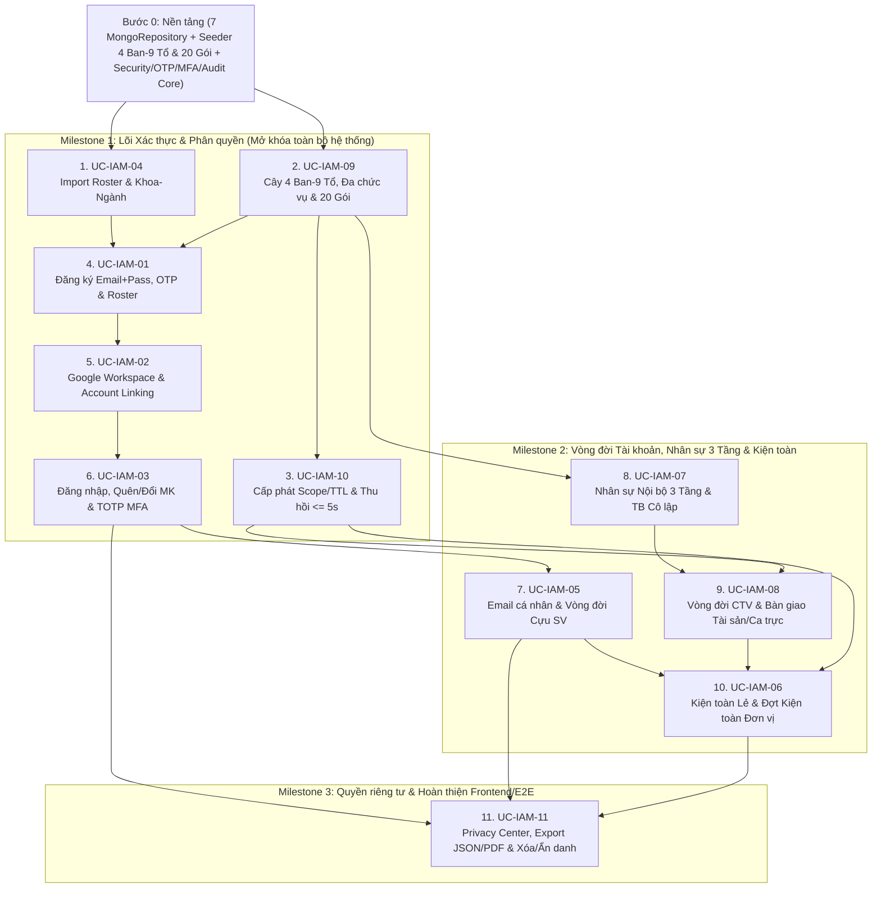

# KẾ HOẠCH TRIỂN KHAI & THỨ TỰ PHÁT TRIỂN PHÂN HỆ 4.1: ĐĂNG NHẬP, VÒNG ĐỜI TÀI KHOẢN & PHÂN QUYỀN LINH HOẠT

**Dự án:** YITZone — Hệ thống Quản lý Hoạt động Đoàn - Hội & Học thuật Khoa Công nghệ Thông tin  
**Tài liệu nguồn:** [USECASE_YITZone.md](./USECASE_YITZone.md) · [SRS_YITZone.md](./SRS_YITZone.md) (v2.2.1) · [MONGODB_REPOSITORY_GUIDE.md](./MONGODB_REPOSITORY_GUIDE.md) · [API_Overview_YITZone.md](./API_Overview_YITZone.md)  
**Phạm vi:** 11 Use Case (`UC-IAM-01` → `UC-IAM-11`) · 9 Yêu cầu Chức năng (`FR-IAM-01..04`, `FR-RBAC-01..05`) · NFR Bảo mật & BVDLCN (`NFR-AUTH-01`, `NFR-SEC-06`, `NFR-PRIV-01..04`)  
**Độ ưu tiên:** P0 (Bắt buộc — MVP)  
**Ngày lập:** 20/11/2026

---

## 1. Đánh giá Hiện trạng Codebase (Baseline Audit)

| Tầng / Thành phần | Đã có sẵn trong Codebase | Cần xây dựng / Hoàn thiện mới |
| :--- | :--- | :--- |
| **Domain Entities (`@Document`)** | Đủ 11 Entity IAM (`User`, `UserAuthIdentity`, `OrgUnit`, `DeviceToken`, `FacultyMajorCatalog`, `OfficialDirectoryRoster`, `PermissionModule`, `Role`, `RoleCode`, `RestructuringBatch`, `HrProposal`) và 2 Entity Privacy (`ConsentRecord`, `DataPrivacyRequest`). | Giữ nguyên cấu trúc Entity đã khởi tạo (tuân thủ [MONGODB_REPOSITORY_GUIDE.md](./MONGODB_REPOSITORY_GUIDE.md)); chỉ bổ sung trường nhỏ nếu phát sinh nhu cầu nghiệp vụ (ví dụ: `batchId` trên `RoleScope`). |
| **MongoRepository** | Đã có 5/12 repo: `UserRepository`, `OrgUnitRepository`, `DeviceTokenRepository`, `FacultyMajorCatalogRepository`, `OfficialDirectoryRosterRepository`. | Tạo 7 repo còn lại của 4.1 (`UserAuthIdentityRepository`, `PermissionModuleRepository`, `RoleRepository`, `RestructuringBatchRepository`, `HrProposalRepository`, `ConsentRecordRepository`, `DataPrivacyRequestRepository`) + repo phụ trợ liên thông (`AuditLogRepository`, `NotificationRepository`, `EventAttendanceRepository`, `OfficeAssetRepository`, `OfficeDutyShiftRepository`). |
| **Security & RBAC Core** | Đã có `SecurityConfig`, `JwtTokenService`, `JwtAuthenticationFilter`, `ActiveScopeFilter`, `ScopeContextHolder`, `ScopedPermissionEvaluator`, `DevicePopVerifierService`, `RbacCacheInvalidationService`. | Bổ sung `PasswordEncoder` (`Argon2id`/`BCrypt`), Google OAuth2/OIDC `CustomOidcUserService` + `OAuth2SuccessHandler`, `OtpService`, `TotpMfaService`, `RefreshTokenService` (rotation + Idle Timeout), `EffectivePermissionService` (nạp `EffectiveGrant` thực tế), Redis Pub/Sub listener đồng bộ `rbac:invalidate`. |
| **Business Services & Controllers** | Đã có `FacultyMajorCatalogService` (đọc `khoa_nganh.csv` & resolve MSSV), `IamController` khung (`dev-token`, `/me` đơn giản, `/device-tokens`, `/majors/**`, `/roster/import` stub), `PrivacyController` stub. | Xây dựng đầy đủ các Service & Controller cho toàn bộ 11 Use Case (`AuthController`, `IamController`, `RbacController`, `RestructuringController`, `UnitHrController`, `PrivacyController`). |
| **Frontend (`yitzone-client`)** | Đã có `LoginPage.tsx` (chỉ gọi `dev-token` + sinh khóa `ECDSA P-256`), `auth-store.ts`, `webcrypto.ts`, `api-client.ts`, `ProtectedRoute.tsx`. | Nâng cấp `LoginPage` thành Hybrid Auth (Google Workspace + Email/Password + OTP + Forgot Password + TOTP MFA + Consent Modal), thêm `ScopeSwitcher` trên `AppLayout`, xây dựng 6 màn hình nghiệp vụ 4.1 (Profile/Security, Roster/Major, Org & RBAC 20 gói, Restructuring Wizard, Unit HR 3 tầng, Privacy Center). |

---

## 2. Thứ tự Phát triển Các Use Case (Dependency-Driven Order)

Thứ tự dưới đây được sắp xếp theo **đồ thị phụ thuộc kỹ thuật** (tránh phải viết code giả hoặc sửa lại nhiều lần) và chia thành **3 Cột mốc (Milestones)** rõ ràng để có thể kiểm thử tích hợp sớm và mở khóa cho các phân hệ tiếp theo (4.2 Sự kiện, 4.3 Điểm danh...).

### 2.1. Sơ đồ Phụ thuộc Giữa Các Use Case

### 2.2. Bảng Thứ tự Phát triển & Theo dõi Tiến độ

| Thứ tự | Mã UC / Hạng mục | Tên hạng mục | Phụ thuộc trực tiếp | Lý do xếp thứ tự | Backend | Frontend | Kiểm thử |
| :-: | :--- | :--- | :--- | :--- | :---: | :---: | :---: |
| **0** | **Nền tảng (Foundation)** | 7 `MongoRepository` + Seeder (4 Ban - 9 Tổ, 8 Role, 20 Gói) + `PasswordEncoder` / `OtpService` / `TotpMfaService` / `RefreshTokenService` / `AuditLogService` | — | Tiền đề dữ liệu và bảo mật dùng chung cho mọi UC. | `[x]` | `—` | `[x]` |
| **1** | **UC-IAM-04** *(FR-IAM-01)* | Import Danh sách Chính thức (`OFFICIAL_DIRECTORY_ROSTER`) & Danh mục Khoa – Ngành (`FACULTY_MAJOR_CATALOG`) | Bước 0 | `UC-IAM-01` và `UC-IAM-02` bắt buộc đối chiếu Roster & Khoa-Ngành để gán MSSV tin cậy; `FacultyMajorCatalogService` đã có sẵn nên hoàn tất nhanh. | `[ ]` | `[ ]` | `[ ]` |
| **2** | **UC-IAM-09** *(FR-RBAC-01, 02)* | Quản lý Cây Tổ chức 4 Ban - 9 Tổ, Đa chức vụ (Union) & 20 Gói Quyền | Bước 0 | Cung cấp `EffectivePermissionService` (hợp quyền) và `OrgUnit.ancestors` để nạp quyền thực vào JWT/Filter cho toàn bộ các UC sau. | `[ ]` | `[ ]` | `[ ]` |
| **3** | **UC-IAM-10** *(FR-RBAC-03..05)* | Cấp phát Gói Quyền Theo Phạm vi/Thời hạn & Thu hồi Tức thì ($\le 5\text{s}$) | `UC-IAM-09` | Khép kín lõi RBAC (chống vượt thẩm quyền, `Non-delegable`, Redis Pub/Sub `rbac:invalidate` $\le 5\text{s}$) để `UC-IAM-06` và `UC-IAM-08` tái sử dụng ngay. | `[ ]` | `[ ]` | `[ ]` |
| **4** | **UC-IAM-01** *(FR-IAM-01)* | Đăng ký Tài khoản bằng Email + Mật khẩu (OTP SMTP, Roster & Auto-Link) | `UC-IAM-04`, `UC-IAM-09` | Tạo thực thể `User` + `UserAuthIdentity`, xác thực OTP, ghi `ConsentRecord` cơ bản, đối chiếu Roster và `Auto-Link` `PENDING_SSO_LINK`. | `[ ]` | `[ ]` | `[ ]` |
| **5** | **UC-IAM-02** *(FR-IAM-01)* | Đăng nhập / Tự khởi tạo qua Google Workspace & Account Linking | `UC-IAM-01` | Cần luồng `UC-IAM-01` có sẵn để xử lý và kiểm thử đầy đủ **Account Linking** và chống **Pre-account Takeover**. | `[ ]` | `[ ]` | `[ ]` |
| **6** | **UC-IAM-03** *(FR-IAM-01, NFR-AUTH-01)* | Đăng nhập Email + Mật khẩu, Thiết lập / Quên Mật khẩu & TOTP MFA | `UC-IAM-02` | Hoàn thiện cụm xác thực (Rate Limit 5 lần / khóa 15p, TOTP MFA cho `BTV`/`SystemAdmin`, đặt MK từ Google, thu hồi Refresh Token khi đổi MK). **Chốt Milestone 1.** | `[ ]` | `[ ]` | `[ ]` |
| **7** | **UC-IAM-05** *(FR-IAM-02)* | Liên kết Email Cá nhân & Quản lý Vòng đời Tài khoản Sau Tốt nghiệp | `UC-IAM-03` | Tái sử dụng `OtpService` và đăng nhập Email+Password để hỗ trợ Cựu SV đăng nhập bằng `personalEmail` khi email trường bị thu hồi. | `[ ]` | `[ ]` | `[ ]` |
| **8** | **UC-IAM-07** *(FR-IAM-03)* | Quản lý Nhân sự Nội bộ Ban/Tổ (3 Tầng) & Thông báo Cô lập theo Đơn vị | `UC-IAM-09` | Xây dựng danh bạ cô lập, phiếu `HrProposal` (Đề xuất / Thực hiện / Phê duyệt) và thông báo nội bộ theo ranh giới 4 Ban - 9 Tổ. | `[ ]` | `[ ]` | `[ ]` |
| **9** | **UC-IAM-08** *(FR-IAM-04)* | Chuyển Trạng thái Vòng đời CTV & Bàn giao Trách nhiệm | `UC-IAM-07`, `UC-IAM-10` | Mở rộng trực tiếp trên nhân sự đơn vị, bổ sung kiểm tra chặn tài sản VP chưa trả (`Edge 34`), thu hồi `MOD_DEPT_*` $\le 5\text{s}$ và rút ca trực `OFIT`. | `[ ]` | `[ ]` | `[ ]` |
| **10** | **UC-IAM-06** *(FR-IAM-02)* | Kiện toàn Bộ máy Nhân sự Linh hoạt (Kiện toàn Lẻ & Đợt Kiện toàn Đơn vị) | `UC-IAM-05`, `UC-IAM-08`, `UC-IAM-10` | Nghiệp vụ tổng hợp phức tạp nhất: tái sử dụng toàn bộ cảnh báo bàn giao, lưu `termHistory`, thu hồi quyền $\le 5\text{s}$, bổ sung Diff Preview & Scheduler hẹn hiệu lực (`Edge 29`). **Chốt Milestone 2.** | `[ ]` | `[ ]` | `[ ]` |
| **11** | **UC-IAM-11** *(NFR-PRIV-01, 04)* | Xác nhận Đồng ý Dữ liệu (Consent), Tải Bản sao (JSON/PDF) & Yêu cầu Xóa/Ẩn danh hóa | `UC-IAM-01..10` | Làm cuối cùng để Export bản sao & Ẩn danh hóa bao quát đủ toàn bộ trường dữ liệu cá nhân đã phát sinh từ 10 UC trước *(lưu ý: API ghi `ConsentRecord` opt-in cơ bản đã bật sẵn từ Bước 0/4)*. **Chốt Milestone 3.** | `[ ]` | `[ ]` | `[ ]` |

> **Gợi ý song song hóa (nếu có từ 2 lập trình viên trở lên):**
> - Ngay sau **Bước 0**, Dev A làm chuỗi **Xác thực (`UC-IAM-04 → 01 → 02 → 03 → 05`)**, Dev B làm song song chuỗi **RBAC & Nhân sự (`UC-IAM-09 → 10 → 07 → 08 → 06`)**, sau đó hợp nhất ở **`UC-IAM-11`** và kiểm thử E2E.

---

## 3. Kế hoạch Triển khai Chi tiết Theo Từng Bước

### Bước 0: Nền tảng Dữ liệu, Seed Chuẩn hóa & Dịch vụ Bảo mật Cốt lõi
1. **Tạo 7 `MongoRepository` còn thiếu của 4.1** (và đánh dấu `[x]` trong [MONGODB_REPOSITORY_GUIDE.md](./MONGODB_REPOSITORY_GUIDE.md)):
   - `iam/repository/UserAuthIdentityRepository.java`: `findByGoogleSub`, `findByEmail`, `findByUserId`, `existsByEmail`.
   - `iam/repository/PermissionModuleRepository.java`: `findByModuleCode`, `findByModuleCodeIn`.
   - `iam/repository/RoleRepository.java`: `findByCode`.
   - `iam/repository/RestructuringBatchRepository.java`: `findByStatusAndEffectiveAtLessThanEqual`, `findAllByOrderByCreatedAtDesc`.
   - `iam/repository/HrProposalRepository.java`: `findByUnitIdAndStatusOrderByCreatedAtDesc`, `findByUnitIdInAndStatusOrderByCreatedAtDesc`.
   - `privacy/repository/ConsentRecordRepository.java`: `findByUserIdAndConsentTypeAndPolicyVersion`, `findByUserIdOrderByConsentedAtDesc`.
   - `privacy/repository/DataPrivacyRequestRepository.java`: `findByUserIdOrderByRequestedAtDesc`, `findByStatusOrderByRequestedAtAsc`.
   - *Repo phụ trợ liên thông:* `AuditLogRepository`, `NotificationRepository`, `EventAttendanceRepository`, `OfficeAssetRepository`, `OfficeDutyShiftRepository`.
   - *Bổ sung trên `UserRepository`:* `findByPersonalEmailAndPersonalEmailVerifiedTrue`, `findByRoleScopesUnitId`, `findByRoleScopesUnitIdIn`.
2. **Seeder Idempotent (`IamBootstrapSeeder`):**
   - Cây tổ chức **1 Khoa (`FIT`) → 4 Ban (`EMFIT`, `SV5T`, `OFIT`, `ARTIT`) → 9 Tổ trực thuộc** kèm mảng `ancestors[]`.
   - **8 Vai trò** (`RoleCode`) và **20 Gói Quyền Nghiệp vụ (`PERMISSION_MODULES`)** đúng Bảng 3.2 & 3.3B SRS (đánh dấu `nonDelegable`, không trùng quyền nhạy cảm `liveqa:moderate`, `voting:host`, `liveqa:unmask`, tách quyền HR khỏi `MOD_DEPT_*`, không gán `MOD_LIVEQA_UNMASK` cho `SYSTEM_ADMIN`).
3. **Dịch vụ Bảo mật & Kiểm toán lõi:**
   - `PasswordEncoder`: `Argon2PasswordEncoder` (hoặc `BCryptPasswordEncoder(12)`).
   - `OtpService`: sinh OTP 6 số (`SecureRandom`), lưu hash, TTL `5–10p` (đăng ký) / `10–15p` (quên MK, email cá nhân), gửi qua `JavaMailSender` (có Console fallback trên profile `dev`).
   - `TotpMfaService`: RFC 6238 (6 digits, 30s, ±1 window), sinh QR qua `zxing`, mã hóa secret bằng AES-256-GCM.
   - `RefreshTokenService`: lưu trên Redis kèm `refreshTokenVersion` + `lastActivityAt`, áp dụng **Idle Timeout ≤ 30 phút** cho quản trị (`BCH`/`BTV`/`SYSTEM_ADMIN`) và **≤ 7 ngày** cho Sinh viên/CTV; xoay vòng token và thu hồi hàng loạt khi tăng `refreshTokenVersion`.
   - `AuditLogService`: append-only hash-chain nguyên tử qua `MongoTemplate.findAndModify` trên `AUDIT_CHAIN_STATE` (`MAIN_CHAIN`), chỉ lưu `changedFields`.

---

### Bước 1 (`UC-IAM-04`): Import Roster & Danh mục Khoa – Ngành
- **Backend:**
  - `OfficialDirectoryRosterService`: đọc CSV & Excel `.xlsx` (Apache POI), validate email/MSSV/mã CB, upsert hàng loạt vào `OFFICIAL_DIRECTORY_ROSTER`, hỗ trợ 4 nhóm `UserType`.
  - Hoàn thiện `POST /api/v1/iam/roster/import` và `GET /api/v1/iam/roster` (chỉ `BTV`/`SystemAdmin`).
  - Giữ & kiểm chứng `FacultyMajorCatalogService` (`GET/POST /api/v1/iam/majors`, `GET /api/v1/iam/majors/resolve/{studentCode}`).
- **Frontend:** `RosterMajorAdminPage.tsx` (upload CSV/Excel Roster, upload CSV 42 ngành / 12 Khoa, bảng tra cứu & bộ lọc `fitOnly`).

---

### Bước 2 (`UC-IAM-09`): Cây Tổ chức 4 Ban - 9 Tổ, Đa chức vụ & 20 Gói Quyền
- **Backend:**
  - `OrgUnitService` & `RbacController`: `GET/POST/PUT /api/v1/rbac/org-units` (tự tính `ancestors[]`, hỗ trợ mở rộng CLB/Đội/Nhóm).
  - `PermissionModuleService`: `GET/POST/PUT /api/v1/rbac/modules` kèm validator invariant (không trùng quyền nhạy cảm, tách quyền HR khỏi `MOD_DEPT_*`, cấm `MOD_LIVEQA_UNMASK` cho `SYSTEM_ADMIN`).
  - `EffectivePermissionService`: tính **Hợp quyền (Union)** từ `User.roleScopes` đang tại nhiệm + `User.assignedModules` còn hạn; cache Redis theo `userId` + `permissionVersion`; tích hợp nạp `EffectiveGrant` vào `JwtAuthenticationFilter` & `ActiveScopeFilter`.
  - Nâng cấp `GET /api/v1/iam/me` trả đầy đủ hồ sơ, `roleScopes[]`, `assignedModules[]`, `allowedScopes[]`, quyền hiệu lực theo `X-Active-Scope-Id`.
- **Frontend:** `ScopeSwitcher` trên `AppLayout.tsx` (gửi header `X-Active-Scope-Id`), tab quản lý cây đơn vị & cấu trúc 20 gói trong `OrgRbacAdminPage.tsx`.

---

### Bước 3 (`UC-IAM-10`): Cấp phát Gói Quyền Theo Scope/TTL & Thu hồi Tức thì ($\le 5\text{s}$)
- **Backend:**
  - `RbacGrantService`: `POST /api/v1/rbac/grants`, `GET /api/v1/rbac/grants`, `DELETE /api/v1/rbac/grants/{grantId}`.
  - Kiểm tra chống vượt thẩm quyền (`FR-RBAC-05`): người cấp phải đang giữ đầy đủ gói quyền trong phạm vi mục tiêu; từ chối `403` + ghi cảnh báo `AuditLog` nếu cố ủy quyền gói `nonDelegable` của `BTV`.
  - Thu hồi thủ công: tăng `User.permissionVersion` nguyên tử → gọi `RbacCacheInvalidationService.invalidateUserPermissions()` (xóa Redis + phát Pub/Sub `rbac:invalidate` để các node xóa local cache $\le 5\text{s}$ — `Edge 30`) + ghi `AuditLog`.
  - Đăng ký `RedisMessageListenerContainer` nhận kênh `rbac:invalidate`; `@Scheduled` job dọn `AssignedModule` quá hạn `expiresAt`.
- **Frontend:** Tab cấp phát & thu hồi gói quyền theo Scope/TTL trong `OrgRbacAdminPage.tsx`.

---

### Bước 4 (`UC-IAM-01`): Đăng ký Tài khoản Email + Mật khẩu, OTP & Đối chiếu Roster
- **Backend:**
  - `HybridAuthService`, `IdentityResolutionService`, `WalkInAutoLinkService`, `AuthController`:
    - `POST /api/v1/iam/auth/register`: validate độ mạnh mật khẩu, bắt buộc `consentAccepted = true` (ghi `ConsentRecord`), kiểm tra email đã tồn tại ở dạng Google Workspace → gợi ý đăng nhập Google/Quên MK, gửi OTP 6 số (`5–10p`).
    - `POST /api/v1/iam/auth/verify-email-otp` & `/resend-otp`: kích hoạt tài khoản, đối chiếu `OFFICIAL_DIRECTORY_ROSTER` (không nhận MSSV tự nhập tay; ngoài domain → `TEMP_GUEST`), tra `FacultyMajorCatalog`, chạy `WalkInAutoLinkService` liên kết bản ghi `PENDING_SSO_LINK` khớp `studentCode` (`Edge 40`).
- **Frontend:** Tab Đăng ký + màn hình nhập OTP 6 số + checkbox đồng ý BVDLCN trong `LoginPage.tsx`.

---

### Bước 5 (`UC-IAM-02`): Đăng nhập / Tự khởi tạo qua Google Workspace & Account Linking
- **Backend:**
  - `GoogleOidcAuthService` + `OAuth2AuthenticationSuccessHandler` + cấu hình `SecurityConfig.oauth2Login` (`/oauth2/authorization/google`).
  - Lọc ưu tiên `hd` domain trường, bắt buộc `email_verified = true`, tra cứu `googleSub` trước rồi `email`.
  - **Account Linking:** đã có Email+Password đã xác thực → gắn `googleSub` vào cùng `User`.
  - **Chống Pre-account Takeover:** đã đăng ký Email+Password nhưng `emailVerified = false` → vô hiệu hóa mật khẩu/OTP cũ chưa xác thực, giao quyền sở hữu cho chủ Google Workspace thật.
  - Đọc OIDC Custom Claims → fallback `OFFICIAL_DIRECTORY_ROSTER`, chạy `Auto-Link` `PENDING_SSO_LINK`, cấp JWT + Refresh Token + `HttpOnly` cookie `yitz_dt`.
- **Frontend:** Nút **"Đăng nhập với Google Workspace"** trên `LoginPage.tsx` + `OAuth2CallbackPage.tsx` (tự động sinh/đăng ký khóa thiết bị `ECDSA P-256` và mở Consent Modal nếu lần đầu).

---

### Bước 6 (`UC-IAM-03`): Đăng nhập Email + Mật khẩu, Thiết lập / Quên MK & TOTP MFA
- **Backend:**
  - `POST /api/v1/iam/auth/login`: Rate Limit & khóa tạm `15 phút` sau `5` lần sai liên tiếp; hỗ trợ đăng nhập bằng `email` hoặc `personalEmail` đã xác thực; nếu vai trò `BTV`/`SYSTEM_ADMIN` → bắt buộc bước **TOTP MFA** (`mfaRequired: true` + `mfaChallengeToken`).
  - `POST /api/v1/iam/auth/mfa/setup` & `/mfa/verify`: thiết lập và xác minh TOTP MFA.
  - `POST /api/v1/iam/auth/password/setup`: cho phép user Google Workspace thiết lập mật khẩu (xác thực lại phiên/OTP).
  - `POST /api/v1/iam/auth/password/forgot` (luôn trả thông báo trung tính), `/password/reset`, `/password/change`: tăng `refreshTokenVersion` thu hồi toàn bộ phiên cũ + gửi email cảnh báo bảo mật.
  - `POST /api/v1/iam/auth/refresh` & `/logout`: xoay vòng Refresh Token, kiểm tra Idle Timeout.
- **Frontend:** Form đăng nhập Email+Password, màn hình nhập mã TOTP MFA, luồng Quên/Đặt lại mật khẩu (`LoginPage.tsx`), interceptor tự động refresh token trong `api-client.ts`.

---

### Bước 7 (`UC-IAM-05`): Liên kết Email Cá nhân & Vòng đời Tài khoản Sau Tốt nghiệp
- **Backend:**
  - `PUT /api/v1/iam/me/profile`: cập nhật Lớp, Chi đoàn, Chi hội, ngày vào Đoàn/Hội (`UnionMemberProfile`).
  - `POST /api/v1/iam/personal-email/link` & `/verify-otp`: gửi & xác thực OTP cho email cá nhân dự phòng.
  - `PATCH /api/v1/iam/users/{userId}/lifecycle` (chỉ `BTV`): chuyển `ACTIVE_STUDY → GRADUATED → ARCHIVED`, ghi `AuditLog`.
- **Frontend:** `ProfileSecurityPage.tsx` (hồ sơ Đoàn/Hội, liên kết email cá nhân, đặt/đổi mật khẩu, cài đặt TOTP MFA QR, xem lịch sử cống hiến `termHistory`).

---

### Bước 8 (`UC-IAM-07`): Quản lý Nhân sự Nội bộ Ban/Tổ 3 Tầng & Thông báo Cô lập
- **Backend:**
  - `UnitHrService` & `UnitHrController`:
    - `GET /api/v1/iam/units/{unitId}/members`: trả danh bạ cô lập đúng Bảng 3.3A (chặn `403` khi truy cập 3 Ban khác).
    - `POST/GET /api/v1/iam/units/{unitId}/hr-proposals` & `POST .../hr-proposals/{id}/review`: `Tổ phó`/`Phó Ban` tạo Đề xuất; `Tổ trưởng` Thực hiện trong Tổ; `Trưởng Ban` Phê duyệt & Điều chuyển giữa các Tổ trong Ban mình.
    - `POST /api/v1/iam/units/{unitId}/announcements`: gửi thông báo nội bộ tới đúng thành viên trong đơn vị.
- **Frontend:** `UnitHrPage.tsx` (danh bạ cô lập theo `activeScopeId`, luồng tạo/duyệt phiếu đề xuất 3 tầng, form gửi thông báo nội bộ).

---

### Bước 9 (`UC-IAM-08`): Chuyển Trạng thái Vòng đời CTV & Bàn giao Trách nhiệm
- **Backend:**
  - `CtvLifecycleService`: `POST /api/v1/iam/units/{unitId}/members/{userId}/status` (`ACTIVE → ON_LEAVE / LEFT`).
  - Kiểm tra `OfficeAsset` đang mượn chưa trả: chặn `409 Conflict` khi chuyển sang `LEFT` nếu chưa xác nhận trả đồ/bàn giao người chịu trách nhiệm (`Edge 34`).
  - Tự động thu hồi gói `MOD_DEPT_*` ($\le 5\text{s}$), rút tên khỏi `OfficeDutyShift` tương lai, gửi cảnh báo ca trống cho Ban `OFIT` và ghi `AuditLog`.
- **Frontend:** Tích hợp modal chuyển trạng thái CTV & cảnh báo bàn giao tài sản vào `UnitHrPage.tsx`.

---

### Bước 10 (`UC-IAM-06`): Kiện toàn Bộ máy Nhân sự Linh hoạt (Kiện toàn Lẻ & Đợt Kiện toàn Đơn vị)
- **Backend:**
  - `RestructuringService` & `RestructuringController`:
    - **Kiện toàn lẻ:** `POST /api/v1/iam/personnel/appoint`, `/dismiss`, `/transfer` (đóng `endAt`, tự lưu `termHistory`, thu hồi quyền $\le 5\text{s}$, ghi `AuditLog`; phân quyền `BTV` toàn Khoa / `Trưởng Ban` trong Ban mình).
    - **Đợt Kiện toàn theo Đơn vị (`RestructuringBatch` — `Edge 29`):** `POST/GET/PUT /api/v1/iam/restructuring-batches`, `POST .../{id}/preview-diff` (sinh bảng so sánh Trước–Sau & `handoverWarnings[]` kiểm tra tài sản VP chưa trả + sự kiện dang dở), `POST .../{id}/publish` (chạy ngay hoặc `SCHEDULED`).
    - `@Scheduled` `RestructuringBatchScheduler`: tự động áp dụng các đợt `SCHEDULED` đến giờ `effectiveAt`.
- **Frontend:** `RestructuringPage.tsx` (2 tab: Kiện toàn lẻ & Wizard Đợt kiện toàn theo đơn vị kèm bảng Diff Preview và cảnh báo bàn giao).

---

### Bước 11 (`UC-IAM-11`): Privacy Center, Consent, Tải Bản sao & Yêu cầu Xóa/Ẩn danh hóa
- **Backend:**
  - `PrivacyService` & hoàn thiện `PrivacyController`:
    - `POST /api/v1/privacy/consents` & `GET /api/v1/privacy/consents/me`.
    - `GET /api/v1/privacy/my-data` & `POST /api/v1/privacy/my-data-exports` (xuất JSON & PDF bằng OpenPDF).
    - `POST /api/v1/privacy/deletion-requests`, `POST /api/v1/privacy/rectification-requests`, `GET /api/v1/privacy/requests`, `POST /api/v1/privacy/requests/{id}/process` (`BTV` duyệt ẩn danh hóa PII, bảo lưu `AuditLog`, tài chính & khen thưởng chính thức).
- **Frontend:** `PrivacyCenterPage.tsx` (xem dữ liệu cá nhân, lịch sử Consent, tải bản sao JSON/PDF, gửi/quản lý yêu cầu xóa/ẩn danh hóa).

---

## 4. Kế hoạch Kiểm thử & Tiêu chí Nghiệm thu (Definition of Done)

Sau mỗi bước và khi chốt từng Milestone, chạy `mvn test` (`yitzone-server`) và `npm run build` / `npm run lint` (`yitzone-client`), bảo đảm bao phủ đầy đủ tiêu chí `Given / When / Then` trong SRS:

| Milestone / Nhóm Test | Kịch bản kiểm chứng bắt buộc |
| :--- | :--- |
| **M1 — Roster & Catalog (`UC-IAM-04`)** | Import CSV/Excel Roster; Import `khoa_nganh.csv` 42 ngành / 12 Khoa; Resolve `110/133/162` → `fitFaculty = true`, ngành ngoài CNTT → `fitFaculty = false`. |
| **M1 — RBAC 20 Gói & $\le 5\text{s}$ (`UC-IAM-09..10`)** | Hợp quyền Union khi giữ 2 chức vụ + chuyển đổi `X-Active-Scope-Id`; không trùng quyền nhạy cảm, tách HR khỏi `MOD_DEPT_*`, `SystemAdmin` không có `MOD_LIVEQA_UNMASK`; `BCH` thử cấp `MOD_YITBOT_FULL` bị từ chối `403` + Audit Log; hết hạn `expiresAt` tự mất quyền; `BTV` thu hồi quyền → API kế tiếp sau 1–3s trả `403` (`Edge 30`). |
| **M1 — Auth, Linking & MFA (`UC-IAM-01..03`)** | Đăng ký Email+Pass + OTP → Roster auto-assign MSSV + Auto-Link `PENDING_SSO_LINK` (`Edge 40`); Google OIDC Account Linking; **Pre-account Takeover** vô hiệu hóa mật khẩu chưa xác thực; Rate limit khóa 15p sau 5 lần sai; bắt buộc TOTP MFA cho `BTV`/`SystemAdmin`; Đổi mật khẩu thu hồi toàn bộ Refresh Token cũ; Quên mật khẩu luôn trả thông báo trung tính. |
| **M2 — Vòng đời, HR 3 Tầng & Kiện toàn (`UC-IAM-05..08`)** | Cựu SV (`GRADUATED`) đăng nhập bằng `personalEmail + Password` vào đúng `User` cũ; `Tổ phó` chỉ tạo đề xuất (bị `403` nếu sửa trực tiếp hoặc truy cập Ban `OFIT`); `Trưởng Ban` điều chuyển trong Ban mình; Chuyển CTV sang `LEFT` bị chặn `409` khi còn giữ tài sản VP chưa trả, sau bàn giao tự rút ca trực & báo `OFIT` (`Edge 34`); Đợt Kiện toàn chỉ chọn `EMFIT` không ảnh hưởng 3 Ban khác, sinh Diff Preview & HandoverWarning, hẹn giờ `SCHEDULED` tự động áp dụng (`Edge 29`). |
| **M3 — Privacy (`UC-IAM-11`)** | Ghi `ConsentRecord`; Xuất bản sao JSON & PDF; Yêu cầu xóa ẩn danh hóa PII nhưng bảo lưu `AuditLog` & khen thưởng chính thức. |
