# ĐẶC TẢ YÊU CẦU PHẦN MỀM (SOFTWARE REQUIREMENTS SPECIFICATION - SRS)

**Tên dự án:** YITZone — Hệ thống Quản lý Hoạt động Đoàn - Hội & Học thuật Khoa Công nghệ Thông tin  
**Phiên bản:** 2.2.1 (Bản Chuẩn Nghiệp vụ — Hoàn thiện Chấm điểm Rủi ro Trọng số, Bằng chứng Khóa Thiết bị `ECDSA P-256`, Hậu kiểm Mã vạch Vãng lai, Bỏ phiếu Kín Outbox & Đối soát Tiền mặt COD theo `report03.md`)  
**Ngày lập:** 19/11/2026  
**Chuẩn tham chiếu:** ISO/IEC/IEEE 29148 & Agile Product Specification  
**Tài liệu liên kết:**  
- [Tài liệu Thiết kế Hệ thống Mức cao (HLD_YITZone.md)](./HLD_YITZone.md)  
- [Tài liệu Thiết kế Chi tiết Kỹ thuật (LLD_YITZone.md)](./LLD_YITZone.md)  

---

## MỤC LỤC
1. [Giới thiệu (Introduction)](#1-giới-thiệu-introduction)
2. [Mô tả tổng quan (Overall Description)](#2-mô-tả-tổng-quan-overall-description)
3. [Cơ cấu Tổ chức, Tác nhân & Ma trận Phân quyền Nghiệp vụ (Actors & Permission Matrix)](#3-cơ-cấu-tổ-chức-tác-nhân--ma-trận-phân-quyền-nghiệp-vụ-actors--permission-matrix)
4. [Đặc tả Yêu cầu Chức năng (Functional Requirements)](#4-đặc-tả-yêu-cầu-chức-năng-functional-requirements)
   - [4.1. Phân hệ Đăng nhập, Vòng đời Tài khoản & Phân quyền Linh hoạt](#41-phân-hệ-đăng-nhập-vòng-đời-tài-khoản--phân-quyền-linh-hoạt)
   - [4.2. Phân hệ Tổ chức Sự kiện](#42-phân-hệ-tổ-chức-sự-kiện)
   - [4.3. Phân hệ Điểm danh Sự kiện Đa lớp, Quét Mã vạch Thẻ Sinh viên & Soát vé Ngoại tuyến](#43-phân-hệ-điểm-danh-sự-kiện-đa-lớp-quét-mã-vạch-thẻ-sinh-viên--soát-vé-ngoại-tuyến)
   - [4.4. Phân hệ Lịch sử Tham gia Sự kiện & Chứng nhận Điện tử (E-Certificate)](#44-phân-hệ-lịch-sử-tham-gia-sự-kiện--chứng-nhận-điện-tử-e-certificate)
   - [4.5. Phân hệ Bản tin Blog & Truyền thông](#45-phân-hệ-bản-tin-blog--truyền-thông)
   - [4.6. Phân hệ Trò chơi Tương tác Hội trường (Minigame) & Thi Trắc nghiệm Nghiêm túc](#46-phân-hệ-trò-chơi-tương-tác-hội-trường-minigame--thi-trắc-nghiệm-nghiêm-túc)
   - [4.7. Phân hệ Xét duyệt Danh hiệu & Quản lý Phong trào Sinh viên 5 tốt](#47-phân-hệ-xét-duyệt-danh-hiệu--quản-lý-phong-trào-sinh-viên-5-tốt)
   - [4.8. Phân hệ Luyện tập & Thi đấu Lập trình Tự động (Online Judge)](#48-phân-hệ-luyện-tập--thi-đấu-lập-trình-tự-động-online-judge)
   - [4.9. Phân hệ Cửa hàng Vật phẩm Khoa & Gây quỹ Đoàn - Hội](#49-phân-hệ-cửa-hàng-vật-phẩm-khoa--gây-quỹ-đoàn---hội)
   - [4.10. Phân hệ Trợ lý Ảo AI Đoàn - Hội (YITBot)](#410-phân-hệ-trợ-lý-ảo-ai-đoàn---hội-yitbot)
   - [4.11. Phân hệ Quản lý Trực Văn phòng & Kiểm kê Vật dụng Văn phòng (Ban Văn phòng)](#411-phân-hệ-quản-lý-trực-văn-phòng--kiểm-kê-vật-dụng-văn-phòng-ban-văn-phòng)
   - [4.12. Phân hệ Quản lý Văn nghệ & Đăng ký Tiết mục Chương trình (Ban Văn nghệ)](#412-phân-hệ-quản-lý-văn-nghệ--đăng-ký-tiết-mục-chương-trình-ban-văn-nghệ)
   - [4.13. Phân hệ Lịch Hoạt động Tổng hợp & Theo dõi Nhanh](#413-phân-hệ-lịch-hoạt-động-tổng-hợp--theo-dõi-nhanh)
   - [4.14. Phân hệ Thông báo & Nhật ký Kiểm tra Hệ thống](#414-phân-hệ-thông-báo--nhật-ký-kiểm-tra-hệ-thống)
   - [4.15. Phân hệ Khảo sát & Lấy ý kiến Sinh viên](#415-phân-hệ-khảo-sát--lấy-ý-kiến-sinh-viên)
   - [4.16. Phân hệ Hồ sơ Năng lực Số & Xuất CV Xác thực Tự động (E-Portfolio)](#416-phân-hệ-hồ-sơ-năng-lực-số--xuất-cv-xác-thực-tự-động-e-portfolio)
   - [4.17. Phân hệ Bức tường Hỏi - Đáp Trực tiếp tại Hội trường (Live Q&A)](#417-phân-hệ-bức-tường-hỏi---đáp-trực-tiếp-tại-hội-trường-live-qa)
   - [4.18. Phân hệ Ứng dụng Di động Tiện lợi (PWA), Vé Ngoại tuyến & Thông báo Đẩy](#418-phân-hệ-ứng-dụng-di-động-tiện-lợi-pwa-vé-ngoại-tuyến--thông-báo-đẩy)
   - [4.19. Phân hệ Hộp thư Hỏi - Đáp & Nhắn tin Hỗ trợ Trực tiếp với BCH](#419-phân-hệ-hộp-thư-hỏi---đáp--nhắn-tin-hỗ-trợ-trực-tiếp-với-bch)
   - [4.20. Phân hệ Bình chọn Trực tiếp Hội trường, Biểu quyết & Bầu cử Đoàn - Hội (Live Voting & Polling)](#420-phân-hệ-bình-chọn-trực-tiếp-hội-trường-biểu-quyết--bầu-cử-đoàn---hội-live-voting--polling)
5. [Đặc tả Yêu cầu Phi chức năng & Tuân thủ Dữ liệu Cá nhân (NFR & Privacy)](#5-đặc-tả-yêu-cầu-phi-chức-năng--tuân-thủ-dữ-liệu-cá-nhân-nfr--privacy)
6. [Bảng Quy chuẩn Xử lý Tình huống Thực tế & Ngoại lệ Nghiệp vụ (Business Edge Cases)](#6-bảng-quy-chuẩn-xử-lý-tình-huống-thực-tế--ngoại-lệ-nghiệp-vụ-business-edge-cases)
7. [Lộ trình Triển khai MVP, Bàn giao & Kế hoạch Vận hành (Product Roadmap & Handover)](#7-lộ-trình-triển-khai-mvp-bàn-giao--kế-hoạch-vận-hành-product-roadmap--handover)
8. [Phụ lục Chuẩn hóa: Giao diện Bên ngoài, Truy vết & Phê duyệt](#8-phụ-lục-chuẩn-hóa-giao-diện-bên-ngoài-truy-vết--phê-duyệt)

---

## 1. Giới thiệu (Introduction)

### 1.1. Mục đích tài liệu
Tài liệu Đặc tả Yêu cầu Phần mềm (SRS) này mô tả toàn diện các bài toán thực tế, quy trình nghiệp vụ, quyền hạn của từng nhóm người dùng và các tiêu chí nghiệm thu của hệ thống **YITZone**. Tài liệu được biên soạn bằng **ngôn ngữ nghiệp vụ rõ ràng, đo kiểm được**, giúp Ban Chủ nhiệm Khoa, Ban Thường vụ Đoàn Khoa, Ban Thư ký Liên Chi Hội Khoa Công nghệ Thông tin (Khách hàng / Chủ đầu tư) cũng như đội ngũ Phân tích nghiệp vụ (BA), Quản lý sản phẩm (PM) và Kiểm thử (QA) dễ dàng nắm bắt, đối chiếu và nghiệm thu sản phẩm mà không đòi hỏi kiến thức lập trình.

*(Các chi tiết thiết kế kiến trúc kỹ thuật, lựa chọn công nghệ Tech Stack và cơ sở dữ liệu dành cho đội ngũ lập trình viên được tách riêng tại [HLD_YITZone.md](./HLD_YITZone.md) và [LLD_YITZone.md](./LLD_YITZone.md)).*

### 1.2. Phạm vi sản phẩm (Product Scope)
**YITZone** là nền tảng số hóa công tác quản lý Đoàn Thanh niên - Hội Sinh viên và phong trào học thuật tại Khoa Công nghệ Thông tin, giải quyết 8 bài toán cốt lõi theo lộ trình từng giai đoạn (ưu tiên MVP ở Mục 7):
1. **Số hóa vận hành, Trực văn phòng & Quản lý Tổ chức:** Quản lý danh sách cán bộ, cộng tác viên (CTV) qua các nhiệm kỳ theo đúng cơ cấu **4 Ban chuyên môn - 9 Tổ trực thuộc**; quản lý đăng ký, điểm danh ca trực và kiểm kê tài sản văn phòng Đoàn - Hội Khoa; phân quyền linh hoạt theo từng mảng công việc; tổ chức sự kiện và truyền thông nội bộ.
2. **Điểm danh đa lớp, Quét Mã vạch Thẻ Sinh viên & Tự động hóa ghi nhận quyền lợi (kể cả khi mất mạng):** Điểm danh sự kiện kết hợp Mã QR Động mặc định (hoặc Mã QR Cố định cho sự kiện ngoài trời), token thiết bị có bằng chứng sở hữu khóa (`ECDSA P-256`) và tín hiệu vị trí GPS làm chỉ báo rủi ro theo **trọng số**; tự động ghi nhận vào lịch sử tham gia của sinh viên theo một hoặc nhiều loại quyền lợi (**ĐRL** - Điểm rèn luyện, **CTXH** - Công tác xã hội, **CĐDN** - Chuyên đề Doanh nghiệp) kèm giá trị định lượng và cấp Chứng nhận điện tử (E-Certificate). Hỗ trợ đầy đủ cả **Vé QR Ngoại tuyến** trên điện thoại sinh viên (chu kỳ 15s), **Máy soát vé BTC ngoại tuyến** (gói dữ liệu mã hóa và tự xóa sau sự kiện), lẫn **Quét Mã vạch Thẻ Sinh viên vật lý (1D Barcode: Code 128 / Code 39)** bằng camera hoặc súng quét mã vạch cầm tay (USB/Bluetooth HID) có đối chiếu ảnh thẻ vật lý và cơ chế hậu kiểm đối với sinh viên vãng lai/tân sinh viên khi hội trường 300–500 người nghẽn mạng.
3. **Liên thông xét duyệt danh hiệu:** Số hóa quy trình theo dõi tiến độ phấn đấu (cho các tiêu chí đo được trên hệ thống), nộp hồ sơ và chấm duyệt các danh hiệu (*Sinh viên 5 tốt*, *Đoàn viên ưu tú*...), tự động đối chiếu minh chứng từ lịch sử tham gia hoạt động trên hệ thống.
4. **Cửa hàng Vật phẩm Khoa & Gây quỹ Tình nguyện:** Quản lý bán vật phẩm truyền thống của Khoa (áo khoa, dây đeo thẻ, móc khóa...) và các đợt gây quỹ chiến dịch tình nguyện (*Xuân Tình Nguyện*, *Mùa Hè Xanh*...), hỗ trợ áp giá ưu đãi, mã giảm giá (Voucher), giao nhận tại Văn phòng Khoa hoặc giao đến phòng học cùng cơ sở, thanh toán quét mã ngân hàng VietQR (có xác thực chữ ký Webhook) hoặc COD (có hạn nhận hàng và biên bản bàn giao tiền mặt cuối ca), theo dõi **lợi nhuận gây quỹ thực tế (sau khi trừ giá vốn của hàng đã giao)** minh bạch và quét mã QR nhận hàng (hoặc quét mã vạch thẻ sinh viên tra cứu nhanh đơn hàng tại bàn trực). *(Lưu ý: Giao hàng tận nhà bằng CTV không nằm trong phạm vi hệ thống; giao hàng bưu chính mở rộng xem xét ở giai đoạn sau).*
5. **Tương tác Hội trường, Bình chọn (`Live Voting`), Thi Trắc nghiệm & Học thuật CNTT:** Cung cấp hệ thống **Bình chọn Trực tiếp Hội trường & Biểu quyết Đoàn - Hội (`Live Voting & Polling` — hỗ trợ trọng số điểm Ban Giám khảo + Khán giả, ràng buộc cử tri đã điểm danh, bỏ phiếu kín qua thùng đệm Outbox trộn lô có mã biên nhận kiểm chứng không kiểm phiếu thời gian thực, và màn hình LED đua top/đóng băng phút chót; riêng bầu cử nhân sự chính thức bằng phiếu kín đặt ở giai đoạn mở rộng P3 sau khi đối chiếu quy chế)**, trò chơi tương tác trực tiếp tại hội trường (tương tự Kahoot), **Bức tường Hỏi - Đáp trực tiếp với Diễn giả (Live Q&A)**, hệ thống **Thi trắc nghiệm 4 đáp án có răn đe và ghi nhận vi phạm phù hợp giới hạn trình duyệt**, và phân hệ **Luyện tập lập trình (Online Judge)** *(được đánh giá tích hợp nền tảng sẵn có ở giai đoạn sau MVP)*.
6. **Trợ lý Ảo AI (`YITBot`) & Hộp thư Nhắn tin Trực tiếp với BCH (`Q&A Messenger`):** Trợ lý ảo giải đáp tự động có trích dẫn nguồn quy chế, tra cứu nhanh điểm ĐRL/CTXH/CĐDN, sự kiện đang mở, tình trạng đơn hàng của chính người dùng (trong hạn mức ngân sách AI); đồng thời cung cấp **Hộp thư Hỏi - Đáp dạng Nhắn tin 2 chiều** chuyển thẳng thắc mắc của sinh viên về Hộp thư chung của **Ban Chấp hành (BCH/BTV)**.
7. **Hồ sơ Năng lực Số & Xuất CV Xác thực (`Verified IT E-Portfolio` - Giai đoạn mở rộng):** Tổng hợp thành tích đã xác thực trên YITZone kết hợp dự án cá nhân (mặc định chế độ Riêng tư) và xuất file CV (PDF) có mã QR xác thực của Đoàn - Hội Khoa CNTT.
8. **Trải nghiệm Ứng dụng Web Cài đặt được (PWA) & Thông báo Đẩy:** Cho phép cài đặt YITZone ra màn hình chính điện thoại (Android Chrome và iOS Safari $\ge 16.4$), mở xem vé sự kiện/lịch trực khi mất mạng và nhận thông báo nhắc nhở (cũng như thông báo Email).

### 1.3. Định nghĩa, Thuật ngữ và Từ viết tắt
| Thuật ngữ / Viết tắt | Giải nghĩa Nghiệp vụ |
| :--- | :--- |
| **BTV** | Ban Thường vụ Đoàn Khoa / Ban Thư ký Liên Chi Hội Khoa CNTT (Cấp lãnh đạo và phê duyệt cao nhất tại Khoa). |
| **BCH** | Ban Chấp hành Đoàn Khoa / Liên Chi Hội Khoa CNTT (Cấp điều hành các mảng hoạt động toàn Khoa). |
| **CTV** | Cộng tác viên Đoàn - Hội trực thuộc 4 Ban chuyên môn và 9 Tổ trực thuộc. |
| **BTC** | Ban Tổ chức (Nhóm nhân sự đảm nhận 7 vị trí: *MC, Lễ tân, Hậu cần, Điều phối, Truyền thông, Văn nghệ, Kỹ thuật* trong một sự kiện cụ thể). |
| **ĐRL** | Điểm rèn luyện (Ghi nhận sinh viên tham gia hoạt động rèn luyện theo quy chế nhà trường). |
| **CTXH** | Công tác xã hội (Ghi nhận sinh viên tham gia hoạt động tình nguyện, vì cộng đồng). |
| **CĐDN** | Chuyên đề Doanh nghiệp (Hội thảo, Talkshow, Workshop học thuật & định hướng nghề nghiệp cùng doanh nghiệp dành cho sinh viên Khoa CNTT). |
| **SV5T** | Danh hiệu "Sinh viên 5 tốt" gồm 5 tiêu chí: *Đạo đức tốt, Học tập tốt, Thể lực tốt, Tình nguyện tốt, Hội nhập tốt*. |
| **E-Certificate (E-Cert)** | Giấy chứng nhận điện tử có mã số định danh, trạng thái hiệu lực và mã QR chống làm giả, cấp cho sinh viên/BTC hoàn thành sự kiện hoặc đạt danh hiệu. |
| **Mã vạch Thẻ Sinh viên (`1D Barcode`)** | Mã vạch một chiều (chuẩn `Code 128` / `Code 39`) được in sẵn trên thẻ sinh viên vật lý của Nhà trường, mã hóa chuỗi MSSV dùng để BTC quét điểm danh nhanh, tra cứu đơn hàng hoặc mượn-trả tài sản văn phòng bằng camera hoặc súng quét laser/CCD. |
| **Live Voting & Secret Ballot** | Phân hệ Bình chọn tương tác trực tiếp tại hội trường (bình chọn tiết mục văn nghệ, đội thi học thuật kết hợp trọng số Ban Giám khảo & Khán giả) và Biểu quyết / Bỏ phiếu kín có mã biên nhận kiểm chứng lá phiếu trong công tác Đoàn - Hội. |
| **Gói Quyền Nghiệp vụ** | Tập hợp các quyền thao tác thuộc cùng một mảng công việc được đóng gói sẵn để BTV/BCH giao việc nhanh cho CTV hoặc cán bộ phụ trách (gồm 20 gói chuẩn hóa). |
| **Online Judge (OJ)** | Hệ thống giao đề bài và chấm điểm code lập trình tự động (C, C++, Python, Java) dành cho sinh viên CNTT. |
| **YITBot** | Trợ lý ảo AI của Đoàn - Hội Khoa CNTT, hỗ trợ giải đáp quy chế có trích dẫn nguồn và tra cứu thông tin cá nhân tự động. |
| **E-Portfolio** | Hồ sơ năng lực số và trình tạo CV tự động có đóng dấu mã QR kiểm chứng của Đoàn - Hội Khoa CNTT. |
| **Live Q&A** | Bức tường hỏi - đáp tương tác trực tiếp tại hội trường, nơi sinh viên gửi câu hỏi cho diễn giả và bình chọn (Upvote) câu hỏi hay để chiếu lên màn hình sân khấu. |
| **Q&A Messenger** | Hộp thư nhắn tin hỏi - đáp hỗ trợ 2 chiều thời gian thực giữa Sinh viên và Ban Chấp hành Khoa. |
| **MoSCoW / Độ ưu tiên** | **P0 (Bắt buộc - Must):** Có mặt ở Giai đoạn 1 (MVP); **P1 (Cao - Should):** Giai đoạn 2; **P2 (Trung bình - Could):** Giai đoạn 3; **P3 (Thấp / Mở rộng - Won't in MVP):** Giai đoạn sau hoặc tích hợp giải pháp ngoài. |

---

## 2. Mô tả tổng quan (Overall Description)

### 2.1. Sơ đồ Ngữ cảnh Nghiệp vụ Hệ thống (Business Context Diagram)
Sơ đồ dưới đây minh họa cách các nhóm người dùng và các đơn vị bên ngoài tương tác với hệ thống **YITZone** trong thực tế vận hành tại Khoa Công nghệ Thông tin:

```mermaid
flowchart TB
    subgraph Users["Các Nhóm Người Dùng Chính"]
        Guest["Khách, Nhà tuyển dụng & Khách mời\n(Xem bản tin, Xem sự kiện mở, Quét QR xác thực CV/Chứng nhận)"]
        Student["Sinh viên Khoa CNTT & Toàn trường\n(Đăng ký sự kiện, Điểm danh, Bình chọn Voting, Mua áo/Gây quỹ, Nộp hồ sơ SV5T, Hỏi đáp)"]
        Cadre["Cộng tác viên & Ban Chủ nhiệm 4 Ban - 9 Tổ\n(Quản lý nhân sự Ban/Tổ, Quét vé/Mã vạch thẻ SV, Trực văn phòng, Kiểm kê tài sản, Văn nghệ, Rà soát SV5T)"]
        Leader["Ban Chấp hành (BCH), Ban Thường vụ (BTV) & Cán bộ/Giảng viên\n(Điều hành toàn Khoa, Phê duyệt sự kiện/quyền lợi, Chốt danh hiệu/Biểu quyết, Đối soát quỹ)"]
    end

    subgraph CoreSystem["Hệ thống YITZone"]
        Platform["Nền tảng Số hóa Đoàn - Hội & Học thuật Khoa CNTT (YITZone)\n[Website & Ứng dụng PWA + Trợ lý Ảo YITBot]"]
    end

    subgraph External["Các Hệ thống & Đối tác Liên kết"]
        SchoolSSO["Hệ thống Đăng nhập Trường (SSO OAuth2/OIDC)\n(Xác thực Tài khoản & Lấy thuộc tính MSSV/Mã CB)"]
        BankVietQR["Hệ thống Ngân hàng VietQR & Cổng Đối soát\n(Thanh toán & Xác nhận giao dịch tự động qua Webhook)"]
        CommServices["Dịch vụ Email (SMTP), Push & Bản đồ\n(Gửi thông báo, Bản đồ vị trí hội trường)"]
        AIService["Nhà cung cấp AI / LLM (Qua lớp trừu tượng)\n(Hỏi đáp RAG có trích dẫn & Tóm tắt khảo sát khử định danh)"]
    end

    Guest <-->|Tra cứu thông tin & Xác thực chứng chỉ/CV| Platform
    Student <-->|Tham gia hoạt động, Học tập & Tích lũy thành tích| Platform
    Cadre <-->|Vận hành công tác chuyên môn theo Ban/Tổ| Platform
    Leader <-->|Quản trị, Phê duyệt & Điều phối hoạt động Khoa| Platform

    Platform <-->|Xác thực tài khoản & Thuộc tính định danh| SchoolSSO
    Platform <-->|Đối soát tự động khi chuyển khoản| BankVietQR
    Platform <-->|Gửi Email/Push & Hiển thị bản đồ| CommServices
    Platform <-->|Xử lý ngôn ngữ tự nhiên (Có kiểm soát dữ liệu)| AIService
```

### 2.2. Giả định và Ràng buộc Thực tế (Assumptions & Constraints)
* **Thói quen & Thiết bị Sử dụng:**
  * **Trên điện thoại di động (Smartphone):** Sinh viên và BTC chủ yếu dùng điện thoại (Android Chrome $\ge 110$, iOS Safari $\ge 16.4$) có Camera và định vị GPS (tùy chọn) khi tham gia sự kiện, bình chọn (`Live Voting`) tại hội trường hoặc trực văn phòng. Lưu ý: Tính năng Web Push trên iPhone yêu cầu iOS $\ge 16.4$ và người dùng phải thêm ứng dụng ra màn hình chính; iOS Safari không hỗ trợ Web Fullscreen API.
  * **Trên máy tính cá nhân (Laptop/PC) & Súng quét mã vạch cầm tay:** Sinh viên và Cán bộ Đoàn - Hội chủ yếu dùng máy tính khi làm bài thi trắc nghiệm nghiêm túc (khuyến nghị thi trên máy tính), nộp minh chứng xét *Sinh viên 5 tốt*, soạn bài viết truyền thông hoặc duyệt công việc. Tại bàn Lễ tân hội trường và Văn phòng Đoàn - Hội Khoa, BTC có thể sử dụng **Camera điện thoại/máy tính bảng** hoặc **Súng quét mã vạch cầm tay (USB / Bluetooth HID Barcode Scanner)** kết nối với Laptop/Tablet để quét liên tục **Mã vạch 1D trên thẻ sinh viên vật lý**.
* **Điều kiện mạng tại hội trường sự kiện:**
  * Mạng Wi-Fi hoặc sóng 4G tại hội trường lớn (hoặc phòng học tầng hầm) thường xuyên bị nghẽn hoặc mất kết nối cục bộ khi tập trung 300–500 sinh viên. Tín hiệu GPS trong hội trường kín hoặc tầng hầm cũng thường bị sai lệch hàng chục mét hoặc không bắt được.
  * Do đó, hệ thống **không coi GPS là điều kiện cứng để từ chối điểm danh**, mà sử dụng **Mã QR Động (mặc định) / Vé QR Ngoại tuyến ký số** kết hợp **cơ chế BTC quét vé QR hoặc quét Mã vạch thẻ sinh viên vật lý (1D Barcode) ngoại tuyến hoàn toàn trên thiết bị BTC** và **GPS làm tín hiệu rủi ro hậu kiểm**.
* **Quy tắc định danh Mã số sinh viên (MSSV), Thẻ Sinh viên Vật lý & Danh mục Ngành Cấu hình:**
  * **Nguồn định danh tin cậy & Phương án dự phòng khi IdP không trả custom claim (`B2`):** MSSV/Mã cán bộ tin cậy được lấy theo thứ tự ưu tiên: (1) Lấy trực tiếp từ thuộc tính định danh (`studentCode`, `staffId`, `userType`) do hệ thống SSO (Entra ID / Google Workspace) của Nhà trường trả về nếu đã được đơn vị CNTT Trường cấu hình; **HOẶC** (2) Trường hợp IdP của Trường chỉ trả về `email` và `fullName` chuẩn mà không cấu hình custom claim MSSV, hệ thống **tự động đối chiếu `email` đã xác thực qua SSO với Danh sách Sinh viên & Cán bộ Chính thức (`OFFICIAL_DIRECTORY_ROSTER`) được `BTV` import từ tệp CSV/Excel chuẩn của Phòng Đào tạo / Phòng CTSV vào đầu mỗi học kỳ** (không tự cắt chuỗi email phỏng đoán không kiểm chứng). Việc làm việc với đơn vị CNTT của Trường để xác minh cấu hình OIDC claims là hạng mục bắt buộc ngay tuần đầu Giai đoạn 0.
  * MSSV đại học chính quy thông thường có cấu trúc 8 chữ số **`AABBBCCC`** (`AA`: Năm nhập học, `BBB`: Mã ngành đào tạo, `CCC`: Số thứ tự), được in dưới dạng **Mã vạch 1D (chuẩn `Code 128` hoặc `Code 39`)** trên mặt trước Thẻ sinh viên nhựa vật lý chính thức của Nhà trường. Tại bàn soát vé sự kiện, **chỉ chấp nhận thẻ sinh viên nhựa vật lý có in ảnh chân dung** để Lễ tân đối chiếu trực tiếp, không chấp nhận ảnh chụp mã vạch trên màn hình điện thoại hay bản in giấy rời.
  * **Danh mục mã ngành trực thuộc Khoa CNTT** (khởi tạo mặc định gồm `110`: Công nghệ thông tin, `162`: An toàn thông tin, `133`: Kỹ thuật dữ liệu) được **lưu dưới dạng bảng cấu hình động do BTV quản lý**, không gắn cứng vào mã nguồn để sẵn sàng khi Khoa mở ngành mới.
  * Đối với cán bộ/giảng viên (không có MSSV), học viên cao học, sinh viên văn bằng 2/liên thông (cấu trúc mã số khác chuẩn 8 số) hoặc khách mời sự kiện, hệ thống cung cấp các loại tài khoản chuyên biệt tương ứng.

---

## 3. Cơ cấu Tổ chức, Tác nhân & Ma trận Phân quyền Nghiệp vụ (Actors & Permission Matrix)

### 3.1. Mô hình Chức vụ theo Đơn vị, Vai trò Hệ thống & Cây Tổ chức 4 Ban - 9 Tổ
Để phản ánh chính xác mô hình hoạt động thực tế của Đoàn - Hội Khoa CNTT, hệ thống **tách bạch Chức vụ gắn với Đơn vị (`Người dùng — Chức vụ — Đơn vị — Nhiệm kỳ`) khỏi Vai trò Hệ thống**:
* Một cá nhân có thể giữ đồng thời nhiều chức vụ ở các đơn vị khác nhau (ví dụ: vừa là `Phó Ban EMFIT` vừa là `Tổ trưởng Tổ Truyền thông`, hoặc chỉ là `Tổ trưởng` mà không làm `Phó Ban`, hoặc chỉ là `Phó Ban` mà không kiêm `Tổ trưởng`).
* **Quy tắc Hợp quyền (Union of Permissions):** Tập quyền hiệu lực của một tài khoản là **phép hợp** quyền từ các chức vụ đang giữ (kèm phạm vi đơn vị của từng chức vụ) cộng với các **Gói Quyền Nghiệp vụ** đang được cấp còn hiệu lực. Trên giao diện, người dùng kiêm nhiệm có thể chọn đơn vị thao tác hiện tại.

#### A. Sơ đồ Phân cấp Vai trò & Mô hình Gắn Đơn vị
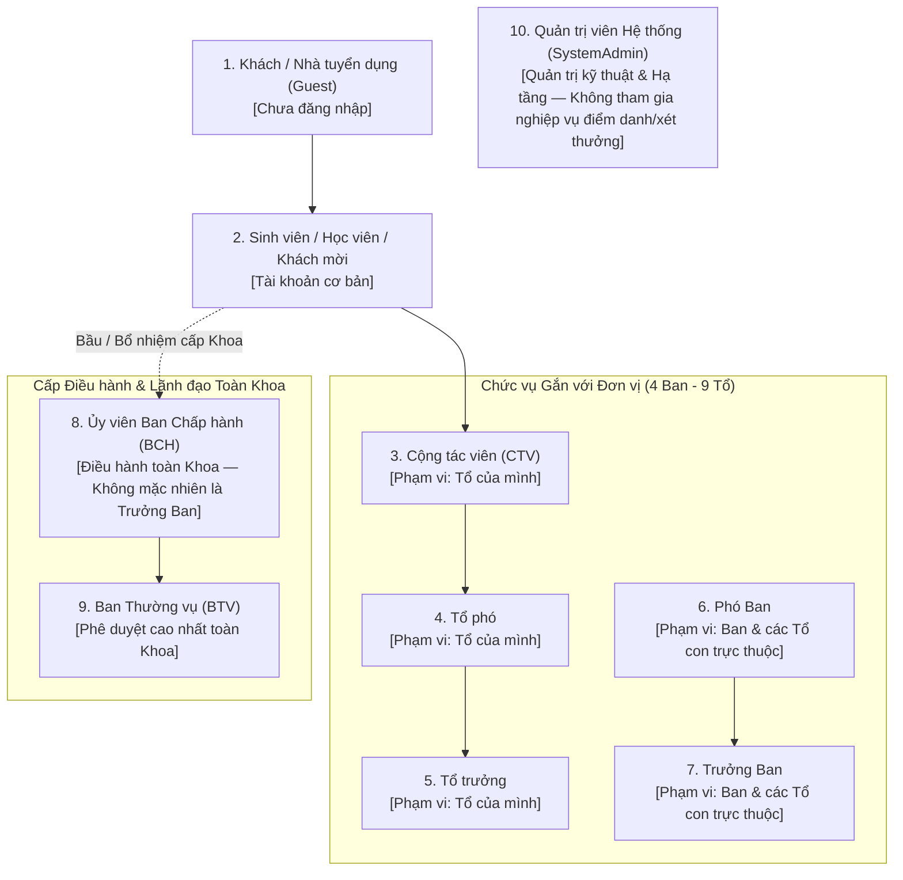

#### B. Sơ đồ Cây Cơ cấu Tổ chức Chuẩn: 4 Ban Chuyên môn & 9 Tổ Trực thuộc
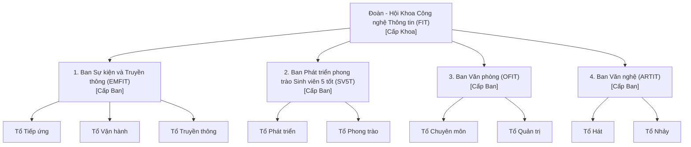

#### C. Danh mục Tác nhân Nghiệp vụ (Actor Catalogue) & Ánh xạ Phân quyền
Mọi tên gọi tác nhân xuất hiện trong các phân hệ ở Mục 4 đều được ánh xạ tường minh về **Vai trò hệ thống** hoặc **Gói Quyền Nghiệp vụ** dưới đây:

| Tác nhân nghiệp vụ trong SRS | Bản chất / Ánh xạ về Vai trò hoặc Gói Quyền |
| :--- | :--- |
| **Cán bộ / Giảng viên / Bí thư Đoàn Khoa** | Tài khoản nhóm `Cán bộ/Giảng viên` (không dùng MSSV 8 số); được gán vai trò `BCH`/`BTV` hoặc quyền xem/phê duyệt tương ứng. |
| **Khách mời có tài khoản tạm** | Diễn giả, đại diện doanh nghiệp, cựu sinh viên được cấp tài khoản tạm có thời hạn theo sự kiện (tham gia `Live Q&A`, xem tài liệu sự kiện). |
| **Trưởng BTC (Sự kiện)** | Sinh viên/CTV/BCH được cấp tạm thời Gói **`MOD_EVENT_OPS`** trong phạm vi 01 sự kiện cụ thể. |
| **Lễ tân / Điều phối (Điểm danh & Quét Mã vạch)** | Thành viên BTC được cấp tạm thời Gói **`MOD_ATTENDANCE_STAFF`** trong phạm vi sự kiện (quét Vé QR & Mã vạch thẻ sinh viên 1D). |
| **MC / Kỹ thuật sân khấu (Minigame, Live Q&A, Voting LED)** | Thành viên BTC được cấp tạm thời Gói **`MOD_QUIZ_EXAM_HOST`** (hoặc nhận bộ file đã chốt từ Ban Văn nghệ). |
| **Ban Giám khảo Sự kiện / Học thuật (Voting Judges)** | Cán bộ/Giảng viên/Khách mời chuyên môn hoặc `BCH`/`BTV` được chỉ định vào danh sách Giám khảo chấm điểm trọng số trong phiên **`Live Voting`**. |
| **Cán bộ Coi thi (Proctor)** | `BCH`/`BTV` hoặc nhân sự được cấp Gói **`MOD_QUIZ_EXAM_HOST`** cho kỳ thi trắc nghiệm đó. |
| **Biên tập viên Truyền thông** | Thành viên **Tổ Truyền thông (`EMFIT`)** hoặc nhân sự được cấp Gói **`MOD_CMS_EDITORIAL`**. |
| **Thủ quỹ** | `BCH`/`BTV` hoặc cán bộ phụ trách tài chính được cấp Gói **`MOD_STORE_MANAGER`** (được `BTV` chỉ định đối soát sao kê). |
| **CTV Trực bàn / Đội giao phòng học** | CTV đang trong ca trực văn phòng (tự mở quyền **`MOD_STORE_BOOTH`**) hoặc nhân sự được cấp **`MOD_STORE_BOOTH`**. |
| **Hội đồng Xét duyệt SV5T** | Tập thể `BCH` & `BTV` (kèm quy tắc chống xung đột lợi ích: không tự chấm hồ sơ của chính mình). |
| **Tổng Đạo diễn (Văn nghệ)** | `Trưởng/Phó Ban Văn nghệ (ARTIT)` mặc định nắm giữ Gói **`MOD_DEPT_ARTS_LEAD`** (hoặc `BCH`/`BTV`). |
| **Ban Học tập / Đội ngũ Ra đề OJ** | Nhân sự chuyên môn được `BCH`/`BTV` cấp Gói **`MOD_OJ_MANAGER`**. |

> [!IMPORTANT]
> **Nguyên tắc Cô lập Nhân sự theo Ban/Tổ & Tách biệt Quyền Chuyên môn:**
> 1. **Cô lập nhân sự theo Ban/Tổ:** Cán bộ cấp Tổ chỉ thao tác trong đúng Tổ mình; Cán bộ cấp Ban chỉ thao tác trong đúng Ban mình và các Tổ con trực thuộc Ban đó, không can thiệp sang 3 Ban còn lại.
> 2. **Tách biệt Quyền Nhân sự khỏi 4 Gói Chuyên môn CTV:** 4 Gói chuyên môn dành cho CTV (`MOD_DEPT_EVENT_MEDIA`, `MOD_DEPT_SV5T`, `MOD_DEPT_OFFICE`, `MOD_DEPT_ARTS`) **không chứa** quyền thêm/sửa/xóa nhân sự.
> 3. **Quyền Không thể Ủy quyền (Non-delegable):** Duyệt xuất bản sự kiện có cộng quyền lợi (`ĐRL/CTXH/CĐDN`), cấp đặc cách `CĐDN`/xác nhận chuyển ngành, chốt danh hiệu SV5T, và duyệt tài khoản ngân hàng nhận tiền gây quỹ **chỉ thuộc về `BTV`**.

---

### 3.2. Danh mục 20 Gói Quyền Nghiệp vụ (Business Permission Packages)
Hệ thống gom các quyền thao tác thành **20 Gói Quyền Nghiệp vụ** phân thành 4 nhóm rõ ràng:

| Mã Gói | Tên Gói Quyền trên Giao diện Quản trị | Mô tả các công việc được phép thực hiện trong Gói | Đối tượng mặc định & Cấp linh hoạt |
| :--- | :--- | :--- | :--- |
| **A. Nhóm Quản lý Nhân sự Nội bộ Ban/Tổ (1 gói — Phân tầng theo chức vụ ở Bảng 3.3A)** | | | |
| **`MOD_UNIT_HR_INTERNAL`** | **Quản lý Nhân sự Ban/Tổ & Thông báo CTV** | Xem danh bạ và gửi thông báo nội bộ theo phạm vi đơn vị; thực hiện tác vụ nhân sự theo đúng 3 cấp ở Bảng 3.3A (`Tổ phó`: chỉ Đề xuất; `Tổ trưởng`: Thực hiện trong Tổ; `Phó Ban`: Đề xuất/Hỗ trợ Ban; `Trưởng Ban`: Phê duyệt & Điều chuyển trong Ban). *(Không cấp cho CTV thường).* | Mặc định theo cấp cho **Tổ phó, Tổ trưởng, Phó Ban, Trưởng Ban, BCH, BTV**. |
| **B. 4 Gói Nghiệp vụ Chuyên môn CTV theo Ban (4 gói — Không gồm quyền nhân sự)** | | | |
| **`MOD_DEPT_EVENT_MEDIA`** | **Nghiệp vụ CTV Ban Sự kiện & Truyền thông** | Tạo, chỉnh sửa và điểm danh các sự kiện nội bộ CTV thuộc Ban `EMFIT` (không cộng điểm quyền lợi). | Cấp cho **CTV / Thành viên Ban `EMFIT`**. |
| **`MOD_DEPT_SV5T`** | **Nghiệp vụ CTV Ban Phát triển Phong trào SV5T** | Theo dõi tiến độ 5 tiêu chí của sinh viên, gửi nhắc nhở và rà soát sơ bộ minh chứng hồ sơ *Sinh viên 5 tốt* (không bao gồm quyền chốt duyệt cuối và tự khóa trên hồ sơ bản thân); tạo, chỉnh sửa và điểm danh sự kiện nội bộ CTV thuộc Ban `SV5T` (không cộng điểm quyền lợi). | Cấp cho **CTV / Thành viên Ban `SV5T`**. |
| **`MOD_DEPT_OFFICE`** | **Nghiệp vụ CTV Ban Văn phòng (Trực & Kiểm kê)** | Kiểm kê vật dụng, lập phiếu mượn-trả tài sản văn phòng (hỗ trợ quét mã QR tài sản & quét mã vạch thẻ sinh viên người mượn); mở đăng ký, cân đối lịch trực và theo dõi điều phối đổi ca trực văn phòng; tạo, chỉnh sửa và điểm danh sự kiện nội bộ CTV thuộc Ban `OFIT` (không cộng điểm quyền lợi). *(Đơn xin vắng hợp lệ được hệ thống chấp nhận tự động).* | Cấp cho **CTV / Thành viên Ban `OFIT`**. |
| **`MOD_DEPT_ARTS`** | **Nghiệp vụ CTV Ban Văn nghệ (Tiết mục & File diễn)**| Đăng ký và cập nhật thông tin tiết mục biểu diễn (tên tiết mục, danh sách diễn viên, tải lên file nhạc Beat, Video LED, kịch bản đèn); tạo, chỉnh sửa và điểm danh sự kiện nội bộ CTV thuộc Ban `ARTIT` (không cộng điểm quyền lợi). | Cấp cho **CTV / Thành viên Ban `ARTIT`**. |
| **C. 2 Gói Thẩm quyền Ban Chủ nhiệm Ban (2 gói)** | | | |
| **`MOD_DEPT_OFFICE_LEAD`**| **Thẩm quyền Trưởng/Phó Ban Văn phòng** | Duyệt ngoại lệ đơn xin vắng trực cận giờ ($< 2\text{h}$) trong trường hợp bất khả kháng; duyệt đổi ca trực ngoại lệ và chốt biên bản chênh lệch kiểm kê tài sản. | Mặc định cho **Trưởng/Phó Ban Văn phòng (`OFIT`)** và **BCH/BTV**. |
| **`MOD_DEPT_ARTS_LEAD`** | **Thẩm quyền Trưởng/Phó Ban Văn nghệ** | Chốt duyệt tiết mục sau tổng duyệt (khóa file nhạc/video bàn giao kỹ thuật) và mở khóa khẩn cấp tối đa 20 phút sát giờ diễn. | Mặc định cho **Trưởng/Phó Ban Văn nghệ (`ARTIT`)** và **BCH/BTV**. |
| **D. Nhóm Nghiệp vụ Điều hành Toàn Khoa & Giám sát (13 gói — Cấp theo phạm vi sự kiện/thời hạn)** | | | |
| **`MOD_EVENT_OPS`** | **Tổ chức & Điều phối Sự kiện Khoa** | Lên kế hoạch sự kiện cấp Khoa, duyệt danh sách ứng tuyển BTC, quản lý điểm danh, xử lý hàng chờ hậu kiểm và xem danh sách chứng nhận sự kiện. *(Không gồm quyền phê duyệt xuất bản sự kiện có quyền lợi).* | Mặc định cho **BCH & BTV**; cấp tạm thời cho *Trưởng BTC* theo sự kiện. |
| **`MOD_ATTENDANCE_STAFF`**| **Điểm danh, Quét Mã vạch Thẻ SV & Soát vé Hội trường** | Chiếu mã QR điểm danh, tải danh sách & khóa công khai để **quét Vé QR ngoại tuyến hoặc quét Mã vạch Thẻ sinh viên 1D (`Code 128` / `Code 39`) bằng camera / súng quét mã vạch (USB/Bluetooth HID) trên máy BTC**, tiếp nhận sinh viên vãng lai (`Walk-in`) và điểm danh bù có ghi lý do. | Mặc định cho **BCH & BTV**; cấp tạm thời cho *Lễ tân / Điều phối* theo sự kiện. |
| **`MOD_QUIZ_EXAM_HOST`** | **Tổ chức Minigame, Live Q&A, Voting LED & Thi Trắc nghiệm** | Tạo bộ câu hỏi, mở phòng Minigame, **duyệt/gộp/chiếu câu hỏi `Live Q&A` và điều khiển màn hình LED đua top / đóng băng kết quả `Live Voting`** trên sân khấu, giám sát phòng thi trắc nghiệm và chuyển thiết bị thi cho thí sinh khi gặp sự cố. | Mặc định cho **BCH & BTV**; cấp tạm thời cho *MC / Kỹ thuật / Coi thi*. |
| **`MOD_CMS_EDITORIAL`** | **Biên tập & Xuất bản Bản tin Truyền thông** | Soạn thảo, tiếp nhận & biên tập bài cộng tác của sinh viên, nhận xét góp ý và duyệt xuất bản bài viết lên trang chủ. | Mặc định cho **BCH & BTV**; cấp cho *Tổ Truyền thông (`EMFIT`)* / nhân sự biên tập. |
| **`MOD_STORE_MANAGER`** | **Quản lý Bán hàng Áo khoa & Gây quỹ** | Tạo đợt bán vật phẩm/gây quỹ, cấu hình giá vốn & voucher, đối soát sao kê ngân hàng, duyệt đổi size/hoàn tiền và xuất báo cáo tài chính. | Mặc định cho **BCH & BTV**; cấp cho *Thủ quỹ* / trưởng nhóm bán hàng. |
| **`MOD_STORE_BOOTH`** | **Trực bàn Giao hàng Vật phẩm (Quét QR / Mã vạch Thẻ SV)** | Xem danh sách đơn đã thanh toán/COD và **quét mã QR nhận hàng hoặc quét Mã vạch 1D trên thẻ sinh viên** để tra cứu & phát áo khoa/vật phẩm tại Văn phòng hoặc phòng học. | Mặc định cho **BCH & BTV**; tự động mở cho CTV đang trong ca trực văn phòng. |
| **`MOD_OJ_MANAGER`** | **Ra đề & Tổ chức Thi Lập trình (Online Judge)**| Tạo đề bài lập trình thuật toán, tải bộ dữ liệu chấm thử (Testcase) và mở kỳ thi lập trình cấp Khoa. | Mặc định cho **BCH & BTV**; cấp cho *Ban Học tập* / đội ngũ ra đề. |
| **`MOD_YITBOT_CURATOR`** | **Biên soạn Tài liệu cho Trợ lý Ảo `YITBot`** | Soạn FAQ, tải lên bản nháp văn bản quy chế Đoàn - Hội để trình BTV phê duyệt vào bộ nhớ `YITBot`. | Mặc định cho **BCH & BTV**; cấp cho cá nhân được ủy quyền cập nhật quy chế. |
| **`MOD_YITBOT_FULL`** | **Quản trị & Phê duyệt Dữ liệu AI `YITBot`** | Phê duyệt tài liệu chính thức đưa vào bộ nhớ `YITBot`, cấu hình giới hạn ngân sách/quota AI và điều chỉnh lời nhắc hệ thống. | Mặc định cho **BTV** (và cấu hình kỹ thuật AI Gateway). |
| **`MOD_SURVEY_POLL`** | **Tạo Khảo sát, Bình chọn (`Voting`) & Lấy ý kiến Sinh viên** | Thiết kế biểu mẫu khảo sát, **tạo chiến dịch Bình chọn (`Live Voting`) / Biểu quyết**, cấu hình trọng số điểm `Ban Giám khảo + Khán giả` & chỉ định danh sách Giám khảo (`judgeUserIds`), xem biểu đồ thống kê (đạt ngưỡng $N \ge 5$ với ẩn danh), xem trước khử định danh & chạy tóm tắt AI và xuất biên bản PDF/Excel. *(Điều khiển màn hình LED sân khấu thuộc gói `MOD_QUIZ_EXAM_HOST`; quyền chấm điểm BGK cấp trực tiếp theo danh sách `judgeUserIds` của từng chiến dịch).* | Mặc định cho **BCH & BTV**; cấp cho nhân sự phụ trách khảo sát/bình chọn. |
| **`MOD_QA_MESSENGER`** | **Trực Hộp thư Hỏi - Đáp & Hỗ trợ BCH** | Xem hộp thư chung BCH, bấm tiếp nhận câu hỏi, xem tóm tắt hồ sơ sinh viên tối thiểu (có ghi Audit Log), nhắn tin giải đáp và đóng luồng hội thoại. | Mặc định thuộc **BCH & BTV**; có thể ủy quyền hạn chế cho nhân sự trực hộp thư. |
| **`MOD_AUDIT_VIEWER`** | **Kiểm toán Nhật ký Hệ thống (`Audit Log`)** | Xem Nhật ký Kiểm tra Hệ thống (`Audit Log` — chỉ đọc) để giám sát an toàn và đối chiếu nghiệp vụ. *(Không bao gồm quyền tra danh tính câu hỏi ẩn danh Live Q&A).* | Mặc định chỉ **BTV & SystemAdmin**. |
| **`MOD_LIVEQA_UNMASK`** | **Tra cứu Danh tính Câu hỏi Ẩn danh `Live Q&A`** | Tra cứu tài khoản gửi câu hỏi ẩn danh trên `Live Q&A` khi phát sinh hành vi quấy rối/vi phạm nội quy (mọi lượt tra cứu đều bắt buộc ghi lý do vào Audit Log). **Không cấp cho `SystemAdmin`.** | Mặc định chỉ **BTV**; có thể cấp tạm cho *Trưởng BTC* sự kiện. |

---

### 3.3. Ma trận Phân quyền Mặc định 2 Lớp (Single Source of Truth)

**Ký hiệu chuẩn hóa:**
* `V` = Xem / Tham gia | `C` = Tạo mới / Soạn thảo / Nộp | `U` = Chỉnh sửa / Thực hiện trong phạm vi | `A` = Phê duyệt / Công bố | `M` = Quản trị toàn diện phân hệ *(mặc nhiên bao hàm `V, C, U, A` trong phạm vi phân hệ đó)*
* `Thẩm định` = Kiểm tra tính hợp lý nội dung, đối tượng, quyền lợi và xác nhận đề xuất trước khi chuyển lên `BTV` phê duyệt cuối cùng
* `(*)` = Mặc định chưa có, được `BTV`/`BCH` cấp tạm thời qua **Gói Quyền Nghiệp vụ** tương ứng ở Mục 3.2

#### Bảng 3.3A: Ma trận Vai trò × Phạm vi Quản trị Nhân sự, Phê duyệt Cấp bậc & Quyền Cá nhân
*(Đây là nguồn quy chuẩn duy nhất cho mọi FR liên quan đến nhân sự và phân cấp phê duyệt; các FR ở Mục 4 tham chiếu trực tiếp bảng này.)*

| Nhóm Chức năng / Tác vụ Nghiệp vụ | Khách (`Guest`) | Sinh viên (`Student`) | Cộng tác viên (`CTV`) | Tổ phó | Tổ trưởng | Phó Ban | Trưởng Ban | Ủy viên BCH | Ban Thường vụ (`BTV`) | Quản trị Hệ thống (`Admin`) |
| :--- | :---: | :---: | :---: | :---: | :---: | :---: | :---: | :---: | :---: | :---: |
| **1. Quản lý Nhân sự Ban/Tổ & Thông báo Nội bộ (`MOD_UNIT_HR_INTERNAL`)** | | | | | | | | | | |
| Xem danh bạ thành viên đơn vị | - | - | `V` (Chỉ Tổ mình) | `V` (Tổ mình + rút gọn Ban) | `V` (Tổ mình + rút gọn Ban) | `V` (Ban mình) | `V` (Ban mình) | `V` (Toàn Khoa) | `M` (Toàn Khoa) | - |
| Tiếp nhận, cập nhật, điều chuyển & cho nghỉ CTV *(3 cấp)* | - | - | - | **Đề xuất** (Chỉ Tổ mình) | **Thực hiện** (Chỉ Tổ mình) | **Đề xuất / Hỗ trợ** (Ban mình) | **Phê duyệt & Điều chuyển** (Ban mình) | **Phê duyệt / Điều phối** (Toàn Khoa) | `M` (Toàn Khoa) | - |
| Gửi thông báo nội bộ đến CTV trong đơn vị | - | - | - | Gửi (Chỉ Tổ mình) | Gửi (Chỉ Tổ mình) | Gửi (Ban mình) | Gửi (Ban mình) | Gửi (Toàn Khoa) | Gửi (Toàn Khoa) | - |
| **2. Quản trị Tổ chức Sự kiện, Quyền lợi & Phân quyền** | | | | | | | | | | |
| Tổ chức sự kiện nội bộ CTV *(không cộng quyền lợi — cô lập đúng Ban)* | - | - | `C, U` (Ban mình) | `C, U` (Ban mình) | `C, U` (Ban mình) | `C, U` (Ban mình) | `C, U, A` (Ban mình) | `C, U, A` (Toàn Khoa) | `M` | - |
| Tạo sự kiện cấp Khoa & Duyệt danh sách BTC (7 vị trí) | - | - | `(*)` | `(*)` | `(*)` | `(*)` | `(*)` | `C, U, A` | `M` | - |
| Phê duyệt xuất bản sự kiện & Gắn quyền lợi (`ĐRL/CTXH/CĐDN`) | - | - | - | - | - | - | **-** *(Không ủy quyền)* | **Thẩm định** | `A, M` *(Duy nhất)* | - |
| Xác nhận SV chuyển ngành / Cấp đặc cách quyền lợi `CĐDN` | - | - | - | - | - | - | - | - | `A, M` *(Duy nhất)* | - |
| Cấp tạm thời Gói Quyền Nghiệp vụ cho cá nhân/CTV | - | - | - | - | - | - | - | `A` (Trong phạm vi ủy quyền) | `M` | - |
| Tạo mới / Chỉnh sửa cấu trúc Gói Quyền, Vai trò & Danh mục Ngành | - | - | - | - | - | - | - | - | `M` (Nghiệp vụ) | `M` (Kỹ thuật) |
| **3. Quyền Cá nhân & Nghiệp vụ Theo Dõi Chung** | | | | | | | | | | |
| Đăng ký tham dự sự kiện, Tự quét QR, Mở Vé Ngoại tuyến / Đưa thẻ SV quét mã vạch | `V` (Xem mở) | `C` / Thực hiện | `C` / Thực hiện | `C` / Thực hiện | `C` / Thực hiện | `C` / Thực hiện | `C` / Thực hiện | `C` / Thực hiện | `C` / Thực hiện | - |
| Tham gia Bình chọn hội trường / Biểu quyết (`Live Voting`) & Kiểm chứng biên nhận lá phiếu | `V` (Bảng mở) | Thực hiện (Đủ ĐK) | Thực hiện (Đủ ĐK) | Thực hiện (Đủ ĐK) | Thực hiện (Đủ ĐK) | Thực hiện (Đủ ĐK) | Thực hiện (Đủ ĐK) | Thực hiện + Chấm BGK `(*)` | Thực hiện + Chốt biên bản | - |
| Đăng ký ca trực VP, Điểm danh đầu/cuối ca, Xin vắng/Đổi ca | - | - | Thực hiện | Thực hiện | Thực hiện | Thực hiện | Thực hiện | Thực hiện | Thực hiện | - |
| Xem thống kê chuyên cần trực VP của CTV theo đơn vị | - | - | - | `V` (Chỉ Tổ mình) | `V` (Chỉ Tổ mình) | `V` (Ban mình) | `V` (Ban mình) | `V` (Toàn Khoa) | `M` (Toàn Khoa) | - |
| Nộp hồ sơ SV5T cá nhân *(Hội đồng không tự chấm hồ sơ mình)* | `V` (DS đạt) | `C, U` (Cá nhân) | `C, U` (Cá nhân) | `C, U` (Cá nhân) | `C, U` (Cá nhân) | `C, U` (Cá nhân) | `C, U` (Cá nhân) | `C, U` (Cá nhân) | `C, U` (Cá nhân) | - |
| E-Portfolio cá nhân & Kiểm duyệt vi phạm *(SV toàn quyền nội dung)* | `V` (Hồ sơ mở) | `C, U` (Cá nhân) | `C, U` (Cá nhân) | `C, U` (Cá nhân) | `C, U` (Cá nhân) | `C, U` (Cá nhân) | `C, U` (Cá nhân) | `C, U` (Cá nhân) | `C, U` (Cá nhân) + Ẩn vi phạm (Audit) | - |
| Xem cửa hàng, Đặt mua vật phẩm, Gửi yêu cầu đổi size/hoàn tiền | `V` | `V, C` (Cá nhân) | `V, C` (Cá nhân) | `V, C` (Cá nhân) | `V, C` (Cá nhân) | `V, C` (Cá nhân) | `V, C` (Cá nhân) | `V, C` (Cá nhân) | `V, C` (Cá nhân) | - |
| Gửi tin nhắn Hỏi - Đáp tới Hộp thư BCH (`Q&A Messenger`) | - | `C, U` (Cá nhân) | `C, U` (Cá nhân) | `C, U` (Cá nhân) | `C, U` (Cá nhân) | `C, U` (Cá nhân) | `C, U` (Cá nhân) | `C, U` (Cá nhân) | `V` | - |
| Xem Nhật ký Kiểm tra Hệ thống (`Audit Log` - `MOD_AUDIT_VIEWER`) | - | - | - | - | - | - | - | - | `V` | `V` |
| Tra cứu danh tính câu hỏi ẩn danh `Live Q&A` (`MOD_LIVEQA_UNMASK`) | - | - | - | - | - | - | - | `(*)` (Trưởng BTC) | `A` (Có Audit) | - |

#### Bảng 3.3B: Ma trận Gói Quyền Nghiệp vụ × Thao tác Chuyên môn
*(Mỗi **thao tác nhạy cảm / thẩm quyền chốt chặn** — như kiểm duyệt `Live Q&A`, tra danh tính ẩn danh, điều khiển màn hình LED `Live Voting`, phê duyệt tri thức AI, duyệt ngoại lệ trực/văn nghệ — chỉ thuộc đúng một Gói Quyền chuyên biệt; bảng này tách biệt rõ thẩm quyền chuyên môn từng Ban khỏi chức danh Trưởng Ban chung chung và bao phủ đủ 20 gói ở Mục 3.2.)*

| Gói Quyền Nghiệp vụ | Thao tác Chuyên môn Được cấp | Đơn vị / Vai trò Sở hữu Mặc định | Quy tắc Cấp tạm thời (`*`) & Phạm vi |
| :--- | :--- | :--- | :--- |
| **`MOD_UNIT_HR_INTERNAL`** | Xem danh bạ, gửi thông báo & quản lý nhân sự 3 cấp theo phân tầng ở Bảng 3.3A | Tổ phó, Tổ trưởng, Phó/Trưởng Ban, `BCH`, `BTV` | Cô lập đúng Tổ/Ban của người giữ chức vụ |
| **`MOD_DEPT_EVENT_MEDIA`** | Tạo, sửa, điểm danh sự kiện nội bộ CTV thuộc `EMFIT` (không cộng quyền lợi) | CTV & BCN Ban `EMFIT` | Chỉ trong phạm vi Ban `EMFIT` |
| **`MOD_DEPT_SV5T`** | Xem tiến độ SV5T toàn Khoa, nhắc nhở, rà soát sơ bộ SV5T (trừ hồ sơ bản thân); tạo, sửa, điểm danh sự kiện nội bộ CTV thuộc `SV5T` (không cộng quyền lợi) | CTV & BCN Ban `SV5T`; Hội đồng (`BCH`, `BTV`) | Sự kiện nội bộ chỉ trong `SV5T`; chốt KQ cuối chỉ thuộc `BTV` |
| **`MOD_DEPT_OFFICE`** | Quản lý danh mục/mượn-trả/kiểm kê tài sản VP (hỗ trợ quét QR tài sản & quét mã vạch thẻ SV); mở cổng, xếp lịch & điều phối ca trực toàn Khoa; tạo, sửa, điểm danh sự kiện nội bộ CTV thuộc `OFIT` (không cộng quyền lợi) | CTV & BCN Ban `OFIT`; `BCH`, `BTV` | Sự kiện nội bộ chỉ trong `OFIT`; trực VP & tài sản toàn Khoa |
| **`MOD_DEPT_OFFICE_LEAD`** | Duyệt ngoại lệ xin vắng cận giờ ($< 2\text{h}$), duyệt đổi ca ngoại lệ, chốt biên bản chênh lệch kiểm kê | Trưởng/Phó Ban `OFIT`; `BCH`, `BTV` | Không cấp cho CTV thường |
| **`MOD_DEPT_ARTS`** | Đăng ký tiết mục văn nghệ, khai báo danh sách diễn viên, tải file Beat/LED/Cue Sheet; tạo, sửa, điểm danh sự kiện nội bộ CTV thuộc `ARTIT` (không cộng quyền lợi) | CTV & BCN Ban `ARTIT`; (Đội thi SV chỉ sửa tiết mục mình) | Sự kiện nội bộ chỉ trong `ARTIT`; tiết mục theo sự kiện |
| **`MOD_DEPT_ARTS_LEAD`** | Chốt duyệt tiết mục sau tổng duyệt, đánh số kịch bản, mở khóa khẩn cấp 20 phút | Trưởng/Phó Ban `ARTIT`; `BCH`, `BTV` | Chỉ `ARTIT` Lead hoặc `BCH`/`BTV` |
| **`MOD_EVENT_OPS`** | Tạo/điều phối sự kiện cấp Khoa, duyệt danh sách BTC, xử lý hàng chờ hậu kiểm điểm danh, xem DS chứng nhận sự kiện | `BCH`, `BTV` | Cấp tạm cho *Trưởng BTC* theo từng sự kiện (không gồm duyệt quyền lợi) |
| **`MOD_ATTENDANCE_STAFF`** | Chiếu QR điểm danh, tải dữ liệu & khóa quét offline trên máy BTC, **quét Vé QR & quét Mã vạch thẻ SV 1D (`Code 128`/`Code 39`) bằng camera hoặc súng quét USB/Bluetooth HID**, tiếp nhận Walk-in/điểm danh bù | `BCH`, `BTV` | Cấp tạm cho Lễ tân/Điều phối theo từng sự kiện |
| **`MOD_QUIZ_EXAM_HOST`** | Mở phòng Minigame, duyệt/gộp/chiếu `Live Q&A`, **điều khiển màn hình LED đua top & đóng băng kết quả `Live Voting`**, giám sát phòng thi & chuyển thiết bị thi | `BCH`, `BTV` | Cấp tạm cho MC/Kỹ thuật/Cán bộ coi thi theo sự kiện |
| **`MOD_CMS_EDITORIAL`** | Tiếp nhận bài cộng tác SV, biên tập, góp ý, duyệt & hẹn giờ đăng bản tin trang chủ | `BCH`, `BTV` | Cấp cho *Tổ Truyền thông (`EMFIT`)* / nhóm biên tập |
| **`MOD_STORE_MANAGER`** | Tạo đợt bán, cấu hình giá vốn/voucher, đối soát sao kê, duyệt đổi size/hoàn tiền, xuất Excel | `BCH`, `BTV` | Cấp cho *Thủ quỹ* / trưởng nhóm chiến dịch |
| **`MOD_STORE_BOOTH`** | Xem đơn đã thanh toán/COD, **quét QR đơn hàng hoặc quét Mã vạch thẻ SV** để giao hàng tại bàn trực hoặc phòng học | `BCH`, `BTV`; CTV đang trong ca trực VP | Tự kích hoạt trong ca trực VP (`Đúng giờ`/`Đi trễ`) hoặc cấp cho đội giao lớp |
| **`MOD_OJ_MANAGER`** | Tạo đề thi thuật toán, tải Testcase, mở kỳ thi ICPC/IOI, xem báo cáo trùng lặp code | `BCH`, `BTV` | Cấp cho *Ban Học tập* / đội ngũ ra đề |
| **`MOD_YITBOT_CURATOR`** | Soạn FAQ, tải bản nháp quy chế cho `YITBot` (chờ `BTV` duyệt) | `BCH`, `BTV` | Cấp cho nhân sự soạn thảo văn bản |
| **`MOD_YITBOT_FULL`** | Phê duyệt tri thức chính thức cho `YITBot`, đặt ngân sách & hạn mức AI | `BTV` | Không ủy quyền cho CTV |
| **`MOD_SURVEY_POLL`** | Tạo khảo sát & **chiến dịch Bình chọn (`Live Voting`) / Biểu quyết**, cấu hình trọng số điểm BGK/Khán giả, xem thống kê (đạt $N \ge 5$ nếu ẩn danh), xem trước khử định danh & chạy tóm tắt AI, xuất biên bản kiểm phiếu | `BCH`, `BTV` | Cấp theo sự kiện hoặc phạm vi Ban/Tổ |
| **`MOD_QA_MESSENGER`** | Tiếp nhận, trả lời, ghi chú nội bộ vàng, xem tóm tắt SV tối thiểu (có Audit), đóng luồng | `BCH`, `BTV` | Ủy quyền hạn chế khi thiếu nhân lực trực hộp thư |
| **`MOD_AUDIT_VIEWER`** | Xem Nhật ký Kiểm tra Hệ thống (`Audit Log` — chỉ đọc) | `BTV`, `SystemAdmin` | Không bao gồm quyền tra danh tính Live Q&A |
| **`MOD_LIVEQA_UNMASK`** | Tra cứu tài khoản gửi câu hỏi ẩn danh `Live Q&A` khi có quấy rối (mọi lượt đều ghi Audit Log) | `BTV` | Có thể cấp tạm cho *Trưởng BTC* theo sự kiện; **không cấp cho `SystemAdmin`** |

#### Diễn giải Tóm tắt Quyền hạn Cốt lõi theo Vai trò
1. **Khách & Nhà tuyển dụng (`Guest`):** Xem tin công khai, lịch sự kiện mở, bảng vàng SV5T, đề OJ mở, gian hàng, hỏi `YITBot` (giới hạn lượt), và **quét QR kiểm chứng E-Cert / CV (hoạt động độc lập với trạng thái tài khoản cựu SV)**.
2. **Sinh viên / Học viên / Khách mời:** Tham gia sự kiện, tự quét QR điểm danh, dùng Vé QR Ngoại tuyến hoặc xuất trình Thẻ sinh viên vật lý để BTC quét mã vạch 1D, tải E-Cert, tham gia **Bình chọn hội trường / Biểu quyết (`Live Voting`) & tra cứu mã biên nhận lá phiếu**, chơi Minigame, đặt câu hỏi `Live Q&A`, thi trắc nghiệm, nộp hồ sơ SV5T, đặt mua vật phẩm, quản lý E-Portfolio (mặc định Riêng tư), nhắn tin `Q&A Messenger`.
3. **Cộng tác viên (`CTV`):** Quyền Sinh viên + xem danh bạ Tổ mình + đăng ký/điểm danh trực văn phòng + thực hiện nghiệp vụ chuyên môn theo gói `MOD_DEPT_*` của Ban mình (không có quyền thêm/xóa nhân sự).
4. **Tổ phó (`DeputyTeamLeader`):** Xem danh bạ Tổ mình + rút gọn Ban mình, gửi thông báo Tổ mình, **đề xuất** tiếp nhận/cập nhật CTV Tổ mình, xem thống kê trực VP Tổ mình.
5. **Tổ trưởng (`TeamLeader`):** Xem danh bạ Tổ mình + rút gọn Ban mình, quản lý nhân sự **thực tế** (tiếp nhận/cập nhật/chuyển nghỉ) trong đúng Tổ mình, gửi thông báo Tổ mình, xem thống kê trực VP Tổ mình.
6. **Phó Ban (`ViceCommitteeHead`):** Hỗ trợ Trưởng Ban xem danh bạ, gửi thông báo, xem thống kê trực VP và **đề xuất/hỗ trợ điều phối** nhân sự trong đúng Ban mình (có thể kiêm thêm chức Tổ trưởng nếu được bổ nhiệm).
7. **Trưởng Ban (`CommitteeHead`):** Toàn quyền nhân sự (phê duyệt/điều chuyển giữa các Tổ con) và tổ chức sự kiện nội bộ **trong đúng Ban mình** (không can thiệp 3 Ban khác; **không** có quyền duyệt sự kiện có cộng điểm `ĐRL/CTXH/CĐDN`).
8. **Ủy viên Ban Chấp hành (`BCH`):** Điều hành toàn Khoa trên các phân hệ chuyên môn, tham gia Hội đồng SV5T (không tự chấm hồ sơ mình), **thẩm định** sự kiện có quyền lợi trước khi trình BTV, trực hộp thư `Q&A Messenger`.
9. **Ban Thường vụ (`BTV`):** Lãnh đạo và phê duyệt nghiệp vụ cao nhất: duyệt xuất bản sự kiện có `ĐRL/CTXH/CĐDN`, xác nhận chuyển ngành/đặc cách `CĐDN`, chốt kết quả SV5T & biên bản biểu quyết/bầu cử, phê duyệt tài khoản ngân hàng gây quỹ & tài liệu `YITBot`, cấu hình danh mục mã ngành, cấp/thu hồi gói quyền và ẩn nội dung E-Portfolio vi phạm.
10. **Quản trị viên Hệ thống (`SystemAdmin`):** Quản trị hạ tầng, cấu hình kỹ thuật và xem `Audit Log`; không tham gia điểm danh hay nộp hồ sơ khen thưởng.

---

## 4. Đặc tả Yêu cầu Chức năng (Functional Requirements)

### 4.1. Phân hệ Đăng nhập, Vòng đời Tài khoản & Phân quyền Linh hoạt

| Mã YC | Tên yêu cầu | Mô tả chi tiết & Quy tắc nghiệp vụ (Business Rules) | Tiêu chí chấp nhận (`Given / When / Then`) & Kiểm chứng | Độ ưu tiên |
| :--- | :--- | :--- | :--- | :---: |
| **FR-IAM-01** | Đăng nhập SSO, Danh sách Đối chiếu Dự phòng (`OFFICIAL_DIRECTORY_ROSTER`), Phân loại Tài khoản & Nhận diện Ngành Cấu hình Động | - Đăng nhập 1 chạm theo chuẩn OAuth2/OIDC với hệ thống tài khoản chính thức của Nhà trường (cấu hình IdP Microsoft Entra ID hoặc Google Workspace).<br>- **Hỗ trợ 4 nhóm tài khoản:** (1) `Sinh viên` (có MSSV), (2) `Cán bộ / Giảng viên / Bí thư Đoàn Khoa` (mã cán bộ, không có MSSV), (3) `Học viên cao học / VB2 / Liên thông` (cấu trúc mã số riêng), (4) `Khách mời có tài khoản tạm` (có hạn sử dụng theo sự kiện).<br>- **Nguồn định danh tin cậy 2 lớp (Xử lý rủi ro IdP không trả claim MSSV — `B2`):**<br>&nbsp;&nbsp;• **Lớp 1 (OIDC Custom Claims):** Đọc trực tiếp thuộc tính `studentCode` / `staffId` / `userType` từ ID Token nếu IdP của Trường đã cấu hình trả về.<br>&nbsp;&nbsp;• **Lớp 2 (Phương án dự phòng chuẩn — Bảng Danh sách Chính thức `OFFICIAL_DIRECTORY_ROSTER`):** Trường hợp IdP của Trường chỉ trả về `email` và `fullName` mà chưa cấu hình custom claim MSSV, hệ thống **tự động đối chiếu `email` trường đã xác thực với bảng Danh sách Sinh viên & Cán bộ Chính thức do `BTV` import từ tệp CSV/Excel của Phòng Đào tạo / Phòng CTSV vào đầu mỗi học kỳ** để gán chính xác `studentCode`/`staffId`/`userType` (không phân tích phỏng đoán tự do từ chuỗi email).<br>- **Danh mục Mã ngành Khoa CNTT cấu hình động:** Tách phần mã ngành `BBB` trong MSSV chuẩn `AABBBCCC` đối chiếu với **bảng danh mục ngành do BTV cấu hình** (khởi tạo mặc định: `110`, `162`, `133`). | **Given** sinh viên đăng nhập SSO thành công (hoặc IdP trả claim `MSSV = 25110001`, hoặc IdP chỉ trả `email` và hệ thống tra cứu khớp `MSSV = 25110001` từ bảng `OFFICIAL_DIRECTORY_ROSTER` đã import) với mã ngành `110` nằm trong bảng ngành cấu hình.<br>**When** hệ thống tạo/cập nhật phiên đăng nhập.<br>**Then** tài khoản được gắn đúng `studentCode = 25110001` thuộc Khoa CNTT và không lỗi nếu đăng nhập bằng tài khoản Cán bộ/Khách mời không có MSSV 8 số.<br>*Kiểm chứng: Test tích hợp SSO (cả 2 chế độ: OIDC claim & Roster fallback) + Kiểm tra danh mục ngành.* | Bắt buộc (P0) |
| **FR-IAM-02** | Hồ sơ Nhiệm kỳ, **Chuyển giao Nhiệm kỳ** & Vòng đời Tài khoản Sau Tốt nghiệp | - Lưu trữ Lớp, Chi đoàn, Chi hội, ngày vào Đoàn/Hội và lịch sử giữ chức vụ gắn đơn vị qua từng nhiệm kỳ.<br>- **Công cụ Chốt & Chuyển giao Nhiệm kỳ (Term Rollover Wizard):** Cho phép `BTV`/`SystemAdmin` chốt kết thúc nhiệm kỳ, lưu toàn bộ chức vụ cũ vào lịch sử cống hiến (`termHistory`), tự động thu hồi quyền điều hành cũ và thiết lập nhân sự nhiệm kỳ mới mà không làm mất dữ liệu cũ (Edge 29).<br>- **Liên kết Email cá nhân & Vòng đời sau tốt nghiệp:** Sinh viên có thể liên kết và xác thực OTP cho 01 **email cá nhân dự phòng** trước khi ra trường. Tài khoản có trạng thái vòng đời: `Đang học` $\rightarrow$ `Đã tốt nghiệp (Cựu SV)` $\rightarrow$ `Lưu trữ`. Khi email trường bị thu hồi, cựu sinh viên vẫn đăng nhập được bằng email cá nhân để xem E-Cert/E-Portfolio.<br>- **Trang xác thực QR công khai** của E-Cert và CV hoạt động độc lập với trạng thái email trường của người sở hữu. | **Given** sinh viên đã liên kết email cá nhân chuyển sang `Đã tốt nghiệp`, và cuối năm học `BTV` chạy công cụ Chốt & Chuyển giao Nhiệm kỳ.<br>**When** email trường bị vô hiệu hóa và sinh viên đăng nhập bằng email cá nhân; đồng thời cán bộ nhiệm kỳ cũ đăng nhập sau khi chuyển giao.<br>**Then** cựu sinh viên vẫn truy cập được lịch sử thành tích và trang QR vẫn hợp lệ; cán bộ cũ lưu lịch sử chức vụ ở `termHistory` và không còn quyền điều hành cũ.<br>*Kiểm chứng: Test vòng đời tài khoản & Edge 29.* | Bắt buộc (P0) |
| **FR-IAM-03** | Quản lý Nhân sự Nội bộ Ban/Tổ & Thông báo Cô lập theo Đơn vị | Thực hiện quản lý danh bạ, tiếp nhận/cập nhật/điều chuyển CTV và gửi thông báo nội bộ theo **đúng 3 cấp thẩm quyền (Đề xuất / Thực hiện / Phê duyệt) và ranh giới cô lập Ban/Tổ quy định tại Bảng 3.3A**:<br>- Cấp Tổ (`Tổ phó` chỉ Đề xuất; `Tổ trưởng` Thực hiện) chỉ thao tác trong đúng Tổ mình.<br>- Cấp Ban (`Phó Ban` Đề xuất/Hỗ trợ; `Trưởng Ban` Phê duyệt & Điều chuyển giữa các Tổ trực thuộc) chỉ thao tác trong đúng Ban mình, không truy cập dữ liệu nhân sự của 3 Ban khác. | **Given** `Tổ phó` và `Trưởng Ban EMFIT` đăng nhập vào mục Nhân sự.<br>**When** `Tổ phó` tạo đề xuất thêm CTV và thử truy cập danh sách Ban `OFIT`.<br>**Then** hệ thống tạo phiếu đề xuất chờ duyệt (không xóa/sửa trực tiếp danh sách) và trả lỗi từ chối truy cập (`403`) với dữ liệu Ban `OFIT`.<br>*Kiểm chứng: Test phân quyền API & UI.* | Bắt buộc (P0) |
| **FR-IAM-04** | Quản lý Vòng đời Thành viên CTV & Bàn giao Trách nhiệm | Quản lý trạng thái hoạt động của CTV theo 3 trạng thái: `Đang hoạt động` $\rightarrow$ `Tạm nghỉ` $\rightarrow$ `Đã rời`. Khi cán bộ chuyển trạng thái CTV sang `Tạm nghỉ` hoặc `Đã rời`:<br>- Tự động thu hồi các gói quyền chuyên môn Ban/Tổ đang gắn.<br>- Tự động rút tên CTV khỏi các ca trực văn phòng tương lai và gửi cảnh báo ca trống cho Ban `OFIT`.<br>- Nếu CTV đang đứng tên **Phiếu mượn tài sản văn phòng chưa trả**, hệ thống cảnh báo và yêu cầu xác nhận trả đồ hoặc chuyển người chịu trách nhiệm trước khi hoàn tất chuyển sang `Đã rời`. | **Given** CTV đang giữ 01 bộ đàm chưa trả và có 2 ca trực tuần tới.<br>**When** Trưởng Ban bấm chuyển trạng thái CTV sang `Đã rời`.<br>**Then** hệ thống chặn hoàn tất cho đến khi xử lý bàn giao bộ đàm, sau đó rút 2 ca trực tương lai và thông báo cho Ban `OFIT`.<br>*Kiểm chứng: Test nghiệp vụ (Edge 34).* | Bắt buộc (P0) |
| **FR-RBAC-01** | Quản lý Cây Cơ cấu Tổ chức 4 Ban - 9 Tổ & Hợp quyền Đa chức vụ | Thiết lập sơ đồ cây tổ chức 4 Ban - 9 Tổ (cho phép BTV mở rộng CLB/Đội/Nhóm). Hỗ trợ mô hình `Người dùng — Chức vụ — Đơn vị — Nhiệm kỳ`: quyền hiệu lực là **phép hợp (union)** các chức vụ đang giữ, có bộ chuyển đổi đơn vị làm việc trên giao diện. Cán bộ quản lý cấp trên kế thừa phạm vi quản lý các Tổ con trực thuộc Ban mình. | **Given** một người giữ đồng thời 2 chức vụ (`Phó Ban EMFIT` và `Tổ trưởng Tổ Truyền thông`).<br>**When** người dùng chọn đơn vị làm việc trên thanh chuyển đổi.<br>**Then** giao diện và API thực thi đúng quyền của đơn vị đã chọn và không vượt sang Ban `OFIT`.<br>*Kiểm chứng: Test & Inspection.* | Bắt buộc (P0) |
| **FR-RBAC-02** | Thiết lập & Quản lý 20 Gói Quyền Nghiệp vụ | Cho phép `BTV` và `SystemAdmin` (cấu hình kỹ thuật) quản lý cấu trúc **20 Gói Quyền Nghiệp vụ** (Bảng 3.2), đảm bảo mỗi **thao tác nhạy cảm / thẩm quyền chốt chặn** (như kiểm duyệt `Live Q&A`, tra danh tính ẩn danh `MOD_LIVEQA_UNMASK`, điều khiển màn hình LED bình chọn, phê duyệt tri thức AI, duyệt ngoại lệ trực/văn nghệ) chỉ thuộc đúng một gói quyền chuyên biệt, và tách riêng `MOD_LIVEQA_UNMASK` khỏi `MOD_AUDIT_VIEWER`. | **Given** `BTV` mở màn hình Cấu hình Gói Quyền.<br>**When** `BTV` kiểm tra danh sách gói.<br>**Then** hệ thống hiển thị đủ 20 gói đúng phân nhóm, không trùng lặp các quyền nhạy cảm (`liveqa:moderate`, `voting:host`, `liveqa:unmask`) giữa các gói và `SystemAdmin` không giữ `MOD_LIVEQA_UNMASK`.<br>*Kiểm chứng: Inspection.* | Bắt buộc (P0) |
| **FR-RBAC-03** | Cấp phát Gói Quyền theo Phạm vi / Thời hạn & Tự động Thu hồi | `BTV`/`BCH` cấp một hoặc nhiều Gói Quyền kèm **Phạm vi** (Toàn Khoa / Ban / Tổ / Sự kiện cụ thể) và **Thời hạn hiệu lực**. Hết thời hạn, hệ thống tự động thu hồi gói quyền. | **Given** CTV được cấp `MOD_ATTENDANCE_STAFF` cho sự kiện A đến `18:00`.<br>**When** đồng hồ hệ thống qua `18:00`.<br>**Then** CTV tự động mất quyền quét vé của sự kiện A mà không cần thu hồi thủ công.<br>*Kiểm chứng: Test tự động theo thời gian.* | Bắt buộc (P0) |
| **FR-RBAC-04** | Tách biệt Quyền Nhân sự khỏi Gói Chuyên môn & Thu hồi Hiệu lực $\le 5$ giây | 4 Gói chuyên môn CTV (`MOD_DEPT_*`) hoàn toàn không chứa quyền thêm/sửa/xóa nhân sự. Khi `BTV` thu hồi quyền của một tài khoản, hệ thống chủ động xóa bộ nhớ đệm quyền để việc thu hồi có hiệu lực trong **$\le 5$ giây (tại thao tác API kế tiếp)**, không chờ hết phiên hay TTL dài. | **Given** CTV đang mở phiên làm việc với `MOD_EVENT_OPS`.<br>**When** `BTV` bấm thu hồi quyền và CTV thực hiện thao tác sau 3 giây.<br>**Then** yêu cầu của CTV bị từ chối với mã `403` và thông báo hết quyền.<br>*Kiểm chứng: Test thu hồi phiên trực tiếp (Edge 30).* | Bắt buộc (P0) |
| **FR-RBAC-05** | Quy tắc Chống Cấp Quyền Vượt Thẩm quyền | Người cấp chỉ được cấp các Gói Quyền mà bản thân đang sở hữu đầy đủ, trong phạm vi đơn vị/sự kiện mình quản lý, và không thể tự ý ủy quyền các quyền `Non-delegable` của `BTV`. | **Given** `BCH` thử cấp gói `MOD_YITBOT_FULL` (chỉ thuộc `BTV`) cho CTV.<br>**When** `BCH` gửi lệnh cấp quyền.<br>**Then** hệ thống từ chối và ghi nhận cảnh báo vượt thẩm quyền.<br>*Kiểm chứng: Test phân quyền âm tính.* | Bắt buộc (P0) |

---

### 4.2. Phân hệ Tổ chức Sự kiện

| Mã YC | Tên yêu cầu | Mô tả chi tiết & Quy tắc nghiệp vụ (Business Rules) | Tiêu chí chấp nhận (`Given / When / Then`) & Kiểm chứng | Độ ưu tiên |
| :--- | :--- | :--- | :--- | :---: |
| **FR-EVT-01** | Tạo Kế hoạch Sự kiện, Đa buổi (Sessions), Tiêu chí SV5T & Vòng đời Chặt chẽ | - **Thông tin chung:** Tên sự kiện, đơn vị phụ trách, học kỳ (`HK1`, `HK2`, `HK Hè`), năm học, thời gian mở/đóng đăng ký, giờ khóa danh sách (mặc định $60$ phút trước giờ diễn ra), số lượng tối đa, **đóng góp cho Tiêu chí SV5T** (*Đạo đức / Học tập / Thể lực / Tình nguyện / Hội nhập / Không áp dụng*), và bộ nhãn quyền lợi kèm giá trị định lượng `(Loại: ĐRL/CTXH/CĐDN, Giá trị, Đơn vị)`.<br>- **Thực thể con Nhiều Buổi (`Sessions`):** Một sự kiện có thể gồm $1$ hoặc nhiều buổi (VD: Hội trại 2 ngày, Giải thể thao). Mỗi buổi có thời gian bắt đầu/kết thúc, **vị trí Check-in**, **vị trí Check-out riêng (tùy chọn nếu khác điểm Check-in)**, bán kính và cấu hình số buổi tối thiểu cần đạt ($K/N$ buổi) để hoàn thành sự kiện.<br>- **Cấu hình Tuyển BTC (7 vai trò):** `Nội bộ CTV` hoặc `Toàn Khoa`, bật/tắt trong 7 vị trí (`MC, Lễ tân, Hậu cần, Điều phối, Truyền thông, Văn nghệ, Kỹ thuật`).<br>- **Biểu mẫu Động:** Hỗ trợ 1 chạm hoặc câu hỏi tùy chỉnh (Ngắn/Đoạn văn, Trắc nghiệm 1 lựa chọn, Ô tích cam kết).<br>- **Vòng đời Trạng thái Đầy đủ:** `Bản nháp` $\rightarrow$ `Chờ BTV phê duyệt` $\leftrightarrow$ `Yêu cầu chỉnh sửa / Từ chối` $\rightarrow$ `Đã công bố (Mở đăng ký)` $\rightarrow$ `Đã đóng đăng ký` $\rightarrow$ `Đang diễn ra` (hoặc `Tạm hoãn`) $\rightarrow$ `Đã hoàn thành` $\rightarrow$ `Đã chốt kết quả & Cấp chứng nhận` (hoặc `Đã hủy`).<br>- **Quy tắc Sửa trường Nhạy cảm:** Sau khi đã được `BTV` duyệt, mọi chỉnh sửa liên quan đến *Quyền lợi, Thời gian, Địa điểm, Sức chứa* bắt buộc đưa sự kiện quay lại trạng thái `Chờ BTV phê duyệt`. | **Given** sự kiện đã được `BTV` duyệt công bố gồm 2 buổi có vị trí Check-out khác Check-in.<br>**When** người tạo sửa giá trị điểm `CTXH` từ 1.0 lên 1.5 ngày.<br>**Then** trạng thái tự động chuyển về `Chờ BTV phê duyệt` và tạm ẩn thay đổi cho đến khi `BTV` duyệt lại.<br>*Kiểm chứng: Test state machine & Edge 5, 14.* | Bắt buộc (P0) |
| **FR-EVT-02** | Đăng ký Tham dự viên & Giữ chỗ Danh sách chờ (`Waitlist`) Có Thời hạn | - Sinh viên đăng ký 1 chạm hoặc điền biểu mẫu tùy chỉnh trong thời gian mở cổng; BTC xuất được câu trả lời ra Excel.<br>- **Cơ chế Waitlist thống nhất:** Khi đạt trần sức chứa, lượt đăng ký mới vào `Waitlist`. Khi có người hủy trước **Giờ khóa danh sách**, hệ thống **giữ chỗ riêng $T$ phút** (mặc định $T = 30$ phút; tự động rút ngắn còn $10$ phút nếu còn dưới $2$ giờ trước sự kiện) và gửi thông báo đẩy + email khẩn cho người đứng đầu Waitlist xác nhận. Hết $T$ phút không xác nhận, suất tự động chuyển cho người tiếp theo. | **Given** sự kiện đã đầy $200/200$ và có 3 người trong Waitlist.<br>**When** 1 người hủy trước giờ khóa danh sách.<br>**Then** người #1 nhận thông báo giữ chỗ $30$ phút; nếu người #1 không xác nhận sau $30$ phút, suất chuyển sang người #2.<br>*Kiểm chứng: Test Waitlist & Edge 9.* | Bắt buộc (P0) |
| **FR-EVT-03** | Ứng tuyển & Duyệt Ban Tổ chức (NV1/NV2) & Xử lý Kiêm nhiệm | - Ứng viên chọn **Nguyện vọng 1 (chính thức)** và tùy chọn **Nguyện vọng 2 (dự phòng)** trong 7 vị trí BTC đang mở.<br>- `BCH`/`BTV`/`Trưởng BTC` duyệt, điều chuyển giữa 7 vị trí và cấp nhanh Gói Quyền tạm thời theo sự kiện.<br>- **Kiêm nhiệm BTC & Văn nghệ:** Mỗi thành viên giữ **01 vị trí chính thức** để in E-Cert và ghi nhận thêm vai trò kiêm nhiệm `Văn nghệ` nếu tham gia biểu diễn, không tạo trùng dòng. | **Given** sinh viên đã được duyệt làm `MC` và sau đó có tên trong tiết mục văn nghệ được duyệt.<br>**When** hệ thống tổng hợp danh sách BTC.<br>**Then** sinh viên chỉ xuất hiện 1 dòng với vị trí chính `MC` và vai trò kiêm nhiệm `Văn nghệ`.<br>*Kiểm chứng: Test nghiệp vụ & Edge 2, 13.* | Bắt buộc (P0) |
| **FR-EVT-04** | Liên kết Khảo sát Lấy ý kiến sau Sự kiện | Gắn biểu mẫu khảo sát (Mục 4.15) ở chế độ **Tùy chọn** hoặc **Bắt buộc hoàn thành khảo sát sau Check-out** để mở khóa cấp E-Cert (hỗ trợ tùy chọn miễn cho BTC đã điểm danh làm nhiệm vụ). | **Given** sự kiện cấu hình bắt buộc khảo sát sau Check-out.<br>**When** tham dự viên Check-out xong nhưng chưa gửi khảo sát.<br>**Then** trạng thái E-Cert hiển thị `Chờ hoàn thành khảo sát`, tự động mở khóa ngay khi nộp khảo sát.<br>*Kiểm chứng: Test luồng liên thông.* | Cao (P1) |
| **FR-EVT-05** | Tổ chức Sự kiện Nội bộ CTV cho Cả 4 Ban & Chốt chặn Duyệt Quyền lợi | - Cho phép **cả 4 Ban (`EMFIT`, `SV5T`, `OFIT`, `ARTIT`)** khởi tạo sự kiện nội bộ CTV trong phạm vi Ban mình (Training, Bonding, Họp định kỳ); `EMFIT` điều phối sự kiện nội bộ cấp Khoa. Chỉ CTV/Cán bộ trong phạm vi mới xem và đăng ký được.<br>- **Quy tắc chốt chặn quyền lợi:** Sự kiện nội bộ **không cộng quyền lợi** do Trưởng Ban tương ứng tự duyệt công bố. Nếu sự kiện có tích chọn bất kỳ quyền lợi nào (`ĐRL/CTXH/CĐDN`), hệ thống khóa nút tự duyệt của Trưởng Ban (Bảng 3.3A) và bắt buộc chuyển lên **`BTV` phê duyệt**. | **Given** Trưởng Ban `OFIT` tạo buổi training nội bộ cho CTV Ban mình.<br>**When** không gắn quyền lợi vs. có gắn `ĐRL`.<br>**Then** không gắn quyền lợi thì Trưởng Ban `OFIT` duyệt được; có gắn `ĐRL` thì bắt buộc chuyển `BTV` duyệt.<br>*Kiểm chứng: Test phân quyền 4 Ban.* | Bắt buộc (P0) |
| **FR-EVT-06** | Chính sách Vắng mặt Không lý do (No-show Policy) | Định nghĩa quy tắc xử lý sinh viên đã đăng ký chính thức nhưng vắng mặt không hủy trước giờ khóa danh sách:<br>- Cấu hình ngưỡng vi phạm (mặc định: **$\ge 3$ lần vắng không phép/học kỳ**) và thời hạn tạm khóa quyền đăng ký ưu tiên (mặc định: **$14$ ngày**).<br>- Khi đang bị khóa, sinh viên vẫn xem được sự kiện nhưng không đăng ký trước được (hoặc chỉ xếp cuối Waitlist). `BCH`/`BTV` có quyền mở khóa sớm khi có minh chứng lý do chính đáng (lưu Audit Log). | **Given** sinh viên đã tích lũy 2 lần vắng không phép trong học kỳ.<br>**When** sinh viên vắng không phép lần thứ 3.<br>**Then** tài khoản chuyển trạng thái tạm khóa đăng ký $14$ ngày kèm thông báo rõ lý do và hướng dẫn khiếu nại tới BCH.<br>*Kiểm chứng: Test chính sách No-show.* | Cao (P1) |

---

### 4.3. Phân hệ Điểm danh Sự kiện Đa lớp, Quét Mã vạch Thẻ Sinh viên & Soát vé Ngoại tuyến

#### Sơ đồ Quy trình Nghiệp vụ Điểm danh Sự kiện tại Hội trường (Tự quét QR, Vé QR Ngoại tuyến & Quét Mã vạch Thẻ Sinh viên 1D)
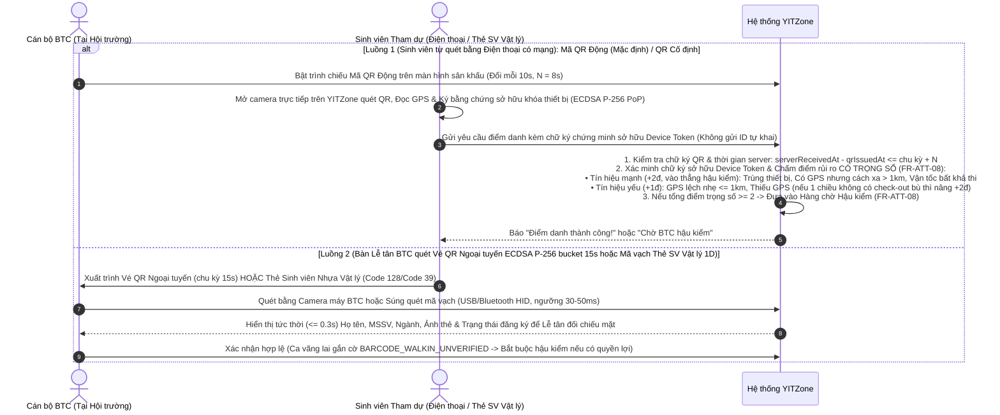

| Mã YC | Tên yêu cầu | Mô tả chi tiết & Quy tắc nghiệp vụ (Business Rules) | Tiêu chí chấp nhận (`Given / When / Then`) & Kiểm chứng | Độ ưu tiên |
| :--- | :--- | :--- | :--- | :---: |
| **FR-ATT-01** | Điểm danh 1 chiều hoặc 2 chiều, Check-out Bù Hội trường Kín & Cửa sổ Mở rộng | - Hỗ trợ 1 chiều (Check-in) hoặc 2 chiều (Check-in & Check-out).<br>- **Mặc định bắt buộc kiểm soát bù cho sự kiện hội trường kín có quyền lợi (`A1`):** Đối với sự kiện **có cộng quyền lợi (`ĐRL / CTXH / CĐDN`)** bật chế độ *"Hội trường kín/Tầng hầm"* (`isIndoorNoGpsMode`), hệ thống **đặt mặc định bắt buộc Điểm danh 2 chiều (`Check-in & Check-out` hoặc Check-out qua bàn BTC) hoặc bật 01 lượt quét QR ngẫu nhiên giữa giờ** để bù cho việc nới lỏng tín hiệu GPS trong nhà.<br>- **Đo lường chính xác:** Điều kiện hoàn thành là **khoảng thời gian giữa Check-in và Check-out đạt $\ge X\%$ thời lượng buổi/chương trình** (VD: $\ge 70\%$).<br>- Mở **cửa sổ Check-out kéo dài** (VD: $20$ phút cuối + $15$ phút sau kết thúc) để giảm nghẽn cho $500$ người; cho phép Check-out bằng Vé ngoại tuyến, quét mã vạch thẻ sinh viên vật lý hoặc máy BTC quét khi mất mạng. | **Given** sự kiện hội trường kín $120$ phút có cộng ĐRL (mặc định bật điểm danh 2 chiều, yêu cầu thời lượng $\ge 70\%$ = $84$ phút).<br>**When** sinh viên Check-in lúc `08:05` và Check-out lúc `09:35` ($90$ phút).<br>**Then** hệ thống đánh dấu hoàn thành đủ thời lượng; nếu Check-out lúc `08:50`, hệ thống báo chưa đạt thời lượng tối thiểu.<br>*Kiểm chứng: Test tính toán thời lượng & mặc định 2 chiều cho sự kiện có quyền lợi.* | Bắt buộc (P0) |
| **FR-ATT-02** | Mã QR Động (Mặc định) & Xác thực Theo Thời gian Server | - **Mã QR Động (Mặc định cho sự kiện trong nhà có màn chiếu):** Tự động đổi mỗi $10$ giây kèm bộ đếm sĩ số thời gian thực.<br>- **Xác thực bằng thời gian phía máy chủ:** Mã QR chứa **`qrIssuedAt` nằm trong phần dữ liệu đã ký số của server**; khi nhận yêu cầu, máy chủ kiểm tra theo **đồng hồ phía server**: `serverReceivedAt − qrIssuedAt ≤ chu kỳ đổi mã + N` (không dùng timestamp do client tự khai để tránh giả mạo). Ngưỡng trễ mạng $N$ cấu hình được (mặc định **$N = 8$ giây**, khoảng cho phép `5–15` giây tùy hạ tầng hội trường).<br>- **Mã QR Cố định (Tùy chọn ngoài trời):** Dùng khi không có màn chiếu, đi kèm nhắc BTC soát vé ngẫu nhiên. | **Given** sự kiện bật QR Động đổi mỗi $10$ giây và ngưỡng trễ cấu hình $N = 8$ giây (cửa sổ tối đa $18$ giây).<br>**When** QR phát hành ở giây `0`, sinh viên quét và server nhận lúc giây `16` vs lúc giây `22` (kể cả khi client gửi kèm timestamp giả ở giây `5`).<br>**Then** lượt nhận lúc giây `16` hợp lệ, lượt nhận lúc giây `22` bị từ chối hết hạn theo `serverReceivedAt`.<br>*Kiểm chứng: Test giả lập độ trễ mạng & giả mạo timestamp client.* | Bắt buộc (P0) |
| **FR-ATT-03** | Vị trí GPS làm Tín hiệu Rủi ro Phân tầng & Khóa Chọn Ảnh Thư viện | - Màn hình quét QR bắt buộc dùng **camera trực tiếp**, không cho tải ảnh có sẵn từ thư viện.<br>- **GPS là tín hiệu rủi ro phân tầng theo khoảng cách thực tế (`A1`):** Hệ thống chỉ đọc GPS đúng thời điểm bấm điểm danh (hỗ trợ tọa độ Check-out khác Check-in):<br>&nbsp;&nbsp;• **Trong bán kính hợp lệ** ($\le R + \min(\text{accuracy}, 50\text{m})$): `0 điểm rủi ro GPS`.<br>&nbsp;&nbsp;• **Có tọa độ GPS nhưng cách xa bất thường (`GPS_FAR_OUT_OF_RANGE`, mặc định $> 1.000\text{m}$ hoặc $> 3R$):** Gán **`+2 điểm trọng số` (Tín hiệu mạnh)** — một mình đủ đẩy vào Hàng chờ Hậu kiểm (`FR-ATT-08`) vì phản ánh người quét đang ở nhà/nơi khác chứ không phải nhiễu sóng trong hội trường.<br>&nbsp;&nbsp;• **Có tọa độ GPS nhưng lệch nhẹ ngoài bán kính (`GPS_MODERATE_DRIFT`, $\le 1.000\text{m}$):** Gán **`+1 điểm trọng số` (Tín hiệu yếu)**.<br>&nbsp;&nbsp;• **Không thu được GPS / Từ chối quyền vị trí (`GPS_UNAVAILABLE`):** Tại hội trường kín có bật kiểm soát bù 2 chiều/QR giữa giờ (`FR-ATT-01`) thì ghi nhận cảnh báo nhẹ (`0–1 điểm`, không chặn 500 người mất sóng tầng hầm); ngược lại nếu sự kiện chỉ điểm danh 1 chiều không có bước kiểm soát bù mà người dùng tắt GPS thì gán **`+2 điểm trọng số`** (đẩy vào Hàng chờ Hậu kiểm để hạn chế kịch bản ở nhà nhận ảnh QR qua Zalo rồi cố tình tắt quyền định vị). | **Given** sự kiện hội trường tầng hầm có Check-out cuối buổi: SV A ngồi trong tầng hầm mất sóng GPS; SV B ở nhà cách trường $3\text{km}$ nhận ảnh QR qua Zalo và bật GPS; SV C ở nhà nhận ảnh QR qua Zalo tại sự kiện 1 chiều và cố tình tắt quyền GPS.<br>**When** A, B, C gửi yêu cầu điểm danh trong cửa sổ 18 giây.<br>**Then** A được ghi nhận hợp lệ (kèm cảnh báo nhẹ thiếu GPS); cả B (`GPS_FAR_OUT_OF_RANGE = +2đ`) và C (`GPS_UNAVAILABLE` sự kiện 1 chiều `= +2đ`) đều bị đẩy vào Hàng chờ Hậu kiểm (`PENDING_REVIEW`).<br>*Kiểm chứng: Test thực địa & Mock GPS 3 kịch bản.* | Bắt buộc (P0) |
| **FR-ATT-04** | Định danh Thiết bị có Bằng chứng Sở hữu Khóa (`Device Token PoP`) | - **Cấp phát từ Server & Bằng chứng sở hữu khóa (`A2`):** Khi đăng nhập trên trình duyệt/PWA, Server cấp định danh thiết bị gắn với phiên (`HttpOnly Cookie`) đồng thời trình duyệt sinh cặp khóa bất đối xứng **WebCrypto `ECDSA P-256` (`extractable: false`)** lưu trong `IndexedDB` và đăng ký khóa công khai (`publicKeyJwk`) lên hệ thống. Khi bấm điểm danh (hoặc bỏ phiếu/vào thi), thiết bị **bắt buộc ký số lên chuỗi thử thách (`Proof-of-Possession`)** bằng khóa riêng cục bộ; máy chủ xác minh chữ ký để định danh thiết bị thực tế, **không nhận mã `deviceTokenId` tự khai dạng chuỗi thuần từ request body**.<br>- **Xử lý trùng thiết bị (`DEVICE_TOKEN_COLLISION`):** Trong cùng một buổi sự kiện, nếu 01 thiết bị đã xác thực gửi yêu cầu điểm danh cho $\ge 2$ tài khoản khác nhau (hoặc dùng khóa thiết bị vừa tạo mới tức thời `< 15 phút` kiểu ẩn danh/xóa dữ liệu kèm tín hiệu khác), hệ thống gán **`+2 điểm trọng số` (Tín hiệu mạnh)** để **đẩy thẳng vào Hàng chờ Hậu kiểm (`FR-ATT-08`)** hoặc yêu cầu quét xác nhận trực tiếp tại bàn BTC. | **Given** tài khoản A và B ngồi ngay trong hội trường (GPS tốt, 0 điểm rủi ro GPS) nhưng dùng chung 1 điện thoại để điểm danh hộ nhau; hoặc client sửa đổi gửi một `deviceTokenId` ngẫu nhiên trong body mà không có chữ ký khóa `ECDSA P-256` hợp lệ.<br>**When** tài khoản B bấm điểm danh.<br>**Then** request giả mạo ID không chữ ký bị từ chối `403`; lượt điểm danh thứ 2 trên cùng thiết bị của B bị gắn `DEVICE_TOKEN_COLLISION (+2 điểm)` và đưa ngay vào Hàng chờ Hậu kiểm (`PENDING_REVIEW`), không được tự động chấp nhận.<br>*Kiểm chứng: Test 1 máy điểm danh 2 tài khoản trong hội trường & Test chống giả mạo body.* | Bắt buộc (P0) |
| **FR-ATT-05** | Điểm danh Dự phòng (BTC Quét Vé QR / Mã vạch Thẻ SV) & Điểm danh Bù | Cán bộ Lễ tân/Điều phối (`MOD_ATTENDANCE_STAFF` / `MOD_EVENT_OPS`) quét Vé QR cá nhân/ngoại tuyến của sinh viên, **quét Mã vạch 1D trên thẻ sinh viên vật lý (`FR-ATT-09`)**, hoặc nhập MSSV để điểm danh trực tiếp/điểm danh bù. Mọi thao tác điểm danh bù bằng tay bắt buộc nhập **lý do** và ghi **Audit Log**. | **Given** điện thoại sinh viên hết pin và BTC nhập MSSV điểm danh bù.<br>**When** BTC chọn lý do `"Điện thoại hết pin, xác nhận thẻ SV tại bàn"`.<br>**Then** lượt điểm danh được ghi nhận và Audit Log lưu người thực hiện, thời gian, lý do.<br>*Kiểm chứng: Test & Audit Log check.* | Bắt buộc (P0) |
| **FR-ATT-06** | Điểm danh Sớm dành riêng cho Ban Tổ chức | Thành viên BTC (7 vị trí) được Trưởng BTC/cán bộ phụ trách điểm danh sớm trước giờ diễn ra sự kiện $1$–$2$ tiếng. Chỉ những thành viên BTC **đã duyệt và có bản ghi điểm danh làm nhiệm vụ** mới được công nhận hoàn thành và miễn bài thu hoạch. | **Given** sự kiện bắt đầu `08:00`, BTC mở cổng điểm danh sớm lúc `06:30`.<br>**When** MC đã được duyệt BTC thực hiện điểm danh lúc `06:45`.<br>**Then** trạng thái MC chuyển thành `Đã điểm danh BTC` và được tính quyền lợi sau sự kiện.<br>*Kiểm chứng: Test nghiệp vụ BTC.* | Bắt buộc (P0) |
| **FR-ATT-07** | Máy Soát vé BTC Ngoại tuyến (`ECDSA P-256`, Bucket 15s, Mã hóa & Tự xóa Gói Offline) | Giải quyết bài toán hội trường mất mạng cho cả phía **máy quét của BTC** đồng thời bảo vệ dữ liệu cá nhân trên thiết bị Lễ tân (`A9`, `A10`, `A14`):<br>- **Chuẩn bị trước giờ G & Mã hóa gói Offline (`A14`):** Khi còn mạng, ứng dụng trên máy BTC (`MOD_ATTENDANCE_STAFF` / `MOD_EVENT_OPS`) tải danh sách sinh viên đã đăng ký của sự kiện (MSSV, họ tên, ảnh thẻ có Consent), **Khóa công khai (`Server Public Key`)** và đồng bộ độ lệch đồng hồ (`lastServerSyncAt`, `clockOffsetMs`). Gói dữ liệu lưu trong `IndexedDB` của máy BTC **bắt buộc được mã hóa bằng khóa phiên (`AES-GCM`)** và chỉ có hiệu lực nếu được tải trong vòng **$\le 12$ giờ** trước khi quét.<br>- **Tương thích `ECDSA P-256` & Cửa sổ vé `15 giây` (`A9`, `A10`):** Sử dụng thuật toán chữ ký số bất đối xứng **`ECDSA P-256`** (tương thích hoàn toàn với WebCrypto trên cả **iOS Safari $\ge 16.4$ và Android Chrome $\ge 110$**). Mã QR trên vé ngoại tuyến của sinh viên đổi mỗi **`15 giây`**; máy BTC sau khi hiệu chỉnh `clockOffsetMs` chỉ chấp nhận **bucket 15 giây hiện tại (cộng biên lệch đồng hồ $\le 5\text{s}$)**, hiển thị **Ảnh thẻ chân dung** để Lễ tân đối chiếu và ghi vào hàng đợi theo thứ tự `localSeq` + `adjustedScanAt`.<br>- **Đồng bộ, Phát hiện Quét Trùng Đa Máy & Tự động Xóa Gói Offline (`A10`, `A14`):** Khi có mạng lại, máy BTC đẩy hàng đợi lên server. Nếu cùng 1 vé ngoại tuyến bị quét trên **$\ge 2$ máy BTC khác nhau**, server giữ bản ghi sớm nhất nhưng đồng thời gắn cờ **`DUPLICATE_OFFLINE_TICKET_SCAN (+2 điểm)`** đưa vào Hàng chờ Hậu kiểm để kiểm tra nghi vấn chia sẻ ảnh chụp vé. Ngay sau khi đồng bộ hoàn tất (hoặc chậm nhất **`24 giờ` sau khi sự kiện kết thúc**, hay khi nhận lệnh thu hồi máy BTC từ xa), ứng dụng BTC **tự động xóa sạch gói dữ liệu sinh viên và ảnh thẻ khỏi `IndexedDB`**. | **Given** sinh viên dùng iPhone iOS 16.4 mở Vé QR Ngoại tuyến (`ECDSA P-256`, bucket 15s) và máy BTC #1, #2 đã tải gói offline mã hóa rồi tắt mạng.<br>**When** máy #1 quét vé ở giây thứ 5 của bucket (hợp lệ), một người khác cầm ảnh chụp màn hình vé đó quét ở giây thứ 25 (quá cửa sổ 15s $\pm 5\text{s}$) hoặc quét cùng lúc trên máy #2 rồi đồng bộ.<br>**Then** ảnh chụp quá 20s bị từ chối ngay tại máy BTC; nếu quét trùng trên 2 máy trong cùng cửa sổ thì khi đồng bộ bị gắn cờ vào Hàng chờ Hậu kiểm; sau khi đồng bộ xong hoặc quá 24h sau sự kiện, gói dữ liệu trên máy BTC tự động bị xóa sạch.<br>*Kiểm chứng: Test iOS 16.4 / Chrome 110, cửa sổ 15s & Auto-wipe gói offline (Edge 26).* | Bắt buộc (P0) |
| **FR-ATT-08** | **Hàng chờ Hậu kiểm & Chấm điểm Rủi ro Theo Trọng số (`Weighted Risk Scoring`)** | Chuẩn hóa quy trình hậu kiểm để vừa không bỏ lọt gian lận phổ biến vừa tránh quá tải duyệt tay cho sự kiện 300–500 người (`A1`):<br>- **Bảng Trọng số Tín hiệu Rủi ro (Ngưỡng vào Hàng chờ Hậu kiểm mặc định: $\text{Tổng điểm trọng số} \ge 2$):**<br>&nbsp;&nbsp;• **Nhóm Tín hiệu Mạnh (`+2 điểm` — một mình đủ đẩy vào Hàng chờ Hậu kiểm `PENDING_REVIEW`):** (1) `DEVICE_TOKEN_COLLISION` (1 thiết bị điểm danh cho $\ge 2$ tài khoản trong cùng buổi); (2) `GPS_FAR_OUT_OF_RANGE` (có tọa độ GPS nhưng cách tâm sự kiện $> 1.000\text{m}$ hoặc $> 3R$); (3) `IMPOSSIBLE_VELOCITY` (vận tốc di chuyển bất khả thi giữa 2 lần quét); (4) `DUPLICATE_OFFLINE_TICKET_SCAN` (1 vé offline bị quét trên $\ge 2$ máy BTC); (5) `BARCODE_WALKIN_UNVERIFIED` (khách vãng lai quét mã vạch thẻ SV tại sự kiện có cộng quyền lợi `ĐRL/CTXH/CĐDN`).<br>&nbsp;&nbsp;• **Nhóm Tín hiệu Yếu / Trung bình (`+1 điểm`):** (1) `GPS_MODERATE_DRIFT` (có GPS nhưng lệch nhẹ ngoài bán kính $\le 1.000\text{m}$); (2) `ABNORMAL_ACCURACY` (sai số GPS cố định bất thường `< 1m`); (3) `NEW_EPHEMERAL_DEVICE` (khóa thiết bị vừa khởi tạo $< 15$ phút trước giờ quét); (4) `GPS_UNAVAILABLE` (mất GPS: tính `0 điểm` ở hội trường kín *chỉ khi* sự kiện có bật Check-out 2 chiều/QR giữa giờ; tính **`+2 điểm`** nếu sự kiện chỉ điểm danh 1 chiều mà người dùng tắt GPS).<br>- **Thẩm quyền, Hạn chót `48 giờ` & Hành vi Mặc định:** `Trưởng BTC` (`MOD_EVENT_OPS`), `BCH`/`BTV` hoặc `MOD_ATTENDANCE_STAFF` xử lý Hàng chờ Hậu kiểm trong vòng **`48 giờ`** sau khi kết thúc buổi/sự kiện. Quá 48 giờ chưa duyệt, hệ thống nhắc khẩn và **mặc định giữ trạng thái `Chưa duyệt / Không tự động cấp E-Cert`** cho tới khi có xác nhận tường minh.<br>- **Xác nhận Hàng loạt Có Kiểm toán:** Chỉ cho phép *"Xác nhận hàng loạt"* với nhóm cảnh báo nhẹ cùng ngữ cảnh, **cấm gộp duyệt hàng loạt đối với các ca Tín hiệu Mạnh (`DEVICE_TOKEN_COLLISION`, `GPS_FAR_OUT_OF_RANGE`, `BARCODE_WALKIN_UNVERIFIED`)**; mọi lượt duyệt đều bắt buộc nhập lý do và ghi **Audit Log (`FR-SYS-02`)**. | **Given** sự kiện hội trường 300 người có cộng ĐRL (bật Check-out 2 chiều, ngưỡng trọng số $\ge 2$ điểm):<br>• 285 người ngồi trong tầng hầm mất GPS nhưng dùng thiết bị riêng và có Check-out đủ (`0–1 điểm`);<br>• Ca (a): SV X dùng 1 điện thoại ngay trong hội trường (GPS tốt `0 điểm`) điểm danh hộ cho SV Y (`DEVICE_TOKEN_COLLISION = +2 điểm`);<br>• Ca (b): SV Z ở nhà nhận ảnh QR qua Zalo trong 18s (có GPS cách $3\text{km} \implies +2$ điểm, hoặc tắt GPS ở sự kiện 1 chiều $\implies +2$ điểm).<br>**When** hệ thống chấm điểm rủi ro.<br>**Then** 285 người được ghi nhận hợp lệ; **cả Ca (a) lẫn Ca (b) đều đạt $2$ điểm trọng số và bị đẩy ngay vào Hàng chờ Hậu kiểm (`PENDING_REVIEW`)**, không thể lọt qua tự động và không được cấp E-Cert nếu quá 48h chưa duyệt.<br>*Kiểm chứng: Test Ca (a) 1 máy nhiều tài khoản tại hội trường & Ca (b) QR qua Zalo tại nhà (Edge 10).* | Bắt buộc (P0) |
| **FR-ATT-09** | **Quét Mã vạch Thẻ Sinh viên Vật lý (`1D Barcode: Code 128 / Code 39`), Quy chuẩn Đối chiếu Thẻ Vật lý & Hậu kiểm Vãng lai (`Auto-Link`)** | Phục vụ điểm danh tốc độ cao tại cổng hội trường hoặc khi điện thoại sinh viên hết pin (`A3`, `A24`, `B1`):<br>- **Hỗ trợ 2 chế độ phần cứng đọc Mã vạch 1D (`Code 128`, `Code 39` — khớp chuẩn MSSV 8 chữ số `^[0-9]{8}$`, loại bỏ `EAN-13` khỏi mặc định):**<br>&nbsp;&nbsp;1. **Quét bằng Camera thiết bị BTC:** Trình quét của máy BTC nhận diện đồng thời cả mã 2D (`QR Code`) và mã vạch 1D (`Code 128`/`Code 39`) trên thẻ sinh viên vật lý.<br>&nbsp;&nbsp;2. **Quét bằng Súng quét mã vạch cầm tay (`USB / Bluetooth HID Scanner`):** Bộ bắt luồng phím HID **chỉ kích hoạt trên màn hình Soát vé/Trực bàn**, gọi `preventDefault()` khi nhận diện luồng quét tốc độ cao với **ngưỡng thời gian giữa 2 ký tự cấu hình được (mặc định `30–50 ms/ký tự` để tương thích cả súng Bluetooth lẫn USB)** kết thúc bằng `Enter`, không gây xung đột với ô nhập MSSV thủ công (`FR-ATT-05`), đạt tốc độ tra cứu **$\le 0.3$ giây/thẻ**.<br>- **Quy tắc Bắt buộc Thẻ Vật lý & Chống Quét hộ (`A3`, Edge 41):** Chỉ Cán bộ BTC (`MOD_ATTENDANCE_STAFF` / `MOD_EVENT_OPS`) mới mở được trình quét mã vạch. **Quy định nghiệp vụ chỉ chấp nhận Thẻ sinh viên nhựa vật lý chính thức; nghiêm cấm quét mã vạch hiển thị trên màn hình điện thoại hoặc bản in giấy rời.** Ngay khi quét thẻ của sinh viên đã đăng ký, màn hình BTC hiển thị **`Họ tên + MSSV + Ngành + Ảnh thẻ (nếu có Consent) + Trạng thái Đăng ký`** để Lễ tân đối chiếu trực tiếp khuôn mặt với cả màn hình lẫn ảnh in trên mặt thẻ vật lý.<br>- **Kiểm soát Chặt chẽ Tiếp nhận Vãng lai (`Walk-in`) & `Auto-Link SSO` (`A3`, `B1`):**<br>&nbsp;&nbsp;• *(Lộ trình: GĐ1 triển khai quét mã vạch 1D cho sinh viên đã đăng ký/có trong danh sách chính thức; luồng Walk-in Auto-Link hoàn thiện ở đầu GĐ2).*<br>&nbsp;&nbsp;• Đối với sự kiện có cộng quyền lợi (`ĐRL/CTXH/CĐDN`), **mặc định đặt `allowBarcodeWalkIn = false`**. Nếu `BTV`/`Trưởng BTC` chủ động bật cho phép tiếp nhận vãng lai tại cổng: hệ thống kiểm tra mã vạch khớp định dạng MSSV 8 số và mã ngành `BBB` hợp lệ, yêu cầu Lễ tân **bấm xác nhận đã đối chiếu khuôn mặt với ảnh in trên thẻ nhựa vật lý**, và luôn gắn cờ **`BARCODE_WALKIN_UNVERIFIED (+2 điểm)`**.<br>&nbsp;&nbsp;• Khi chủ nhân MSSV đăng nhập SSO lần đầu (`Auto-Link`), hệ thống ghép `userId` vào bản ghi `PENDING_SSO_LINK`; tuy nhiên **với sự kiện có quyền lợi (`ĐRL/CTXH/CĐDN`), bản ghi vãng lai bắt buộc nằm trong Hàng chờ Hậu kiểm (`FR-ATT-08`) để BTC duyệt xác nhận chứ không tự động cấp E-Cert ngay**. Bản ghi `PENDING_SSO_LINK` không có người liên kết sau `01 học kỳ` (hoặc `180 ngày`) sẽ tự động bị xóa (`NFR-PRIV-03`). | **Given** sự kiện hội thảo có cộng `CĐDN` (mặc định `allowBarcodeWalkIn = false`; khi BTC bật tiếp nhận vãng lai):<br>• SV A (đã đăng ký trước) xuất trình thẻ SV nhựa vật lý `25110001`;<br>• SV B (vãng lai chưa từng đăng nhập YITZone) xuất trình thẻ SV nhựa vật lý `26110088`;<br>• SV C đưa ảnh chụp mã vạch `Code 128` trên màn hình điện thoại hoặc mã không khớp 8 chữ số MSSV.<br>**When** Lễ tân dùng súng quét HID (30–50ms/ký tự) quét tại bàn.<br>**Then** SV C bị từ chối theo quy chế thẻ vật lý / sai regex MSSV; SV A hiện ảnh thẻ + tên trong $\le 0.3\text{s}$ và được ghi nhận hợp lệ; SV B được Lễ tân đối chiếu ảnh trên thẻ vật lý, ghi nhận `PENDING_SSO_LINK` kèm cờ `BARCODE_WALKIN_UNVERIFIED` và khi SV B đăng nhập SSO lần đầu thì bản ghi được ghép `userId` nhưng **phải qua Hàng chờ Hậu kiểm duyệt mới cấp E-Cert có quyền lợi**.<br>*Kiểm chứng: Test Súng quét HID không đụng ô input, Regex MSSV & Hậu kiểm Walk-in (Edge 40, 41).* | Bắt buộc (P0: Đã ĐK) / Cao (P1: Walk-in Auto-Link) |

---

### 4.4. Phân hệ Lịch sử Tham gia Sự kiện & Chứng nhận Điện tử (E-Certificate)

> [!NOTE]
> Hệ thống **không** tự cộng điểm rèn luyện tổng kết cuối kỳ thay cho cổng thông tin đào tạo của nhà trường, mà đóng vai trò **ghi nhận chính xác Lịch sử tham gia từng sự kiện kèm cặp giá trị quyền lợi định lượng `(Loại, Giá trị, Đơn vị)` và cấp E-Certificate** phục vụ sinh viên làm minh chứng và Khoa xuất báo cáo đối soát.

| Mã YC | Tên yêu cầu | Mô tả chi tiết & Quy tắc nghiệp vụ (Business Rules) | Tiêu chí chấp nhận (`Given / When / Then`) & Kiểm chứng | Độ ưu tiên |
| :--- | :--- | :--- | :--- | :---: |
| **FR-CERT-01** | Tự động Ghi nhận Lịch sử & Quyền lợi Định lượng `(Loại, Giá trị, Đơn vị)` | Khi sự kiện kết thúc, tự động ghi nhận lịch sử cho Tham dự viên & BTC hợp lệ:<br>- **Tư cách:** *Tham dự viên* hoặc *BTC (01 vị trí chính + vai trò kiêm nhiệm)*.<br>- **Quyền lợi định lượng:** Lưu cấu trúc **`(Loại, Giá trị, Đơn vị)`**, ví dụ: `(ĐRL, 5, điểm)`, `(CTXH, 1.5, ngày)`, `(CĐDN, 1, buổi)`.<br>- **Điều kiện miễn bài thu hoạch cho BTC:** Chỉ áp dụng cho thành viên BTC **đã được duyệt chính thức và đã điểm danh làm nhiệm vụ (`FR-ATT-06` hoặc trong sự kiện)** để chống đăng ký BTC ảo nhằm né bài kiểm tra. | **Given** sự kiện cộng `(CTXH, 1.5, ngày)` có bài thu hoạch cuối buổi; BTC A đã điểm danh sớm, BTC B vắng không điểm danh.<br>**When** sự kiện chốt kết quả.<br>**Then** BTC A được miễn bài thu hoạch và nhận `1.5 ngày CTXH`; BTC B không được công nhận.<br>*Kiểm chứng: Test chốt kết quả sự kiện.* | Bắt buộc (P0) |
| **FR-CERT-02** | Kiểm tra `CĐDN` theo Danh mục Ngành Cấu hình & Đặc cách Duy nhất bởi `BTV` | - **Tự động theo bảng ngành cấu hình (`FR-IAM-01`):** Chỉ tự động ghi nhận `CĐDN` cho sinh viên có mã ngành nằm trong danh mục ngành trực thuộc Khoa CNTT do `BTV` cấu hình (mặc định `110, 162, 133`). Sinh viên khoa khác vẫn được ghi nhận các nhãn còn lại (`ĐRL`/`CTXH`) hoặc nhận chứng nhận *"Tham dự viên hoàn thành Chuyên đề (Không tích lũy chuẩn CĐDN Khoa CNTT)"*.<br>- **Đặc cách chuyển ngành (Chỉ `BTV`):** Duy nhất **`BTV`** được bật xác nhận *"Sinh viên thuộc Khoa CNTT"* kèm chọn **Ngày hiệu lực của quyết định chuyển ngành** (và lý do bắt buộc lưu Audit Log). Hệ thống tự động rà soát cộng bổ sung `CĐDN` cho các hội thảo sinh viên đã tham gia từ ngày hiệu lực đó trở về sau. | **Given** sinh viên mã ngành cũ `120` chuyển sang Khoa CNTT có quyết định hiệu lực từ `01/09/2026`.<br>**When** `BTV` bật xác nhận chuyển ngành với ngày hiệu lực `01/09/2026` (BCH không thấy nút này).<br>**Then** hệ thống cộng bù `CĐDN` cho các hội thảo từ `01/09/2026` trở đi và phát hành phiên bản E-Cert mới (Edge 1, 33).<br>*Kiểm chứng: Test đặc cách & Audit Log.* | Bắt buộc (P0) |
| **FR-CERT-03** | Cấp Giấy Chứng nhận Điện tử (E-Certificate) có Mã QR Xác thực Độc lập | Xuất E-Cert định dạng PDF/Ảnh hiển thị: Họ tên, MSSV, Tên sự kiện, Tư cách tham gia, Quyền lợi định lượng, Mã chứng nhận duy nhất, Số phiên bản và **Mã QR trỏ tới trang xác thực công khai**. Trang xác thực công khai hoạt động độc lập với trạng thái email trường của cựu sinh viên. | **Given** sinh viên hoàn thành sự kiện.<br>**When** người dùng hoặc nhà tuyển dụng quét mã QR trên E-Cert.<br>**Then** trang xác thực công khai hiển thị thông tin khớp bản in và trạng thái `Hợp lệ`.<br>*Kiểm chứng: Demo & Test xuất PDF.* | Bắt buộc (P0) |
| **FR-CERT-04** | Thống kê Lịch sử Cá nhân & Xuất Báo cáo Tổng hợp Theo Mẫu CTSV | - Sinh viên lọc lịch sử theo học kỳ/năm học, xem tổng giá trị tích lũy (`tổng điểm ĐRL`, `tổng ngày CTXH`, `tổng số buổi CĐDN`) và tải E-Cert.<br>- `BCH`/`BTV` xuất file Excel theo mẫu đối soát của Phòng CTSV / Đào tạo (hiển thị chi tiết từng dòng lẫn cột tổng hợp giá trị định lượng). | **Given** sinh viên có 2 sự kiện CTXH (`1.0 ngày` và `1.5 ngày`).<br>**When** sinh viên xem thống kê hoặc `BTV` xuất báo cáo học kỳ.<br>**Then** tổng CTXH hiển thị chính xác `2.5 ngày` (2 hoạt động) đúng định dạng mẫu.<br>*Kiểm chứng: Test xuất Excel.* | Bắt buộc (P0) |
| **FR-CERT-05** | Quản lý Phiên bản, Thu hồi & Cấp lại E-Certificate | Hỗ trợ `BTV` (hoặc quy trình tự động khi cấp bù `CĐDN`) thực hiện:<br>- **Thu hồi chứng nhận:** Khi hủy kết quả do gian lận hoặc cấp nhầm (bắt buộc ghi lý do & lưu Audit Log).<br>- **Cấp lại phiên bản mới:** Khi cập nhật họ tên, sửa tư cách BTC hoặc bổ sung `CĐDN` (Edge 33), chứng nhận cũ chuyển sang trạng thái `Đã thay thế bởi bản mới (kèm link tới bản mới)`.<br>- Trang tra cứu QR luôn hiển thị rõ 1 trong 3 trạng thái: **`Hợp lệ`**, **`Đã thu hồi (kèm lý do)`**, hoặc **`Đã thay thế bởi bản mới`**. | **Given** E-Cert số `CERT-001` vừa bị `BTV` thu hồi do phát hiện gian lận điểm danh.<br>**When** quét mã QR trên bản PDF cũ của `CERT-001`.<br>**Then** trang xác thực công khai hiển thị cảnh báo đỏ `ĐÃ THU HỒI` kèm lý do và ngày thu hồi.<br>*Kiểm chứng: Test xác thực QR 3 trạng thái.* | Bắt buộc (P0) |

---

### 4.5. Phân hệ Bản tin Blog & Truyền thông

| Mã YC | Tên yêu cầu | Mô tả chi tiết & Quy tắc nghiệp vụ (Business Rules) | Tiêu chí chấp nhận (`Given / When / Then`) & Kiểm chứng | Độ ưu tiên |
| :--- | :--- | :--- | :--- | :---: |
| **FR-CMS-01** | Soạn thảo Bài viết Truyền thông & Học thuật Đa phương tiện | Trình soạn thảo hỗ trợ ảnh, video nhúng, bảng biểu, khối mã nguồn (Code block), gắn thẻ và phân loại chuyên mục: *Bản tin Đoàn - Hội, Góc Học thuật CNTT, Cơ hội Thực tập & Tuyển dụng, Gương sáng Sinh viên 5 tốt*. | **Given** biên tập viên soạn bài có chèn khối code Java và ảnh.<br>**When** lưu và xem trước bài viết.<br>**Then** nội dung hiển thị đúng định dạng trên cả di động và máy tính.<br>*Kiểm chứng: Demo UI.* | Cao (P1) |
| **FR-CMS-02** | Quy trình Biên tập Tổ Truyền thông (`EMFIT`) & Luồng Bài Cộng tác Sinh viên | Tách rõ 2 luồng duyệt gắn đúng đơn vị chuyên môn:<br>1. **Bài truyền thông nội bộ Ban (`EMFIT` / `MOD_CMS_EDITORIAL`):** `Bản nháp` $\rightarrow$ `Biên tập & Góp ý (Tổ trưởng Tổ Truyền thông / Biên tập viên giữ MOD_CMS_EDITORIAL)` $\rightarrow$ `Duyệt nội dung (Trưởng nhóm Truyền thông / Phó Ban EMFIT phụ trách)` $\rightarrow$ `Đã xuất bản` (`BCH`/`BTV` hoặc người giữ `MOD_CMS_EDITORIAL`). *(Tổ trưởng các Tổ không liên quan như Tổ Hát không tham gia luồng duyệt bài).*<br>2. **Bài cộng tác của Sinh viên thường:** `Sinh viên gửi bài cộng tác` $\rightarrow$ `Hàng chờ Tiếp nhận (Tổ Truyền thông / MOD_CMS_EDITORIAL)` $\rightarrow$ `Biên tập & Góp ý sửa` $\rightarrow$ `Duyệt xuất bản`. | **Given** Tổ trưởng Tổ Hát đăng nhập vào CMS.<br>**When** có bài viết chờ duyệt từ CTV Tổ Truyền thông và 1 bài cộng tác từ sinh viên.<br>**Then** Tổ trưởng Tổ Hát không thấy nút duyệt bài; bài đi đúng hàng chờ của Tổ Truyền thông / `MOD_CMS_EDITORIAL`.<br>*Kiểm chứng: Test phân quyền luồng CMS.* | Cao (P1) |
| **FR-CMS-03** | Hẹn giờ Tự động Đăng bài | Cài đặt ngày giờ công bố để hệ thống tự động đăng bài viết đã được duyệt lên trang chủ đúng khung giờ hẹn. | **Given** bài viết đã duyệt hẹn đăng lúc `20:00`.<br>**When** thời gian hệ thống đạt `20:00`.<br>**Then** bài viết tự động chuyển sang `Đã xuất bản` trong $\le 60$ giây.<br>*Kiểm chứng: Test lịch hẹn.* | Trung bình (P2) |

---

### 4.6. Phân hệ Trò chơi Tương tác Hội trường (Minigame) & Thi Trắc nghiệm Nghiêm túc

> [!IMPORTANT]
> **Phân biệt rõ 2 Chế độ Tổ chức trong Sự kiện (Giai đoạn 3 - P2):**
> | Tiêu chí | Chế độ 1: Trò chơi Tương tác Hội trường (Kiểu Kahoot) | Chế độ 2: Thi Trắc nghiệm 4 Đáp án Nghiêm túc (Răn đe + Ghi nhận) |
> | :--- | :--- | :--- |
> | **Mục đích sử dụng** | Khuấy động không khí, giao lưu vui vẻ tại hội trường (MC chiếu câu hỏi lên màn hình lớn). | Các cuộc thi chính trị - học thuật hoặc Bài kiểm tra thu hoạch cuối buổi hội thảo. *(Lưu ý giới hạn nền web: các kỳ thi xếp loại quan trọng cần tổ chức tại phòng máy hoặc dùng Safe Exam Browser).* |
> | **Cách thức làm bài** | **Làm cùng lúc theo MC:** Cả hội trường cùng trả lời câu số 1 trong 10–60 giây, xem bảng xếp hạng rồi mới qua câu số 2. | **Làm bài độc lập theo thời gian riêng:** Mỗi thí sinh tự làm đề gồm $N$ câu trắc nghiệm (A, B, C, D) trong tổng thời gian quy định. |
> | **Cách tính điểm** | Đúng và **nhanh hơn** được nhiều điểm hơn + Cộng điểm thưởng chuỗi thắng (Streak) định nghĩa tường minh. | Tính điểm theo **số câu trả lời đúng**; bằng điểm nhau mới xét thời gian hoàn thành ngắn hơn. |
> | **Mức độ chống gian lận** | Hiển thị `Họ tên + 3 số cuối MSSV` (che 5 số đầu để bảo vệ dữ liệu cá nhân). | **Răn đe + Ghi nhận phù hợp trình duyệt:** Đảo câu hỏi & đảo 4 đáp án trên server, khóa chọn/copy & chèn watermark (`MSSV + Họ tên + Thời gian`), bắt buộc Toàn màn hình **trên Desktop** (không chặn người dùng iPhone Safari), ghi log `blur/visibilitychange` (ẩn tab/mất focus) và tự động khóa `YITBot` **chỉ với thí sinh đang thi**. |

#### 4.6.1. Chế độ 1: Trò chơi Tương tác Trực tiếp tại Hội trường (Minigame kiểu Kahoot)

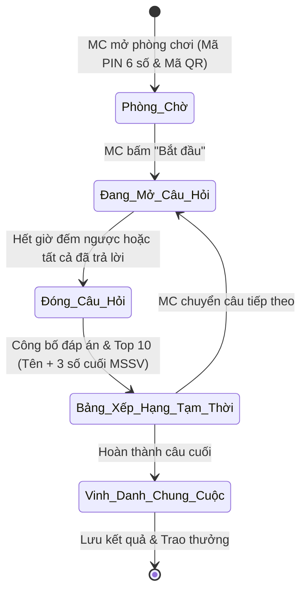

| Mã YC | Tên yêu cầu | Mô tả chi tiết & Quy tắc nghiệp vụ (Business Rules) | Tiêu chí chấp nhận (`Given / When / Then`) & Kiểm chứng | Độ ưu tiên |
| :--- | :--- | :--- | :--- | :---: |
| **FR-GAME-01** | Tạo Bộ Câu hỏi Trò chơi (Quiz Builder) | Soạn bộ câu hỏi gồm: 1 đáp án đúng, Nhiều đáp án đúng (chấm điểm khi **chọn đúng đủ toàn bộ các đáp án**), hoặc Đúng/Sai; thời gian suy nghĩ ($10/20/30/60\text{s}$), điểm cơ bản ($1000$ hoặc $2000$ điểm). | **Given** MC tạo câu hỏi Nhiều đáp án đúng gồm `{A, C}`.<br>**When** thí sinh chỉ chọn `{A}`.<br>**Then** hệ thống chấm $0$ điểm cho câu đó và đặt lại chuỗi thắng về $0$.<br>*Kiểm chứng: Test chấm điểm.* | Trung bình (P2) |
| **FR-GAME-02** | Phòng chờ Mã PIN 6 số / QR & Hiển thị Che 5 Số đầu MSSV | Mở phòng chơi hiển thị PIN 6 số và QR. Người chơi đã đăng nhập hiển thị **`Họ tên + 3 số cuối MSSV`** trên màn hình chiếu (không công khai trọn 8 số MSSV của 500 người). Tùy chọn cho **Khách mời** tham gia bằng tên hiển thị qua bộ lọc từ ngữ nhạy cảm. | **Given** sinh viên `25110042 - Nguyễn Văn An` vào phòng.<br>**When** màn hình chiếu hiển thị danh sách người chơi.<br>**Then** bảng chiếu chỉ hiển thị `Nguyễn Văn An (042)`, không lộ đầy đủ MSSV.<br>*Kiểm chứng: Demo màn hình chiếu.* | Trung bình (P2) |
| **FR-GAME-03** | Công thức Tính điểm Chuẩn Server-Bounded Client Timestamp & Bảng thưởng Streak | - Công thức tính điểm:<br>$$S = \left\lfloor S_{\text{cơ bản}} \times \left(1 - \frac{1}{2} \times \frac{\Delta t}{T}\right) \right\rfloor + S_{\text{streak}}$$<br>- **Đo thời gian $\Delta t$ công bằng & chống sửa client:** Trình duyệt gửi $\Delta t_{\text{client}}$ đo từ lúc câu hỏi hiển thị đến lúc bấm chọn, nhưng máy chủ tính $\Delta t_{\text{server}} = T_{\text{nhận}} - T_{\text{phát}}$ và **chặn hai đầu bằng thời gian máy chủ**: $\Delta t_{\text{client}}$ chỉ được chấp nhận trong khoảng $[\max(0, \Delta t_{\text{server}} - L_{\max}),\; \Delta t_{\text{server}}]$ (với $L_{\max} = 2\text{s}$). Nếu ngoài khoảng này (dấu hiệu giả mạo $\Delta t \approx 0$), máy chủ loại bỏ và dùng $\Delta t_{\text{server}}$ (giới hạn trong $[0, T]$).<br>- **Bảng thưởng chuỗi thắng ($S_{\text{streak}}$ — Định nghĩa rõ $k$):** Gọi **`k` là tổng số câu trả lời đúng liên tiếp tính đến và bao gồm cả câu hiện tại**. Từ câu trả lời đúng liên tiếp thứ 2 trở đi ($k \ge 2$): $S_{\text{streak}} = 100 \times \min(k - 1, 5)$ (tối đa $+500$ điểm/câu khi $k \ge 6$). Trả lời sai thì $S=0$ và đặt lại $k=0$. | **Given** câu hỏi $1000$ điểm, $T=20\text{s}$, người chơi đã đúng 2 câu liên tiếp trước đó và trả lời đúng tiếp câu hiện tại nâng chuỗi thắng lên **`k = 3` (tính cả câu hiện tại)**, thời gian server ghi nhận $\Delta t_{\text{server}} = 6\text{s}$ ($L_{\max} = 2\text{s}$).<br>**When** người chơi A gửi $\Delta t_{\text{client}} = 4.5\text{s}$ (hợp lệ trong $[4\text{s}, 6\text{s}]$) vs người chơi B sửa client gửi $\Delta t_{\text{client}} = 0.1\text{s}$.<br>**Then** A tính theo $4.5\text{s}$; B bị phát hiện ngoài khoảng hợp lệ nên hệ thống áp $\Delta t = \Delta t_{\text{server}} = 6\text{s}$ và thưởng chuỗi thắng $S_{\text{streak}} = 100 \times (3 - 1) = 200$ (tổng $\lfloor 1000 \times (1 - 0.5 \times 6/20)\rfloor + 200 = 1050$ điểm).<br>*Kiểm chứng: Unit test công thức & chống giả mạo.* | Trung bình (P2) |
| **FR-GAME-04** | Khôi phục Điểm số khi Rớt mạng Giữa chừng | Khi người chơi tải lại trang hoặc rớt mạng ngắn rồi vào lại phòng chơi đang diễn ra, hệ thống khôi phục nguyên vẹn điểm số, chuỗi thắng và đồng bộ tiếp câu hiện tại. | **Given** người chơi có $2100$ điểm ở câu 4 bị mất mạng 10 giây.<br>**When** người chơi kết nối lại ở câu 5.<br>**Then** điểm số vẫn giữ $2100$ và trả lời tiếp câu 5 bình thường.<br>*Kiểm chứng: Test ngắt mạng.* | Trung bình (P2) |

#### 4.6.2. Chế độ 2: Cuộc thi Trắc nghiệm 4 Đáp án Nghiêm túc (Răn đe + Ghi nhận)

```mermaid
sequenceDiagram
    autonumber
    actor SV as Thí sinh Dự thi (Khuyến nghị Desktop)
    participant System as Hệ thống Thi YITZone
    actor Proctor as Cán bộ Coi thi / BTC

    SV->>System: Bấm "Bắt đầu làm bài"
    System->>System: 1. Kiểm tra điều kiện (Đăng ký / Đã điểm danh)<br/>2. Gắn phiên thi với 1 thiết bị & Khóa YITBot CHỈ với thí sinh này<br/>3. Rút ngẫu nhiên đề & Xáo trộn thứ tự câu + 4 đáp án A/B/C/D
    System-->>SV: Mở giao diện làm bài (Fullscreen trên Desktop; Watermark; tự lưu nháp 5-10s)
    opt Khi phát hiện sự kiện blur / visibilitychange / thoát fullscreen (trên Desktop)
        System->>System: Hiện cảnh báo đỏ & Ghi nhật ký vi phạm kèm timestamp
        alt Tổng vi phạm đạt ngưỡng tối đa (Mặc định: 3 lần)
            System-->>SV: Tự động khóa & thu bài trong <= 5 giây
        end
    end
    opt Khi thiết bị thí sinh hỏng / hết pin
        Proctor->>System: Chuyển lượt thi sang thiết bị mới (có lý do + Audit Log)
    end
    SV->>System: Nộp bài (hoặc hết giờ tự thu bài với ân hạn 5s)
    System->>System: Chấm điểm, mở khóa lại YITBot & cập nhật bảng xếp hạng
```

| Mã YC | Tên yêu cầu | Mô tả chi tiết & Quy tắc nghiệp vụ (Business Rules) | Tiêu chí chấp nhận (`Given / When / Then`) & Kiểm chứng | Độ ưu tiên |
| :--- | :--- | :--- | :--- | :---: |
| **FR-EXAM-01** | Ngân hàng Câu hỏi 4 Đáp án & Rút đề theo Ma trận Độ khó | Tạo ngân hàng câu hỏi 4 đáp án (`A, B, C, D`, 1 đáp án đúng) theo 3 mức độ (*Nhận biết, Thông hiểu, Vận dụng*). Cấu hình số câu rút ngẫu nhiên, thời gian làm bài, số lượt thi và điều kiện dự thi (đã đăng ký hoặc đã điểm danh sự kiện). | **Given** ngân hàng có 120 câu (40/40/40) và đề cấu hình rút 30 câu theo tỷ lệ `40%/40%/20%`.<br>**When** thí sinh bắt đầu thi.<br>**Then** đề thi nhận đúng 12 Nhận biết, 12 Thông hiểu, 6 Vận dụng.<br>*Kiểm chứng: Test rút đề.* | Trung bình (P2) |
| **FR-EXAM-02** | Xáo trộn Đề Độc lập & Giữ Đáp án Đúng tại Server | Đảo thứ tự câu hỏi và thứ tự 4 đáp án `A, B, C, D` riêng cho từng thí sinh. Trong thời gian làm bài, API chỉ trả về nội dung câu hỏi và 4 lựa chọn xuống trình duyệt; **đáp án đúng được giữ trên server** cho đến khi thí sinh nộp bài hoặc hết giờ thi. | **Given** thí sinh mở công cụ Inspect Network trên trình duyệt trong lúc thi.<br>**When** kiểm tra toàn bộ gói tin API tải đề.<br>**Then** không có trường đáp án đúng hay hash đáp án nào xuất hiện trong payload.<br>*Kiểm chứng: Security Inspection.* | Trung bình (P2) |
| **FR-EXAM-03** | Giám sát Mức Răn đe + Ghi nhận trên Trình duyệt & Watermark | Áp dụng các biện pháp khả thi thực tế trên trình duyệt/PWA:<br>1. **Quy chuẩn Thiết bị Thi:** Ghi rõ **"Các kỳ thi xếp loại/đánh giá quan trọng bắt buộc thí sinh làm bài trên Desktop/Laptop"**. Thiết bị Desktop yêu cầu bật Toàn màn hình (`Fullscreen`); **không áp dụng chặn bắt buộc Fullscreen đối với iOS Safari / điện thoại** vì iPhone Safari không hỗ trợ Web Fullscreen API.<br>2. **Phân biệt Xử lý Rời tab / Mất focus (`visibilitychange` & `blur`) & Đứt Heartbeat (`A33`):**<br>&nbsp;&nbsp;• **Trên Desktop:** Ghi nhận vi phạm kèm mốc thời gian; khi chạm ngưỡng vi phạm tối đa (mặc định `3 lần`) thì tự động khóa & thu bài.<br>&nbsp;&nbsp;• **Trên Mobile (điện thoại):** Vì `visibilitychange`/`blur` dễ nổ oan khi có cuộc gọi đến, kéo thanh thông báo hoặc hiện popup pin yếu, hệ thống **chỉ ghi nhật ký sự kiện & cảnh báo nhắc nhở** (mặc định **không tự động thu bài trên điện thoại**) để Cán bộ coi thi xem xét hậu kiểm.<br>&nbsp;&nbsp;• **Đứt kết nối Heartbeat (`> 15 giây`):** Khi máy chủ phát hiện gián đoạn xung nhịp lưu bài $> 15$ giây, hệ thống ghi nhận sự kiện `HEARTBEAT_GAP` kèm thời lượng gián đoạn vào nhật ký coi thi hậu kiểm và **không tự động thu bài** (tránh thu bài oan khi rớt Wi-Fi ngắn).<br>3. **Răn đe Sao chép, Watermark & Giới hạn Trình duyệt (`A33`):** Vô hiệu hóa chọn văn bản/chuột phải/copy trên vùng đề; hiển thị watermark chéo **`MSSV + Họ tên + Thời gian`**. *(Lưu ý giới hạn kỹ thuật: các sự kiện rời tab do trình duyệt phía client báo cáo nên có thể bị vô hiệu hóa nếu người dùng can thiệp sửa trình duyệt, đồng thời trình duyệt không phát hiện được cửa sổ nổi hay phím chụp màn hình của hệ điều hành; do đó các kỳ thi có tính chất quyết định bắt buộc tổ chức tập trung tại phòng máy có giám thị).* | **Given** 1 thí sinh thi trên Desktop Chrome, 1 thí sinh thi bài thu hoạch trên điện thoại, và 1 thí sinh bị đứt mạng Wi-Fi 20 giây.<br>**When** thí sinh Desktop thoát tab 3 lần; thí sinh điện thoại nhận 3 cuộc gọi/popup pin yếu; thí sinh thứ 3 mất heartbeat 20 giây.<br>**Then** thí sinh Desktop bị ghi 3 vi phạm và tự động thu bài; thí sinh điện thoại và thí sinh đứt mạng chỉ bị ghi log sự kiện (`LOG_ONLY` / `HEARTBEAT_GAP`) cho coi thi hậu kiểm, không bị thu bài oan.<br>*Kiểm chứng: Test đa thiết bị (Desktop & Mobile) & giả lập đứt Heartbeat.* | Trung bình (P2) |
| **FR-EXAM-04** | Khóa 1 Thiết bị, Chuyển Thiết bị khi Sự cố & Lưu bài Tự động | - Mặc định khóa 1 phiên thiết bị duy nhất cho lượt thi, lưu nháp mỗi 5–10 giây, tính giờ theo đồng hồ server (ân hạn độ trễ nộp bài $5$ giây khi hết giờ).<br>- **Chuyển thiết bị bởi Coi thi:** Nếu máy thí sinh bị hỏng hoặc hết pin hẳn, Cán bộ coi thi (`MOD_QUIZ_EXAM_HOST`) có nút **"Cấp phép chuyển sang thiết bị khác"** (hủy khóa thiết bị cũ, bắt buộc ghi lý do và lưu **Audit Log**). | **Given** laptop của thí sinh sập nguồn không bật lại được ở phút thứ 10.<br>**When** Cán bộ coi thi thực hiện chuyển lượt thi và thí sinh đăng nhập trên máy dự phòng.<br>**Then** thí sinh làm tiếp các câu đã lưu nháp với thời gian còn lại theo server, Audit Log ghi nhận thao tác chuyển.<br>*Kiểm chứng: Test chuyển thiết bị (Edge 3, 4, 15).* | Trung bình (P2) |
| **FR-EXAM-05** | Khóa `YITBot` Riêng cho Thí sinh Đang thi | Khi thí sinh đang trong lượt thi trắc nghiệm đang diễn ra, hệ thống **tạm khóa quyền sử dụng `YITBot` đối với đúng tài khoản thí sinh đó** cho đến khi nộp bài xong. *(Không khóa `YITBot` của toàn bộ Guest trên hệ thống; lưu ý rằng thi trực tuyến không giám sát vật lý luôn tồn tại rủi ro thí sinh tra cứu công cụ ngoài).* | **Given** sinh viên A đang làm bài thi và sinh viên B (không dự thi) cùng mở hệ thống.<br>**When** A và B mở khung chat `YITBot`.<br>**Then** A nhận thông báo `YITBot tạm khóa trong giờ thi của bạn`, trong khi B và Guest vẫn sử dụng bình thường.<br>*Kiểm chứng: Test phân biệt tài khoản.* | Trung bình (P2) |
| **FR-EXAM-06** | Bảng Xếp hạng, Hậu kiểm Vi phạm & Điểm sàn Hoàn thành Sự kiện | Xếp hạng theo `(1) Điểm cao nhất -> (2) Thời gian ngắn nhất -> (3) Số cảnh báo vi phạm ít nhất`. Cán bộ coi thi xem nhật ký vi phạm để hủy kết quả nếu gian lận có hệ thống. Hỗ trợ cấu hình điểm sàn để mở khóa E-Cert sự kiện. | **Given** sự kiện đặt điểm sàn bài thu hoạch $\ge 50\%$.<br>**When** thí sinh đạt $40\%$ và không phải BTC.<br>**Then** hệ thống không cấp E-Cert cho thí sinh đó.<br>*Kiểm chứng: Test điều kiện điểm sàn.* | Trung bình (P2) |

---

### 4.7. Phân hệ Xét duyệt Danh hiệu & Quản lý Phong trào Sinh viên 5 tốt

| Mã YC | Tên yêu cầu | Mô tả chi tiết & Quy tắc nghiệp vụ (Business Rules) | Tiêu chí chấp nhận (`Given / When / Then`) & Kiểm chứng | Độ ưu tiên |
| :--- | :--- | :--- | :--- | :---: |
| **FR-AWD-01** | Mở Đợt Xét duyệt Danh hiệu & Cấu hình Cây Tiêu chí | Cho phép `BTV` mở đợt xét danh hiệu (*SV5T, Đoàn viên ưu tú...*) và cấu hình cây 5 tiêu chí kèm điều kiện bắt buộc / tự chọn. | **Given** `BTV` tạo đợt xét SV5T 2026–2027.<br>**When** thiết lập đủ 5 nhóm tiêu chí và lưu công bố.<br>**Then** sinh viên mở được biểu mẫu nộp hồ sơ theo đúng cây tiêu chí đã cấu hình.<br>*Kiểm chứng: Demo cấu hình.* | Cao (P1) |
| **FR-AWD-02** | Tự động Đối chiếu & Đính kèm Minh chứng Có sẵn trên YITZone | Tự động điền sẵn minh chứng tích lũy trên hệ thống (sự kiện `CTXH`, `ĐRL`, `CĐDN` kèm E-Cert, chức vụ Đoàn - Hội, kết quả OJ nếu có); sinh viên tải thêm minh chứng ngoài (Bảng điểm, Chứng chỉ ngoại ngữ, Giấy khám sức khỏe/chạy bộ). | **Given** sinh viên đã hoàn thành 3 hoạt động `CTXH` trên YITZone.<br>**When** sinh viên mở hồ sơ đăng ký SV5T.<br>**Then** 3 minh chứng `CTXH` tự động hiển thị để chọn đính kèm mà không cần tải lại file.<br>*Kiểm chứng: Test liên thông dữ liệu.* | Cao (P1) |
| **FR-AWD-03** | Rà soát Hồ sơ, Chống Xung đột Lợi ích & Phúc khảo 72 Giờ | - **Bước 1:** Ban `SV5T` thẩm tra sơ bộ từng minh chứng.<br>- **Bước 2:** Hội đồng (`BCH`/`BTV`) chấm duyệt trạng thái (`Đạt / Không đạt / Cần bổ sung`).<br>- **Quy tắc chống xung đột lợi ích:** Mọi thành viên Ban `SV5T` hoặc Hội đồng (`BCH`/`BTV`) đều **không thể tự rà soát hoặc chấm duyệt hồ sơ của chính mình** (hệ thống tự động ẩn/khóa nút thao tác chấm trên hồ sơ trùng `userId`).<br>- **Bước 3 — Phúc khảo:** Sinh viên có thời hạn **`72 giờ kể từ thời điểm công bố kết quả sơ khảo`** (hoặc `03 ngày làm việc` theo cấu hình đợt) để gửi giải trình/bổ sung minh chứng trước khi khóa sổ. | **Given** Ủy viên BCH A đồng thời là ứng viên nộp hồ sơ SV5T.<br>**When** BCH A mở danh sách hồ sơ cần Hội đồng chấm duyệt.<br>**Then** các nút `Đạt/Không đạt` trên hồ sơ của chính A bị khóa; nút phúc khảo của sinh viên tự động đóng sau đúng $72$ giờ kể từ lúc công bố sơ khảo.<br>*Kiểm chứng: Test xung đột lợi ích & đếm ngược 72h.* | Cao (P1) |
| **FR-AWD-04** | Bảng vàng Vinh danh, Badge & Cấp E-Certificate Danh hiệu | Xuất danh sách đạt chuẩn mẫu hành chính, gắn huy hiệu lên E-Portfolio và cấp E-Certificate danh hiệu (có QR xác thực). | **Given** `BTV` bấm chốt kết quả đợt xét SV5T.<br>**When** công bố bảng vàng.<br>**Then** sinh viên đạt danh hiệu nhận được E-Cert danh hiệu và hiển thị trên bảng vàng công khai.<br>*Kiểm chứng: Demo & Test xuất file.* | Cao (P1) |
| **FR-AWD-05** | Theo dõi Tiến độ 5 Tiêu chí Từ Đầu Năm (`Ban SV5T`) | - Sinh viên đăng ký mục tiêu phấn đấu từ đầu năm.<br>- **Tính toán trung thực theo dữ liệu hệ thống:** Thanh tiến độ chỉ tính tự động phần trăm đối với các tiêu chí có dữ liệu sự kiện/hoạt động gắn nhãn **Tiêu chí SV5T đóng góp (`FR-EVT-01`)** trên YITZone (như *Tình nguyện tốt, Đạo đức tốt, Hội nhập/Học thuật từ sự kiện*). Các tiêu chí đòi hỏi dữ liệu ngoài hệ thống (như *Học tập tốt — GPA*, *Thể lực tốt — Giấy khám sức khỏe/chạy bộ*, *Chứng chỉ ngoại ngữ*) hiển thị rõ trạng thái **`"Chờ minh chứng ngoài"`** để sinh viên chủ động tự tải lên bổ sung. | **Given** sinh viên hoàn thành sự kiện gắn nhãn tiêu chí `Tình nguyện tốt` và chưa nộp bảng điểm GPA.<br>**When** sinh viên và Ban `SV5T` mở bảng tiến độ.<br>**Then** thanh `Tình nguyện tốt` tăng tương ứng, còn tiêu chí `Học tập tốt` hiển thị `"Chờ minh chứng ngoài"` chứ không báo 0% sai sự thật.<br>*Kiểm chứng: Test tính tiến độ.* | Cao (P1) |

---

### 4.8. Phân hệ Luyện tập & Thi đấu Lập trình Tự động (Online Judge)
*(Ghi chú Phạm vi: Phân hệ này thuộc nhóm mở rộng sau MVP — P3; Ban Quản trị và đội ngũ kỹ thuật cân nhắc phương án **tích hợp nền tảng sẵn có như DMOJ / VNOJ** trước khi đầu tư tự xây cụm Judge Worker độc lập).*

#### Sơ đồ Quy trình Nộp bài & Chấm điểm Code Tự động
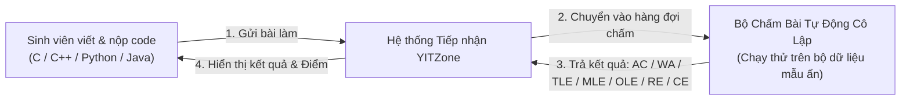

| Mã YC | Tên yêu cầu | Mô tả chi tiết & Quy tắc nghiệp vụ (Business Rules) | Tiêu chí chấp nhận (`Given / When / Then`) & Kiểm chứng | Độ ưu tiên |
| :--- | :--- | :--- | :--- | :---: |
| **FR-OJ-01** | Quản lý Ngân hàng Đề bài Thuật toán | *Ban Học tập* (`MOD_OJ_MANAGER`) tạo bài tập với đề bài (Markdown/công thức toán), giới hạn thời gian ($0.5\text{s}$–$5.0\text{s}$), bộ nhớ ($64\text{MB}$–$512\text{MB}$), độ khó và tệp `.zip` bộ Testcase. | **Given** cán bộ giữ `MOD_OJ_MANAGER` tải lên đề bài và file Testcase hợp lệ.<br>**When** lưu và mở bài tập.<br>**Then** bài tập hiển thị đúng công thức toán học và sẵn sàng chấm.<br>*Kiểm chứng: Test CRUD bài tập.* | Mở rộng (P3) |
| **FR-OJ-02** | Soạn thảo Code Trực tuyến & Chấm bài Tự động Đa ngôn ngữ | Nộp code trực tuyến (C, C++, Python, Java) và trả trạng thái `AC`, `WA`, `TLE`, `MLE`, `OLE` (vượt giới hạn $16\text{MB}$ stdout), `RE`, `CE` trong môi trường cô lập. | **Given** sinh viên nộp code in vô hạn ra stdout.<br>**When** máy chấm thực thi bài nộp.<br>**Then** tiến trình bị ngắt khi vượt $16\text{MB}$ và trả về `OLE` mà không ảnh hưởng các bài chấm khác (Edge 37).<br>*Kiểm chứng: Test sandbox.* | Mở rộng (P3) |
| **FR-OJ-03** | Tổ chức Kỳ thi Lập trình Cấp Khoa (ICPC / IOI) | Hỗ trợ mở contest trong khung giờ cố định theo quy tắc **ICPC** (đạt toàn bộ Testcase mới tính bài, phạt $20$ phút/lần sai, đóng băng bảng xếp hạng 30–60 phút cuối) hoặc **IOI** (chấm từng phần). | **Given** kỳ thi ICPC bật Freeze 30 phút cuối.<br>**When** thí sinh nộp `AC` trong 20 phút cuối.<br>**Then** thí sinh thấy kết quả cá nhân nhưng bảng xếp hạng công khai giữ nguyên trạng thái đóng băng.<br>*Kiểm chứng: Test contest mode.* | Mở rộng (P3) |
| **FR-OJ-04** | Kiểm tra Trùng lặp Mã nguồn | Quét đối chiếu cấu trúc AST/token bài nộp giữa các thí sinh sau kỳ thi để cảnh báo dấu hiệu sao chép code cho Ban Giám khảo. | **Given** 2 bài nộp chỉ đổi tên biến.<br>**When** cán bộ chạy kiểm tra trùng lặp.<br>**Then** hệ thống liệt kê cặp bài có độ tương đồng vượt ngưỡng cảnh báo.<br>*Kiểm chứng: Test so khớp.* | Mở rộng (P3) |

---

### 4.9. Phân hệ Cửa hàng Vật phẩm Khoa & Gây quỹ Đoàn - Hội

#### Sơ đồ Quy trình Đặt mua Vật phẩm, Thanh toán VietQR & Giao nhận tại Văn phòng / Phòng học
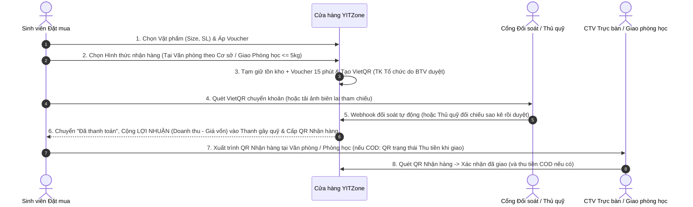

| Mã YC | Tên yêu cầu | Mô tả chi tiết & Quy tắc nghiệp vụ (Business Rules) | Tiêu chí chấp nhận (`Given / When / Then`) & Kiểm chứng | Độ ưu tiên |
| :--- | :--- | :--- | :--- | :---: |
| **FR-STR-01** | Danh mục Vật phẩm, **Giá vốn**, Tồn kho & Giá Ưu đãi theo Đợt | - Quản lý theo danh mục (*Đồng phục & Áo Khoa, Phụ kiện & Quà lưu niệm, Đồ ăn/Thức uống Gây quỹ*). *(Vé sự kiện quản lý trực tiếp tại Phân hệ 4.2 để tránh tách rời danh sách đăng ký).*<br>- Mỗi sản phẩm lưu: Kích cỡ (`S..3XL`), màu sắc, tồn kho (hoặc Pre-order), khối lượng, **Giá vốn (`costPrice`)** để hạch toán lợi nhuận gây quỹ, **Giá gốc niêm yết** và **Giá ưu đãi theo thời hạn**. | **Given** Áo gây quỹ có giá vốn `95.000đ` và giá bán `150.000đ`.<br>**When** quản lý lưu sản phẩm và bật đợt giá ưu đãi `135.000đ` trong 7 ngày.<br>**Then** hệ thống lưu đủ 3 mức giá và tự động quay về `150.000đ` khi hết 7 ngày.<br>*Kiểm chứng: Test quản lý sản phẩm.* | Cao (P1) |
| **FR-STR-02** | Hình thức Nhận hàng Theo Cơ sở & Phạm vi Giao nhận Thực tế | Bỏ giao hàng tận nhà bằng CTV; hỗ trợ tách bạch 2 hình thức chính trong giai đoạn vận hành chuẩn:<br>1. **Nhận trực tiếp tại Văn phòng Đoàn - Hội theo Cơ sở (`0 VNĐ`):** Sinh viên chọn đúng cơ sở học tập để nhận hàng.<br>2. **Giao đến Phòng học cùng Cơ sở (`0đ–5.000đ`, chỉ áp dụng đơn $\le 5\text{kg}$):** Sinh viên chọn `Cơ sở` $\rightarrow$ `Tòa nhà` $\rightarrow$ `Phòng học & Ca học` từ danh sách chuẩn; đội CTV giao vào giờ giải lao. **Đơn nặng $> 5\text{kg}$** bắt buộc nhận tại Văn phòng hoặc tách thành nhiều đơn $\le 5\text{kg}$.<br>*(Giao qua đơn vị vận chuyển bưu chính GHN/GHTK API theo Quận/Huyện là tùy chọn mở rộng ở GĐ sau — P3 khi có tài khoản đối tác).* | **Given** giỏ hàng gồm 2 món có tổng khối lượng $6\text{kg}$.<br>**When** sinh viên chọn hình thức `Giao đến Phòng học`.<br>**Then** hệ thống thông báo vượt giới hạn $5\text{kg}$ và yêu cầu chọn `Nhận tại Văn phòng theo Cơ sở` hoặc tách đơn.<br>*Kiểm chứng: Test quy tắc giỏ hàng (Edge 24).* | Cao (P1) |
| **FR-STR-03** | Chiến dịch Gây quỹ Minh bạch theo **Lợi nhuận Thực tế (Trừ Giá vốn & Hoàn tiền)** | Tạo chiến dịch gây quỹ kèm mục tiêu số tiền và thanh tiến độ trực tiếp:<br>- **Hạch toán trung thực (không trừ giảm giá hai lần):**<br>$$\text{Lợi nhuận quỹ} = \sum(\text{Thực thu tiền hàng sau giảm giá}) - \sum(\text{Giá vốn của hàng đã giao/chốt xuất}) - \text{Hoàn tiền thực tế}$$<br>*(Phí giao phòng học hạch toán tách biệt. Khi hoàn tiền đơn hàng: nếu hàng chưa giao hoặc trả lại nguyên vẹn nhập lại kho thì giá vốn tương ứng được hoàn nhập, không tính vào tổng giá vốn đã giao; nếu hàng hỏng không thu hồi được thì giá vốn giữ nguyên để phản ánh đúng chi phí quỹ)*.<br>- Giao diện tách rõ 2 chỉ số có nhãn tường minh: **`"Tổng doanh thu thực thu"`** và **`"Số tiền thực góp vào quỹ (Lợi nhuận sau trừ giá vốn)"`**. | **Given** bán 10 áo giá niêm yết `150.000đ` (giá vốn `95.000đ`), trong đó có 1 đơn dùng Voucher giảm `15.000đ` (thực thu `135.000đ`), và sau đó 1 đơn nguyên giá `150.000đ` được duyệt hoàn tiền nhập lại kho (giữ còn 9 áo giao thực tế).<br>**When** đối soát hoàn tất 9 đơn giao thực tế.<br>**Then** tổng thực thu sau hoàn = `8 × 150.000 + 135.000 = 1.335.000đ`, tổng giá vốn 9 áo = `855.000đ`, lợi nhuận thực góp quỹ hiển thị đúng `1.335.000 - 855.000 = 480.000đ` (không trừ Voucher 2 lần).<br>*Kiểm chứng: Test tính toán gây quỹ có Voucher & Hoàn tiền.* | Cao (P1) |
| **FR-STR-04** | Hệ thống Mã Giảm giá (`Voucher` Tiền hàng & Phí giao phòng) | Hỗ trợ Voucher giảm số tiền cố định, giảm `%` (có trần tối đa), hoặc giảm phí giao phòng học; cấu hình phạm vi, giá trị đơn tối thiểu, tổng lượt dùng toàn Khoa, giới hạn lượt/người và dùng chung khuyến mãi. | **Given** Voucher `GIAM15K` giới hạn 1 lượt/sinh viên, đơn tối thiểu `100.000đ`.<br>**When** sinh viên áp dụng cho đơn `150.000đ` rồi hủy trước thanh toán (Edge 25).<br>**Then** lượt Voucher được hoàn trả và chỉ trừ lượt sau khi đặt thành công.<br>*Kiểm chứng: Test Voucher & hoàn lượt.* | Cao (P1) |
| **FR-STR-05** | Tài khoản Tổ chức, Xác thực Chữ ký Webhook, Giữ chỗ 15 Phút & Tạo Mã VietQR | - **Ràng buộc tài khoản nhận tiền & Xác thực chữ ký Webhook (`A11`):** Tài khoản ngân hàng nhận VietQR **bắt buộc đứng tên tổ chức/đơn vị và do `BTV` phê duyệt** cấu hình; tích hợp thống nhất **01 cổng đối soát tự động** (SePay Webhook hoặc PayOS). Máy chủ **bắt buộc xác minh chữ ký số / HMAC-SHA256 của Webhook cổng thanh toán** trước khi gạch nợ đơn hàng (mọi Webhook sai chữ ký đều bị từ chối và ghi cảnh báo vào Audit Log).<br>- Giữ chỗ tồn kho & Voucher trong `15 phút` (+ `5 phút` ân hạn kiểm tra giao dịch chậm — Edge 32) đối với đơn chuyển khoản VietQR. | **Given** đơn hàng hết hạn `15 phút` nhưng tiền về sau `2 phút` qua Webhook có chữ ký hợp lệ; đồng thời kẻ tấn công gửi một request giả mạo không có chữ ký hợp lệ vào endpoint Webhook.<br>**When** hệ thống xử lý.<br>**Then** request giả mạo bị từ chối `401/403` và ghi Audit Log; đơn có chữ ký Webhook hợp lệ được khôi phục sang `Đã thanh toán` (hoặc chuyển `"Đã nhận tiền — Chờ Thủ quỹ hoàn tiền/đổi mẫu"` nếu kho đã hết — Edge 32).<br>*Kiểm chứng: Test xác thực chữ ký Webhook & race condition (Edge 16, 32).* | Cao (P1) |
| **FR-STR-06** | Đối soát Thanh toán, **Quy trình Đơn COD (Hạn Giữ hàng & Bàn giao Tiền mặt Cuối ca)** & Quét Mã vạch Thẻ SV Nhận hàng | - **3 phương thức thanh toán:** (1) Đối soát tự động qua Webhook ngân hàng có xác thực chữ ký; (2) Tải ảnh biên lai **chỉ mang tính tham chiếu** — Thủ quỹ (`MOD_STORE_MANAGER`) **bắt buộc đối chiếu sao kê ngân hàng thực tế** trước khi bấm duyệt; (3) Thanh toán tiền mặt khi nhận hàng (`COD`, nếu đợt bán bật cho phép).<br>- **Kiểm soát chặt chẽ Đơn `COD` (`B3`, `A12`):**<br>&nbsp;&nbsp;• **Trạng thái & Hạn nhận hàng COD:** Khi đặt đơn `COD`, đơn hàng khởi tạo ở trạng thái **`Chờ nhận hàng & thu tiền COD` (`PENDING_COD`)** (không coi là đã thu tiền). Mỗi sinh viên chỉ được có tối đa **`02 đơn COD` đang chờ nhận** cùng lúc và đơn `COD` có **hạn nhận hàng mặc định `03 ngày làm việc`** (hoặc theo hạn chót đợt bán); quá hạn không đến nhận, hệ thống **tự động hủy đơn và hoàn trả tồn kho + Voucher** để chống đặt COD ảo giữ hết hàng.<br>&nbsp;&nbsp;• **Thu tiền & Phiếu Bàn giao Tiền mặt COD Cuối ca (`COD_CASH_HANDOVERS`):** Khi sinh viên đến nhận, QR đơn `COD` hiển thị nổi bật **`"CHỜ THU TIỀN KHI GIAO — [Số tiền]"`**; CTV trực bàn quét QR (hoặc **quét Mã vạch 1D trên Thẻ sinh viên vật lý `FR-ATT-09`** để tra cứu đơn), đối chiếu thẻ, thu tiền mặt và bấm xác nhận chuyển đơn sang **`Đã thu tiền COD` (`COD_CONFIRMED`)**. Cuối mỗi ca trực/ngày bán, hệ thống tự động lập **Phiếu Bàn giao Tiền mặt COD** tổng hợp số tiền từng CTV đã thu để **nộp về Thủ quỹ (`MOD_STORE_MANAGER`) ký nhận đối soát trên hệ thống (lưu Audit Log)**; nếu quá `24 giờ` sau ca trực chưa bàn giao tiền mặt, hệ thống gửi cảnh báo đỏ cho Thủ quỹ, Trưởng Ban `OFIT` và `BTV`. | **Given** sinh viên chọn `COD` cho đơn `150.000đ` (khởi tạo ở `PENDING_COD`, hạn nhận 3 ngày); CTV A thu tiền mặt 4 đơn `COD` tổng `600.000đ` trong Ca 2.<br>**When** CTV A quét QR / Mã vạch thẻ SV xác nhận thu tiền lúc giao và kết thúc Ca 2 nộp tiền cho Thủ quỹ.<br>**Then** đơn chuyển từ `PENDING_COD` sang `COD_CONFIRMED`; hệ thống sinh Phiếu bàn giao `600.000đ` đứng tên CTV A và chỉ hoàn tất khi Thủ quỹ bấm xác nhận đã nhận đủ tiền mặt (ghi Audit Log); đơn `PENDING_COD` quá 3 ngày không nhận tự động hủy và hoàn tồn kho.<br>*Kiểm chứng: Test hạn hủy đơn COD, bàn giao tiền mặt cuối ca & quét thẻ SV nhận hàng.* | Cao (P1) |
| **FR-STR-07** | Xuất Báo cáo Đặt may, Danh sách Giao nhận & Sao kê Tài chính | Xuất Excel: (1) Tổng hợp số lượng theo Size; (2) Danh sách nhận tại Văn phòng theo Cơ sở & giao Phòng học theo Tòa nhà/Ca học; (3) Sao kê minh bạch (Doanh thu gốc, Giá vốn, Giảm giá/Voucher, Phí giao phòng, **Lợi nhuận thực góp quỹ**). | **Given** đợt bán kết thúc với 120 đơn hợp lệ.<br>**When** Thủ quỹ bấm xuất báo cáo Excel.<br>**Then** file Excel chứa đủ 3 sheet đúng số liệu đối soát từng đơn.<br>*Kiểm chứng: Test xuất Excel.* | Cao (P1) |
| **FR-STR-08** | Yêu cầu Hỗ trợ Đơn hàng: Đổi Size, Trả hàng & Hoàn tiền | Khóa nút tự hủy khi đơn đã `Đã thanh toán`. Cung cấp luồng **Yêu cầu Hỗ trợ Đơn hàng**:<br>- Sinh viên chọn loại yêu cầu (**Đổi size** / **Đổi mẫu** / **Trả hàng & Hoàn tiền**), nhập lý do và tải ảnh minh chứng (nếu có).<br>- Thủ quỹ (`MOD_STORE_MANAGER`) hoặc `BTV` xem xét $\rightarrow$ `Chấp nhận đổi size` (tự động điều chỉnh tồn kho 2 size nếu chưa giao) hoặc `Chấp nhận hoàn tiền` (đính kèm mã giao dịch/minh chứng hoàn tiền, cập nhật lại thanh gây quỹ, lưu **Audit Log**). | **Given** sinh viên đã thanh toán áo Size `M` muốn đổi sang `L` hoặc hoàn tiền do hết hàng (Edge 7, 32).<br>**When** sinh viên gửi yêu cầu và Thủ quỹ duyệt.<br>**Then** tồn kho cập nhật trừ `L` cộng `M` (hoặc hoàn tiền trừ vào thanh tiến độ quỹ) và lưu Audit Log.<br>*Kiểm chứng: Test đổi size & hoàn tiền.* | Cao (P1) |

---

### 4.10. Phân hệ Trợ lý Ảo AI Đoàn - Hội (`YITBot`)

#### Sơ đồ Quy trình Trợ lý Ảo `YITBot` Hỗ trợ Sinh viên
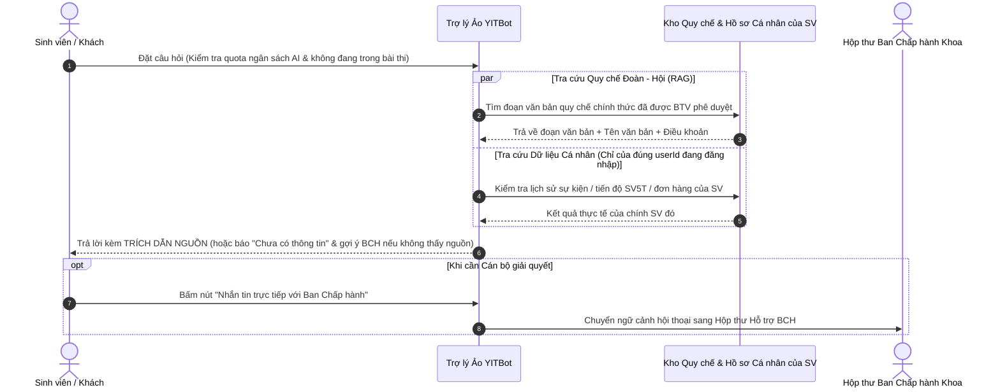

| Mã YC | Tên yêu cầu | Mô tả chi tiết & Quy tắc nghiệp vụ (Business Rules) | Tiêu chí chấp nhận (`Given / When / Then`) & Kiểm chứng | Độ ưu tiên |
| :--- | :--- | :--- | :--- | :---: |
| **FR-BOT-01** | Giải đáp Quy chế Có Trích dẫn Nguồn & Ngưỡng Chính xác Đo được | `YITBot` trả lời hỏi đáp quy chế (`ĐRL`, `CTXH`, `CĐDN` theo bảng ngành cấu hình động, `SV5T`, cơ cấu 4 Ban - 9 Tổ, size áo) **bắt buộc đính kèm trích dẫn nguồn** (*Tên văn bản, Mục/Điều khoản*).<br>- **Chống bịa đặt (Anti-hallucination):** Nếu không tìm thấy thông tin trong kho văn bản đã `BTV` duyệt, `YITBot` phải trả lời rõ *"Chưa có thông tin chính thức trong quy chế hiện hành"* và hiển thị nút chuyển sang Hộp thư BCH.<br>- **Chỉ tiêu chất lượng:** Đạt **$\ge 90\%$ câu trả lời đúng và có trích dẫn chính xác** trên bộ 100 câu hỏi kiểm thử chuẩn do `BTV` phê duyệt. | **Given** sinh viên hỏi điều kiện xét SV5T cấp Khoa.<br>**When** `YITBot` trả lời.<br>**Then** câu trả lời kèm trích dẫn đúng tên quy chế/điều khoản; nếu hỏi quy định không tồn tại trong kho, Bot từ chối suy đoán và gợi ý nhắn BCH.<br>*Kiểm chứng: Đánh giá trên bộ 100 câu hỏi chuẩn.* | Trung bình (P2) |
| **FR-BOT-02** | Tra cứu Dữ liệu Cá nhân Đúng Chủ thể & Bảo mật Dữ liệu | Sinh viên đã đăng nhập tra cứu sự kiện đang mở, lịch sử `ĐRL/CTXH/CĐDN`, trạng thái đơn hàng của chính mình. Hệ thống chỉ truy vấn theo `userId` của phiên đăng nhập hiện tại từ tầng máy chủ, từ chối và làm sạch các chuỗi đánh lừa câu lệnh (Prompt Injection — Edge 19). | **Given** sinh viên A nhập câu lệnh yêu cầu Bot xem điểm của sinh viên B.<br>**When** hệ thống thực thi truy vấn.<br>**Then** Bot chỉ truy xuất được dữ liệu gắn `userId` của A và từ chối truy cập dữ liệu B.<br>*Kiểm chứng: Test bảo mật & Edge 19.* | Trung bình (P2) |
| **FR-BOT-03** | Gợi ý Hướng Giải Bài tập Lập trình (Liên kết OJ) | Giải thích lỗi biên dịch và gợi ý từng bước tư duy thuật toán cho bài luyện tập mở trên OJ (không in sẵn toàn bộ đáp án); tự động khóa khi thí sinh đang thi contest. | **Given** thí sinh đang thi Contest ICPC trên OJ.<br>**When** thí sinh hỏi hướng giải bài thi với `YITBot`.<br>**Then** Bot từ chối gợi ý thuật toán cho bài thuộc contest đang diễn ra.<br>*Kiểm chứng: Test khóa khi thi.* | Mở rộng (P3) |
| **FR-BOT-04** | Quản lý & Phê duyệt Kho Tri thức Quy chế | `BCH` / `MOD_YITBOT_CURATOR` soạn FAQ và tải bản nháp quy chế; chỉ `BTV` (`MOD_YITBOT_FULL`) phê duyệt tài liệu chính thức đưa vào bộ nhớ RAG của `YITBot`. | **Given** `BCH` tải lên file Quy chế mới 2026.<br>**When** `BTV` chưa bấm duyệt vs. sau khi `BTV` bấm duyệt.<br>**Then** trước khi duyệt Bot chưa dùng văn bản mới; sau khi `BTV` duyệt Bot cập nhật câu trả lời theo văn bản mới.<br>*Kiểm chứng: Test luồng duyệt tri thức.* | Trung bình (P2) |
| **FR-BOT-05** | Chuyển tiếp Sang Hộp thư BCH Chỉ với 1 Nút bấm | Nút **"Nhắn tin trực tiếp với Ban Chấp hành"** ngay trong cửa sổ chat để mở luồng `Q&A Messenger` (Mục 4.19) kèm tóm tắt nội dung vừa trao đổi với Bot. | **Given** sinh viên bấm nút chuyển tiếp sau khi hỏi Bot về chuyển ngành.<br>**When** hộp thoại tạo yêu cầu xác nhận.<br>**Then** cuộc trò chuyện mới xuất hiện trong Hộp thư chung BCH kèm ngữ cảnh vừa hỏi.<br>*Kiểm chứng: Test tích hợp.* | Trung bình (P2) |

---

### 4.11. Phân hệ Quản lý Trực Văn phòng & Kiểm kê Vật dụng Văn phòng (Ban Văn phòng)

#### Sơ đồ Quy trình Đăng ký Trực, Điểm danh, Xin vắng/Đổi ca, Tạm ngưng & Kết thúc Chu kỳ
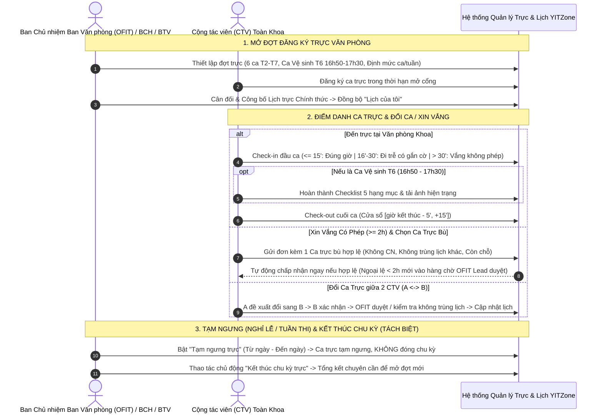

| Mã YC | Tên yêu cầu | Mô tả chi tiết & Quy tắc nghiệp vụ (Business Rules) | Tiêu chí chấp nhận (`Given / When / Then`) & Kiểm chứng | Độ ưu tiên |
| :--- | :--- | :--- | :--- | :---: |
| **FR-DUTY-01** | Thiết lập Đợt Trực, Chuẩn hóa Giờ Ca Vệ sinh & Định mức Tuần | Cho phép `OFIT` (`MOD_DEPT_OFFICE`) / `BCH` / `BTV` mở đợt trực kèm định mức tối đa mỗi ca, **định mức số ca tối thiểu/tuần của mỗi CTV** (cấu hình được, VD: 1 ca/tuần) và bán kính Văn phòng ($30\text{m}$, GPS làm tín hiệu cảnh báo):<br>1. **6 Ca cố định (Thứ 2 – Thứ 7):** Sáng (**Ca 1:** `07h30–08h30`, **Ca 2:** `08h40–09h40`, **Ca 3:** `09h50–10h50`); Chiều (**Ca 4:** `13h30–14h30`, **Ca 5:** `14h40–15h40`, **Ca 6:** `15h50–16h50`).<br>2. **Ca Vệ sinh Văn phòng:** **Chiều Thứ 6 từ `16h50 – 17h30`** *(nối tiếp sau Ca 6, không trùng giờ)*. | **Given** cấu hình lịch tuần mới từ Thứ 2 đến Thứ 7.<br>**When** xem lịch Thứ 6.<br>**Then** Ca 6 (`15h50–16h50`) và Ca Vệ sinh (`16h50–17h30`) nối tiếp nhau, không chồng lấn thời gian.<br>*Kiểm chứng: Inspection & Test lịch.* | Cao (P1) |
| **FR-DUTY-02** | Đăng ký Ca Trực, Công bố Lịch Tổng & Đồng bộ Lịch Cá nhân | CTV đăng ký ca trực theo định mức; hết cổng đăng ký `OFIT` cân đối và công bố lịch chính thức; tự động đồng bộ vào *"Lịch của tôi"* và đặt nhắc nhở trước $30$ phút. | **Given** CTV đăng ký đủ định mức và `OFIT` bấm Công bố.<br>**When** lịch được công bố.<br>**Then** ca trực hiển thị màu Cam trong *"Lịch của tôi"* kèm nhắc trước 30 phút.<br>*Kiểm chứng: Test đồng bộ lịch.* | Cao (P1) |
| **FR-DUTY-03** | Điểm danh Đầu/Cuối Ca & Tách bạch 3 Trạng thái (`Đúng giờ / Đi trễ / Vắng không phép`) | - Tách bạch 3 trạng thái Check-in đầu ca rõ ràng (sửa mâu thuẫn khóa form phút 16):<br>&nbsp;&nbsp;• **`Đúng giờ`:** Check-in trong **$\le 15$ phút** đầu ca.<br>&nbsp;&nbsp;• **`Đi trễ`:** Check-in từ **phút thứ $16$ đến phút thứ $30$** (biểu mẫu **vẫn mở** để ghi nhận sự có mặt thực tế tại văn phòng, gắn cờ `Đi trễ` và gửi thông báo cho `OFIT`/Trưởng Ban).<br>&nbsp;&nbsp;• **`Vắng không phép`:** Quá **$30$ phút** không Check-in.<br>- **Cửa sổ Check-out cuối ca:** Mở trong khoảng **`[giờ kết thúc ca − 5 phút, giờ kết thúc ca + 15 phút]`** (VD: Ca 1 `07h30–08h30` mở Check-out từ `08h25` đến `08h45`, tránh hiểu nhầm được về sớm 15 phút; quá hạn ghi nhận lỗi `Thiếu check-out`). | **Given** Ca 1 `07h30–08h30`.<br>**When** CTV A Check-in lúc `07h40` & Check-out lúc `08h32`, CTV B Check-in lúc `07h52`, CTV C không Check-in đến `08h01`.<br>**Then** A = `Đúng giờ` (Check-out hợp lệ), B = `Đi trễ` (vẫn mở quyền trực), C = `Vắng không phép`; nếu A bấm Check-out lúc `08h15` hệ thống báo chưa tới cửa sổ `[08h25–08h45]`.<br>*Kiểm chứng: Test 3 mốc Check-in & cửa sổ Check-out (Edge 22).* | Cao (P1) |
| **FR-DUTY-04** | Xin Vắng Tự động (khi Hợp lệ), Duyệt Ngoại lệ & Chế tài Vi phạm | - **Chấp nhận tự động:** Đơn gửi trước giờ trực **$\ge 2$ giờ** kèm 1 ca trực bù hợp lệ (**không vào Chủ Nhật**, **không trùng giờ với bất kỳ ca trực hoặc sự kiện nào đã có trong Lịch của tôi**, **còn chỗ trống**) được hệ thống **chấp nhận tự động ngay**, không cần chờ duyệt tay.<br>- **Hàng chờ duyệt ngoại lệ:** Đơn gửi cận giờ ($< 2$ giờ) do cấp cứu/bất khả kháng đi vào hàng chờ của **Ban Chủ nhiệm `OFIT` (`MOD_DEPT_OFFICE_LEAD`)** để duyệt thủ công có lý do.<br>- **Chế tài vi phạm:** Thống kê chuyên cần cuối kỳ báo về Trưởng Ban/`BTV`; tự động gửi cảnh báo nhắc nhở khi CTV đạt ngưỡng vi phạm (VD: $\ge 2$ lần vắng không phép/tháng). | **Given** CTV gửi đơn xin vắng trước $3$ giờ và chọn ca bù Thứ 5 còn trống không trùng lịch.<br>**When** CTV bấm Gửi.<br>**Then** đơn chuyển ngay sang `Đã chấp nhận tự động`, ca cũ được hủy và ca bù thêm vào lịch.<br>*Kiểm chứng: Test tự động vs ngoại lệ (Edge 17, 21).* | Cao (P1) |
| **FR-DUTY-05** | Checklist Ca Vệ sinh (`16h50–17h30` T6), Sổ Nhật ký & Mở quyền Phát áo | Checklist 5 hạng mục dọn dẹp + ảnh minh chứng cho Ca Vệ sinh (`16h50–17h30` Thứ 6); ghi sổ trực điện tử; tự động mở quyền `MOD_STORE_BOOTH` khi CTV Check-in ca trực hợp lệ (cả `Đúng giờ` và `Đi trễ`). | **Given** CTV Check-in Ca 2 thành công.<br>**When** sinh viên đến Văn phòng nhận áo.<br>**Then** CTV thấy công cụ Quét QR phát áo trong suốt thời gian Ca 2.<br>*Kiểm chứng: Test cấp quyền theo ca.* | Cao (P1) |
| **FR-DUTY-06** | Thống kê Giờ trực, Định mức Tuần & Chuyên cần theo Ban/Tổ | Thống kê riêng từng chỉ số: `Số ca đã trực / Định mức`, `Tổng giờ trực`, `Đúng giờ`, `Đi trễ`, `Vắng có phép`, `Vắng không phép`, `Thiếu check-out`. Cán bộ cấp Tổ/Ban xem đúng phạm vi đơn vị mình; `OFIT`/`BCH`/`BTV` xuất Excel toàn Khoa. | **Given** CTV có 1 lần `Đi trễ` và 1 lần `Vắng không phép`.<br>**When** Trưởng Ban mở bảng chuyên cần.<br>**Then** 2 cột `Đi trễ = 1` và `Vắng không phép = 1` hiển thị tách biệt chính xác.<br>*Kiểm chứng: Test báo cáo thống kê.* | Cao (P1) |
| **FR-DUTY-07** | Quản lý Danh mục Tài sản, Thiết bị & Vật tư Văn phòng | Quản lý tài sản dùng nhiều lần (kèm mã QR tài sản: *Tốt / Hỏng / Mất*) và vật tư tiêu hao (cảnh báo mức tồn tối thiểu). | **Given** pin micro còn $2$ viên dưới mức cảnh báo $5$.<br>**When** mở trang Quản trị `OFIT`.<br>**Then** hiển thị cảnh báo sắp hết vật tư cho pin micro.<br>*Kiểm chứng: Test ngưỡng tồn kho.* | Cao (P1) |
| **FR-DUTY-08** | Quản lý Cho Mượn & Nhận Trả Vật dụng Văn phòng (Quét QR Tài sản & Mã vạch Thẻ SV) | Lập Phiếu Mượn - Trả gắn sự kiện, số lượng, tình trạng mượn/trả (Edge 20: đánh dấu hỏng tự động trừ số lượng tốt và cộng vào đang hỏng/sửa chữa). Hỗ trợ **quét mã QR dán trên thiết bị kết hợp quét Mã vạch 1D trên Thẻ sinh viên vật lý của người mượn** để điền nhanh thông tin trong $\le 0.3\text{s}$. Liên kết với `FR-IAM-04` khi CTV nghỉ hoạt động. | **Given** trả 6 bộ đàm trong đó 1 chiếc bị hỏng, và CTV quét mã vạch thẻ SV người trả.<br>**When** `OFIT` chọn 5 Tốt, 1 Hỏng và lưu biên bản.<br>**Then** hệ thống nhận diện đúng người mượn, tồn kho Tốt giảm 1, Hỏng tăng 1 và biên bản lưu trách nhiệm nhóm mượn.<br>*Kiểm chứng: Test mượn trả & quét mã vạch (Edge 20).* | Cao (P1) |
| **FR-DUTY-09** | Kiểm kê Định kỳ & Biên bản Chênh lệch / Hư hỏng | Đối chiếu số lượng sổ sách vs thực tế; ghi nhận hàng dư vào mục *"Tài sản dư chờ xác minh nguồn gốc"* (Edge 8); xuất biên bản trình `BTV` (duyệt chốt bởi `MOD_DEPT_OFFICE_LEAD`). | **Given** sổ sách ghi 10 standee nhưng đếm thực tế 11 cái.<br>**When** lập phiếu kiểm kê.<br>**Then** 1 standee dư vào mục chờ xác minh nguồn gốc, không tự cộng vào tài sản chính thức.<br>*Kiểm chứng: Test kiểm kê (Edge 8).* | Cao (P1) |
| **FR-DUTY-10** | Tách biệt **Tạm ngưng Trực (Nghỉ lễ/Thi)** và **Kết thúc Chu kỳ Trực** | Tách riêng 2 nghiệp vụ độc lập:<br>1. **Tạm ngưng trực (Nghỉ lễ / Tuần thi):** `OFIT` đặt khoảng ngày tạm ngưng; các ca trực trong khoảng này chuyển trạng thái `Tạm ngưng` (không tính vắng). Khi hết thời gian nghỉ lễ (VD: nghỉ lễ 1–2 ngày) hoặc tuần thi, **chu kỳ trực hiện tại vẫn tiếp tục bình thường**, không bị cắt ngang.<br>2. **Kết thúc Chu kỳ Trực:** Chỉ thực hiện khi Ban Chủ nhiệm `OFIT` (`MOD_DEPT_OFFICE_LEAD`) **bấm thao tác chủ động "Kết thúc chu kỳ & Tổng kết"** để chốt số liệu và mở đợt đăng ký mới. | **Given** chu kỳ trực học kỳ đang chạy và trường nghỉ lễ Quốc khánh 2 ngày.<br>**When** `OFIT` bật `Tạm ngưng trực` 2 ngày đó và hết 2 ngày lễ.<br>**Then** các ca ngày lễ không bị tính vắng và các tuần tiếp theo trong chu kỳ vẫn tiếp tục bình thường.<br>*Kiểm chứng: Test tách 2 cơ chế (Edge 23).* | Cao (P1) |
| **FR-DUTY-11** | Đổi Ca trực giữa Hai Cộng tác viên | Hỗ trợ đổi ca trực minh bạch giữa 2 CTV (truy vết Edge 6):<br>- CTV A chọn 1 ca trực của mình và gửi yêu cầu đổi sang CTV B (kèm lý do).<br>- Hệ thống kiểm tra điều kiện B không bị trùng giờ với lịch trực/sự kiện khác; CTV B bấm **Xác nhận đồng ý nhận ca**.<br>- Nhân sự `OFIT` bấm duyệt (hoặc tự động duyệt nếu gửi trước $\ge 24\text{h}$ và hợp lệ). Ngay khi duyệt, ca trực chính thức thuộc trách nhiệm của B; nếu B bận sau đó thì B tự tạo yêu cầu mới, không tự ý chuyền tay. | **Given** CTV A gửi đổi Ca 3 Thứ 4 cho CTV B.<br>**When** B đồng ý và được duyệt.<br>**Then** lịch của A gỡ Ca 3 Thứ 4, lịch của B thêm Ca 3 Thứ 4 và trách nhiệm điểm danh thuộc về B.<br>*Kiểm chứng: Test đổi ca (Edge 6).* | Cao (P1) |

---

### 4.12. Phân hệ Quản lý Văn nghệ & Đăng ký Tiết mục Chương trình (Ban Văn nghệ)

#### Sơ đồ Quy trình Đăng ký Tiết mục, Nộp File Nhạc/Video LED, Tổng duyệt & Bàn giao Kỹ thuật
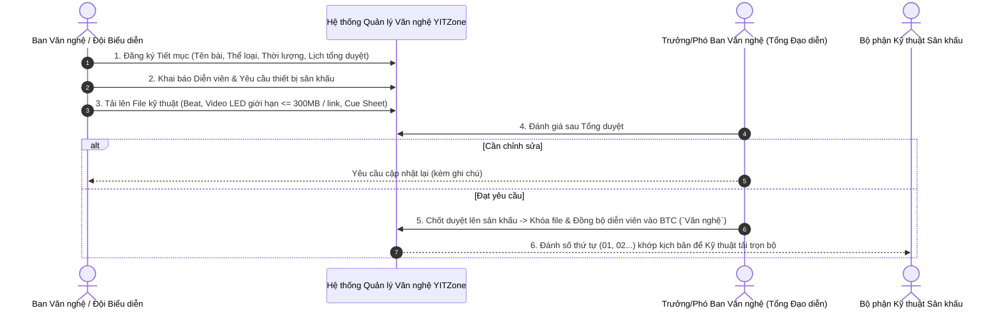

| Mã YC | Tên yêu cầu | Mô tả chi tiết & Quy tắc nghiệp vụ (Business Rules) | Tiêu chí chấp nhận (`Given / When / Then`) & Kiểm chứng | Độ ưu tiên |
| :--- | :--- | :--- | :--- | :---: |
| **FR-ART-01** | Đăng ký Tiết mục Biểu diễn gắn Sự kiện | Đăng ký tiết mục (*Đơn ca, Song/Tốp ca, Nhảy/Múa, Nhạc cụ, Kịch*), thời lượng, thứ tự kịch bản, lịch chạy thử/tổng duyệt (đồng bộ màu Hồng lên Lịch tổng hợp). | **Given** đội văn nghệ đăng ký tiết mục kèm lịch tổng duyệt `18:00 Thứ 5`.<br>**When** lưu tiết mục.<br>**Then** lịch tổng duyệt hiển thị màu Hồng trên Lịch tổng hợp cho các diễn viên.<br>*Kiểm chứng: Test tạo tiết mục & lịch.* | Trung bình (P2) |
| **FR-ART-02** | Danh sách Diễn viên, Thiết bị Sân khấu & Tự động Ghi nhận BTC | Chọn sinh viên/CTV hoặc nhập tên khách mời/cựu SV; khi tiết mục được chốt duyệt sau tổng duyệt, sinh viên diễn viên tự động được thêm vào danh sách BTC ở vị trí `Văn nghệ` (hoặc gắn kiêm nhiệm nếu đã giữ vị trí BTC khác); khai báo số micro, nhạc cụ, đạo cụ cho Hậu cần/Kỹ thuật. | **Given** 5 sinh viên trong tiết mục được chốt duyệt (trong đó 1 bạn đã là `MC`).<br>**When** chốt duyệt tiết mục.<br>**Then** 4 bạn vào vị trí `Văn nghệ`, bạn `MC` giữ nguyên `MC` kèm nhãn kiêm nhiệm `Văn nghệ`.<br>*Kiểm chứng: Test đồng bộ BTC (Edge 2, 13).* | Trung bình (P2) |
| **FR-ART-03** | Nộp & Chuẩn hóa File Kỹ thuật Sân khấu | Tải Beat (`.mp3/.wav/.flac`), Video LED (`.mp4` $\le 300\text{MB}$ hoặc link thư mục ngoài), Cue Sheet & lời bài hát; tự động đổi tên chuẩn hóa theo số thứ tự tiết mục (`01_TenTietMuc_Beat.wav`). | **Given** đổi thứ tự tiết mục #3 lên #1 (Edge 38).<br>**When** Kỹ thuật bấm tải trọn bộ.<br>**Then** tiền tố tên file tự động đánh lại thành `01_...` đúng thứ tự mới.<br>*Kiểm chứng: Test đổi thứ tự & tải gói (Edge 38).* | Trung bình (P2) |
| **FR-ART-04** | Tổng duyệt, Khóa File & Mở khóa Khẩn cấp 20 Phút | Trạng thái: `Mới đăng ký -> Chờ tổng duyệt -> Cần chỉnh sửa -> Đã chốt biểu diễn / Từ chối`. Sau khi chốt, khóa sửa file cho đội diễn; chỉ `MOD_DEPT_ARTS_LEAD` hoặc `BTV` có nút **"Mở khóa khẩn cấp"** tự động khóa lại sau đúng $20$ phút (Edge 18, lưu Audit Log). | **Given** Trưởng Ban `ARTIT` bấm Mở khóa khẩn cấp lúc `18:00`.<br>**When** đến `18:20` mà quên khóa tay.<br>**Then** hệ thống tự động khóa file trở lại lúc `18:20` và ghi Audit Log.<br>*Kiểm chứng: Test timer 20 phút (Edge 18).* | Trung bình (P2) |

---

### 4.13. Phân hệ Lịch Hoạt động Tổng hợp & Theo dõi Nhanh

#### Sơ đồ Gom Lịch Hoạt động Đa Nguồn về Một Màn hình Duy nhất
```mermaid
flowchart LR
    subgraph Sources["6 Nguồn Lịch Hoạt động trong Khoa"]
        S1["1. Sự kiện Chính thức Cấp Khoa\n(Màu Xanh dương)"]
        S2["2. Sự kiện Nội bộ CTV cả 4 Ban\n(Màu Tím)"]
        S3["3. Ca trực & Vệ sinh Văn phòng\n(Màu Cam)"]
        S4["4. Lịch Tập & Tổng duyệt Văn nghệ\n(Màu Hồng)"]
        S5["5. Lịch Thi Trắc nghiệm & Thi Code\n(Màu Xanh lá)"]
        S6["6. Hạn chót Nộp Hồ sơ SV5T & Gây quỹ\n(Màu Đỏ)"]
    end

    subgraph Calendar["Bảng Lịch Hoạt động Tổng hợp (Unified Calendar)"]
        Filter["Tự động lọc theo quyền người xem\n& Nút chuyển 'Lịch Của Tôi' <-> 'Lịch Chung'"]
        Alert["Tự động phát hiện & Cảnh báo Đụng lịch (Trùng giờ)"]
        Action["Bấm vào xem nhanh & Thao tác 1 chạm"]
    end

    Sources --> Filter
    Filter --> Alert
    Alert --> Action
```

| Mã YC | Tên yêu cầu | Mô tả chi tiết & Quy tắc nghiệp vụ (Business Rules) | Tiêu chí chấp nhận (`Given / When / Then`) & Kiểm chứng | Độ ưu tiên |
| :--- | :--- | :--- | :--- | :---: |
| **FR-CAL-01** | Bảng Lịch Tổng hợp Đa Chế độ & 6 Màu sắc Trực quan | Xem theo Tháng, Tuần, Ngày, Danh sách; gom 6 nguồn với 6 màu: Xanh dương (Sự kiện Khoa), Tím (Sự kiện nội bộ CTV của cả 4 Ban `EMFIT/SV5T/OFIT/ARTIT`), Cam (Ca trực/Vệ sinh VP), Hồng (Văn nghệ), Xanh lá (Thi cử), Đỏ (Hạn chót SV5T/Gây quỹ). | **Given** Trưởng Ban `ARTIT` tạo 1 buổi training nội bộ và `OFIT` mở lịch trực tuần.<br>**When** CTV Ban `ARTIT` mở Lịch.<br>**Then** buổi training hiển thị màu Tím, ca trực hiển thị màu Cam; CTV Ban `OFIT` không thấy lịch nội bộ riêng của `ARTIT`.<br>*Kiểm chứng: Test hiển thị & cô lập lịch.* | Cao (P1) |
| **FR-CAL-02** | Chuyển đổi 1 Chạm: *"Lịch Của Tôi"* và *"Lịch Toàn Khoa / Ban"* | Chế độ *"Lịch của tôi"* lọc các hoạt động cá nhân tham gia; chế độ *"Lịch Toàn Khoa & Nội bộ Ban/Tổ"* hiển thị lịch công khai + lịch nội bộ đúng Ban/Tổ của người xem. | **Given** sinh viên đã đăng ký 2 sự kiện trong số 10 sự kiện Khoa.<br>**When** chuyển từ *"Lịch Toàn Khoa"* sang *"Lịch Của Tôi"*.<br>**Then** bảng lịch chỉ còn hiển thị đúng 2 sự kiện sinh viên đã đăng ký.<br>*Kiểm chứng: Demo UI.* | Cao (P1) |
| **FR-CAL-03** | Thẻ Xem Nhanh Thông tin & Nút Thao tác Trực tiếp | Bấm vào sự kiện/ca trực trên lịch mở thẻ xem nhanh kèm nút thao tác theo ngữ cảnh (*Đăng ký, Quét QR, Điểm danh ca trực, Xin vắng/Đổi ca, Vào thi*). | **Given** sự kiện đang trong khung giờ mở đăng ký.<br>**When** bấm vào thẻ sự kiện trên lịch.<br>**Then** thẻ mở trong $\le 300\text{ms}$ với nút *"Đăng ký ngay"* hoạt động trực tiếp.<br>*Kiểm chứng: Demo & Test UI.* | Cao (P1) |
| **FR-CAL-04** | Tự động Phát hiện & Cảnh báo Đụng lịch (Trùng giờ) | Kiểm tra trùng giờ với các mục đã có trong *"Lịch của tôi"* khi đăng ký sự kiện, ứng tuyển BTC, xếp/đổi ca trực hoặc chọn ca trực bù; hiện cảnh báo đỏ nêu rõ 2 hoạt động trùng. | **Given** CTV có ca trực `08h40–09h40` Thứ 4.<br>**When** CTV bấm đăng ký sự kiện diễn ra `08h00–10h00` Thứ 4.<br>**Then** hộp thoại cảnh báo đỏ hiển thị tên ca trực bị trùng trước khi cho xác nhận.<br>*Kiểm chứng: Test kiểm tra trùng giờ.* | Cao (P1) |
| **FR-CAL-05** | Khung Nhắc việc 7 Ngày & Đồng bộ Lịch Điện thoại (`.ics`) | Thanh tóm tắt hoạt động trong `24h` và `7 ngày tới`; nút xuất/đồng bộ sang Google Calendar / Apple Calendar. | **Given** người dùng có 3 lịch trong tuần tới.<br>**When** bấm *"Thêm vào Lịch Điện thoại"*.<br>**Then** tải xuống tệp `.ics` hợp lệ mở được trên Google/Apple Calendar.<br>*Kiểm chứng: Test file `.ics`.* | Trung bình (P2) |

---

### 4.14. Phân hệ Thông báo & Nhật ký Kiểm tra Hệ thống

| Mã YC | Tên yêu cầu | Mô tả chi tiết & Quy tắc nghiệp vụ (Business Rules) | Tiêu chí chấp nhận (`Given / When / Then`) & Kiểm chứng | Độ ưu tiên |
| :--- | :--- | :--- | :--- | :---: |
| **FR-SYS-01** | Trung tâm Thông báo Đa kênh (In-App, Web Push & **Email SMTP**) | - **3 kênh thông báo:** Thông báo trong ứng dụng (In-App), Web Push (khi thiết bị hỗ trợ), và **Email qua giao thức SMTP** đối với các thông báo quan trọng (hủy/đổi giờ sự kiện — Edge 31, đôn danh sách chờ Waitlist, xác nhận thanh toán/hoàn tiền, cảnh báo chuyên cần trực/no-show, cấp/thu hồi quyền).<br>- **Thông báo nội bộ Ban/Tổ:** Cán bộ cấp Tổ/Ban gửi thông báo triệu tập đúng phạm vi nhân sự theo Bảng 3.3A. | **Given** BTC đổi giờ diễn ra sự kiện có $150$ người đăng ký.<br>**When** `BTV` duyệt thay đổi giờ.<br>**Then** hệ thống gửi đồng thời Web Push và Email thông báo đến toàn bộ $150$ người trong hàng đợi bất đồng bộ (Edge 31).<br>*Kiểm chứng: Test gửi Email SMTP & Push.* | Bắt buộc (P0) |
| **FR-SYS-02** | Nhật ký Kiểm tra (`Audit Log`) Append-Only, **Tuần tự Hóa & Neo Hash Định kỳ Ra Ngoài** (Lưu trữ 05 Năm) | - **Danh sách sự kiện bắt buộc ghi Log:** Cấp/Thu hồi quyền hạn, Điểm danh bù bằng tay, Duyệt/từ chối hàng loạt hàng chờ hậu kiểm điểm danh, Cấp đặc cách `CĐDN`, Xác nhận thanh toán/Đổi size/Hoàn tiền đơn hàng, **Ký nhận bàn giao tiền mặt COD cuối ca**, **Từ chối Webhook thanh toán sai chữ ký**, Duyệt/Từ chối/Chốt hồ sơ SV5T, Thu hồi/Cấp lại E-Cert, Mở khóa văn nghệ khẩn cấp, Duyệt ngoại lệ vắng trực, Chuyển thiết bị thi, Ẩn E-Portfolio vi phạm, **Tra cứu danh tính câu hỏi ẩn danh `Live Q&A` (`MOD_LIVEQA_UNMASK`)**, và **Mở xem Bảng tóm tắt Hồ sơ sinh viên (`FR-QACHAT-04`)**.<br>- **Cơ chế bảo toàn, Chống rẽ nhánh đồng thời & Neo Hash ra ngoài (`A20`):**<br>&nbsp;&nbsp;• Ghi dạng **chỉ nối thêm (`Append-only`) có chuỗi băm kiểm toàn vẹn (Hash-chain)** với bộ cấp số thứ tự `seq` nguyên tử tuần tự (chống trùng `seq` hoặc rẽ nhánh chuỗi khi nhiều yêu cầu ghi đồng thời).<br>&nbsp;&nbsp;• **Neo Hash định kỳ ra ngoài (`External Hash Anchoring`):** Hằng ngày hệ thống tự động trích xuất đỉnh chuỗi băm `{seq, hash, timestamp}` gửi qua Email SMTP tới hộp thư lưu trữ độc lập của `BTV` và ghi vào vùng sao lưu chỉ ghi (Off-site WORM Backup) để phát hiện mọi hành vi can thiệp/tính lại chuỗi ở tầng CSDL; đồng thời chạy **Job kiểm tra toàn vẹn chuỗi hằng tuần**.<br>&nbsp;&nbsp;• **Tối thiểu hóa dữ liệu:** Chỉ lưu các trường thay đổi cần thiết (**`changedFields` diff tối thiểu**, không chụp nguyên tài liệu chứa dữ liệu cá nhân thừa) và **lưu trữ tối thiểu $05$ năm**. Chỉ vai trò giữ `MOD_AUDIT_VIEWER` (`BTV` & `SystemAdmin`) được quyền xem. | **Given** nhiều cán bộ thao tác nhạy cảm đồng thời (tra cứu danh tính Live Q&A, điểm danh bù, ký nhận tiền COD).<br>**When** kiểm tra màn hình Audit Log với quyền `MOD_AUDIT_VIEWER` và chạy công cụ kiểm tra toàn vẹn chuỗi.<br>**Then** các bản ghi có `seq` tăng đơn điệu không trùng/rẽ nhánh, hiển thị đủ `Actor, Timestamp, Action, Target, ChangedFields (diff tối thiểu), Reason` kèm mã hash khớp với mốc neo `External Hash Anchor` đã gửi email cho `BTV`.<br>*Kiểm chứng: Concurrency Audit test & Hash-chain Integrity check.* | Bắt buộc (P0) |

---

### 4.15. Phân hệ Khảo sát & Lấy ý kiến Sinh viên

#### Sơ đồ Quy trình Khảo sát Ý kiến Sinh viên (Định danh / Ẩn danh An toàn) & Tổng hợp AI
```mermaid
sequenceDiagram
    autonumber
    actor Creator as BCH / BTV / BTC Sự kiện
    participant System as Hệ thống Khảo sát YITZone
    actor SV as Sinh viên Tham gia
    participant AI as Trợ lý Tổng hợp Ý kiến AI

    Creator->>System: 1. Tạo biểu mẫu (Định danh hoặc Ẩn danh Đã xác thực)
    System-->>SV: 2. Gửi thông báo / Tự bật sau Check-out
    SV->>System: 3. Gửi phản hồi khảo sát
    alt Chế độ Định danh
        System->>System: Lưu định danh -> Mở khóa cấp E-Cert
    else Chế độ Ẩn danh Đã xác thực
        System->>System: Kiểm tra 1 lần gửi/người; Tách rời userId & KHÔNG lưu timestamp chi tiết
    end
    Creator->>System: 4. Xem thống kê (Chỉ hiển thị khi đủ >= 5 phản hồi với ẩn danh) & Xem trước khử định danh
    System->>System: Khử định danh tự động + Người phụ trách rà soát/che thủ công tên riêng (VD: "anh Tuấn...")
    System->>AI: 5. Gửi dữ liệu đã xác nhận khử định danh -> Trả về báo cáo 3 mục
```

| Mã YC | Tên yêu cầu | Mô tả chi tiết & Quy tắc nghiệp vụ (Business Rules) | Tiêu chí chấp nhận (`Given / When / Then`) & Kiểm chứng | Độ ưu tiên |
| :--- | :--- | :--- | :--- | :---: |
| **FR-SUR-01** | Biểu mẫu Khảo sát Linh hoạt & Kho Mẫu Chuẩn | 5 dạng câu hỏi (Sao 1–5, Thang 5 mức, 1 lựa chọn + Ý kiến khác, Nhiều lựa chọn, Tự luận) cùng Kho mẫu chuẩn của Khoa. | **Given** người tạo chọn mẫu *"Đánh giá Hội thảo"*.<br>**When** tùy biến thêm 1 câu tự luận và xuất bản.<br>**Then** biểu mẫu sẵn sàng nhận phản hồi trên di động.<br>*Kiểm chứng: Demo UI.* | Cao (P1) |
| **FR-SUR-02** | 3 Phạm vi Khảo sát (Sau Sự kiện, Toàn Khoa, Nội bộ Ban/Tổ) | Kiểm soát đối tượng trả lời đúng phạm vi (đã điểm danh sự kiện, toàn Khoa, hoặc đúng Ban/Tổ). | **Given** khảo sát nội bộ Ban `OFIT`.<br>**When** sinh viên không thuộc Ban `OFIT` truy cập link.<br>**Then** hệ thống từ chối hiển thị biểu mẫu (`403`).<br>*Kiểm chứng: Test phân quyền phạm vi.* | Cao (P1) |
| **FR-SUR-03** | Chế độ Định danh & Chế độ **Ẩn danh An toàn ($N \ge 5$, Tách Bảng & Không Timestamp Chi tiết)** | - **Định danh:** Lưu Họ tên/MSSV để xét điều kiện E-Cert.<br>- **Ẩn danh Đã xác thực (Chống liên kết ngược bởi cả Quản trị viên):** Tách riêng danh sách *"đã nộp"* (chống gửi trùng) khỏi bảng lưu câu trả lời tự luận; bản ghi câu trả lời **không chứa `userId` hay khóa băm liên kết tới người gửi**, **không lưu timestamp chi tiết đến giờ/phút/giây** (chỉ lưu ngày theo lô xáo trộn thứ tự ghi), và **chỉ hiển thị kết quả chi tiết khi tổng số phản hồi đạt ngưỡng tối thiểu $N \ge 5$**. | **Given** khảo sát ẩn danh nội bộ Tổ có 10 thành viên.<br>**When** mới có 3 người trả lời vs khi đủ $\ge 5$ người trả lời và Admin kiểm tra dữ liệu câu trả lời.<br>**Then** lúc mới có 3 người, quản lý chưa xem được chi tiết; khi đủ $\ge 5$ người, không có cột giờ gửi chi tiết và bản ghi câu trả lời không có trường hay khóa băm nào liên kết ngược được về tài khoản người nộp.<br>*Kiểm chứng: Test ngưỡng ẩn danh & kiểm tra schema tách bảng.* | Cao (P1) |
| **FR-SUR-04** | Tự động Bật Khảo sát sau Check-out & Chia sẻ Mã QR | Tự bật form sau Check-out nếu gắn sự kiện (hỗ trợ gửi bù trong $24\text{h}$ — Edge 35); cấp QR riêng cho mỗi khảo sát. | **Given** sự kiện có gắn khảo sát sau Check-out.<br>**When** sinh viên hoàn tất Check-out.<br>**Then** màn hình chuyển ngay sang biểu mẫu khảo sát.<br>*Kiểm chứng: Test luồng Check-out.* | Cao (P1) |
| **FR-SUR-05** | Thống kê Trực quan, Xuất Excel & Tóm tắt AI Đã Khử Định danh Có Xem trước | - Biểu đồ thống kê, xuất `.xlsx`.<br>- **Khử định danh 2 bước trước khi gọi LLM (`NFR-PRIV-05`):** Hệ thống nhận dạng mẫu tự động (che MSSV, email, SĐT và gợi ý NER tên riêng tiếng Việt). Do nhận dạng tự động không đảm bảo bắt chính xác 100% họ tên tiếng Việt viết tự do (VD: *"anh Tuấn ban hậu cần..."*), hệ thống **bắt buộc hiển thị bước Xem trước & Chỉnh sửa thủ công bản đã che** cho người phụ trách (`MOD_SURVEY_POLL`) rà soát, che thêm nếu còn sót và bấm xác nhận trước khi gửi payload sang LLM. | **Given** 100 câu góp ý trong đó có câu chứa MSSV `25110001`, SĐT `0901234567` và tên riêng `"anh Tuấn ban hậu cần"`.<br>**When** cán bộ bấm *"Tóm tắt bằng AI"*.<br>**Then** hệ thống tự động che MSSV/SĐT, mở màn hình xem trước để cán bộ kiểm tra/che thêm `"anh Tuấn"` thành `[ĐÃ ẨN TÊN]` rồi mới gửi sang LLM và trả về báo cáo 3 mục.<br>*Kiểm chứng: Test bộ lọc PII kèm tên riêng tiếng Việt & bước xem trước.* | Cao (P1) |

---

### 4.16. Phân hệ Hồ sơ Năng lực Số & Xuất CV Xác thực Tự động (E-Portfolio)
*(Ghi chú Phạm vi: Thuộc nhóm Mở rộng sau MVP — P3, triển khai khi các phân hệ dữ liệu nguồn ở GĐ1–GĐ2 vận hành ổn định).*

#### Sơ đồ Tổng hợp Thành tích Đã Xác thực & Xuất Bản CV Có Mã QR Kiểm chứng
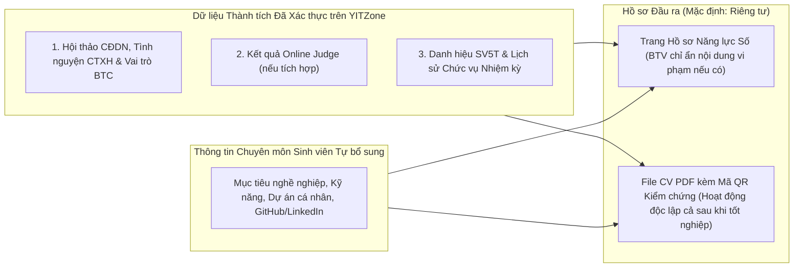

| Mã YC | Tên yêu cầu | Mô tả chi tiết & Quy tắc nghiệp vụ (Business Rules) | Tiêu chí chấp nhận (`Given / When / Then`) & Kiểm chứng | Độ ưu tiên |
| :--- | :--- | :--- | :--- | :---: |
| **FR-PORT-01** | Tổng hợp Thành tích Đã Xác thực trên YITZone | Tự động tổng hợp `CĐDN`, `CTXH`, vai trò `BTC`, danh hiệu `SV5T`, lịch sử chức vụ Đoàn - Hội (và kết quả OJ nếu có) kèm nhãn `[Đã xác thực bởi Đoàn - Hội Khoa CNTT]`. | **Given** sinh viên đã hoàn thành 3 sự kiện `CĐDN` và 1 kỳ làm `MC`.<br>**When** mở trang E-Portfolio.<br>**Then** các mục này hiển thị tự động với huy hiệu xác thực và liên kết tới E-Cert.<br>*Kiểm chứng: Test tổng hợp.* | Mở rộng (P3) |
| **FR-PORT-02** | Quản lý Dự án Cá nhân & **Mặc định Riêng tư (Privacy by Default)** | - Sinh viên toàn quyền biên tập thông tin cá nhân, chọn ghim/ẩn từng chứng nhận.<br>- **Mặc định Riêng tư:** Khi khởi tạo tài khoản, E-Portfolio luôn ở trạng thái **`Riêng tư`** (người ngoài không xem được). Sinh viên chủ động chuyển sang `Chỉ người có Link/QR` hoặc `Công khai`.<br>- `BTV` không được sửa nội dung cá nhân của sinh viên; chỉ có quyền **Ẩn/Gỡ nội dung vi phạm chuẩn mực** kèm lý do bắt buộc và lưu **Audit Log**. | **Given** sinh viên mới kích hoạt tài khoản lần đầu.<br>**When** Guest truy cập URL E-Portfolio của sinh viên đó.<br>**Then** hệ thống hiển thị thông báo hồ sơ đang ở chế độ `Riêng tư` cho đến khi sinh viên tự bật công khai.<br>*Kiểm chứng: Test quyền riêng tư mặc định.* | Mở rộng (P3) |
| **FR-PORT-03** | Xuất File CV PDF (Kèm Mã QR Xác thực Hoạt động Độc lập) | Xuất CV PDF phân biệt rõ thành tích xác thực vs tự kê khai, gắn mã QR kiểm chứng ở cuối CV. Trang kiểm chứng vẫn xác thực hợp lệ các danh hiệu/chứng nhận in trên CV ngay cả khi hồ sơ đặt chế độ Riêng tư (Edge 28) hoặc sinh viên đã tốt nghiệp (`FR-IAM-02`). | **Given** sinh viên đặt E-Portfolio về `Riêng tư` sau khi đã in CV.<br>**When** nhà tuyển dụng quét mã QR trên bản CV PDF.<br>**Then** trang kiểm chứng không lộ chi tiết dự án cá nhân nhưng vẫn xác thực tính hợp lệ của các chứng nhận/danh hiệu đã in (Edge 28).<br>*Kiểm chứng: Test QR xác thực (Edge 28).* | Mở rộng (P3) |
| **FR-PORT-04** | Trợ lý AI Gợi ý Diễn đạt Mô tả Kinh nghiệm cho CV | Gợi ý viết lại mô tả kinh nghiệm Đoàn - Hội sang ngôn ngữ tuyển dụng (Việt/Anh) dựa trên dữ liệu đã khử định danh và nằm trong hạn mức AI. | **Given** sinh viên chọn 1 hoạt động BTC và bấm *"Gợi ý mô tả CV"*.<br>**When** AI trả kết quả.<br>**Then** hiển thị 2 phương án mô tả để sinh viên tự chọn áp dụng (không tự ghi đè).<br>*Kiểm chứng: Demo AI.* | Mở rộng (P3) |

---

### 4.17. Phân hệ Bức tường Hỏi - Đáp Trực tiếp tại Hội trường (Live Q&A)

#### Sơ đồ Quy trình Đặt Câu hỏi Giao lưu Diễn giả, Bình chọn (Upvote) & Trình chiếu Sân khấu
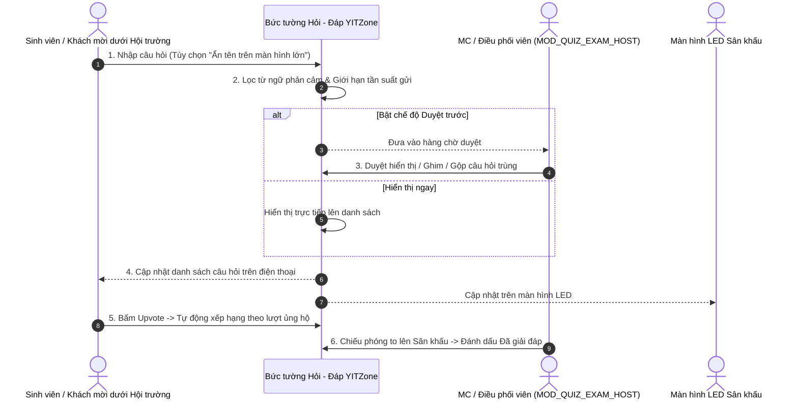

| Mã YC | Tên yêu cầu | Mô tả chi tiết & Quy tắc nghiệp vụ (Business Rules) | Tiêu chí chấp nhận (`Given / When / Then`) & Kiểm chứng | Độ ưu tiên |
| :--- | :--- | :--- | :--- | :---: |
| **FR-QA-01** | Mở Phiên Hỏi - Đáp Gắn với Sự kiện | Bật `Live Q&A` theo sự kiện (PIN 6 số / QR), tùy chỉnh chế độ duyệt trước, cho phép ẩn tên sân khấu và giới hạn số câu hỏi mỗi 5 phút. | **Given** BTC bật `Live Q&A` giới hạn tối đa 2 câu/5 phút.<br>**When** sinh viên gửi câu thứ 3 trong phút thứ 2.<br>**Then** hệ thống tạm chặn và báo thời gian chờ còn lại.<br>*Kiểm chứng: Test rate limit.* | Cao (P1) |
| **FR-QA-02** | Ẩn Tên trên Màn hình & Tra Danh tính Có Kiểm toán | Người gửi phải đăng nhập (hoặc dùng tài khoản Khách mời sự kiện). Khi chọn *"Ẩn tên trên màn hình"*, khán giả và màn hình LED chỉ thấy *"Sinh viên Khoa CNTT (Ẩn danh)"*. Chỉ người có gói **`MOD_LIVEQA_UNMASK`** (`BTV` hoặc `Trưởng BTC` được ủy quyền trong sự kiện đó — **không cấp cho `SystemAdmin`**) mới tra cứu được tài khoản gốc khi có quấy rối, và **mọi lượt tra cứu đều bắt buộc ghi lý do vào Audit Log (`FR-SYS-02`)**. | **Given** sinh viên A gửi câu hỏi ẩn danh vi phạm nội quy.<br>**When** `BTV` (hoặc Trưởng BTC giữ `MOD_LIVEQA_UNMASK`) bấm xem danh tính kèm lý do `"Xử lý quấy rối hội trường"`.<br>**Then** hiển thị MSSV/Tên A đồng thời sinh 1 bản ghi trong `Audit Log`; `SystemAdmin` và CTV thường không thấy nút tra cứu.<br>*Kiểm chứng: Test ẩn danh & Audit Log (Edge 27).* | Cao (P1) |
| **FR-QA-03** | Bình chọn (`Upvote`) & Xếp hạng Thời gian thực | Mỗi người tối đa 1 Upvote/câu hỏi (bấm lại để bỏ); sắp xếp theo `Nhiều lượt ủng hộ nhất` hoặc `Mới nhất`. | **Given** 50 sinh viên bấm Upvote cho câu hỏi #5.<br>**When** bảng xếp hạng cập nhật.<br>**Then** câu #5 tự động dịch chuyển lên vị trí tương ứng với số Upvote chính xác.<br>*Kiểm chứng: Load test WebSocket.* | Cao (P1) |
| **FR-QA-04** | Lọc Từ ngữ Nhạy cảm, Gộp Câu hỏi Trùng & Bảng Điều khiển MC | Từ chối từ ngữ phản cảm theo từ điển cấu hình; MC (`MOD_QUIZ_EXAM_HOST`) duyệt/từ chối, ghim hoặc gộp 2 câu hỏi trùng ý (cộng tập hợp người Upvote không tính trùng người — Edge 36). | **Given** câu A có `{SV1, SV2}`, câu B có `{SV2, SV3}`.<br>**When** MC gộp B vào A.<br>**Then** câu sau gộp có tổng đúng $3$ Upvote (`{SV1, SV2, SV3}`), không bị thành 4 (Edge 36).<br>*Kiểm chứng: Test gộp Upvote (Edge 36).* | Cao (P1) |
| **FR-QA-05** | Màn hình Sân khấu Chuyên dụng & Xuất Tổng kết Excel/PDF | Giao diện LED chữ lớn độ tương phản cao, có QR góc màn hình; xuất toàn bộ câu hỏi kèm lượt quan tâm ra Excel/PDF sau hội thảo. | **Given** hội thảo kết thúc với 45 câu hỏi.<br>**When** BTC bấm xuất báo cáo.<br>**Then** tải về tệp Excel/PDF đủ nội dung câu hỏi, trạng thái giải đáp và số lượt Upvote.<br>*Kiểm chứng: Demo LED & Export.* | Cao (P1) |

---

### 4.18. Phân hệ Ứng dụng Di động Tiện lợi (PWA), Vé Ngoại tuyến & Thông báo Đẩy

#### Sơ đồ Sử dụng Vé QR Ngoại tuyến Khép kín (Cả Sinh viên & Máy Soát vé BTC đều Mất mạng)
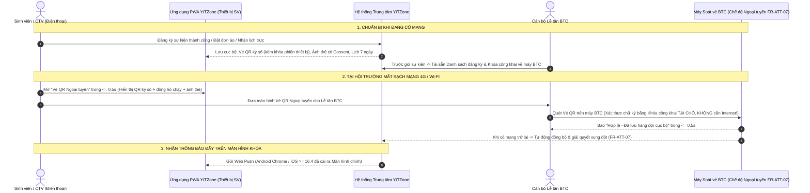

| Mã YC | Tên yêu cầu | Mô tả chi tiết & Quy tắc nghiệp vụ (Business Rules) | Tiêu chí chấp nhận (`Given / When / Then`) & Kiểm chứng | Độ ưu tiên |
| :--- | :--- | :--- | :--- | :---: |
| **FR-PWA-01** | Cài đặt Ra Màn hình Chính (Android & iOS $\ge 16.4$) & Phím tắt | Cài đặt PWA trực tiếp từ trình duyệt không qua Store (Android Chrome $\ge 110$, iOS Safari $\ge 16.4$); cung cấp 4 lối tắt nhanh (*Quét QR, Vé Ngoại tuyến, Lịch Trực/Sự kiện, YITBot*). | **Given** mở YITZone trên Android Chrome hoặc iOS Safari $\ge 16.4$.<br>**When** thêm ra Màn hình chính và mở lại.<br>**Then** ứng dụng chạy chế độ standalone toàn màn hình và hiển thị các lối tắt.<br>*Kiểm chứng: Test thực tế trên Android & iOS.* | Bắt buộc (P0) |
| **FR-PWA-02** | **Vé QR Ký số Ngoại tuyến (`ECDSA P-256`, Chu kỳ 15s)**, Nhắc Kích hoạt Lại trên iOS, Ảnh Chân dung Có Đồng ý & Lịch Ngoại tuyến | Lưu đệm vào bộ nhớ cục bộ để mở trong **$\le 0.5\text{s}$ khi bật Chế độ máy bay** (`A9`, `A9b`, `A10`):<br>1. **Vé QR Sự kiện Ký số Ngoại tuyến (`ECDSA P-256`):** Chứa dữ liệu vé + **chữ ký số bất đối xứng theo chuẩn `ECDSA P-256`** (tương thích rộng rãi trên cả **iOS Safari $\ge 16.4$ và Android Chrome $\ge 110$**) gắn với khóa riêng thiết bị (`extractable: false`). Mã QR hiển thị biến đổi theo **chu kỳ `15 giây`** kèm đồng hồ chạy để **hạn chế** việc chụp ảnh màn hình vé gửi qua mạng xã hội. Máy BTC dùng Khóa công khai (`FR-ATT-07`) xác thực tại chỗ (chỉ chấp nhận bucket 15s hiện tại $\pm 5\text{s}$) và đối chiếu ảnh thẻ mà không cần Internet.<br>2. **Nhắc kiểm tra/kích hoạt lại vé trước sự kiện `24 giờ` (`A9b`):** Vì Safari trên iOS có thể tự xóa `IndexedDB` của trang web lâu không mở nếu người dùng chưa thêm PWA ra Màn hình chính, hệ thống tự động gửi thông báo nhắc sinh viên mở ứng dụng kiểm tra/tải lại Vé Ngoại tuyến trước giờ sự kiện `24 giờ` (và luôn có phương án dự phòng bằng **Mã vạch 1D trên Thẻ sinh viên vật lý**).<br>3. **Ảnh thẻ nhận diện trên vé:** Lấy từ ảnh thẻ sinh viên do Trường cung cấp hoặc sinh viên tự tải lên **sau khi xác nhận đồng ý (`NFR-PRIV-01`)**.<br>4. **Mã QR Nhận hàng**, **Lịch 7 ngày tới**, **E-Cert đã ghim**. | **Given** sinh viên dùng iPhone iOS 16.4 hoặc Android Chrome 110 đã tải Vé QR Ngoại tuyến (`ECDSA P-256`, chu kỳ 15s) và bật Chế độ máy bay trước khi vào hội trường.<br>**When** mở Vé QR Ngoại tuyến và đưa máy BTC ở chế độ ngoại tuyến quét.<br>**Then** vé mở trong $\le 0.5\text{s}$ kèm ảnh thẻ và máy BTC xác thực thành công chữ ký `ECDSA P-256` trong cửa sổ 15s mà cả 2 máy đều không có Internet.<br>*Kiểm chứng: Test Offline End-to-End trên iOS 16.4 & Android Chrome 110.* | Bắt buộc (P0) |
| **FR-PWA-03** | Hàng đợi Lưu Tạm & Tự động Gửi Bù khi Mạng Chập chờn | Lưu cục bộ phiếu khảo sát sau sự kiện, câu hỏi Live Q&A hoặc nhật ký trực khi mất mạng tạm thời và tự động đồng bộ nền khi có kết nối lại (Edge 35: khảo sát gửi bù hợp lệ trong $24\text{h}$ sau sự kiện). | **Given** sinh viên mất mạng đúng lúc bấm gửi Phiếu khảo sát cuối giờ.<br>**When** có mạng lại sau 10 phút.<br>**Then** ứng dụng tự động gửi phiếu lên server mà sinh viên không cần nhập lại.<br>*Kiểm chứng: Test ngắt mạng lúc Submit.* | Cao (P1) |
| **FR-PWA-04** | Thông báo Đẩy Web Push lên Màn hình Khóa | Gửi Web Push (nhắc trực trước $30'$, nhắc sự kiện trước $2\text{h}$, đôn Waitlist, tin nhắn BCH, trạng thái đơn hàng), cho phép bật/tắt từng loại. *(Ghi chú ràng buộc: Trên iOS, tính năng Web Push hoạt động từ iOS $\ge 16.4$ sau khi người dùng cài PWA ra Màn hình chính).* | **Given** người dùng cấp quyền nhận thông báo trên Android hoặc iOS PWA đã cài ra màn hình chính.<br>**When** tới mốc trước ca trực 30 phút.<br>**Then** thiết bị nhận thông báo đẩy ngay cả khi đóng trình duyệt.<br>*Kiểm chứng: Test Push Android & iOS.* | Bắt buộc (P0) |

---

### 4.19. Phân hệ Hộp thư Hỏi - Đáp & Nhắn tin Hỗ trợ Trực tiếp với BCH

#### Sơ đồ Quy trình Sinh viên Nhắn tin Hỏi - Đáp Chuyển về Hộp thư Chung Ban Chấp hành
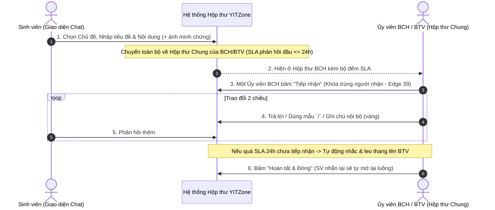

| Mã YC | Tên yêu cầu | Mô tả chi tiết & Quy tắc nghiệp vụ (Business Rules) | Tiêu chí chấp nhận (`Given / When / Then`) & Kiểm chứng | Độ ưu tiên |
| :--- | :--- | :--- | :--- | :---: |
| **FR-QACHAT-01** | Mở Cuộc trò chuyện Theo Chủ đề & Chuyển về Hộp thư Chung BCH | Sinh viên chọn nhãn chủ đề (*Điểm danh/Quyền lợi, SV5T, Sự kiện/BTC, Cửa hàng, Trực VP, Thắc mắc chung*), nhập nội dung (+ ảnh); toàn bộ chuyển về Hộp thư Chung của `BCH`/`BTV` (`MOD_QA_MESSENGER`), không phân tán sang các Tổ lẻ. | **Given** sinh viên chọn chủ đề `Điểm danh & Quyền lợi` và gửi tin nhắn.<br>**When** kiểm tra Hộp thư BCH.<br>**Then** cuộc trò chuyện xuất hiện ngay trong hàng chờ `Chưa có người nhận` với đúng nhãn chủ đề.<br>*Kiểm chứng: Test định tuyến hộp thư.* | Trung bình (P2) |
| **FR-QACHAT-02** | Giao diện Nhắn tin 2 Chiều Thời gian thực | Nhắn tin real-time, hiển thị *"Đang soạn..."*, *"Đã xem"*, dán ảnh chụp màn hình ($\le 5\text{MB}$), Reply trích dẫn và huy hiệu chính danh `[Ban Chấp hành Đoàn - Hội Khoa CNTT]`. | **Given** sinh viên dán 1 ảnh lỗi `.png` và BCH trả lời trích dẫn.<br>**When** gửi tin nhắn.<br>**Then** hai bên nhận nội dung trong $\le 1\text{s}$ khi trực tuyến.<br>*Kiểm chứng: Test WebSocket chat.* | Trung bình (P2) |
| **FR-QACHAT-03** | Điều phối Chống Trùng, Ghi chú Nội bộ, **SLA 24h & Leo thang BTV** | - Bộ lọc hộp thư + Cơ chế khóa *"Tiếp nhận"* chống 2 BCH trả lời trùng (Edge 39) + Tab **"Ghi chú nội bộ BCH (Màu vàng)"** chỉ hiển thị cho cán bộ trực hộp thư.<br>- **SLA & Leo thang tự động:** Đặt mục tiêu **phản hồi đầu tiên $\le 24$ giờ** (trong ngày làm việc). Nếu quá $24$ giờ cuộc trò chuyện vẫn chưa có người tiếp nhận hoặc chưa phản hồi lần đầu, hệ thống tự động gửi thông báo nhắc khẩn và **leo thang lên hàng chờ giám sát của `BTV`**. | **Given** 2 BCH bấm tiếp nhận cùng thời điểm (Edge 39), và 1 câu hỏi khác tồn quá 24h chưa ai nhận.<br>**When** hệ thống xử lý.<br>**Then** chỉ người bấm trước nhận được luồng chat; câu quá 24h tự động gắn cờ `Quá SLA` và gửi cảnh báo cho `BTV`.<br>*Kiểm chứng: Test concurrency & SLA job.* | Trung bình (P2) |
| **FR-QACHAT-04** | Kho Câu trả lời Mẫu (`/`) & Tóm tắt Hồ sơ Sinh viên **Tối thiểu Có Audit Log** | - Gõ `/` chọn mẫu trả lời nhanh.<br>- Cột bên phải hiển thị **Bảng tóm tắt tối thiểu phục vụ giải đáp** (*Họ tên, MSSV, Ngành, 3 sự kiện gần nhất, tiến độ SV5T/đơn hàng liên quan*). Quyền xem bảng tóm tắt này chỉ cấp cho `BCH`/`BTV` (hoặc người giữ `MOD_QA_MESSENGER` được ủy quyền), và **mọi lượt mở xem tóm tắt hồ sơ đều được ghi vào Audit Log (`FR-SYS-02`)**. | **Given** BCH A mở cuộc trò chuyện của sinh viên X để hỗ trợ kiểm tra điểm danh.<br>**When** cột tóm tắt hồ sơ X tải dữ liệu.<br>**Then** chỉ các trường tối thiểu hiển thị và hệ thống ghi 1 bản ghi `VIEW_STUDENT_SUMMARY` vào Audit Log.<br>*Kiểm chứng: Test tối thiểu dữ liệu & Audit Log.* | Trung bình (P2) |
| **FR-QACHAT-05** | Đánh dấu Hoàn tất, Mở lại & Thông báo Đẩy khi Vắng mặt | Đóng cuộc trò chuyện sang `Đã giải quyết`; tự mở lại khi sinh viên nhắn tiếp; gửi Web Push nếu sinh viên thoát ứng dụng. | **Given** cuộc trò chuyện đang ở trạng thái `Đã giải quyết`.<br>**When** sinh viên nhắn thêm câu hỏi mới.<br>**Then** trạng thái tự động chuyển lại thành `Chờ BCH trả lời` và nổi lên đầu hộp thư.<br>*Kiểm chứng: Test vòng đời ticket.* | Trung bình (P2) |

---

### 4.20. Phân hệ Bình chọn Trực tiếp Hội trường, Biểu quyết & Bầu cử Đoàn - Hội (`Live Voting & Polling`)

#### Sơ đồ Quy trình Bình chọn Hội trường (Trọng số BGK + Khán giả), Bỏ phiếu Kín Qua Thùng đệm Trộn lô (`Outbox Shuffle`) & Đóng băng LED Phút chót
```mermaid
sequenceDiagram
    autonumber
    actor Host as BCH / BTV / BTC Sự kiện (MOD_SURVEY_POLL)
    actor Judge as Ban Giám khảo (judgeUserIds)
    actor Voter as Cử tri / Sinh viên Đã Điểm danh
    participant System as Hệ thống Bình chọn YITZone
    actor Screen as Màn hình LED Sân khấu (MOD_QUIZ_EXAM_HOST)

    Host->>System: 1. Thiết lập Phiên Bình chọn / Biểu quyết (Thể thức [minK..maxK], Điều kiện cử tri, Trọng số BGK/Khán giả, Chế độ Kín/Định danh)
    Host->>System: 2. Mở cổng Bình chọn (Mã PIN / QR; Quầy Kiosk Mã vạch thẻ SV chỉ mở cho Bình chọn Định danh)
    par Khán giả / Cử tri Bỏ phiếu (1 người / 1 lượt)
        Voter->>System: 3a. Gửi lá phiếu kèm chữ ký sở hữu Device Token (Kiểm tra đã Check-in sự kiện / Đủ điều kiện cử tri)
        alt Chế độ Bỏ phiếu Kín Đã Xác thực (isSecretBallot = true — KHÔNG kiểm phiếu thời gian thực)
            System->>System: Giao dịch nguyên tử: Ghi VOTING_VOTER_LOGS (_id UUIDv4) + Ghi thùng đệm VOTING_BALLOT_OUTBOX (_id UUIDv4, không userId)
            System->>System: Khi đủ lô >= k phiếu (hoặc đóng cổng): Xáo trộn ngẫu nhiên thứ tự -> Chuyển sang VOTING_BALLOTS
            System-->>Voter: Cấp Mã Biên nhận Lá phiếu (VOTE-XXXX-YYYY) hiển thị 1 lần để tự kiểm chứng
            System-->>Screen: Chỉ cập nhật "Tổng số cử tri đã bỏ phiếu" (Không đẩy biến động phiếu từng ứng viên ra LED hay kênh .admin)
        else Chế độ Bình chọn Định danh (isSecretBallot = false)
            System->>System: Lưu lá phiếu định danh & Cập nhật bộ đếm thời gian thực
            System-->>Screen: 4. Cập nhật biểu đồ Đua Top thời gian thực qua WebSocket (hoặc ẩn trên LED khi bật Freeze Mode phút chót)
        end
    and Ban Giám khảo Chấm điểm Trọng số (Bảng định danh riêng VOTING_JUDGE_SCORES)
        Judge->>System: 3b. Chấm điểm từng tiết mục / đội thi (Kiểm tra quyền trực tiếp theo danh sách judgeUserIds)
    end
    Host->>System: 5. Đóng cổng -> Kiểm phiếu, Tính tổng điểm Trọng số (BGK + Khán giả), Mở băng công bố Vinh danh & Xuất Biên bản Kiểm phiếu
```

| Mã YC | Tên yêu cầu | Mô tả chi tiết & Quy tắc nghiệp vụ (Business Rules) | Tiêu chí chấp nhận (`Given / When / Then`) & Kiểm chứng | Độ ưu tiên |
| :--- | :--- | :--- | :--- | :---: |
| **FR-VOTE-01** | Thiết lập Chiến dịch Bình chọn / Biểu quyết Đa Thể thức, Liên kết Tiết mục & Ràng buộc Quy chế Bầu cử | Cho phép `BCH`/`BTV` hoặc cán bộ giữ `MOD_SURVEY_POLL` khởi tạo phiên bình chọn theo các nhóm nghiệp vụ (`A8`):<br>1. **Bình chọn Sự kiện / Học thuật / Văn nghệ (`EVENT_CONTEST_VOTE` — Triển khai GĐ2 `P1`):** Tự động đồng bộ danh sách tiết mục đã chốt từ Phân hệ Văn nghệ (`4.12`) hoặc nhập danh sách đội thi/ấn phẩm thiết kế áo khoa làm ứng viên (kèm ảnh, mã số, mô tả).<br>2. **Biểu quyết Nghị quyết / Lấy ý kiến Hội nghị (`RESOLUTION_POLL` — Triển khai GĐ2 `P1`):** Thể thức `Tán thành / Không tán thành / Không ý kiến`.<br>3. **Bầu cử / Lấy phiếu Tín nhiệm Nhân sự (`PERSONNEL_ELECTION` — Tách sang GĐ Mở rộng `P3` sau khi đối chiếu quy chế `A8`):** Vì công tác bầu cử nhân sự Đoàn - Hội chính thức phải tuân thủ quy chế bầu cử và hướng dẫn của Đoàn - Hội cấp trên (Ban kiểm phiếu, thể thức bầu tròn/bầu thiếu), phân hệ hỗ trợ cấu hình linh hoạt khoảng số lượng lựa chọn **`[minChoicesK, maxChoicesK]`** trên $N$ ứng viên: **Chọn 1 (`SINGLE_CHOICE`)**, **Chọn tối đa $K$ ứng viên (`MULTI_CHOICE_MAX_K` — cho phép cử tri bầu ít hơn hoặc bằng $K$)**, hoặc **Bắt buộc chọn đúng $K$ ứng viên (`MULTI_CHOICE_EXACT_K`)** tùy quy chế từng đợt. Nghiệp vụ `PERSONNEL_ELECTION` bằng bỏ phiếu kín chỉ đưa vào vận hành chính thức ở `P3` sau khi `BTV` xác nhận văn bản quy chế và hoàn tất kiểm thử bảo mật độc lập. | **Given** phiên bình chọn cấu hình `MULTI_CHOICE_MAX_K` (`min=1, max=3` trên 5 ứng viên) vs phiên cấu hình `MULTI_CHOICE_EXACT_K` (`min=3, max=3`).<br>**When** cử tri tích chọn 2 ứng viên và bấm Gửi phiếu.<br>**Then** ở phiên `MAX_K` phiếu được chấp nhận hợp lệ; ở phiên `EXACT_K` giao diện nhắc chọn đủ $3$ ứng viên trước khi xác nhận.<br>*Kiểm chứng: Test validation linh hoạt `[minChoicesK, maxChoicesK]`.* | Cao (P1: Sự kiện & Biểu quyết) / Mở rộng (P3: Bầu cử nhân sự) |
| **FR-VOTE-02** | Kiểm soát Điều kiện Cử tri Hợp lệ, **Quy tắc Đổi phiếu**, **Quầy Kiosk Mã vạch Có Phiên Riêng** & Hạn chế Rải phiếu Ảo | Cấu hình ranh giới cử tri được phép bỏ phiếu để **hạn chế** tình trạng chia sẻ link ra ngoài hội trường kéo phiếu ảo (`A6`, `A7`, `B10`, Edge 42):<br>- **4 chế độ cử tri:** (1) **`Chỉ sinh viên đã Check-in điểm danh có mặt tại sự kiện`** (mặc định cho bình chọn hội trường); (2) `Toàn thể sinh viên Khoa CNTT`; (3) `Chỉ thành viên thuộc Ban/Tổ cụ thể`; (4) `Danh sách Đại biểu được chỉ định`.<br>- **Khóa 1 cử tri / 1 lá phiếu & Quy tắc đổi phiếu (`A6`):** Mỗi tài khoản đủ điều kiện chỉ có **01 lượt phiếu hợp lệ**. Tùy chọn *"Cho phép đổi lựa chọn trước giờ đóng cổng"* **chỉ được bật đối với Bình chọn Định danh (`isSecretBallot = false`)**; đối với **Bỏ phiếu kín (`isSecretBallot = true`)**, cử tri **chỉ nộp 01 lần duy nhất và không thể thay đổi sau khi đã gửi** (vì lá phiếu kín đã tách đứt liên kết khỏi `userId`). Trong bình chọn sự kiện trên thiết bị cá nhân, hệ thống xác minh chữ ký sở hữu `Device Token` (`FR-ATT-04`) để chặn hoặc gắn cờ khi 01 thiết bị gửi phiếu từ $\ge 2$ tài khoản khác nhau.<br>- **Quầy Bình chọn Nhanh bằng Mã vạch Thẻ SV (`Kiosk Barcode Voting` — `A7`, triển khai GĐ2):** Dùng cho sinh viên hết pin điện thoại tại sự kiện. **Chỉ áp dụng cho Bình chọn Định danh sự kiện (`isSecretBallot = false`) — mặc định khóa chế độ Kiosk đối với Bỏ phiếu kín** để đảm bảo tính bí mật trước mặt Lễ tân. Tại quầy Kiosk, cán bộ BTC quét **Mã vạch 1D trên thẻ sinh viên vật lý** và đối chiếu ảnh thẻ để kích hoạt một **phiên bỏ phiếu Kiosk dùng 1 lần có hiệu lực `60 giây`** gắn với đúng sinh viên đó, rồi quay màn hình để sinh viên tự chạm chọn; thiết bị đã đăng ký làm máy Kiosk được **miễn kiểm tra trùng `Device Token`** nhưng vẫn khóa chặt `1 sinh viên / 1 phiếu`. | **Given** phiên bình chọn tiết mục văn nghệ (`isSecretBallot = false`) cấu hình `Chỉ sinh viên đã Check-in sự kiện`:<br>• SV A (ở nhà, chưa Check-in) mở link bình chọn;<br>• SV B và SV C (đã Check-in nhưng hết pin điện thoại) đến quầy Kiosk BTC quét thẻ SV vật lý.<br>**When** A bấm bình chọn; BTC quét thẻ SV của B và C trên cùng 1 máy Kiosk.<br>**Then** A bị từ chối `"Chỉ dành cho khán giả đã điểm danh tại hội trường"`; máy Kiosk tạo phiên 60 giây riêng cho B và C bỏ phiếu thành công mà không bị chặn lỗi trùng Device Token, đồng thời khóa không cho B hay C bỏ phiếu lần 2; nếu chiến dịch bật `isSecretBallot = true` thì chế độ Kiosk và nút đổi phiếu tự động bị vô hiệu hóa.<br>*Kiểm chứng: Test ràng buộc Check-in, Đổi phiếu & Luồng Kiosk 60s (Edge 42).* | Cao (P1) |
| **FR-VOTE-03** | Chế độ **Bỏ phiếu Kín Đã Xác thực (`Verified Secret Ballot`) Qua Thùng đệm Trộn lô (`Outbox Shuffle`), Tắt Kiểm phiếu Thời gian thực** & Mã Biên nhận Kiểm chứng | Đảm bảo tính khuyết danh của lá phiếu và chống liên kết ngược danh tính cử tri trong cơ sở dữ liệu lẫn qua tương quan thời gian (`A5`, `B4`, `A29`):<br>- **Không kiểm phiếu thời gian thực khi `isSecretBallot = true` (`A5a`):** Trong suốt thời gian mở cổng bỏ phiếu kín, hệ thống **không cộng điểm ứng viên theo thời gian thực và không phát biến động số phiếu của từng ứng viên ra bất kỳ màn hình hay kênh WebSocket nào (kể cả kênh quản trị `.admin`)**. Giao diện hội trường và màn hình điều hành chỉ hiển thị **"Tổng số cử tri đã bỏ phiếu / Tổng số cử tri hợp lệ"**; việc kiểm đếm lá phiếu chỉ diễn ra sau khi đã đóng cổng để không ai có thể ghép *"cử tri $X$ vừa nộp"* với *"ứng viên $Y$ vừa tăng 1 phiếu"*.<br>- **Giao dịch nguyên tử kết hợp Thùng đệm Trộn lô (`Transactional Outbox Shuffle` — `A5b`, `A29`):** Khi cử tri nộp phiếu kín, trong **cùng một giao dịch nguyên tử (ACID Transaction)**, hệ thống: (1) ghi nhận trạng thái *"Cử tri $X$ đã bỏ phiếu"* vào bảng `VOTING_VOTER_LOGS` với **`_id` là `UUID v4` ngẫu nhiên** (không dùng `ObjectId` chứa thời gian, không lưu giờ/phút/giây); và (2) ghi lá phiếu vào **thùng đệm `VOTING_BALLOT_OUTBOX`** (`_id` là `UUID v4` ngẫu nhiên, hoàn toàn không chứa `userId`). Chỉ sau khi giao dịch commit thành công mới cập nhật bộ đếm cử tri trên Redis (đảm bảo **không bao giờ mất phiếu nếu sập máy chủ hoặc lỗi giao dịch**). Khi thùng đệm tích lũy đủ **lô $\ge k$ phiếu (mặc định $k = 10$ phiếu)** hoặc khi đóng cổng, tiến trình nền đọc cả lô, **xáo trộn ngẫu nhiên thứ tự** và chuyển sang thùng phiếu chính thức **`VOTING_BALLOTS`**, đồng thời tắt ghi log HTTP request đối với nội dung phiếu kín.<br>- **Mã Biên nhận Lá phiếu (`Ballot Receipt Code`):** Ngay khi nộp phiếu kín, hệ thống trả về cho cử tri một mã biên nhận ngẫu nhiên duy nhất (VD: `VOTE-8F3A-92C1`, chỉ hiển thị 1 lần; máy chủ chỉ lưu giá trị băm một chiều `SHA-256` kèm salt của chiến dịch). Sau khi đóng cổng và công bố kết quả, cử tri có thể nhập mã biên nhận để tự kiểm chứng lá phiếu của mình đã nằm trong thùng phiếu hợp lệ mà không ai có thể suy ngược mã đó thuộc về ai. | **Given** phiên bỏ phiếu kín đang mở và chỉ có 1 cử tri A vừa nộp phiếu ở thời điểm vắng người (nhận mã biên nhận `VOTE-8F3A-92C1`).<br>**When** người quản trị theo dõi kênh `.admin` ngay lúc A vừa nộp phiếu và `SystemAdmin` truy vấn trực tiếp bảng `VOTING_VOTER_LOGS`, `VOTING_BALLOT_OUTBOX`, `VOTING_BALLOTS`.<br>**Then** màn hình `.admin` chỉ tăng bộ đếm `"Số cử tri đã bỏ phiếu: +1"` mà không hiển thị ứng viên nào vừa nhận phiếu; `_id` các bảng đều là `UUID v4` không chứa timestamp, các phiếu chỉ được trộn ngẫu nhiên sang `VOTING_BALLOTS` theo lô $\ge 10$ phiếu (hoặc khi đóng cổng); sau khi đóng cổng, A tra cứu `VOTE-8F3A-92C1` thấy xác nhận lá phiếu hợp lệ.<br>*Kiểm chứng: Test chống tương quan thời gian trên kênh `.admin`, Test rollback/crash Outbox & Tra cứu biên nhận SHA-256.* | Cao (P1) |
| **FR-VOTE-04** | Tính điểm Trọng số Kết hợp (`Ban Giám khảo + Khán giả`), **Bảng Điểm Giám khảo Định danh Riêng** & Quy tắc Phân định Đồng điểm | Phục vụ các đêm chung kết Học thuật / Văn nghệ có kết hợp điểm chuyên môn và bình chọn đại chúng (`A17`, `A31`, `A26b`):<br>- **Phân quyền & Lưu vết Giám khảo độc lập (`A17`, `A31`):** Quyền chấm điểm Ban Giám khảo được kiểm tra trực tiếp theo **danh sách Giám khảo chỉ định của từng chiến dịch (`judgeUserIds`)** — hỗ trợ cả Giảng viên và Khách mời chuyên môn mà không cần cấp gói quyền khảo sát toàn hệ thống. Điểm chấm của từng vị Giám khảo được lưu vào bảng định danh riêng (**`VOTING_JUDGE_SCORES`**) để xuất bảng điểm kiểm toán minh bạch theo từng Giám khảo.<br>- **Công thức quy đổi chuẩn hóa thang 100 ($W_{\text{BGK}}\% + W_{\text{Khán giả}}\% = 100\%$):**<br>$$S_{\text{chung cuộc}}(i) = \frac{W_{\text{BGK}}}{100} \times \overline{S}_{\text{BGK}}(i) + \frac{W_{\text{Khán giả}}}{100} \times \left(\frac{V_i}{V_{\max}} \times 100\right)$$<br>*(trong đó $\overline{S}_{\text{BGK}}(i)$ là điểm trung bình thang 100 từ các giám khảo đã chấm cho ứng viên $i$, $V_i$ là số phiếu hợp lệ của ứng viên $i$, và $V_{\max} = \max_j V_j > 0$)*.<br>- **Quy tắc phân định khi bằng điểm (`Tie-breaker` — `A26b`, Edge 42):** Nếu 2 ứng viên có $S_{\text{chung cuộc}}$ bằng nhau, hệ thống ưu tiên xếp trên cho ứng viên có **điểm Ban Giám khảo ($\overline{S}_{\text{BGK}}$) cao hơn**; nếu vẫn bằng nhau: với **Bình chọn Định danh (`isSecretBallot = false`)**, ưu tiên ứng viên đạt mốc số phiếu bình chọn đó ở thời điểm sớm hơn; với **Bỏ phiếu kín (`isSecretBallot = true`)** (không lưu thời gian từng phiếu), hệ thống đánh dấu đồng hạng để Chủ tọa / Ban Kiểm phiếu quyết định hoặc mở vòng bỏ phiếu phụ. | **Given** cuộc thi cấu hình `70% BGK + 30% Khán giả` với 3 Giảng viên nằm trong `judgeUserIds`; Tiết mục A có $\overline{S}_{\text{BGK}} = 90$, $V_A = 100$ phiếu; Tiết mục B có $\overline{S}_{\text{BGK}} = 80$, $V_B = 200$ phiếu ($V_{\max} = 200$).<br>**When** 3 Giảng viên gửi bảng điểm và hệ thống tính điểm tổng hợp.<br>**Then** chỉ đúng 3 Giảng viên trong `judgeUserIds` chấm được điểm (lưu định danh từng người trong `VOTING_JUDGE_SCORES`); Điểm quy đổi khán giả của A = $50$, của B = $100$; Điểm chung cuộc của A = $78.0$, của B = $86.0$ (B xếp hạng 1).<br>*Kiểm chứng: Unit test công thức trọng số, phân quyền `judgeUserIds` & Tie-breaker (Edge 42).* | Cao (P1) |
| **FR-VOTE-05** | Màn hình LED Đua Top Thời gian thực (Với Bình chọn Định danh), Chế độ Đóng băng Phút chót (`Freeze Mode`) & Xuất Biên bản Kiểm phiếu | - **Màn hình LED Sân khấu (Chỉ điều khiển bởi gói `MOD_QUIZ_EXAM_HOST` — `A17`):** Đối với **Bình chọn Định danh sự kiện (`isSecretBallot = false`)**, hiển thị biểu đồ thanh đua top trực tiếp theo thời gian thực kèm mã QR bình chọn ở góc màn hình. *(Đối với Bỏ phiếu kín `isSecretBallot = true`, màn hình LED chỉ hiển thị số cử tri đã bỏ phiếu và chỉ mở kết quả sau khi đóng cổng).*<br>- **Đóng băng kết quả phút chót (`Freeze / Blind Countdown` — áp dụng cho Bình chọn Định danh):** Cho phép MC/Kỹ thuật (`MOD_QUIZ_EXAM_HOST`) bật đóng băng màn hình chiếu tự động trước khi hết giờ $M$ phút (VD: 5 phút cuối) hoặc bấm đóng băng thủ công. Khi đang đóng băng, màn hình LED công khai ngừng cập nhật số phiếu mới để giữ kịch tính trước giờ trao giải, trong khi máy chủ vẫn tiếp nhận phiếu hợp lệ và chỉ đẩy số thực sang kênh điều hành đã xác thực quyền (`voting:host` / `BTV`).<br>- **Kiểm toán & Xuất Biên bản Kiểm phiếu:** Mọi thao tác mở/đóng cổng, đóng băng, gia hạn hoặc hủy phiếu vi phạm đều bắt buộc ghi **Audit Log (`FR-SYS-02`)**. Hỗ trợ xuất **Biên bản Kiểm phiếu (PDF/Excel)** theo đúng thể thức Đoàn - Hội (Tổng số cử tri, Số phiếu thu về, Bảng điểm từng Giám khảo, Tỷ lệ %, Chữ ký xác nhận). | **Given** phiên bình chọn định danh tiết mục văn nghệ còn 5 phút cuối và MC (`MOD_QUIZ_EXAM_HOST`) bật chế độ `Đóng băng màn hình LED`.<br>**When** có thêm 40 sinh viên bỏ phiếu trong 5 phút cuối và sau đó MC bấm `Mở băng & Công bố kết quả`.<br>**Then** trong 5 phút cuối màn hình LED giữ nguyên số cũ (sinh viên thường không subscribe được kênh `.admin`); khi bấm Công bố, màn hình LED bật hiệu ứng cập nhật đủ +40 phiếu và xuất được Biên bản kiểm phiếu PDF/Excel.<br>*Kiểm chứng: Test WebSocket Freeze/Unfreeze, phân quyền kênh `.admin` & Export biên bản.* | Cao (P1) |

---

## 5. Đặc tả Yêu cầu Phi chức năng & Tuân thủ Dữ liệu Cá nhân (NFR & Privacy)

Phần này quy định các chỉ tiêu **đo kiểm được** về hiệu năng, bảo mật, tuân thủ pháp luật bảo vệ dữ liệu cá nhân, độ sẵn sàng, lưu trữ, tương thích và ngân sách vận hành.

### 5.1. Yêu cầu về Hiệu năng & Khả năng Chịu tải
* **NFR-PERF-01 (Độ trễ phía Server & Kịch bản Tải đỉnh Hội trường 500 người):** Kịch bản kiểm thử chịu tải chuẩn hóa cho hội trường lớn: **`500` người dùng ảo**, tăng tải (ramp-up) trong **`10` giây**, mỗi người thực hiện **`1` lượt check-in QR Động + `20` lượt tương tác (Bình chọn `Live Voting` / Upvote `Live Q&A` / trả lời `Minigame`) trong `60` giây**, tạo lưu lượng đỉnh nghiệm thu chính thức (**Acceptance SLA**) đạt **`≥ 150 req/s`** *(kiến trúc hướng tới ngưỡng dự phòng thiết kế tham khảo `300 req/s`, nhưng nghiệm thu chính thức theo mốc `150 req/s` — `A23`)*. Tại mức tải đỉnh này, thời gian xử lý phía máy chủ đạt **`p95 ≤ 300 ms`** với tỷ lệ lỗi hệ thống `< 0.5%`. *(Độ trễ đường truyền mạng di động của người dùng được tách riêng và xử lý qua cơ chế ân hạn thời gian / hàng đợi ngoại tuyến).*
* **NFR-PERF-02 (Phản hồi Giao diện Quản trị):** Thời gian tải trang danh sách nhân sự, bảng lịch tổng hợp và tìm kiếm hồ sơ ở điều kiện bình thường đạt **`p95 ≤ 500 ms`** tính từ khi máy chủ nhận yêu cầu. *(Chỉ tiêu nội bộ kiểm tra quyền mức mã nguồn được quy định tại HLD/LLD).*
* **NFR-PERF-03 (Chống Vượt Tồn kho & Chịu tải Nộp bài):**
  * Khi có nhiều người đặt mua cùng lúc các mặt hàng/Voucher giới hạn số lượng, tỷ lệ vượt tồn kho cho phép là **`0%`** nhờ xử lý giao dịch nguyên tử; đơn VietQR chưa thanh toán tự động hoàn tồn kho sau `15 phút` (+ `5 phút` ân hạn kiểm tra giao dịch); đơn `PENDING_COD` quá hạn nhận hàng (`03 ngày làm việc`) tự động hủy và hoàn tồn kho.
  * *(Nếu triển khai OJ ở GĐ4):* Đảm bảo xử lý ổn định hàng đợi khi **`100` sinh viên nộp bài đồng thời** trong một kỳ thi cấp Khoa.
* **NFR-PERF-04 (Tốc độ Trợ lý Ảo `YITBot`):** Thời gian hiển thị ký tự phản hồi đầu tiên (TTFT) trong luồng bình thường đạt **`p95 ≤ 1.5 giây`** (tính trên điều kiện API nhà cung cấp AI ổn định).
* **NFR-PERF-05 (Tốc độ Ngoại tuyến, Quét Mã vạch Thẻ SV & Xuất PDF):**
  * Mở **Vé QR Ngoại tuyến (`ECDSA P-256`)** (phía sinh viên) và xác thực vé trên **Máy soát vé BTC Ngoại tuyến** hoàn tất trong **`≤ 0.5 giây`**; nhận diện & tra cứu **Mã vạch 1D trên Thẻ sinh viên vật lý** (qua súng quét USB/Bluetooth HID hoặc camera BTC) hoàn tất trong **`≤ 0.3 giây`** kể cả khi thiết bị không có mạng.
  * Sinh và tải xuống tệp **E-Certificate PDF**, **Biên bản Kiểm phiếu PDF** hoặc **CV PDF** hoàn tất trong **`≤ 2.0 giây`** với 1 hồ sơ đơn lẻ.

### 5.2. Yêu cầu về Bảo mật, Chống Gian lận & Phiên Đăng nhập
* **NFR-SEC-01 (Cô lập Thực thi Mã nguồn OJ — Nếu triển khai):** Tiến trình chấm code phải chạy trong môi trường cô lập không có truy cập mạng nội bộ/Internet, giới hạn thời gian CPU (`0.5s–5.0s`), bộ nhớ (`64MB–512MB`) và dung lượng đầu ra chuẩn (`≤ 16MB`) để không ảnh hưởng đến máy chủ chính.
* **NFR-SEC-02 (Kiểm soát Điểm danh, Bằng chứng Sở hữu Device Token & Chấm điểm Rủi ro Trọng số):**
  * Khóa tính năng tải ảnh từ thư viện trong giao diện quét QR điểm danh (chỉ nhận luồng camera trực tiếp).
  * **Device Token có bằng chứng sở hữu khóa (`A2`):** Sử dụng định danh thiết bị do máy chủ cấp (`HttpOnly Cookie`) kết hợp chữ ký bằng chứng sở hữu khóa thiết bị bất đối xứng **WebCrypto `ECDSA P-256` (`extractable: false`)** thay cho browser fingerprint hoặc ID do client tự khai trong body.
  * **Chấm điểm rủi ro theo trọng số (`A1`):** Gán trọng số mạnh (`+2 điểm`, một mình đủ đẩy vào Hàng chờ Hậu kiểm) cho hành vi trùng thiết bị (`DEVICE_TOKEN_COLLISION`), có tọa độ GPS nhưng cách xa hội trường (`> 1 km`), vận tốc di chuyển bất khả thi, vé offline quét trên nhiều máy hoặc khách vãng lai mã vạch ở sự kiện có quyền lợi.
  * **Ghi nhận trung thực rủi ro còn lại trên trình duyệt (`A2`):** Trên nền tảng trình duyệt web di động, một điện thoại vật lý vẫn có thể cài nhiều trình duyệt khác nhau hoặc tạo nhiều hồ sơ trình duyệt (browser profiles) độc lập, và trình duyệt không phát hiện được phần mềm Fake GPS ở mức hệ điều hành. Do đó, `Device Token` và `GPS` đóng vai trò là **tín hiệu phát hiện rủi ro có trọng số**, được kết hợp với điểm danh 2 chiều / đối chiếu ảnh thẻ vật lý tại bàn BTC đối với các sự kiện có quyền lợi cao.
* **NFR-SEC-03 (Bảo mật Tệp Minh chứng Riêng tư):** Tệp minh chứng nhạy cảm (bảng điểm, giấy khám sức khỏe...) được lưu trong vùng lưu trữ riêng tư, chỉ truy xuất qua đường dẫn ký tạm thời có hạn ngắn (`≤ 5 phút`) dành riêng cho chủ sở hữu và thành viên Ban thẩm tra/Hội đồng không có xung đột lợi ích.
* **NFR-SEC-04 (Kiểm soát Truy cập Dữ liệu của `YITBot`):** Truy vấn dữ liệu cá nhân của `YITBot` phải lấy định danh người dùng từ phiên xác thực phía máy chủ (không lấy từ văn bản câu hỏi); giới hạn tốc độ tối đa `20 câu/phút` (đã đăng nhập) và `5 câu/phút` (Guest).
* **NFR-SEC-05 (Chống Gian lận Thi Trắc nghiệm Phù hợp Giới hạn Trình duyệt):** Đảo câu hỏi/đáp án và giữ đáp án đúng tại máy chủ; bắt buộc toàn màn hình **trên Desktop** (không chặn người dùng iOS Safari); ghi nhận sự kiện `blur`/`visibilitychange` và đứt kết nối `HEARTBEAT_GAP` (`> 15s`, chỉ ghi log hậu kiểm, không tự thu bài); chèn watermark định danh; khóa `YITBot` riêng đối với thí sinh đang thi.
* **NFR-SEC-06 (Thu hồi Quyền Tức thì $\le 5$ Giây):** Mọi thay đổi thu hồi quyền hoặc hạ cấp chức vụ từ `BTV`/`Trưởng Ban` phải có hiệu lực trong **`≤ 5 giây`** (ngay tại yêu cầu API kế tiếp) thông qua cơ chế **chủ động xóa cache quyền (active cache invalidation)** hoặc đối chiếu phiên bản quyền (`permissionVersion`); không được lưu cache quyền cũ quá `5 giây`.
* **NFR-AUTH-01 (Xác thực 2 Lớp & Thời gian Hết phiên):** Bắt buộc xác thực 2 lớp (MFA qua SSO hoặc TOTP) cho vai trò **`BTV`** và **`SystemAdmin`**. Thời gian hết phiên khi không hoạt động (Idle Timeout): **`≤ 30 phút`** đối với phiên quản trị (`BCH`, `BTV`, `SystemAdmin`) và **`≤ 7 ngày`** đối với phiên sinh viên (kèm cơ chế xoay vòng Refresh Token).

### 5.3. Tuân thủ Bảo vệ Dữ liệu Cá nhân (`NFR-PRIV` — Luật 91/2025/QH15, Nghị định 356/2025/NĐ-CP & Nghị định 330/2026/NĐ-CP)
*(Đáp ứng quy định pháp luật về bảo vệ dữ liệu cá nhân có hiệu lực từ 01/01/2026 và quy định xử phạt vi phạm hành chính về an ninh mạng & BVDLCN theo Nghị định 330/2026/NĐ-CP ban hành ngày 19/08/2026 đối với dữ liệu vị trí, ảnh chân dung, gói soát vé ngoại tuyến, hồ sơ sức khỏe/điểm số và chuyển dữ liệu qua dịch vụ AI):*
* **NFR-PRIV-01 (Thông báo Minh bạch & Xin Đồng ý — Consent):** Hiển thị màn hình thông báo chính sách dữ liệu và yêu cầu xác nhận đồng ý rõ ràng (opt-in) khi đăng nhập lần đầu, trước khi thu thập ảnh chân dung cho vé ngoại tuyến và trước khi sử dụng tính năng AI; nêu rõ mục đích sử dụng, loại dữ liệu thu thập và các bên thứ ba tiếp nhận (nhà cung cấp LLM, ngân hàng VietQR, đơn vị vận chuyển nếu bật).
* **NFR-PRIV-02 (Tối thiểu hóa Dữ liệu):** Không thu thập ảnh CCCD trừ trường hợp bắt buộc theo quy định pháp lý/hành chính được `BTV` phê duyệt rõ lý do; tọa độ GPS chỉ đọc tại đúng thời điểm bấm Check-in/Check-out, **không theo dõi vị trí nền liên tục**.
* **NFR-PRIV-03 (Chính sách Thời hạn Lưu trữ Dữ liệu — Data Retention):** *(Nguyên tắc xác định hạn: với quy định có 2 mốc như "90 ngày hoặc hết 01 học kỳ", hệ thống áp dụng **mốc muộn hơn trong hai mốc** để tránh xóa sớm trước khi chốt điểm kỳ).*

| Nhóm Dữ liệu | Thời hạn Lưu trữ Tối đa / Tiêu chuẩn | Hành động Khi Hết hạn |
| :--- | :--- | :--- |
| Tọa độ GPS & Device Token điểm danh | **Mốc muộn hơn giữa `90 ngày` và `kết thúc 01 học kỳ`** sau khi chốt điểm danh | Tự động xóa/ẩn danh trường tọa độ chi tiết & token; chỉ giữ trạng thái `Hợp lệ / Hậu kiểm`. |
| **Gói dữ liệu soát vé ngoại tuyến trên máy cá nhân của Lễ tân BTC (`Offline Scanner Bundle` — `A14`)** | **Tối đa đến khi đồng bộ xong sau sự kiện, hoặc chậm nhất `24 giờ` sau khi sự kiện kết thúc** *(mã hóa cục bộ `AES-GCM` bằng khóa phiên)* | Ứng dụng BTC tự động xóa sạch danh sách MSSV, họ tên và ảnh thẻ khỏi `IndexedDB`; hỗ trợ lệnh xóa/thu hồi máy BTC từ xa khi mất máy. |
| **Bản ghi điểm danh vãng lai chờ liên kết SSO (`PENDING_SSO_LINK` mồ côi — `A3`, `B9`)** | **Mốc muộn hơn giữa `180 ngày` và `kết thúc 01 học kỳ`** kể từ ngày sự kiện diễn ra | Tự động xóa các bản ghi `PENDING_SSO_LINK` không bao giờ có tài khoản SSO đăng nhập nhận. |
| Ảnh chân dung trên Vé Ngoại tuyến (trên máy chủ) | **Trong thời gian `Đang học` (tối đa `12 tháng`/lần cập nhật)**; tự xóa sau **`90 ngày` kể từ khi chuyển `Đã tốt nghiệp`** | Xóa ảnh thẻ khỏi lưu trữ riêng tư (hoặc cho phép sinh viên tự xóa bất kỳ lúc nào). |
| Câu trả lời Khảo sát, Lá phiếu Bầu cử & Trạng thái Đã nộp | Khảo sát/Bình chọn định danh: **`02 năm`**; bảng chống nộp trùng ẩn danh (`SURVEY_PARTICIPATIONS`, `VOTING_VOTER_LOGS` của phiếu kín): **`30 ngày`** sau khi đóng khảo sát/chốt biên bản bầu cử | Xóa/ẩn danh hóa nội dung định danh; xóa bảng vết cử tri đã nộp của khảo sát/bỏ phiếu kín (bản trả lời/lá phiếu kín vốn không có `userId`). |
| Minh chứng xét danh hiệu SV5T | **Hết khóa học + 01 năm** | Xóa tệp minh chứng đính kèm; giữ lại quyết định/danh hiệu đạt được. |
| Lịch sử chat `Q&A Messenger` & `YITBot` | **02 năm** kể từ lần tương tác cuối | Xóa hoặc ẩn danh hóa nội dung hội thoại. |
| **Sổ cái theo dõi Token & Chi phí AI (`AI_USAGE_LEDGER` — `B9`)** | Trường định danh `userId`: **`90 ngày`**; số liệu tổng hợp chi phí theo tháng (`monthKey`): **`02 năm`** | Tự động ẩn danh/xóa `userId` sau 90 ngày; chỉ giữ thống kê tổng token và chi phí cấp Khoa phục vụ quyết toán ngân sách. |
| Tài khoản ở trạng thái `Lưu trữ` (`Archived`) | **`02 năm`** ở trạng thái `Lưu trữ` không đăng nhập | Rà soát xóa/ẩn danh hóa dữ liệu hồ sơ mở rộng; giữ lại tối thiểu thông tin xác thực độc lập E-Cert/E-Portfolio và khen thưởng chính thức. |
| Đơn hàng, Biên bản bàn giao tiền mặt COD, Sao kê tài chính & Hóa đơn gây quỹ | **05 năm** (phục vụ đối soát tài chính) | Lưu trữ chỉ đọc (Archive), tách khỏi dữ liệu vận hành nóng. |
| Nhật ký Kiểm tra (`Audit Log`) | **Tối thiểu 05 năm** | Lưu trữ bất biến (Append-only + Hash-chain + Neo hash định kỳ ra ngoài), **chỉ lưu các trường thay đổi cần thiết (`changedFields`), không chụp nguyên tài liệu chứa dữ liệu cá nhân thừa**. |
| Dữ liệu E-Cert & Trạng thái Xác thực QR | **Duy trì lâu dài** phục vụ xác thực văn bằng/chứng nhận | Hoạt động độc lập với trạng thái email trường của cựu sinh viên (`FR-IAM-02`). |

* **NFR-PRIV-04 (Quyền của Chủ thể Dữ liệu):** Sinh viên có thể xem toàn bộ dữ liệu cá nhân đang lưu, **tải xuống bản sao dữ liệu cá nhân** (JSON/PDF), yêu cầu chỉnh sửa thông tin sai lệch hoặc gửi yêu cầu xóa/ẩn danh hóa tài khoản (ngoại trừ bản ghi tài chính, kết quả khen thưởng chính thức và `Audit Log` bắt buộc lưu theo quy chế).
* **NFR-PRIV-05 (Bảo vệ Dữ liệu Gửi Dịch vụ AI Bên ngoài):** Thực hiện khử định danh (loại bỏ MSSV, email, SĐT, kết hợp NER tiếng Việt và **bước người phụ trách xem trước & rà soát thủ công họ tên tiếng Việt** trước khi bấm gửi) đối với góp ý khảo sát sang LLM; **nghiêm cấm** gửi ảnh CCCD, giấy khám sức khỏe, bảng điểm chi tiết sang dịch vụ AI bên ngoài; hợp đồng/cấu hình API AI không sử dụng dữ liệu người dùng để huấn luyện mô hình công cộng.
* **NFR-PRIV-06 (Đánh giá Tác động DPIA & Đầu mối Phụ trách theo Nghị định 356/2025/NĐ-CP & 330/2026/NĐ-CP):** Lập Hồ sơ đánh giá tác động xử lý dữ liệu cá nhân (DPIA — bao gồm cả đánh giá rủi ro và biện pháp mã hóa/tự xóa đối với gói dữ liệu soát vé ngoại tuyến trên thiết bị cá nhân của BTC theo `A14`, cũng như đối chiếu chế tài tại **Nghị định 330/2026/NĐ-CP**) trước khi vận hành chính thức, và chỉ định đầu mối chịu trách nhiệm bảo vệ dữ liệu phía Đoàn - Hội / Khoa CNTT.

### 5.4. Sẵn sàng, Sao lưu, Lưu trữ, Tương thích, Tiếp cận & Ngân sách AI
* **NFR-AVAIL-01 (Tính Sẵn sàng):** Độ sẵn sàng dịch vụ đạt **`≥ 99.5%`** trong các khung giờ diễn ra sự kiện/thi cử đã công bố và **`≥ 99.0%`** trong giờ vận hành thường ngày.
* **NFR-BACKUP-01 (Sao lưu & Khôi phục):** Tự động sao lưu cơ sở dữ liệu và tệp lưu trữ hàng ngày ra vùng lưu trữ tách biệt; chỉ tiêu phục hồi **`RPO ≤ 24 giờ`** (riêng dữ liệu điểm danh & giao dịch thanh toán **`RPO ≤ 1 giờ`**) và **`RTO ≤ 4 giờ`**.
* **NFR-STORAGE-01 (Giới hạn Tải lên & Kiểm tra Mã độc):** Giới hạn dung lượng tải lên: Ảnh `≤ 5 MB`, Tài liệu PDF `≤ 10 MB`, Video LED văn nghệ `≤ 300 MB` (khuyến khích link lưu trữ ngoài cho video lớn); kiểm tra loại tệp thực tế (magic bytes), từ chối lưu trữ các tệp thực thi (`.exe`, `.sh`, `.bat`, `.js`...) và quét mã độc tệp tải lên.
* **NFR-COMPAT-01 (Ma trận Thiết bị & Trình duyệt Hỗ trợ):** Hỗ trợ chính thức **Android Chrome $\ge 110$**, **iOS Safari $\ge 16.4$** *(lưu ý: Web Push trên iOS yêu cầu từ iOS 16.4 trở lên và người dùng đã thêm PWA ra Màn hình chính)*, và Desktop Chrome / Edge / Firefox / Safari (2 phiên bản chính thức gần nhất).
* **NFR-A11Y-01 (Khả năng Tiếp cận — Accessibility):** Giao diện tuân thủ mức cơ bản **WCAG 2.1 Level AA** về tỷ lệ tương phản màu chữ (đặc biệt trên màn hình LED Live Q&A/Minigame/Live Voting), hỗ trợ điều hướng bàn phím cho các biểu mẫu chính.
* **NFR-AI-BUDGET-01 (Kiểm soát Ngân sách & Hạn mức AI):** Cấu hình hạn mức chi phí AI hàng tháng (budget cap), hạn mức token/số câu hỏi mỗi ngày cho từng người dùng và **cơ chế ngắt mạch tự động (Circuit Breaker)**: khi vượt ngân sách tháng, tính năng AI tạm chuyển sang trả lời từ kho FAQ tĩnh và gợi ý nhắn tin BCH mà không làm gián đoạn các phân hệ cốt lõi khác.

---

## 6. Bảng Quy chuẩn Xử lý Tình huống Thực tế & Ngoại lệ Nghiệp vụ (Business Edge Cases)

Bảng dưới đây quy định **42 tình huống thực tế và ngoại lệ**, mỗi tình huống được truy vết trực tiếp về mã Yêu cầu Chức năng (`FR`) tương ứng:

| STT | Mã FR Liên quan | Tình huống Thực tế Phát sinh (Scenario) | Cách Hệ thống Xử lý Chuẩn hóa cho Người dùng |
| :---: | :---: | :--- | :--- |
| **1** | `FR-IAM-01`, `FR-CERT-02` | **Sinh viên chuyển ngành từ khoa khác vào Khoa CNTT nhưng vẫn giữ MSSV cũ** | Duy nhất **Ban Thường vụ (`BTV`)** được bật xác nhận *"Sinh viên thuộc Khoa CNTT"* kèm ngày hiệu lực quyết định chuyển ngành (có lý do & Audit Log) để ghi nhận quyền lợi `CĐDN`. |
| **2** | `FR-EVT-03`, `FR-ART-02` | **Sinh viên vừa làm Ban Tổ chức (BTC) vừa là Diễn viên Văn nghệ trong cùng sự kiện** | Giữ nguyên **01 vị trí BTC chính thức** (VD: `MC`) để in E-Cert và tính chuyên cần, đồng thời ghi nhận thêm vai trò kiêm nhiệm `Văn nghệ`, không tạo 2 dòng trùng. |
| **3** | `FR-EXAM-04` | **Đang làm bài thi Trắc nghiệm thì máy tính bị mất mạng hoặc hỏng/sập nguồn** | Đồng hồ vẫn chạy theo server. Nếu mở lại trên cùng máy, bài nháp đã lưu (5–10s) được khôi phục; nếu máy hỏng hẳn, Cán bộ coi thi chuyển lượt thi sang máy khác (có Audit Log). |
| **4** | `FR-EXAM-04` | **Hết giờ làm bài thi Trắc nghiệm nhưng sinh viên chưa kịp bấm nút "Nộp bài"** | Khi chạm mốc `00:00`, hệ thống tự động thu bài, chấm điểm các câu đã lưu và mở khóa lại `YITBot` cho thí sinh đó. |
| **5** | `FR-EVT-01`, `FR-ATT-01` | **Sự kiện kéo dài qua nhiều ngày hoặc nhiều buổi (Hội trại, Giải Thể thao)** | Hỗ trợ thực thể con **Buổi (`Session`)** trong `FR-EVT-01`: mỗi buổi có giờ, điểm Check-in/Check-out riêng; hoàn thành tối thiểu $K/N$ buổi theo cấu hình để nhận quyền lợi. |
| **6** | `FR-DUTY-11` | **Xin đổi ca trực văn phòng lòng vòng qua nhiều người (A đổi B, rồi B đổi C)** | Theo `FR-DUTY-11`, khi A đổi sang B được duyệt, ca trực thuộc trách nhiệm của B. Nếu B bận sau đó, chỉ B được tạo yêu cầu đổi ca mới tới C, tránh chuyền tay tự ý. |
| **7** | `FR-STR-08` | **Sinh viên muốn hủy/đổi đơn đặt mua Áo khoa sau khi đã chuyển khoản thành công** | Khóa nút tự hủy ở trạng thái *"Đã thanh toán"*. Sinh viên gửi **Yêu cầu Hỗ trợ Đơn hàng (`FR-STR-08`)** để Thủ quỹ xử lý đổi size hoặc hoàn tiền minh bạch (lưu Audit Log). |
| **8** | `FR-DUTY-09` | **Khi kiểm kê Văn phòng Khoa phát hiện số lượng đồ thực tế nhiều hơn sổ sách** | Ghi nhận phần dư vào mục *"Tài sản dư chờ xác minh nguồn gốc"*, không tự cộng vào tài sản chính thức khi chưa xác minh rõ. |
| **9** | `FR-EVT-02` | **Có người hủy đăng ký sự kiện trước giờ khóa danh sách khi Waitlist còn người đợi** | Giữ chỗ riêng cho người đứng đầu Waitlist trong thời gian $T$ phút (mặc định $30'$, rút ngắn còn $10'$ khi sát giờ và dừng trước Giờ khóa danh sách); hết hạn $T$ chuyển người kế tiếp. |
| **10** | `FR-ATT-02`, `FR-ATT-03`, `FR-ATT-04`, `FR-ATT-08` | **Sinh viên trong hội trường quay video / gửi ảnh mã QR qua Zalo cho bạn ở nhà quét, hoặc dùng 1 điện thoại điểm danh hộ nhiều tài khoản trong hội trường** | Bị hạn chế và phát hiện bởi **Mã QR Động đổi mỗi 10s** (`serverReceivedAt − qrIssuedAt ≤ 10s + N`, `N = 8s`), khóa chọn ảnh thư viện, bằng chứng sở hữu khóa thiết bị (`ECDSA P-256 PoP`), và **chấm điểm rủi ro theo trọng số (`FR-ATT-08`)**: chỉ cần trùng thiết bị (`DEVICE_TOKEN_COLLISION = +2đ`), có GPS cách xa $> 1\text{km}$ (`GPS_FAR_OUT_OF_RANGE = +2đ`), hoặc tắt GPS ở sự kiện 1 chiều (`+2đ`) là một mình đủ đẩy thẳng vào Hàng chờ Hậu kiểm (hạn 48h). |
| **11** | `FR-CERT-02` | **Sinh viên khoa khác tham gia buổi hội thảo chỉ gắn duy nhất quyền lợi `CĐDN`** | Vẫn cho phép điểm danh, lưu lịch sử và cấp E-Cert nhưng tự động lược bỏ `CĐDN` Khoa CNTT và ghi rõ *"Tham dự viên hoàn thành Chuyên đề (Không tích lũy chuẩn CĐDN Khoa CNTT)"*. |
| **12** | `FR-RBAC-01` | **Một cán bộ kiêm nhiệm nhiều chức vụ ở các đơn vị khác nhau** | Quyền hiệu lực là phép hợp các chức vụ đang giữ; giao diện hiển thị nút chuyển đổi đơn vị làm việc nhanh ở góc trên màn hình để thao tác đúng phạm vi. |
| **13** | `FR-EVT-03`, `FR-ART-02` | **Đồng bộ Diễn viên Văn nghệ vào danh sách BTC khi người đó đã được duyệt làm BTC** | Tự động nhận diện trùng tài khoản: giữ vị trí BTC đã duyệt làm vị trí chính và gắn thêm nhãn kiêm nhiệm `Văn nghệ`. |
| **14** | `FR-EVT-01`, `FR-ATT-03` | **Sự kiện di chuyển địa điểm (Check-in ở Cơ sở A, Check-out ở Cơ sở B / Công viên)** | Mỗi Buổi (`Session`) trong `FR-EVT-01` hỗ trợ cấu hình **vị trí và bán kính Check-out riêng biệt** so với vị trí Check-in. |
| **15** | `FR-EXAM-04` | **Thí sinh bấm "Nộp bài thi" ở giây cuối cùng nhưng mạng chậm trễ vài giây** | Hệ thống áp dụng ân hạn độ trễ truyền **`≤ 05 giây`** sau thời điểm hết giờ để ghi nhận lệnh nộp bài hợp lệ. |
| **16** | `FR-STR-05`, `FR-STR-06` | **Sinh viên chuyển khoản mua Áo khoa sai số tiền hoặc sai nội dung mã đơn** | Ghi nhận giao dịch ở trạng thái *"Cần kiểm tra lệch số tiền/nội dung"* và thông báo Thủ quỹ đối chiếu sao kê để xử lý thủ công, không tự hủy đơn gây mất tiền. |
| **17** | `FR-DUTY-04` | **CTV gửi đơn xin vắng ca trực cận giờ ($< 2$ tiếng) hoặc không gửi đơn** | Hệ thống từ chối chấp nhận tự động đơn cận giờ; đơn cận giờ do cấp cứu/bất khả kháng được đưa vào hàng chờ duyệt ngoại lệ của Ban Chủ nhiệm `OFIT` (`MOD_DEPT_OFFICE_LEAD`). |
| **18** | `FR-ART-04` | **Trưởng Ban Văn nghệ bấm "Mở khóa khẩn cấp" sửa file nhạc sát giờ diễn rồi quên khóa** | Đồng hồ đếm ngược **`20 phút`** tự động kích hoạt khi mở khóa và tự khóa file trở lại khi hết $20$ phút (lưu Audit Log). |
| **19** | `FR-BOT-02` | **Có người cố tình chèn câu lệnh đánh lừa AI vào tên sự kiện hoặc ghi chú đơn hàng** | Hệ thống làm sạch văn bản, phân tách ranh giới dữ liệu và lệnh trước khi đưa vào `YITBot`, chỉ thực thi truy vấn theo `userId` từ phiên đăng nhập hợp lệ. |
| **20** | `FR-DUTY-08` | **Nhận trả thiết bị mượn của Văn phòng Khoa phát hiện thiết bị bị hỏng** | Chọn tình trạng trả *"Bị hư hỏng"* sẽ tự động trừ tồn kho Tốt, cộng vào mục Hỏng/Sửa chữa và lưu biên bản trách nhiệm người mượn. |
| **21** | `FR-DUTY-04` | **CTV xin vắng trực nhưng chọn ca trực bù vào Chủ Nhật hoặc trùng lịch đã có** | Biểu mẫu chặn và báo lỗi đỏ nếu ca bù rơi vào Chủ Nhật, hết chỗ hoặc **trùng giờ với bất kỳ ca trực/sự kiện nào khác trong *"Lịch của tôi"***. |
| **22** | `FR-DUTY-03` | **CTV đến Văn phòng nhưng gửi Check-in đầu ca sau phút thứ 15** | Từ **phút $16\text{--}30$**, biểu mẫu **vẫn mở** và ghi nhận trạng thái **`Đi trễ`** (kèm cờ thông báo cho `OFIT`/Trưởng Ban); chỉ khóa và tính **`Vắng không phép`** khi quá **$30$ phút**. |
| **23** | `FR-DUTY-10` | **Ban Văn phòng thông báo Lịch nghỉ trực (Nghỉ lễ 1–2 ngày hoặc Tuần thi)** | Chuyển các ca trong khoảng ngày đó sang **`Tạm ngưng`** (không tính vắng) và **giữ nguyên chu kỳ trực hiện tại**; việc đóng chu kỳ là thao tác chủ động riêng của `OFIT` Lead. |
| **24** | `FR-STR-02` | **Sinh viên thêm vào giỏ 2 món hàng có hình thức nhận hàng không giao nhau** | Khi thanh toán, hệ thống thông báo rõ và hướng dẫn tách thành 2 đơn riêng biệt theo hình thức nhận hàng hợp lệ (VD: Nhận tại VP cơ sở A vs Giao phòng học). |
| **25** | `FR-STR-04`, `FR-STR-05`, `FR-STR-06` | **Đơn hàng VietQR bị hủy tự động sau 15 phút (cộng 5p ân hạn) chưa thanh toán, hoặc đơn `PENDING_COD` quá hạn nhận hàng 03 ngày làm việc** | Tự động chuyển trạng thái `Đã hủy` và hoàn trả lại cả tồn kho sản phẩm lẫn **lượt sử dụng Voucher** cho sinh viên trong một giao dịch nguyên tử. |
| **26** | `FR-ATT-07`, `FR-PWA-02` | **Cả điện thoại sinh viên và máy quét BTC đều mất mạng trong hội trường 500 người** | Sinh viên mở **Vé QR Ký số Ngoại tuyến (`ECDSA P-256`, bucket `15s`)** (hoặc đưa **Thẻ sinh viên nhựa vật lý in Mã vạch 1D**); BTC dùng **Máy soát vé BTC Ngoại tuyến (`FR-ATT-07`, `FR-ATT-09`)** đã tải sẵn gói dữ liệu mã hóa (`AES-GCM`, hiệu lực $\le 12\text{h}$), khóa công khai & độ lệch đồng hồ `clockOffsetMs` để xác thực tại chỗ ($\le 0.5\text{s}$), đối chiếu ảnh thẻ, tự đồng bộ theo `localSeq` khi có mạng lại và tự xóa gói dữ liệu sau sự kiện. |
| **27** | `FR-QA-02`, `FR-SYS-02` | **Lợi dụng tính năng "Ẩn tên trên màn hình sân khấu" Live Q&A để gửi nội dung quấy rối** | Bộ lọc từ ngữ chặn tự động; người giữ **`MOD_LIVEQA_UNMASK`** (`BTV` / Trưởng BTC được ủy quyền — không cấp cho `SystemAdmin`) tra cứu được tài khoản gốc để xử lý kỷ luật, và **mọi lượt tra cứu đều bị ghi Audit Log**. |
| **28** | `FR-PORT-02`, `FR-PORT-03` | **Nhà tuyển dụng quét mã QR trên bản in CV khi sinh viên để E-Portfolio ở chế độ "Riêng tư"** | Trang xác thực không lộ dự án riêng tư nhưng vẫn xác nhận tính hợp lệ của các chứng nhận/danh hiệu chính thức đã in trên bản CV đó (hoạt động độc lập cả khi đã tốt nghiệp). |
| **29** | `FR-IAM-02` | **Kết thúc năm học và Chuyển giao sang Nhiệm kỳ BCH / Ban Chủ nhiệm Mới** | Công cụ **"Chốt & Chuyển giao Nhiệm kỳ"** lưu chức vụ cũ vào lịch sử cống hiến, thu hồi quyền điều hành cũ và thiết lập nhân sự nhiệm kỳ mới mà không mất dữ liệu cũ. |
| **30** | `FR-RBAC-04`, `NFR-SEC-06` | **Thu hồi quyền của một Cán bộ / CTV khi người đó đang mở phiên đăng nhập** | Chủ động xóa cache quyền ngay khi thu hồi; mọi thao tác API kế tiếp của tài khoản đó bị chặn trong **$\le 5$ giây** (trả mã `403`). |
| **31** | `FR-EVT-01`, `FR-SYS-01`, `FR-ATT-07` | **Sự kiện buộc phải Hủy hoặc Đổi giờ diễn ra sau khi đã có hàng trăm người đăng ký** | Tự động cập nhật Lịch tổng hợp/ngoại tuyến, gửi **Web Push + Email (`SMTP`)** khẩn cấp đến toàn bộ Tham dự viên & BTC đã đăng ký, đưa sự kiện vào danh sách thu hồi vé ngoại tuyến; ứng dụng Máy soát vé BTC từ chối quét nếu gói dữ liệu offline đã tải quá `12 giờ` hoặc sự kiện đã `CANCELLED` ở lần đồng bộ gần nhất (`A34`). |
| **32** | `FR-STR-05`, `FR-STR-08` | **Tiền VietQR về ngân hàng chậm vài phút sau khi đơn hết hạn giữ chỗ 15 phút** | Trong cửa sổ ân hạn hoặc khi Webhook (đã xác thực chữ ký) báo tiền về: nếu còn tồn kho thì khôi phục `"Đã thanh toán"`; nếu hết tồn kho thì chuyển `"Đã nhận tiền — Chờ Thủ quỹ hoàn tiền/đổi mẫu"` qua `FR-STR-08`. |
| **33** | `FR-CERT-02`, `FR-CERT-05` | **BTV xác nhận "Sinh viên thuộc Khoa CNTT" cho sinh viên chuyển ngành ở giữa năm** | Tự động rà soát từ **ngày hiệu lực quyết định chuyển ngành** do `BTV` nhập, cộng bổ sung `CĐDN` cho các hội thảo liên quan và **cấp lại phiên bản E-Cert mới** (đánh dấu bản cũ `Đã thay thế`). |
| **34** | `FR-IAM-04`, `FR-DUTY-08` | **Một CTV nghỉ hoạt động khi vẫn đang mượn tài sản VP hoặc còn lịch trực tuần tới** | Hệ thống yêu cầu xác nhận trả/chuyển giao đồ mượn trước khi chuyển sang `Đã rời`, đồng thời tự động rút tên khỏi các ca trực tương lai và cảnh báo ca trống cho `OFIT`. |
| **35** | `FR-PWA-03`, `FR-SUR-04` | **Điện thoại có mạng lại và gửi bù câu hỏi Live Q&A / Phiếu khảo sát sau khi hội thảo kết thúc** | Câu hỏi Live Q&A lưu vào mục *"Gửi sau sự kiện"*; **Phiếu khảo sát cuối giờ** được chấp nhận gửi bù hợp lệ trong vòng **`24 giờ`** sau khi kết thúc để không mất E-Cert. |
| **36** | `FR-QA-04` | **MC gộp 2 câu hỏi trùng ý nhau trên Live Q&A khi cả 2 câu đã có nhiều Upvote** | Cộng hợp nhất tập hợp người Upvote (`Union`): mỗi sinh viên đã Upvote cả 2 câu vẫn chỉ tính **01 lượt hợp lệ**. |
| **37** | `FR-OJ-02` | **Sinh viên nộp bài code trên Online Judge có chứa lệnh in dữ liệu vô hạn** | Máy chấm cô lập giới hạn đầu ra tối đa **`16 MB`**, tự động ngắt tiến trình và trả mã lỗi `OLE` mà không ảnh hưởng tác vụ khác. |
| **38** | `FR-ART-03` | **Đạo diễn thay đổi thứ tự biểu diễn tiết mục Văn nghệ sau khi các đội đã nộp file** | Kéo-thả sắp xếp lại thứ tự kịch bản; hệ thống tự động đánh lại tiền tố số thứ tự tên file (`01_`, `02_`, `03_...`) khi bộ phận Kỹ thuật tải gói `.zip`. |
| **39** | `FR-QACHAT-03` | **Hai Ủy viên BCH cùng bấm "Tiếp nhận hỗ trợ" cho 1 cuộc trò chuyện cùng thời điểm** | Xử lý khóa cạnh tranh nguyên tử: chỉ người đến máy chủ trước được gắn phụ trách; người thứ hai nhận thông báo *"Câu hỏi này vừa được đồng chí [Tên] tiếp nhận"*. |
| **40** | `FR-ATT-09`, `FR-IAM-01` | **Tân sinh viên hoặc sinh viên vãng lai chưa từng đăng nhập YITZone mang thẻ SV vật lý đến quét mã vạch tại hội trường** | Mặc định tắt tiếp nhận vãng lai cho sự kiện có quyền lợi (`allowBarcodeWalkIn = false`). Nếu BTC chủ động bật: chỉ nhận **thẻ nhựa vật lý** khớp regex MSSV 8 số, Lễ tân xác nhận đã đối chiếu ảnh in trên thẻ, hệ thống lưu `PENDING_SSO_LINK` kèm cờ **`BARCODE_WALKIN_UNVERIFIED (+2đ)`**. Khi sinh viên đăng nhập SSO lần đầu, hệ thống tự ghép `userId`; nếu sự kiện có cộng `ĐRL/CTXH/CĐDN` thì bản ghi **bắt buộc qua Hàng chờ Hậu kiểm duyệt mới cấp E-Cert** (`A3`). |
| **41** | `FR-ATT-09` | **Một sinh viên cầm xấp nhiều thẻ sinh viên vật lý của bạn (hoặc ảnh chụp mã vạch trên điện thoại) đến bàn Lễ tân để quét điểm danh hộ** | Chỉ tài khoản BTC (`MOD_ATTENDANCE_STAFF` / `MOD_EVENT_OPS`) mới mở được trình quét mã vạch 1D; quy chế cấm quét mã vạch trên màn hình điện thoại/giấy in; màn hình BTC hiển thị tức thời Họ tên + MSSV + Ảnh thẻ (nếu có Consent) để Lễ tân đối chiếu mặt trực tiếp và cảnh báo đỏ nếu quét trùng mã trong cùng buổi. |
| **42** | `FR-VOTE-02`, `FR-VOTE-04` | **Chia sẻ link Bình chọn (`Live Voting`) ra ngoài hội trường để kéo phiếu ảo, hoặc 2 tiết mục bằng điểm tổng hợp ở giây cuối** | Ràng buộc cử tri phải có bản ghi `Đã Check-in` hợp lệ tại sự kiện + xác minh chữ ký sở hữu `Device Token` (riêng quầy Kiosk dùng phiên 60s một lần và khóa với phiếu kín); khi hai ứng viên bằng điểm tổng hợp trọng số thì phân định thứ hạng theo ưu tiên điểm Ban Giám khảo ($\overline{S}_{\text{BGK}}$) cao hơn trước, sau đó (với bình chọn định danh) mới xét thời điểm đạt mốc phiếu sớm hơn (còn với phiếu kín thì do Ban Kiểm phiếu quyết định/bỏ phiếu phụ — `A26b`). |

---

## 7. Lộ trình Triển khai MVP, Bàn giao & Kế hoạch Vận hành (Product Roadmap & Handover)

### 7.1. Bối cảnh Triển khai & Lộ trình Theo Giai đoạn (Ưu tiên MVP & Khớp Năng lực Đội Phát triển — `B1`, `B2`, `A8`)
* **Bối cảnh thực tế:** Dự án triển khai trong năm học **`2026–2027`**, đội ngũ phát triển sinh viên dự kiến **`5–7` thành viên**. Lộ trình được tính toán thực tế có **trừ thời gian ôn và thi cuối kỳ Học kỳ 1 (tháng 12/2026 – 01/2027)** cũng như **kỳ nghỉ Tết Nguyên đán Đinh Mùi (mùng 1 Tết $\approx$ 06/02/2027)**.
* **Nguyên tắc Pilot bắt buộc:** Mỗi giai đoạn trước khi mở rộng toàn Khoa đều phải trải qua **`2–4 tuần` UAT và vận hành thử nghiệm (Pilot)** trên ít nhất **01 sự kiện hoặc đợt hoạt động thật**, kèm đào tạo người dùng trực tiếp.

#### Giai đoạn 0 (Thiết kế, Xác minh SSO & PoC Nền tảng — Tháng 12/2026 – Tháng 01/2027, tính cả kỳ thi cuối kỳ HK1)
* **Mục tiêu (`B1`, `B2`):** Do trùng đợt thi cuối kỳ HK1 của đội ngũ sinh viên phát triển (quỹ thời gian thực tế ~3–4 tuần làm việc quy đổi), GĐ0 tập trung vào **Chốt đặc tả & PoC kỹ thuật cốt lõi** thay vì dàn trải dựng toàn bộ phân hệ:
  1. Chốt đặc tả `SRS / HLD / LLD 2.2.1`.
  2. **Hạng mục ưu tiên số 1 (`B2`):** Làm việc với đơn vị CNTT của Trường để xác minh IdP (Entra ID / Google Workspace) có trả custom claim `MSSV / userType` hay không; xây dựng sẵn cơ chế **Import Danh sách Sinh viên & Cán bộ Chính thức (`OFFICIAL_DIRECTORY_ROSTER`) từ CSV/Excel Phòng Đào tạo** làm nguồn đối chiếu dự phòng.
  3. **PoC & Kiểm thử tương thích thiết bị thật (`A9`):** Kiểm thử thực tế cặp khóa **WebCrypto `ECDSA P-256` (`extractable: false`)** và `IndexedDB` trên **iOS Safari 16.4** và **Android Chrome 110**; dựng khung Docker Compose (Topology A — 1 VPS) + SSO + khung RBAC 20 gói + Audit Log Hash-chain trước kỳ nghỉ Tết.

#### Giai đoạn 1 (MVP Tinh gọn — Tháng 02 – Đầu Tháng 04/2027, ~6 tuần thực làm sau Tết, Pilot Cuối Tháng 03 / Đầu Tháng 04/2027): Cốt lõi Tổ chức, Sự kiện, Điểm danh Đa lớp & Chứng nhận (`P0`)
* **Mục tiêu (`B1`):** Đưa vào vận hành ổn định chuỗi nghiệp vụ xương sống của Đoàn - Hội vào mùa hoạt động sau Tết với phạm vi `P0` được cắt gọn hợp lý cho 5–6 tuần làm việc thực tế.
* **Các phân hệ bàn giao (`P0`):**
  1. **Đăng nhập SSO (kèm Roster CSV Fallback), Vòng đời Tài khoản & RBAC Động 2 lớp** (4 Ban - 9 Tổ, 20 Gói Quyền, đánh giá hết hạn + `permissionVersion` thu hồi $\le 5\text{s}$, vòng đời CTV — Mục 4.1).
  2. **Tổ chức Sự kiện** (Đa buổi `Sessions`, Waitlist giữ chỗ $T$ phút, tuyển 7 vị trí BTC, sự kiện nội bộ cả 4 Ban, chốt chặn `BTV` duyệt quyền lợi — Mục 4.2).
  3. **Điểm danh Đa lớp, Chấm điểm Rủi ro Trọng số, Máy Soát vé BTC Ngoại tuyến (`ECDSA P-256`) & Quét Mã vạch Thẻ SV Cơ bản** (Mã QR Động mặc định xác thực theo thời gian server $N=8\text{s}$, Device Token có bằng chứng sở hữu khóa `ECDSA P-256 PoP`, chấm điểm rủi ro theo **trọng số** & Hàng chờ Hậu kiểm 48h, Offline Scanner chu kỳ 15s có mã hóa/tự xóa gói dữ liệu, và **Quét mã vạch thẻ SV 1D (`Code 128`/`Code 39`) cơ bản cho sinh viên đã đăng ký / đã có trong danh sách chính thức** — Mục 4.3). *(Lưu ý `B1`: Luồng tiếp nhận khách vãng lai chưa có tài khoản `Walk-in Auto-Link` và Quầy Kiosk được tách sang GĐ2).*
  4. **PWA Ngoại tuyến, Thông báo Đa kênh (Push & Email SMTP), Audit Log (Tuần tự & Neo Hash ra ngoài) & Tuân thủ `NFR-PRIV`** (Mục 4.14, 4.18, 5.3).
  5. **Lịch sử Tham gia & E-Certificate** (Lưu cặp giá trị định lượng, đặc cách `CĐDN` bởi `BTV`, phiên bản/thu hồi E-Cert — Mục 4.4).
* **Pilot GĐ1 (Cuối Tháng 03 / Đầu Tháng 04/2027):** 2 tuần thử nghiệm trên 01 Hội thảo chuyên đề quy mô ~200–300 sinh viên (thử nghiệm thực tế kịch bản cắt mạng hội trường, quét vé `ECDSA P-256` & mã vạch thẻ SV 1D và đo tỷ lệ gắn cờ hậu kiểm theo trọng số).

#### Giai đoạn 2 (Vận hành & Tương tác — Tháng 04 – Tháng 05/2027): Trực Văn phòng, Cửa hàng Gây quỹ, SV5T, Live Voting Sự kiện, Walk-in Auto-Link & Khảo sát (`P1`)
* **Mục tiêu:** Số hóa hoàn chỉnh công tác trực văn phòng - tài sản, gây quỹ minh bạch lợi nhuận, xét danh hiệu SV5T, mở rộng tiếp nhận vãng lai và tương tác bình chọn hội trường trước tuần thi cuối kỳ.
* **Các phân hệ bàn giao (`P1`):**
  1. **Mở rộng Điểm danh Mã vạch Vãng lai (`Walk-in Auto-Link` có cờ hậu kiểm `BARCODE_WALKIN_UNVERIFIED`) & Quầy Kiosk Bình chọn Mã vạch (Phiên 60s)** (`B1`, `A3`, `A7` — Mục 4.3, 4.20).
  2. **Quản lý Trực Văn phòng & Kiểm kê Tài sản** (Ca vệ sinh `16h50–17h30`, cửa sổ Check-out `[−5', +15']`, trạng thái `Đi trễ`, đổi ca 2 chiều, quét mã vạch thẻ SV mượn đồ, tách Tạm ngưng vs Kết thúc chu kỳ — Mục 4.11) + **Lịch Tổng hợp & Cảnh báo Đụng lịch** (Mục 4.13).
  3. **Cửa hàng Vật phẩm & Gây quỹ** (Nhận tại Văn phòng theo cơ sở & giao phòng học $\le 5\text{kg}$, thanh toán VietQR 01 cổng có xác thực chữ ký Webhook, đơn `PENDING_COD` có hạn nhận 3 ngày & **Phiếu bàn giao tiền mặt COD cuối ca cho Thủ quỹ**, thanh gây quỹ theo **lợi nhuận thực tế trừ giá vốn tại thời điểm giao**, quét QR/mã vạch thẻ SV nhận hàng, đổi size/hoàn tiền — Mục 4.9).
  4. **Bình chọn Trực tiếp Hội trường & Biểu quyết (`Live Voting`: `EVENT_CONTEST_VOTE`, `RESOLUTION_POLL`)** (Đa thể thức `[minK..maxK]`, ràng buộc cử tri đã Check-in, bỏ phiếu kín qua thùng đệm `VOTING_BALLOT_OUTBOX` trộn lô & tắt kiểm phiếu thời gian thực kèm mã biên nhận `SHA-256`, trọng số điểm `BGK + Khán giả` với bảng điểm giám khảo định danh `VOTING_JUDGE_SCORES`, màn hình LED đóng băng phút chót — Mục 4.20) + **Khảo sát Sinh viên** (Mục 4.15) + **Bức tường `Live Q&A`** (Mục 4.17).
  5. **Xét duyệt Danh hiệu & Tiến độ `SV5T`** (Chống xung đột lợi ích, phúc khảo 72h, hiển thị `"Chờ minh chứng ngoài"` — Mục 4.7) + **Bản tin Blog (`Tổ Truyền thông`)** (Mục 4.5).
* **Pilot GĐ2 (Cuối Tháng 05/2027):** 2–3 tuần chạy song song với 01 đợt trực văn phòng thật, 01 đợt mở bán vật phẩm và 01 đêm sự kiện có bình chọn `Live Voting`.

#### Giai đoạn 3 (Mở rộng Thông minh — Tháng 06 – Tháng 08/2027): Minigame, Thi Trắc nghiệm, Văn nghệ, Messenger & `YITBot` (`P2`)
* **Mục tiêu:** Hoàn thiện trải nghiệm sự kiện sân khấu, hộp thư hỗ trợ BCH và trợ lý AI có kiểm soát ngân sách, sẵn sàng cho mùa Đón Tân Sinh viên năm học mới.
* **Các phân hệ bàn giao (`P2`):**
  1. **Minigame Hội trường** (Che 5 số đầu MSSV, chặn $\Delta t$ theo server, công thức Streak rõ ràng với $k$ tính cả câu hiện tại — Mục 4.6.1) & **Thi Trắc nghiệm Răn đe + Ghi nhận** (Bắt buộc Desktop cho thi xếp loại, Fullscreen Desktop only, Mobile & đứt Heartbeat $> 15\text{s}$ chỉ ghi log hậu kiểm, chuyển thiết bị bởi Coi thi — Mục 4.6.2).
  2. **Quản lý Văn nghệ & Tổng duyệt** (Khóa file, mở khóa 20 phút, đồng bộ tiết mục sang ứng viên `Live Voting` — Mục 4.12).
  3. **Hộp thư `Q&A Messenger`** (SLA 24h & leo thang `BTV`, xem hồ sơ tối thiểu có Audit Log — Mục 4.19).
  4. **Trợ lý Ảo `YITBot`** (Trích dẫn nguồn $\ge 90\%$ trên bộ chuẩn, ngân sách/ngắt mạch AI — Mục 4.10).

#### Ngoài Phạm vi MVP / Nghiên cứu Giai đoạn Sau (`P3` & Hạng mục Loại bỏ)
* **Đánh giá Tích hợp / GĐ4 (`P3`):**
  * **Bầu cử Nhân sự Đoàn - Hội Chính thức bằng Bỏ phiếu Kín (`PERSONNEL_ELECTION` — `A8`):** Chỉ kích hoạt sau khi `BTV` tham vấn và xác nhận văn bản quy chế/hướng dẫn bầu cử điện tử của Đoàn - Hội cấp trên và hoàn tất kiểm thử bảo mật độc lập.
  * **Online Judge (Mục 4.8):** Trước khi tự xây cụm chấm bài cô lập (tốn chi phí bảo mật & vận hành), Ban Chủ nhiệm và đội kỹ thuật sẽ thực hiện đánh giá khả năng **tích hợp hoặc kết nối SSO/API với nền tảng sẵn có (như DMOJ / VNOJ)**.
  * **E-Portfolio & Auto-CV (Mục 4.16):** Triển khai sau khi dữ liệu lịch sử GĐ1–GĐ2 tích lũy đủ phong phú.
  * **Giao hàng Bưu chính (`GHN/GHTK` API):** Chỉ kích hoạt khi Đoàn - Hội có tài khoản đối tác doanh nghiệp chính thức và nhu cầu gửi ngoại tỉnh lớn.
* **Loại bỏ khỏi phạm vi hệ thống:** **Giao hàng tận nhà bằng CTV** ($\le 10\text{km}$, tính phí theo km) được loại bỏ nhằm tránh rủi ro an toàn giao thông và trách nhiệm thất thoát cho sinh viên tình nguyện.

### 7.2. Kế hoạch Vận hành, Đào tạo & Bàn giao Dài hạn
Vì đội ngũ phát triển là sinh viên sẽ tốt nghiệp theo từng khóa, sản phẩm bắt buộc đi kèm gói bàn giao vận hành trước khi kết thúc mỗi giai đoạn:
1. **Bộ Tài liệu Vận hành Chuẩn (SOP & Runbook) & Định mức Bàn Soát vé Hội trường (`A25`):**
   * Hướng dẫn xử lý sự cố tại hội trường (rớt mạng, đồng bộ máy soát vé offline, kết nối súng quét mã vạch HID, thu hồi thiết bị BTC từ xa khi mất máy), quy trình bàn giao tiền mặt COD cuối ca, quy trình sao lưu/khôi phục CSDL, xoay vòng khóa bí mật và gia hạn SSL.
   * **Quy chuẩn thông lượng bàn soát vé (`A25`):** Dù tốc độ quét kỹ thuật đạt $\le 0.3\text{s}$, thời gian di chuyển và Lễ tân đối chiếu trực quan khuôn mặt với ảnh trên thẻ sinh viên vật lý thực tế mất `3–5 giây/người`. Do đó, SOP bắt buộc bố trí **tối thiểu `01 bàn soát vé (máy BTC) / 150 sinh viên`** (VD: sự kiện 450–500 người bố trí tối thiểu 3–4 bàn soát vé song song, tách riêng bàn xử lý vãng lai/sự cố) và **mở cổng đón khách sớm ít nhất `30 phút`** trước giờ khai mạc.
2. **Đào tạo Theo Nhiệm kỳ (Term Handover Training):** Mỗi đầu nhiệm kỳ mới, đội kỹ thuật hiện tại tổ chức 02 buổi bàn giao cho thế hệ kỹ thuật kế cận và 01 buổi tập huấn sử dụng cho tân `BCH/BTV/Ban Chủ nhiệm 4 Ban`.
3. **Phân công Trực Sự cố & Chủ sở hữu Dữ liệu:** Quy định rõ đầu mối chịu trách nhiệm bảo vệ dữ liệu cá nhân (`BTV` phụ trách đối ngoại/văn phòng) và đầu mối trực kỹ thuật trong các sự kiện cấp Khoa $\ge 200$ người.
4. **Dự trù Ngân sách Duy trì Hàng năm:** Lập dự toán minh bạch gửi BCN Khoa / Liên Chi Hội cho: chi phí VPS (cấu hình tối thiểu 4 vCPU / 8 GB RAM / 100 GB NVMe SSD tại HLD 6.1) & sao lưu Off-site định kỳ, tên miền, dịch vụ Email SMTP và **trần ngân sách API AI (`NFR-AI-BUDGET-01`)**.

---

## 8. Phụ lục Chuẩn hóa: Giao diện Bên ngoài, Truy vết & Phê duyệt

*(Lưu ý: Phụ lục chi tiết về Tech Stack, phiên bản thư viện/framework và sơ đồ container kỹ thuật đã được chuyển sang [HLD_YITZone.md](./HLD_YITZone.md) để giữ SRS đúng vai trò tài liệu đặc tả yêu cầu nghiệp vụ. Bảng lặp công nghệ ở phiên bản trước đã được gỡ bỏ).*

### 8.1. Yêu cầu Giao diện Bên ngoài (External Interface Requirements)
| Mã Giao diện | Hệ thống / Đối tác Liên kết | Giao thức / Hình thức Tích hợp | Mục đích & Ràng buộc Nghiệp vụ |
| :--- | :--- | :--- | :--- |
| **EXT-SSO-01** | **Hệ thống Tài khoản Trường (IdP) & Bảng Danh sách Chính thức** | OAuth 2.0 / OpenID Connect (OIDC) + Import CSV/Excel Phòng Đào tạo (`B2`) | Đăng nhập 1 chạm, xác thực MFA (đối với quản trị), nhận thuộc tính tin cậy (`email`, `userType`, `mssv`/`staffId`, `fullName`) từ IdP của Trường (hoặc đối chiếu `email` xác thực với bảng `OFFICIAL_DIRECTORY_ROSTER` do `BTV` import từ Phòng Đào tạo nếu IdP không trả custom claim MSSV) và tự động liên kết (`Auto-Link`) bản ghi điểm danh mã vạch vãng lai. |
| **EXT-PAY-01** | **Hệ thống Ngân hàng VietQR & Cổng Đối soát** | Chuẩn VietQR EMVCo + Webhook HTTPS **có xác minh chữ ký số / HMAC-SHA256 hằng thời gian (`A11`)** | Tạo QR chuyển khoản đúng số tiền & mã đơn về **tài khoản đứng tên tổ chức**; nhận Webhook gạch nợ từ **01 cổng đối soát thống nhất** (SePay hoặc PayOS), bắt buộc kiểm tra chữ ký xác thực trước khi xử lý. |
| **EXT-MSG-01** | **Dịch vụ Email (`SMTP`) & `Web Push`** | SMTP/TLS & W3C Web Push (VAPID) | Gửi email thông báo khẩn cấp (hủy/đổi giờ sự kiện, Waitlist, hóa đơn, mốc neo Hash Audit Log hằng ngày cho `BTV`) và thông báo đẩy tới thiết bị hỗ trợ. |
| **EXT-MAP-01** | **Dịch vụ Bản đồ & Định vị** | Web Geolocation API + Bản đồ số | Hỗ trợ người tổ chức chọn tọa độ tâm điểm danh & bán kính Geofence trên bản đồ. |
| **EXT-AI-01** | **Nhà cung cấp Mô hình Ngôn ngữ (LLM)** | REST / Streaming API qua lớp trừu tượng | Phục vụ `YITBot` và tóm tắt khảo sát; bắt buộc đi qua lớp khử định danh PII và bộ kiểm soát ngân sách (`NFR-AI-BUDGET-01`), có thể thay đổi nhà cung cấp không ảnh hưởng nghiệp vụ. |
| **EXT-SCAN-01** | **Camera Thiết bị & Súng Quét Mã vạch (`USB / Bluetooth HID`)** | WebRTC `getUserMedia` / `BarcodeDetector` & HID Keyboard Wedge (`30–50ms/char`) | Quét mã 2D (`QR Code`) và mã vạch 1D (`Code 128`, `Code 39` trên thẻ sinh viên nhựa vật lý khớp regex 8 số) tại cổng hội trường, quầy Kiosk Voting, bàn phát áo khoa và văn phòng Đoàn - Hội. |
| **EXT-SHIP-01** | **Đơn vị Vận chuyển (`GHN`/`GHTK`) *(P3 - Tùy chọn)*** | REST API đối tác | Chỉ kích hoạt ở giai đoạn mở rộng nếu phát sinh nhu cầu giao bưu chính ngoại tỉnh và có hợp đồng tài khoản cửa hàng chính thức. |

### 8.2. Ma trận Truy vết Yêu cầu (Requirements Traceability Matrix)
| Phân hệ (Mục 4) | Nhóm Mã FR | Edge Cases Liên quan (Mục 6) | Nhóm NFR Áp dụng (Mục 5) | Nhóm Kiểm thử Nghiệm thu (QA Test Suite) |
| :--- | :--- | :--- | :--- | :--- |
| **4.1 IAM & RBAC** | `FR-IAM-01..04`, `FR-RBAC-01..05` | `1, 12, 29, 30, 34, 40` | `NFR-PERF-02`, `NFR-SEC-06`, `NFR-AUTH-01`, `NFR-PRIV-01..04` | `TC-IAM-*` (SSO + Roster fallback, Multi-role, Ban/Tổ isolation, Cache invalidation $\le 5\text{s}$, Walk-in Auto-Link) |
| **4.2 Sự kiện** | `FR-EVT-01..06` | `2, 5, 9, 13, 14, 31` | `NFR-PERF-01`, `NFR-AVAIL-01` | `TC-EVT-*` (Lifecycle, Sessions, Waitlist timer, No-show, 4-Ban internal) |
| **4.3 Điểm danh, Mã vạch & Offline** | `FR-ATT-01..09` | `10, 14, 26, 31, 40, 41` | `NFR-PERF-01`, `NFR-PERF-05`, `NFR-SEC-02`, `NFR-PRIV-02, 03, 06` | `TC-ATT-*` (Server-time QR `N=8s`, Weighted Risk Queue 48h, `ECDSA P-256` PoP & Offline Scanner 15s, 1D Student Barcode Camera/HID & Walk-in Post-Review) |
| **4.4 Lịch sử & E-Cert** | `FR-CERT-01..05` | `1, 11, 33, 40` | `NFR-PERF-05`, `NFR-PRIV-03` | `TC-CERT-*` (Tuple benefits, Dynamic major list, BTV-only override, Revoke/Reissue) |
| **4.5 Bản tin CMS** | `FR-CMS-01..03` | — | `NFR-STORAGE-01`, `NFR-A11Y-01` | `TC-CMS-*` (EMFIT editorial flow, Student contribution queue, Schedule) |
| **4.6 Minigame & Thi** | `FR-GAME-01..04`, `FR-EXAM-01..06` | `3, 4, 15` | `NFR-PERF-01`, `NFR-SEC-05`, `NFR-COMPAT-01` | `TC-GAME-*`, `TC-EXAM-*` (Streak formula $k$, Desktop fullscreen, iOS & Heartbeat gap non-block, Device switch) |
| **4.7 Danh hiệu SV5T** | `FR-AWD-01..05` | — | `NFR-SEC-03`, `NFR-PRIV-02, 03` | `TC-AWD-*` (Self-review lock, 72h appeal, External-proof progress label) |
| **4.8 Online Judge** *(P3)* | `FR-OJ-01..04` | `37` | `NFR-PERF-03`, `NFR-SEC-01` | `TC-OJ-*` (Sandbox limits, OLE 16MB, ICPC/IOI scoring) |
| **4.9 Cửa hàng & Gây quỹ** | `FR-STR-01..08` | `7, 16, 24, 25, 32` | `NFR-PERF-03`, `NFR-PRIV-03`, `NFR-BACKUP-01` | `TC-STR-*` (Webhook signature verify, Profit = Rev - Fulfilled Cost, `PENDING_COD` 3-day expiry & Cash Handover, 1D Barcode pickup) |
| **4.10 Trợ lý AI `YITBot`** | `FR-BOT-01..05` | `19` | `NFR-PERF-04`, `NFR-SEC-04`, `NFR-PRIV-05`, `NFR-AI-BUDGET-01` | `TC-BOT-*` (100-question RAG citation $\ge 90\%$, Prompt injection, Budget circuit breaker) |
| **4.11 Trực VP & Kiểm kê** | `FR-DUTY-01..11` | `6, 8, 17, 20, 21, 22, 23, 34` | `NFR-SEC-02`, `NFR-AVAIL-01` | `TC-DUTY-*` (16h50-17h30 cleaning, 15'/30' late split, A<->B swap, Barcode asset borrow) |
| **4.12 Văn nghệ** | `FR-ART-01..04` | `2, 13, 18, 38` | `NFR-STORAGE-01` | `TC-ART-*` (300MB media limit, 20-min emergency unlock, Auto re-index zip) |
| **4.13 Lịch Tổng hợp** | `FR-CAL-01..05` | `5, 14` | `NFR-PERF-02` | `TC-CAL-*` (6 colors, Conflict alert, `.ics` export) |
| **4.14 Thông báo & Audit** | `FR-SYS-01..02` | `27, 30, 31` | `NFR-SEC-06`, `NFR-PRIV-03`, `NFR-BACKUP-01` | `TC-SYS-*` (SMTP Email, Single-writer hash-chain audit + External hash anchor, 5-year retention) |
| **4.15 Khảo sát** | `FR-SUR-01..05` | `35` | `NFR-PRIV-03, 05`, `NFR-AI-BUDGET-01` | `TC-SUR-*` (Anonymous two-table separation $N \ge 5$, No detailed timestamp, Vietnamese NER + manual PII preview) |
| **4.16 E-Portfolio** *(P3)* | `FR-PORT-01..04` | `28` | `NFR-PERF-05`, `NFR-PRIV-04` | `TC-PORT-*` (Private by default, QR verification under private mode / alumni) |
| **4.17 Live Q&A** | `FR-QA-01..05` | `27, 35, 36` | `NFR-PERF-01`, `NFR-A11Y-01` | `TC-QA-*` (Union upvote merge, Audited unmasking `MOD_LIVEQA_UNMASK`, Stage LED contrast) |
| **4.18 PWA & Ngoại tuyến** | `FR-PWA-01..04` | `26, 35` | `NFR-PERF-05`, `NFR-COMPAT-01`, `NFR-PRIV-01` | `TC-PWA-*` (iOS $\ge 16.4$ & Android `ECDSA P-256` install/push, 24h ticket reminder, Airplane mode E2E scan) |
| **4.19 Q&A Messenger** | `FR-QACHAT-01..05` | `39` | `NFR-STORAGE-01`, `NFR-PRIV-03` | `TC-CHAT-*` (Atomic claim, 24h SLA escalation, Audited 360 summary) |
| **4.20 Bình chọn & Bầu cử (`Live Voting`)** | `FR-VOTE-01..05` | `42` | `NFR-PERF-01`, `NFR-PERF-05`, `NFR-PRIV-03`, `NFR-A11Y-01` | `TC-VOTE-*` (`[minK..maxK]` validation, Check-in & Kiosk 60s token, Secret ballot Outbox shuffle + no realtime tally & SHA-256 receipt, `VOTING_JUDGE_SCORES`, Stage LED Freeze mode) |

### 8.3. Lịch sử Thay đổi Tài liệu & Bảng Ký duyệt Nghiệm thu

#### A. Lịch sử Phiên bản (Version History)
| Phiên bản | Ngày cập nhật | Người biên soạn / Hiệu chỉnh | Tóm tắt Nội dung Thay đổi |
| :---: | :---: | :--- | :--- |
| **1.0.0** | 01/11/2026 | Đội Dự án BA / Product | Khởi tạo bản đặc tả tổng quan ban đầu cho 19 phân hệ YITZone. |
| **2.0.0** | 17/11/2026 | Đội Dự án BA / Architect | Bổ sung sơ đồ Mermaid, cơ cấu 4 Ban - 9 Tổ, 39 Edge Cases và Phụ lục Tech Stack. |
| **2.1.0** | 17/11/2026 | Đội Dự án BA & Rà soát QA | Rà soát & chỉnh sửa toàn diện theo Báo cáo Thẩm định (`report.md`): tái cấu trúc lộ trình MVP (P0–P3), tách ma trận phân quyền 2 lớp (19 gói quyền, mô hình `Người dùng–Chức vụ–Đơn vị–Nhiệm kỳ`), bổ sung Máy soát vé BTC ngoại tuyến (`FR-ATT-07`), sửa cơ chế điểm danh GPS/Device Token & thi trực tuyến đúng giới hạn trình duyệt, sửa thanh gây quỹ theo lợi nhuận trừ giá vốn, bổ sung nhóm tuân thủ BVDLCN (`NFR-PRIV`) theo Luật 91/2025/QH15, bổ sung Tiêu chí chấp nhận (`Given/When/Then`) cho toàn bộ FR, ma trận truy vết và gỡ bỏ Mục 8 Tech Stack trùng lặp chuyển sang HLD. |
| **2.1.1** | 18/11/2026 | Đội Dự án BA & Rà soát QA | Hoàn thiện theo `report2.md` (Mục 2): sửa đảo ngược quyền xem danh bạ Tổ trưởng/Tổ phó; bổ sung sự kiện nội bộ CTV vào cả 4 gói `MOD_DEPT_*` và đủ 20 dòng ở Bảng 3.3B; tách `MOD_LIVEQA_UNMASK` khỏi `MOD_AUDIT_VIEWER` và gỡ quyền nghiệp vụ khỏi `SystemAdmin`; xác thực QR theo thời gian server (`N=8s`); thêm `FR-ATT-08` Hàng chờ hậu kiểm ($\ge 2$ tín hiệu, hạn 48h, duyệt hàng loạt có Audit); chặn $\Delta t$ Minigame bằng server time; phân biệt xử lý `visibilitychange` trên Mobile trong thi trắc nghiệm; sửa công thức lợi nhuận gây quỹ (không trừ giảm giá 2 lần); chuẩn hóa kịch bản tải `NFR-PERF-01`; thêm bước xem trước khử PII tên tiếng Việt; điều chỉnh lịch GĐ0–GĐ1 tránh Tết Nguyên đán 2027; chuẩn hóa cửa sổ Check-out `[−5', +15']`; bổ sung hạn lưu trữ `NFR-PRIV-03` & diff tối thiểu cho Audit Log; bổ sung `clockOffsetMs`/`localSeq` cho `FR-ATT-07` và `Term Rollover Wizard` vào `FR-IAM-02`. |
| **2.2.0** | 18/11/2026 | Đội Dự án BA & Architect | Bổ sung 2 chức năng cốt lõi mới: (1) **Quét Mã vạch Thẻ Sinh viên Vật lý (`1D Barcode: Code 128 / Code 39` — `FR-ATT-09`, mở rộng `FR-STR-06`, `FR-DUTY-08`)** bằng Camera hoặc Súng quét mã vạch cầm tay (`USB / Bluetooth HID`), hỗ trợ cả ngoại tuyến ($\le 0.3\text{s}$), đối chiếu ảnh thẻ trực quan và tiếp nhận sinh viên vãng lai/tân sinh viên tự động liên kết (`Auto-Link`) khi đăng nhập SSO lần đầu (Edge 40, 41); (2) **Phân hệ Bình chọn Trực tiếp Hội trường, Biểu quyết & Bầu cử Đoàn - Hội (`Live Voting & Polling` — Mục 4.20, `FR-VOTE-01..05`)** hỗ trợ đa thể thức ($K/N$ ứng viên), ràng buộc cử tri đã Check-in, bỏ phiếu kín tách bảng có mã biên nhận kiểm chứng (`SHA-256`), tính điểm trọng số `Ban Giám khảo + Khán giả` và màn hình LED đóng băng kết quả phút chót (Edge 42). |

| **2.2.1** | 19/11/2026 | Đội Dự án BA, Architect & QA | Hoàn thiện toàn diện theo `report03.md`: (1) Chuyển chấm điểm rủi ro điểm danh sang **trọng số (`A1`)** và bổ sung **bằng chứng sở hữu khóa thiết bị `ECDSA P-256 PoP` (`A2`)**; (2) Quy định chỉ nhận thẻ SV nhựa vật lý, regex MSSV 8 số, cấu hình HID `30–50ms` và **bắt buộc hậu kiểm `BARCODE_WALKIN_UNVERIFIED` với sự kiện có quyền lợi (`A3`, `A24`, `A25`)**; (3) Chuẩn hóa khóa vé offline **`ECDSA P-256`** tương thích iOS 16.4 / Chrome 110, thu hẹp bucket **`15s`**, mã hóa & tự xóa gói dữ liệu offline trên máy BTC sau sự kiện (`A9`, `A10`, `A14`); (4) Bỏ phiếu kín dùng **`VOTING_BALLOT_OUTBOX` trộn lô**, `_id` `UUID v4`, **tắt kiểm phiếu thời gian thực (kể cả kênh `.admin`)**, cấm đổi phiếu kín, tách API Kiosk 60s, tách bảng điểm `VOTING_JUDGE_SCORES` theo `judgeUserIds` và chuyển `PERSONNEL_ELECTION` sang P3 (`A5..A8`, `A17`, `A26b`, `A31`, `B4`); (5) Bắt buộc xác thực chữ ký Webhook VietQR (`A11`), tách trạng thái `PENDING_COD` (hạn 3 ngày) và **Phiếu bàn giao tiền mặt COD cuối ca cho Thủ quỹ (`A12`, `B3`)**; (6) Bổ sung phương án import danh sách chính thức dự phòng khi SSO không trả claim MSSV (`B2`), điều chỉnh lộ trình GĐ0–GĐ2 tính kỳ thi cuối kỳ & Tết (`B1`), bổ sung Nghị định 330/2026/NĐ-CP và 3 dòng hạn lưu trữ (`B8`, `B9`). |

#### B. Bảng Phê duyệt & Ký nhận Nghiệm thu Đặc tả (Customer Sign-off)
*(Tài liệu là cơ sở pháp lý nội bộ để thống nhất phạm vi phát triển Giai đoạn 1 MVP và các giai đoạn kế tiếp).*

| Đại diện Bên Liên quan | Chức danh / Đơn vị | Trạng thái | Ngày ký duyệt | Chữ ký / Xác nhận |
| :--- | :--- | :---: | :---: | :--- |
| **Đại diện Chủ đầu tư** | Bí thư Đoàn Khoa / Liên Chi Hội Trưởng Khoa CNTT (`BTV`) | `Chờ phê duyệt` | `.... / .... / 2026` | |
| **Cố vấn Chuyên môn** | Đại diện Ban Chủ nhiệm Khoa CNTT | `Chờ phê duyệt` | `.... / .... / 2026` | |
| **Quản lý Sản phẩm (PM/BA)** | Trưởng nhóm Phân tích Nghiệp vụ YITZone | `Đã trình duyệt` | `19 / 11 / 2026` | |
| **Kiểm thử & Đảm bảo Chất lượng (QA)** | Trưởng nhóm QA YITZone | `Đã thẩm định` | `19 / 11 / 2026` | |
